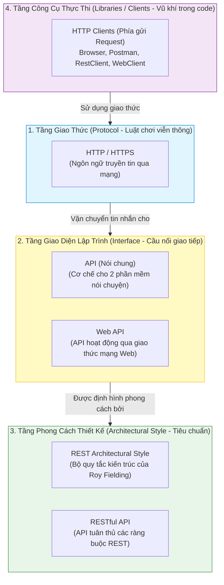
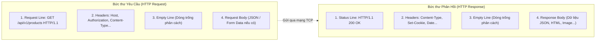
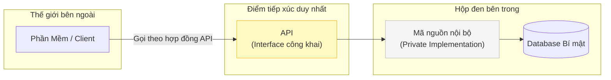
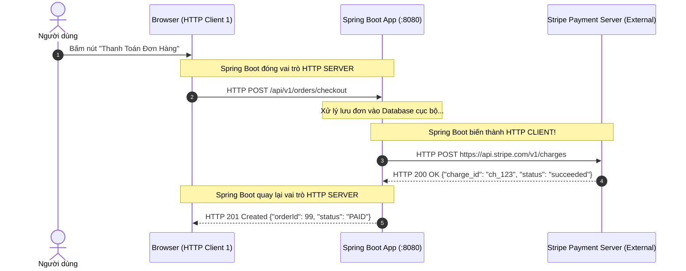
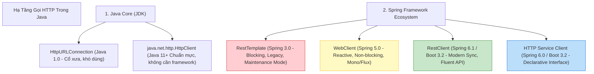
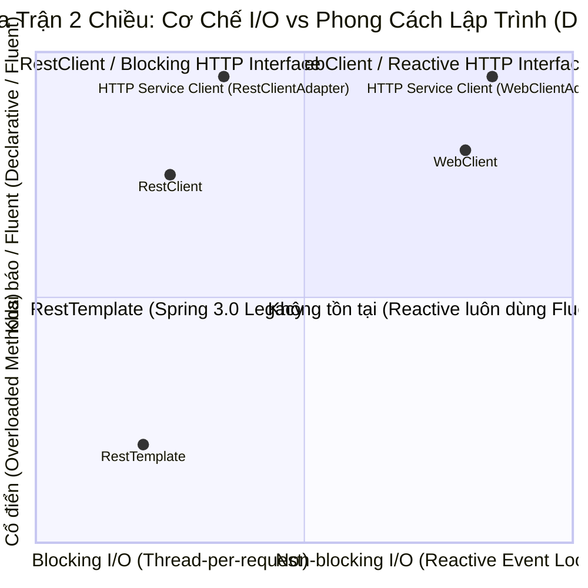

# 🧭 CHUYÊN ĐỀ: BẢN ĐỒ KHÁI NIỆM TỪ GỐC RỄ — HTTP, API, RESTFUL VÀ HỌ HÀNG HTTP CLIENTS

> **Lời mở đầu dành cho bạn:**  
> Trong ngành phần mềm, việc *"code chạy được"* và việc *"hiểu bản chất để giải thích tường minh"* là hai đẳng cấp hoàn toàn khác nhau. Rất nhiều lập trình viên làm việc 3 - 5 năm với cả React/Vue (Frontend) và Spring/Node.js (Backend) vẫn ấp úng khi người phỏng vấn hỏi những câu tưởng chừng cơ bản:
> * *"HTTP khác gì so với REST?"*
> * *"API và RESTful API khác nhau thế nào?"*
> * *"Tại sao ở Backend lại cần một HTTP Client trong khi chính nó là HTTP Server?"*
> * *"Khi nào dùng RestClient, khi nào dùng WebClient?"*
>
> Tài liệu này được biên soạn nhằm giúp bạn **sắp xếp lại ngăn nắp toàn bộ các ngăn kéo tư duy**, phân biệt rạch ròi giữa **Giao thức (Protocol)**, **Kiến trúc (Architecture)**, **Giao diện (Interface)** và **Công cụ thực thi (Tool/Library)**.

---

## 📑 MỤC LỤC

1. [Phần 1: Bản Đồ Phân Loại Tổng Quan (Concept Taxonomy)](#phần-1-bản-đồ-phân-loại-tổng-quan-concept-taxonomy)
2. [Phần 2: Tầng Giao Thức — HTTP & HTTPS Là Gì?](#phần-2-tầng-giao-thức--http--https-là-gì)
3. [Phần 3: Tầng Giao Diện — API & Web API Là Gì?](#phần-3-tầng-giao-diện--api--web-api-là-gì)
4. [Phần 4: Tầng Phong Cách Kiến Trúc — REST & RESTful API Là Gì?](#phần-4-tầng-phong-cách-kiến-trúc--rest--restful-api-là-gì)
5. [Phần 5: Mô Hình Đối Tác — HTTP Server vs HTTP Client](#phần-5-mô-hình-đối-tác--http-server-vs-http-client)
6. [Phần 6: Gia Đình HTTP Client Trong Hệ Sinh Thái Java & Spring](#phần-6-gia-đình-http-client-trong-hệ-sinh-thái-java--spring)
7. [Phần 7: Bảng Ma Trận So Sánh Đa Chiều](#phần-7-bảng-ma-trận-so-sánh-đa-chiều)
8. [Phần 8: 12 Câu Hỏi Phỏng Vấn "Sát Hạch Khái Niệm" Kinh Điển](#phần-8-12-câu-hỏi-phỏng-vấn-sát-hạch-khái-niệm-kinh-điển)

---

## PHẦN 1: BẢN ĐỒ PHÂN LOẠI TỔNG QUAN (CONCEPT TAXONOMY)

Nguyên nhân số 1 khiến bạn bị rối là vì bạn đang xếp những thứ thuộc **các tầng khác nhau** vào chung một rổ!



### Quy tắc định danh nhanh:
* **HTTP:** Là **Giao thức** (Protocol) — Luật lệ để gửi và nhận bức thư dữ liệu.
* **API:** Là **Khái niệm giao tiếp** (Interface) — Bảng điều khiển / thực đơn để tương tác với một cỗ máy phần mềm.
* **REST:** Là **Phong cách thiết kế** (Architectural Style) — Bộ nguyên lý định hướng cách đặt tên và tổ chức API.
* **RESTful API:** Là **Sản phẩm cụ thể** — Một Web API được thiết kế tuân theo phong cách REST.
* **HTTP Client:** Là **Bên chủ động gửi yêu cầu** (Người gửi thư) — Ví dụ trình duyệt, Postman, hoặc `RestClient`/`WebClient` trong Java.

---

## PHẦN 2: TẦNG GIAO THỨC — HTTP & HTTPS LÀ GÌ?

### 2.1. Định nghĩa chuẩn xác
> **HTTP (HyperText Transfer Protocol — Giao thức truyền tải siêu văn bản):**  
> Là một **giao thức tầng ứng dụng (Application Layer - Tầng 7 OSI)** hoạt động theo mô hình **Request - Response (Yêu cầu - Phản hồi)**, quy định định dạng cú pháp chuẩn để hai máy tính trao đổi văn bản, hình ảnh, video, dữ liệu JSON qua mạng Internet.

* **Ẩn dụ đời thực:** HTTP giống như **Luật bưu chính viễn thông**. Nó quy định: Mỗi lá thư gửi đi bắt buộc phải có một chiếc phong bì (Header) ghi người nhận, người gửi, loại thư, và bên trong phong bì chứa nội dung lá thư (Body).

### 2.2. Ba đặc tính cốt lõi của HTTP mà bạn phải thuộc nằm lòng
1. **Stateless (Không lưu trạng thái):** Mỗi request là hoàn toàn độc lập! Server xử lý xong request số 1 là "quên sạch" bạn là ai. Muốn server nhớ, client phải tự gửi kèm thông tin nhận diện ở mỗi request tiếp theo (như Cookie, Session ID, Bearer JWT Token).
2. **Connectionless / Media Independent:** Client và Server chỉ cần biết định dạng dữ liệu (MIME Type: `application/json`, `text/html`, `image/png`) được khai báo ở header `Content-Type`. Bất kỳ dạng dữ liệu nào cũng truyền được.
3. **Chạy trên nền TCP/IP:** HTTP sử dụng giao thức tin cậy TCP ở tầng giao vận để đảm bảo các gói tin không bị rơi rụng hay sai thứ tự.

### 2.3. Cấu trúc một bức thư HTTP (HTTP Message)
Mọi cuộc giao tiếp HTTP chỉ xoay quanh 2 loại bức thư:



### 2.4. HTTPS là gì?
> **HTTPS (HTTP Secure):** Là HTTP chạy bên trong một đường hầm mã hóa bảo mật **TLS/SSL (Transport Layer Security)**.
* **HTTP thuần (Port 80):** Dữ liệu truyền dạng bản rõ (Plaintext). Bất kỳ ai ở trạm trung gian (Wi-Fi công cộng, nhà mạng) đều có thể chặn bắt (`Sniffing`) để đọc được mật khẩu hoặc số thẻ tín dụng.
* **HTTPS (Port 443):** Trước khi truyền HTTP, hai bên thực hiện **TLS Handshake** để xác thực danh tính Server (qua Chứng chỉ số SSL Certificate) và mã hóa toàn bộ nội dung bức thư bằng khóa đối xứng. Kẻ tấn công trên đường truyền chỉ thấy các chuỗi nhị phân rác vô nghĩa.

---

## PHẦN 3: TẦNG GIAO DIỆN — API & WEB API LÀ GÌ?

### 3.1. API là gì? (Khái niệm bao trùm)
> **API (Application Programming Interface — Giao diện lập trình ứng dụng):**  
> Là một **tập hợp các quy tắc, hàm, phương thức hoặc giao ước** mà một hệ thống phần mềm (thư viện, hệ điều hành, cơ sở dữ liệu) mở ra cho các phần mềm khác có thể tương tác với nó mà **không cần biết bên trong nó được lập trình như thế nào**.

* **Ẩn dụ đời thực:**
  * **Ổ cắm điện trên tường:** Là một API vật lý! Bạn chỉ cần biết phích cắm 2 chấu cắm vào là có điện 220V. Bạn không cần biết dây điện chạy ngầm trong tường ra sao hay nhà máy nhiệt điện hoạt động thế nào.
  * **Thực đơn nhà hàng:** Nhà bếp không cho bạn vào bếp tự nấu. Họ đưa bạn cuốn thực đơn (API). Bạn gọi món "Phở bò" (Method/Endpoint), nhà bếp nhận yêu cầu và bưng ra bát phở (Output).



### 3.2. Những dạng API KHÔNG PHẢI Web API
Nhiều người lầm tưởng API bắt buộc phải có URL hay mạng Internet! Thực tế:
* **Java Core API:** `java.util.List` có method `.add()`, `.size()`. Đó là API của thư viện Java!
* **Hệ điều hành API (POSIX / Win32 API):** Hàm `openFile()`, `allocateMemory()`.
* **Database Driver API:** JDBC Interface `Connection.prepareStatement()`.

### 3.3. Vậy Web API là gì?
> **Web API:** Là một API **hoạt động qua mạng** bằng cách sử dụng các giao thức của World Wide Web (chủ yếu là HTTP). Client và Server có thể viết bằng hai ngôn ngữ hoàn toàn khác nhau (Frontend JavaScript gọi Backend Java, ứng dụng Python gọi C#) nhưng vẫn nói chuyện được với nhau nhờ chuẩn Web API.

---

## PHẦN 4: TẦNG PHONG CÁCH KIẾN TRÚC — REST & RESTFUL API LÀ GÌ?

### 4.1. Nguồn gốc của REST
Năm 2000, nhà khoa học máy tính **Roy Fielding** (một trong những tác giả chính tạo ra giao thức HTTP) công bố luận án tiến sĩ định nghĩa ra **REST (Representational State Transfer — Chuyển dịch trạng thái đại diện)**.

 Fielding nhận thấy nhiều người dùng HTTP rất lộn xộn: Họ dùng `POST /getUser`, `GET /deleteUser?id=1`, biến HTTP thành một đường ống truyền hàm từ xa một cách tùy tiện. REST ra đời như một **bộ triết lý định hướng cách sử dụng HTTP đúng nghĩa nguyên bản của nó**.

### 4.2. Bản chất cốt lõi của REST: Mọi thứ là TÀI NGUYÊN (Resource)
Trong tư duy REST:
1. Mọi thực thể nghiệp vụ (User, Product, Order) được xem là một **Tài nguyên (Resource)**.
2. Mỗi tài nguyên được định danh duy nhất bằng một **Danh từ số nhiều (URI)**: `/api/v1/users`, `/api/v1/products/42`.
3. Thao tác trên tài nguyên phải sử dụng chính các **Động từ chuẩn của HTTP (HTTP Verbs)** thay vì nhét động từ vào URL:
   * ❌ Sai phong cách REST: `POST /api/v1/createNewUser`, `GET /api/v1/deleteUserById?id=1`
   * ✅ Chuẩn REST:
     * `GET    /api/v1/users` $\rightarrow$\rightarrow$\rightarrow$ Đọc danh sách users
     * `POST   /api/v1/users` $\rightarrow$\rightarrow$\rightarrow$ Tạo mới user
     * `GET    /api/v1/users/42` $\rightarrow$\rightarrow$\rightarrow$ Xem chi tiết user 42
     * `PUT    /api/v1/users/42` $\rightarrow$\rightarrow$\rightarrow$ Thay thế toàn bộ thông tin user 42
     * `PATCH  /api/v1/users/42` $\rightarrow$\rightarrow$\rightarrow$ Cập nhật một phần user 42
     * `DELETE /api/v1/users/42` $\rightarrow$\rightarrow$\rightarrow$ Xóa user 42

### 4.3. Bảng Thuộc Tính Quan Trọng: Safe & Idempotent
Người phỏng vấn cực kỳ thích hỏi về tính chất của các HTTP Method trong REST:

| HTTP Method | Mục Đích | Safe (An toàn)? | Idempotent (Bất biến / Cùng kết quả)? |
| :--- | :--- | :---: | :---: |
| **GET** | Lấy dữ liệu | ✅ CÓ (Không đổi DB) | ✅ CÓ (Gọi 1 lần hay 100 lần kết quả trả về như nhau) |
| **HEAD** | Lấy header (không body) | ✅ CÓ | ✅ CÓ |
| **PUT** | Ghi đè toàn bộ tài nguyên | ❌ KHÔNG (Có sửa DB) | ✅ CÓ (Ghi đè giá trị $\rightarrow$X$\rightarrow$ 10 lần thì giá trị vẫn là $\rightarrow$X$\rightarrow$) |
| **DELETE** | Xóa tài nguyên | ❌ KHÔNG | ✅ CÓ (Xóa ID=5 một lần là mất, các lần sau vẫn là đã xóa) |
| **POST** | Tạo mới tài nguyên | ❌ KHÔNG | ❌ **KHÔNG** (Gọi 10 lần $\rightarrow$\rightarrow$\rightarrow$ tạo ra 10 bản ghi mới!) |
| **PATCH** | Cập nhật một phần | ❌ KHÔNG | ⚠️ Tùy thuộc logic (cộng dồn `score += 1` thì không idempotent) |

> 💡 **Khái niệm "Idempotent":** Nghĩa là dù bạn có bấm gửi request đó **1 lần hay 100 lần liên tiếp**, trạng thái dữ liệu cuối cùng trên server vẫn hoàn toàn giống nhau! (Cực kỳ quan trọng để xử lý Retry khi mạng bị chập chờn).

### 4.4. RESTful API là gì?
> Một Web API được gọi là **RESTful API** khi và chỉ khi nó tuân thủ các nguyên lý thiết kế của kiến trúc REST.
* Hầu hết các dự án hiện nay đạt mức **REST-ish** (gần chuẩn REST): Dùng đúng URI danh từ, đúng HTTP Methods, trả về JSON và HTTP Status Codes tương ứng (`200 OK`, `201 Created`, `400 Bad Request`, `404 Not Found`, `409 Conflict`, `500 Internal Error`).

---

## PHẦN 5: MÔ HÌNH ĐỐI TÁC — HTTP SERVER VS HTTP CLIENT

Tại sao chúng ta hay nghe nói *"Backend là Server"*, nhưng trong [Bài 16](file:///Users/vovantu/HTML_CSS/JAVA%20/Note/Lesson16/bai-16-goi-external-api-restclient-webclient-http-service-client.md) Backend lại cần một **HTTP Client**?



### 5.1. Định nghĩa rạch ròi
* **HTTP Server:** Là bên **thụ động lắng nghe (Listen)** trên một cổng mạng (Port 80, 443, 8080). Nó không bao giờ tự ý gửi dữ liệu cho ai nếu bên kia chưa hỏi. Nhiệm vụ của nó là nhận HTTP Request $\rightarrow$\rightarrow$\rightarrow$ xử lý $\rightarrow$\rightarrow$\rightarrow$ trả về HTTP Response.
  * *Ví dụ:* Embedded Tomcat trong Spring Boot, Nginx, Apache HTTPD, Node.js Express.
* **HTTP Client:** Là bên **chủ động mở kết nối (Initiate Connection)**, đóng gói bức thư HTTP Request, bắn qua mạng tới Server và chờ nhận kết quả phản hồi.
  * *Ví dụ Client người dùng:* Trình duyệt Chrome/Safari, ứng dụng Mobile, Postman, cURL command line.
  * *Ví dụ Client trong mã nguồn:* Một đoạn code Java nằm trong Spring Boot đóng vai trò Client để bắn HTTP Request sang bên thứ ba (VNPay, ZaloPay, OpenAI, AWS S3).

---

## PHẦN 6: GIA ĐÌNH HTTP CLIENT TRONG HỆ SINH THÁI JAVA & SPRING

Khi Backend cần đóng vai trò là một HTTP Client, chúng ta dùng công cụ gì? Dưới đây là phả hệ đầy đủ:



### 6.1. `RestTemplate` — "Lão tướng về hưu"
* Ra đời từ Spring 3.0 (2009).
* Dùng cơ chế **Blocking I/O** (mỗi request khóa cứng 1 Thread chờ cho đến khi có dữ liệu).
* Nhược điểm: Thiết kế theo hướng nạp chồng method (`getForObject`, `getForEntity`, `postForLocation`...) với hơn 40 biến thể, viết code rất rườm rà.
* **Hiện trạng:** Đã chính thức chuyển sang chế độ bảo trì (**Maintenance Mode**). Không thêm tính năng mới, chỉ sửa lỗi bảo mật.

### 6.2. `WebClient` — "Chiến binh phản ứng nhanh (Reactive)"
* Ra đời từ Spring 5.0 (2017) trong module `spring-webflux`.
* Dùng cơ chế **Non-blocking I/O** chạy trên nền Event Loop của Netty. Khi gửi request đi, thread không bị treo chờ mà quay lại làm việc khác. Khi có data về, hệ điều hành đánh thức Event Loop gọi callback.
* Trả về kiểu dữ liệu luồng phản ứng: `Mono<T>` (0 hoặc 1 giá trị) hoặc `Flux<T>` (danh sách stream 0..N giá trị).
* **Khi nào dùng:** Khi xây dựng hệ thống Reactive WebFlux, microservices stream dữ liệu, hoặc hệ thống cần tải cực lớn (High Throughput).

### 6.3. `RestClient` — "Tiêu chuẩn hiện đại cho Spring MVC (Spring 6.1+)"
* Ra mắt cuối năm 2023 trong Spring 6.1 / Spring Boot 3.2.
* Vẫn sử dụng mô hình đồng bộ (Blocking I/O) truyền thống của Spring MVC, nhưng mang toàn bộ phong cách **Fluent API** thanh lịch của `WebClient` sang.
* Cực kỳ dễ đọc, dễ viết, hỗ trợ lambda bắt lỗi `.onStatus()` rất gọn gàng.
* **Khi nào dùng:** Là sự lựa chọn **mặc định số 1** cho mọi dự án Spring Boot MVC thông thường muốn gọi API ngoài đồng bộ.

### 6.4. `HTTP Service Client` — "Đỉnh cao Declarative (Khai báo)"
* Ra đời trong Spring 6 / Boot 3.0+.
* Bạn không cần viết code triển khai `get()` hay `post()`. Bạn chỉ cần viết một **Java Interface** với `@HttpExchange`, `@GetExchange("/{id}")`.
* Spring dùng **Dynamic Proxy** tự tạo bean cài đặt interface đó lúc chạy.
* **Ẩn dụ:** Giống hệt cách Spring Data JPA tự sinh câu query SQL từ interface `UserRepository`!

---

## PHẦN 7: BẢNG MA TRẬN SO SÁNH ĐA CHIỀU

### 7.1. Bảng phân biệt: HTTP vs API vs REST vs RESTful

| Thuật ngữ | Thuộc nhóm | Là cái gì? | Ví dụ trong thực tế |
| :--- | :--- | :--- | :--- |
| **HTTP** | Giao thức (Protocol) | Quy tắc định dạng và truyền tin trên mạng | `GET /index.html HTTP/1.1` qua cổng 80 |
| **API** | Giao diện lập trình (Interface) | Cầu nối giúp hai phần mềm trao đổi dữ liệu | `Math.max(a, b)` trong Java hoặc Web API |
| **REST** | Phong cách kiến trúc (Architecture) | Bộ quy tắc: coi mọi thứ là tài nguyên, dùng HTTP verbs | Tài nguyên danh từ `/products`, phương thức `POST` |
| **RESTful API** | Sản phẩm thực thi (Implementation) | Hệ thống Web API cụ thể tuân theo chuẩn REST | Hệ thống API của Github, Stripe, Shopee |

---

### 7.2. Bảng chọn lựa: Nên dùng HTTP Client nào trong Java?

| Tình huống dự án | Lựa chọn tối ưu | Lý do |
| :--- | :--- | :--- |
| Dự án Spring Boot 3.2+ thông thường (Spring MVC) | **`RestClient`** hoặc **`HTTP Service Client`** | Đơn giản, hiện đại, fluent API, không cần WebFlux |
| Dự án Reactive Streams, cần chịu tải hàng chục ngàn req/giây | **`WebClient`** | Non-blocking I/O, không nghẽn thread pool của Tomcat |
| Dự án Microservices Spring Cloud lớn (nhiều service gọi nhau) | **`HTTP Service Client`** hoặc **`OpenFeign`** | Khai báo interface sạch đẹp, dễ tích hợp Service Discovery |
| Viết ứng dụng Java Core thuần túy (không dùng Spring Framework) | **`java.net.http.HttpClient`** (Java 11+) | Có sẵn trong JDK, mạnh mẽ, không kéo dependency thừa |
| Dự án cũ Spring Boot 2.x hoặc Spring 4 | `RestTemplate` | Buộc phải duy trì tương thích ngược (Legacy code) |

---

### 7.3. Ma Trận 2 Chiều: Cơ Chế I/O & Phong Cách Lập Trình (Developer Experience)

Khi tìm hiểu về 4 đại diện HTTP Client của Spring (**RestTemplate**, **RestClient**, **WebClient**, **HTTP Service Client**), rất nhiều lập trình viên lầm tưởng: *"Chúng chỉ khác nhau ở cơ chế Non-blocking I/O vs Blocking I/O"*.

👉 **Đó là nhận định đúng một nửa nhưng chưa đủ!** Nếu chỉ khác nhau ở Blocking vs Non-blocking, Spring chỉ cần giữ lại `RestTemplate` và `WebClient` là xong, không việc gì phải sinh ra thêm `RestClient` và `HTTP Service Client`.

Sự khác biệt thực chất nằm trên **2 TRỤC HOÀN TOÀN ĐỘC LẬP**:
1. **Trục 1: Cơ chế I/O bên dưới (Underlying I/O Engine):** Thread bị khóa chờ mạng (**Blocking I/O**) hay Thread được giải phóng dùng Event Loop (**Non-blocking / Reactive I/O**).
2. **Trục 2: Phong cách lập trình bên trên (Developer Experience - DX):** Gọi hàm nạp chồng rời rạc (**Overloaded Methods**) → Xâu chuỗi mượt mà (**Fluent Chaining API**) → Khai báo giao diện thuần túy (**Declarative Interface**).



#### 📊 Bảng ma trận 2 chiều tổng kết:

| Phong cách lập trình (Bề ngoài bạn code) | Cơ chế Blocking I/O (Đồng bộ - Chờ đợi) | Cơ chế Non-blocking I/O (Bất đồng bộ - Reactive) |
| :--- | :--- | :--- |
| **1. Cổ điển (Overloaded Methods)**<br/>Gọi các hàm nạp chồng rời rạc | **`RestTemplate`**<br/>⚠️ *Spring 3.0 (Legacy / Maintenance)*<br/>Thread bị khóa chờ mạng | *(Không có)* |
| **2. Hiện đại (Fluent API)**<br/>Xâu chuỗi `.get().uri().retrieve()` | **`RestClient`**<br/>✅ *Spring 6.1+ / Boot 3.2+*<br/>Thread vẫn bị khóa chờ mạng, nhưng code cực kỳ thanh lịch | **`WebClient`**<br/>🚀 *Spring 5.0+ (WebFlux)*<br/>Thread không bị khóa, chạy trên Netty Event Loop + `Mono`/`Flux` |
| **3. Khai báo (Declarative Interface)**<br/>Chỉ viết Java Interface, Spring tự sinh proxy code | **`HTTP Service Client`**<br/>*(Chạy trên nền `RestClientAdapter`)* | **`HTTP Service Client`**<br/>*(Chạy trên nền `WebClientAdapter`)* |

#### 🔍 Mổ xẻ 3 câu hỏi bản chất:

1. **Tại sao đã có `RestTemplate` (Blocking) lại sinh ra `RestClient` (cũng là Blocking)?**
   * **Bên dưới (Cơ chế I/O):** Cả hai **giống hệt nhau 100%** — đều sử dụng Blocking I/O (chia sẻ chung mô hình Thread-per-request của Spring MVC, khi gửi request thì thread hiện tại phải đứng chờ cho đến khi có dữ liệu trả về).
   * **Bên trên (Trải nghiệm code - DX):** `RestTemplate` có tới hơn 40 method nạp chồng rườm rà (`getForObject`, `getForEntity`, `exchange`...), khó đọc và khó tùy biến. Trong khi đó, `RestClient` mang toàn bộ phong cách **Fluent API** hiện đại của `WebClient` sang: xâu chuỗi method mượt mà, bắt lỗi bằng lambda `.onStatus()` cực kỳ ngắn gọn và rõ ràng.
   * 👉 *Kết luận:* `RestClient` ra đời để **thay thế hoàn toàn `RestTemplate` về mặt cú pháp và trải nghiệm lập trình**, chứ không phải để thay đổi cơ chế I/O!

2. **Tại sao lại cần `WebClient`?**
   * **Khác biệt cốt lõi nằm ở Cơ chế I/O:** `WebClient` không khóa luồng.
   * Khi gửi request sang một bên thứ ba (như cổng thanh toán, AI API) mất 3 giây, Thread của ứng dụng không hề bị treo vô ích mà lập tức quay lại phục vụ các HTTP request khác của người dùng. Khi nào bên thứ ba phản hồi về, Netty Event Loop mới tiếp nhận dữ liệu và thực thi callback thông qua `Mono<T>` hoặc `Flux<T>`.
   * 👉 *Kết luận:* Dành cho hệ thống chịu tải cực cao (High Throughput - hàng chục ngàn request/giây) hoặc các dự án Reactive WebFlux toàn diện (End-to-End Non-blocking).

3. **Vậy `HTTP Service Client` (Spring Boot 3.2+) thực chất là gì?**
   * Nó **không phải là một Network Engine mới**!
   * Nó là một **lớp vỏ trừu tượng cấp cao (High-level Declarative Abstraction)** được xây dựng trên mẫu thiết kế Dynamic Proxy.
   * Bạn chỉ cần khai báo interface:
     ```java
     public interface PaymentClient {
         @PostExchange("/api/v1/payments")
         PaymentResponse pay(@RequestBody PaymentRequest req);
     }
     ```
   * Việc bên dưới chạy Blocking hay Non-blocking hoàn toàn do bạn quyết định thông qua Adapter:
      * Nếu gắn với `RestClientAdapter` → Nó chạy **Blocking I/O**.
      * Nếu gắn với `WebClientAdapter` → Nó chạy **Non-blocking Reactive I/O**.
   * 👉 *Ẩn dụ:* Giống hệt cách Spring Data JPA hoạt động: Bạn chỉ việc khai báo interface `UserRepository`, còn việc nó sinh câu lệnh SQL nào và bắn xuống database ra sao là do Spring tự lo!

---

### 7.4. Chuẩn Hóa Thuật Ngữ Kỹ Thuật: RestTemplate, RestClient, WebClient Là Thư Viện, Dependency Hay Công Cụ?

Khi Backend cần đóng vai trò là một HTTP Client, chúng ta thường nghe nhắc tới `RestTemplate`, `RestClient`, `WebClient`, `HTTP Service Client`. Tuy nhiên, trong phỏng vấn và thảo luận kiến trúc, **nếu gọi sai bản chất thuật ngữ, bạn sẽ bị đánh giá là thiếu nền tảng cơ bản!**

#### 1. Phân biệt rạch ròi 3 khái niệm nền tảng:

| Khái niệm | Bản chất thực sự là gì? | Ví dụ trực quan |
| :--- | :--- | :--- |
| **Công cụ (Tool)** | Là một **phần mềm độc lập hoàn chỉnh** chạy ngoài mã nguồn dự án, có giao diện đồ họa (GUI) hoặc giao diện dòng lệnh (CLI). | Postman, Insomnia, cURL, Docker, Git, VS Code, IntelliJ IDEA. |
| **Dependency (Phụ thuộc)** | Là một **đơn vị đóng gói (Artifact JAR)** được khai báo trong file cấu hình build tool (`pom.xml` của Maven hoặc `build.gradle`) để công cụ tự động tải từ kho chứa (Maven Central) về dự án. | Thẻ `<dependency>` chứa file `.jar` như `spring-boot-starter-web`, `lombok`, `mysql-connector-j`. |
| **Thư viện (Library)** | Là một **tập hợp các package, class, method** được viết sẵn và đóng gói lại để lập trình viên chủ động `import` và gọi vào tái sử dụng trong mã nguồn. | Thư viện Jackson (chuyển đổi JSON), Apache Commons, thư viện `spring-web`. |

#### 2. Vậy `RestTemplate`, `RestClient`, `WebClient` là gì?

Chúng **KHÔNG PHẢI** là 3 thứ trên một cách độc lập:
* ❌ **Không phải là Tool:** Vì bạn không thể bấm double-click chuột mở nó lên trên desktop hay gõ lệnh terminal độc lập như Postman hay cURL.
* ❌ **Không phải là Dependency:** Bạn không thể vào `pom.xml` gõ `<artifactId>rest-client</artifactId>` vì hoàn toàn **không có gói artifact nào tên như vậy**! `RestClient` nằm sẵn bên trong dependency `spring-boot-starter-web` (cụ thể là JAR `spring-web`).
* ❌ **Chưa đủ tầm để gọi là một Thư viện riêng lẻ:** Chúng chỉ là các Class hoặc Interface thành phần nằm bên trong thư viện mẹ `spring-web` (hoặc `spring-webflux`).

#### 3. Cách gọi tên CHUẨN XÁC VÀ CHUYÊN NGHIỆP NHẤT:

Khi thảo luận kiến trúc hoặc trả lời phỏng vấn Senior, bạn nên sử dụng các định danh chuẩn quốc tế sau:

* ✅ **Cách gọi 1 (Chính xác & phổ biến nhất):**  
  > *"Chúng là các **HTTP Client Components** (hoặc **Built-in HTTP Clients**) được tích hợp sẵn trong Spring Framework."*
  * `RestTemplate`: là một **Class** cụ thể (`org.springframework.web.client.RestTemplate`).
  * `RestClient`: là một **Interface** (`org.springframework.web.client.RestClient`).
  * `WebClient`: là một **Interface** (`org.springframework.web.reactive.function.client.WebClient`).
* ✅ **Cách gọi 2 (Dưới góc độ kiến trúc / giải pháp):**  
  > *"Chúng là các **HTTP Client Abstractions / Solutions** (Cơ chế / giải pháp gọi HTTP) mà Spring cung cấp cho lập trình viên."*
* ✅ **Riêng với HTTP Service Client:**  
  > Gọi chuẩn là **Tính năng / Cơ chế trừu tượng khai báo (Declarative HTTP Interface Feature / Abstraction)** — bởi vì nó là một kỹ thuật kiến trúc (kết hợp Java Interface + Dynamic Proxy + Adapter) chứ không đơn thuần là một class/interface gửi HTTP request.

> 💡 **Câu nói mẫu giúp bạn "ghi điểm tuyệt đối" trước hội đồng phỏng vấn:**  
> *"Trong Spring Boot, để ứng dụng đóng vai trò là một HTTP Client gọi ra các API bên ngoài, Spring cung cấp sẵn các HTTP Client Components tùy theo kiến trúc:  
> Ở tầng Spring MVC đồng bộ truyền thống, chúng ta có `RestTemplate` (class cũ) và `RestClient` (interface hiện đại theo phong cách Fluent API từ Spring 6.1).  
> Ở tầng WebFlux bất đồng bộ, chúng ta có `WebClient` (interface reactive).  
> Và ở mức độ trừu tượng cao nhất, Spring cung cấp cơ chế Declarative HTTP Service Client giúp lập trình viên chỉ cần khai báo interface, Spring sẽ tự động sinh proxy code ở runtime."*


---

## PHẦN 8: 12 CÂU HỎI PHỎNG VẤN "SÁT HẠCH KHÁI NIỆM" KINH ĐIỂN

### Câu 1: Em hãy giải thích sự khác biệt giữa HTTP và REST?
**Đáp án chuẩn:**
* **HTTP là một Giao thức mạng** (Protocol) nằm ở tầng ứng dụng, định nghĩa cú pháp và quy tắc kỹ thuật để máy tính truyền tin (Request Line, Headers, Status Code, TCP socket).
* **REST là một Phong cách kiến trúc phần mềm** (Architectural Style), định nghĩa bộ nguyên tắc thiết kế hệ thống phân tán (Resource-oriented, Stateless, Uniform Interface).
* *Mối quan hệ:* REST sử dụng HTTP làm giao thức nền tảng để hiện thực hóa các nguyên lý của mình. Một API có thể dùng HTTP nhưng chưa chắc đã là REST (ví dụ RPC API dùng HTTP POST cho mọi hành động).

---

### Câu 2: Thế nào là tính "Stateless" của HTTP? Nếu HTTP là Stateless thì tại sao website vẫn nhớ giỏ hàng của anh khi bấm chuyển trang?
**Đáp án chuẩn:**
* **Stateless** nghĩa là Server không lưu trữ bất kỳ ngữ cảnh (context) nào của Client giữa các request liên tiếp. Mỗi request đến Server được xử lý hoàn toàn độc lập, như thể người gửi là một người lạ vừa xuất hiện lần đầu.
* Website vẫn nhớ giỏ hàng hoặc phiên đăng nhập vì chúng ta sử dụng **cơ chế quản lý trạng thái ở tầng ứng dụng (Application-level State Management)**:
  1. **Session & Cookie:** Server sinh ra một mã định danh ngẫu nhiên (`JSESSIONID`) gửi về cho Browser lưu vào Cookie. Ở mỗi request tiếp theo, Browser tự động đính kèm Cookie này lên HTTP Header để Server nhận diện.
  2. **Token-based (JWT):** Client lưu Token (chứa ID người dùng đã được ký điện tử). Mỗi request gửi lên, Client chủ động đính Token vào header `Authorization: Bearer <token>`.

---

### Câu 3: Phân biệt sự khác nhau giữa HTTP PUT và HTTP PATCH? Khi nào dùng cái nào?
**Đáp án chuẩn:**
* **`PUT` (Thay thế toàn bộ — Full Replacement):** Client phải gửi lên toàn bộ các trường của tài nguyên. Server sẽ ghi đè toàn bộ đối tượng trong database bằng dữ liệu mới. Những trường không được gửi lên có thể bị set về null hoặc giá trị mặc định. `PUT` có tính chất **Idempotent**.
* **`PATCH` (Cập nhật một phần — Partial Update):** Client chỉ cần gửi lên những trường thực sự muốn thay đổi (ví dụ User có 10 trường, chỉ gửi `{ "phone": "0987654321" }`). Server chỉ cập nhật đúng trường đó, các trường khác giữ nguyên. `PATCH` không bắt buộc phải Idempotent.

---

### Câu 4: Idempotent (Tính bất biến) là gì? Tại sao POST không idempotent mà PUT/DELETE lại idempotent?
**Đáp án chuẩn:**
* Một phương thức được gọi là **Idempotent** khi việc thực thi nó **một lần hay nhiều lần liên tiếp** đều để lại cùng một trạng thái duy nhất trên hệ thống.
* **`POST` không idempotent:** Vì mỗi lần bạn gửi `POST /api/v1/orders`, hệ thống lại tạo ra một bản ghi đơn hàng mới với ID mới trong DB. Gửi 5 lần $\rightarrow$\rightarrow$\rightarrow$ tạo 5 đơn hàng khác nhau.
* **`PUT` idempotent:** Nếu bạn gửi `PUT /api/v1/users/1` với `{ "name": "Nam" }`, dù bạn gửi 1 lần hay bấm liên tục 10 lần do mạng lag, tên của user 1 trên DB vẫn là "Nam".
* **`DELETE` idempotent:** Lần đầu gọi `DELETE /api/v1/users/1`, user bị xóa khỏi DB. Các lần gọi tiếp theo, dữ liệu đó vẫn là trạng thái đã bị xóa (hệ thống có thể trả 404 hoặc 204 nhưng database không bị thay đổi trạng thái khác đi).

---

### Câu 5: Tại sao trong một hệ thống Microservices viết bằng Spring Boot, ứng dụng Backend vừa là HTTP Server vừa là HTTP Client?
**Đáp án chuẩn:**
* Trong kiến trúc Microservices, hệ thống được chia nhỏ thành nhiều dịch vụ độc lập:
  * Khi nhận request từ Frontend (React/Flutter) gọi vào để tạo đơn hàng $\rightarrow$\rightarrow$\rightarrow$ Microservice Order đóng vai trò **HTTP Server** (xử lý endpoint và trả kết quả cho Frontend).
  * Nhưng để hoàn tất đơn hàng, Order Service cần kiểm tra số dư ở Payment Service và kiểm tra kho ở Inventory Service $\rightarrow$\rightarrow$\rightarrow$ Lúc này Order Service phải chủ động gửi HTTP Request sang hai service kia, do đó nó đóng vai trò là **HTTP Client**.

---

### Câu 6: So sánh cơ chế hoạt động của `RestClient` (Spring 6.1+) và `WebClient`? Tại sao không dùng `WebClient` cho tất cả mọi dự án?
**Đáp án chuẩn:**
* **`RestClient`:** Sử dụng **Blocking I/O** đồng bộ. Khi gọi API, thread hiện tại của Tomcat sẽ dừng lại chờ đợi mạng. Nó cực kỳ đơn giản, dễ đọc, dễ debug dòng code theo thứ tự từ trên xuống dưới, tương thích hoàn hảo với Spring MVC và Spring Data JPA (cũng là blocking).
* **`WebClient`:** Sử dụng **Non-blocking I/O (Reactive Streams)** chạy trên Netty EventLoop. Thread không bị dừng mà tiếp tục phục vụ request khác.
* **Lý do không dùng WebClient bừa bãi:**
  1. *Độ phức tạp tư duy (Steep learning curve):* Reactive Streams đòi hỏi hiểu sâu về Functional Programming, Mono, Flux, Scheduler, backpressure.
  2. *Rủi ro Block:* Nếu trong luồng Reactive mà bạn vô tình gọi một hàm blocking (như câu lệnh Hibernate JPA `userRepo.findById()`), toàn bộ Event Loop thread của Netty sẽ bị nghẽn, làm sập hiệu năng toàn bộ ứng dụng.
  3. Nếu ứng dụng thuần Spring MVC với traffic trung bình, `RestClient` là lựa chọn an toàn và tối ưu chi phí phát triển nhất.

---

### Câu 7: Trình bày cơ chế hoạt động đằng sau của Declarative HTTP Service Client trong Spring Boot 3.2?
**Đáp án chuẩn:**
* Declarative HTTP Client áp dụng mẫu thiết kế **Dynamic Proxy Pattern** (`java.lang.reflect.Proxy`):
  1. Lập trình viên chỉ cần khai báo Java Interface có gắn `@HttpExchange`.
  2. Cấu hình `HttpServiceProxyFactory` kết hợp với `RestClientAdapter`.
  3. Khi ứng dụng khởi động, Spring sinh ra một class ẩn cài đặt interface đó trong bộ nhớ RAM.
  4. Khi một method trên interface được gọi, bộ chặn `MethodInterceptor` sẽ đọc metadata của annotation (`@GetExchange`, `@PathVariable`, `@RequestBody`), tự động lắp ghép thành HTTP Request hoàn chỉnh, chuyển cho `RestClient` thực thi và parse JSON trả về kiểu đối tượng của hàm.

---

### Câu 8: Mã trạng thái HTTP (Status Code) được chia thành những nhóm nào? Kể tên 5 mã lỗi thường gặp nhất?
**Đáp án chuẩn:**
* HTTP chia status code thành 5 dải:
  * **`1xx` (Informational):** Đang xử lý thông tin.
  * **`2xx` (Success):** Thành công (`200 OK`, `201 Created`, `204 No Content`).
  * **`3xx` (Redirection):** Điều hướng trang (`301 Moved Permanently`, `302 Found`).
  * **`4xx` (Client Error):** Lỗi do phía Client gửi sai (`400 Bad Request`, `401 Unauthorized`, `403 Forbidden`, `404 Not Found`, `409 Conflict`).
  * **`5xx` (Server Error):** Lỗi do phía Server sập hoặc quá tải (`500 Internal Server Error`, `502 Bad Gateway`, `503 Service Unavailable`, `504 Gateway Timeout`).

---

### Câu 9: Phân biệt `401 Unauthorized` và `403 Forbidden`?
**Đáp án chuẩn:**
* **`401 Unauthorized` (Chưa xác thực danh tính - Authentication Failure):** Server không biết bạn là ai! Lỗi này xảy ra khi request thiếu Token, Token hết hạn, hoặc sai mật khẩu. Cách khắc phục: Hãy đăng nhập lại để lấy Token hợp lệ.
* **`403 Forbidden` (Không đủ quyền hạn - Authorization Failure):** Server **đã biết rõ bạn là ai**, nhưng bạn **không có quyền** truy cập tài nguyên này! Ví dụ: Bạn đăng nhập với tài khoản role `USER`, nhưng lại cố tình gọi API xóa sản phẩm của role `ADMIN`. Dù bạn có đăng nhập lại 100 lần thì vẫn bị chặn 403.

---

### Câu 10: "HATEOAS" trong cấp độ cao nhất của mô hình trưởng thành REST (Richardson Maturity Model) là gì?
**Đáp án chuẩn:**
* **HATEOAS (Hypermedia As The Engine Of Application State):** Là tiêu chuẩn Level 3 trong mô hình Richardson.
* Một API chuẩn HATEOAS không chỉ trả về dữ liệu thuần túy, mà còn trả kèm theo **các đường link (Hyperlinks)** điều hướng cho biết Client có thể làm gì tiếp theo với dữ liệu này.
* *Ví dụ:* Khi bạn lấy thông tin một đơn hàng ở trạng thái `NEW`:
  ```json
  {
    "orderId": 100,
    "total": 500.0,
    "status": "NEW",
    "_links": {
      "self": { "href": "/api/v1/orders/100" },
      "cancel": { "href": "/api/v1/orders/100/cancel" },
      "payment": { "href": "/api/v1/orders/100/payment" }
    }
  }
  ```
  Nếu đơn hàng chuyển sang `PAID`, link `payment` và `cancel` sẽ tự động biến mất và thay bằng link `track_shipping`. Client không cần phải hardcode logic đường dẫn URL mà chỉ việc bấm theo các link do server chỉ dẫn.

---

### Câu 11: Có phải các HTTP Client của Spring (RestTemplate, RestClient, WebClient, HTTP Service Client) chỉ khác nhau ở cơ chế Non-blocking vs Blocking I/O không?
**Đáp án chuẩn:**
* **Khẳng định:** Không hoàn toàn! Khác biệt về cơ chế I/O (Blocking vs Non-blocking) chỉ là **một trong hai trục** phân loại. Sự tiến hóa của các HTTP Client trong Spring diễn ra trên **2 trục độc lập**:
  1. **Trục 1 — Cơ chế I/O (Bên dưới):**
     * *Blocking I/O:* `RestTemplate` và `RestClient`. Cả hai đều khóa cứng thread của Tomcat để chờ phản hồi từ mạng.
     * *Non-blocking I/O:* `WebClient`. Chạy trên Netty Event Loop, giải phóng thread ngay sau khi gửi request.
  2. **Trục 2 — Phong cách thiết kế API / DX (Bên trên):**
     * *Overloaded Methods (Cổ điển):* `RestTemplate` với hơn 40 hàm nạp chồng cồng kềnh.
     * *Fluent API (Hiện đại):* `RestClient` và `WebClient` với cú pháp chuỗi dot notation (`.get().uri().retrieve()`) và xử lý lỗi bằng lambda sạch sẽ.
     * *Declarative Interface (Khai báo trừu tượng):* `HTTP Service Client` — lập trình viên chỉ viết Java Interface (`@HttpExchange`), Spring tự sinh mã proxy thực thi bên dưới (có thể cắm vào `RestClientAdapter` để chạy Blocking hoặc `WebClientAdapter` để chạy Non-blocking).
* *Ý nghĩa:* `RestClient` ra đời không phải để đổi cơ chế I/O (vẫn là blocking), mà để mang trải nghiệm Fluent API hiện đại thay thế cho `RestTemplate` già cỗi.

---

### Câu 12: Khi Backend đóng vai trò là một HTTP Client, chúng ta gọi RestTemplate, RestClient, WebClient là Thư viện, Dependency hay Công cụ? Cách gọi nào chuẩn xác nhất?
**Đáp án chuẩn:**
* **Bản chất kỹ thuật:**
  * Chúng **không phải là Công cụ (Tool)**: Vì Tool là phần mềm độc lập bên ngoài có GUI/CLI (như Postman, cURL, Docker).
  * Chúng **không phải là Dependency độc lập**: Không có gói dependency nào trong Maven tên là `rest-client` hay `rest-template`. Chúng nằm sẵn bên trong file JAR `spring-web` thuộc starter `spring-boot-starter-web`.
  * Chúng **chưa đủ lớn để gọi là một Thư viện riêng lẻ**: Thư viện là cả gói `spring-web` hoặc Jackson.
* **Cách gọi chuẩn xác và chuyên nghiệp nhất:**
  * Gọi là **"Các HTTP Client Components"** (hoặc **"Built-in HTTP Clients"**) tích hợp sẵn trong Spring Framework:
    * `RestTemplate` là một **Class**.
    * `RestClient` và `WebClient` là các **Interface**.
  * Dưới góc độ kiến trúc, gọi là **"Các giải pháp / cơ chế trừu tượng gọi HTTP (HTTP Client Abstractions)"**.
  * Riêng `HTTP Service Client` được định danh là **"Declarative HTTP Interface Feature"** (Tính năng / cơ chế khai báo giao diện HTTP).

---

> 💡 **Lời khuyên luyện tập:**  
> Hãy đọc lại tài liệu này 2 - 3 lần và thử tự đứng trước gương giải thích lại các khái niệm bằng ngôn ngữ tự nhiên của mình. Khi bạn có thể giải thích một khái niệm kỹ thuật phức tạp cho một người mới học hiểu được, đó là lúc bạn đã thực sự làm chủ nó!
