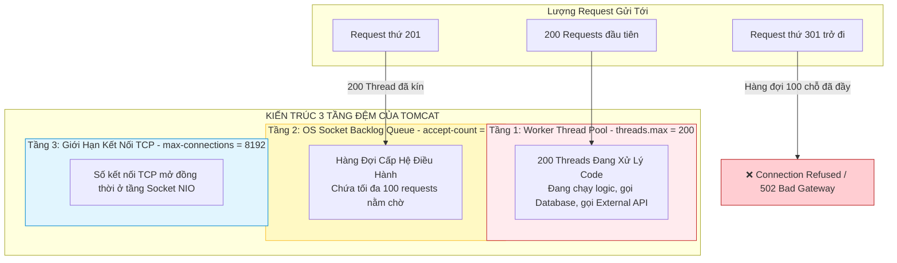
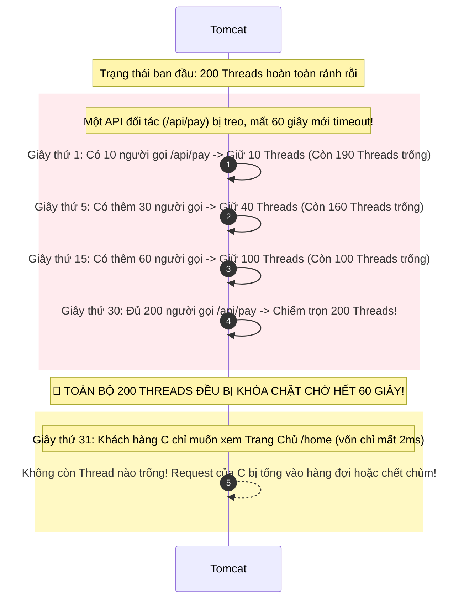
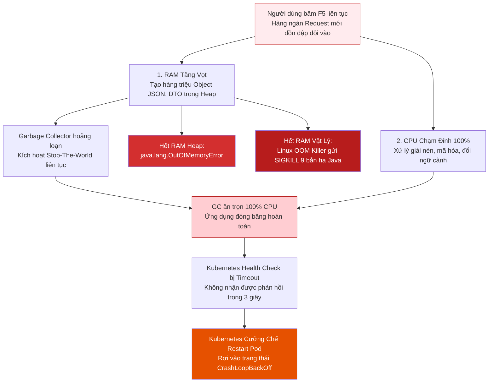
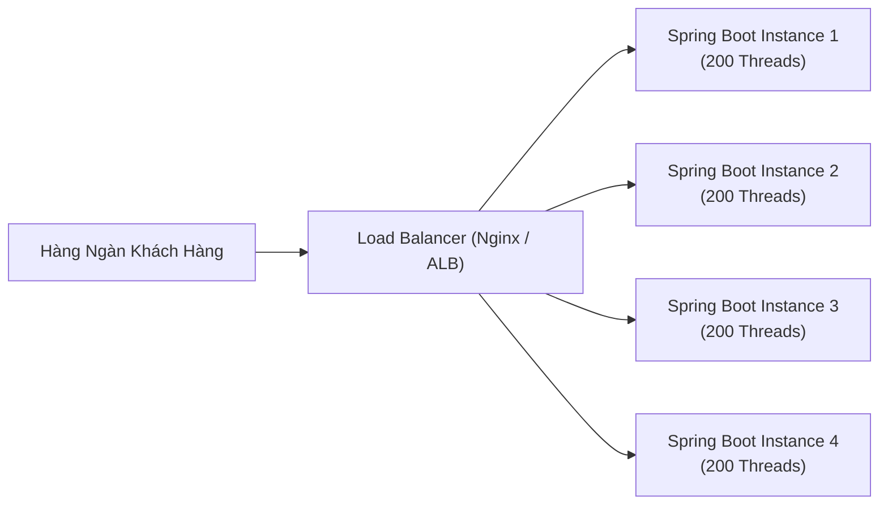

# 🧭 CHUYÊN ĐỀ: BẢN CHẤT NGHẼN THREAD POOL TRONG SPRING MVC & GIẢI PHÁP CHỐNG QUÁ TẢI HỆ THỐNG

> **Tóm tắt cốt lõi & Định nghĩa chuẩn xác:**  
> * **Thread Pool trong Spring MVC (Tomcat):** Là tập hợp các luồng (Worker Threads) được tạo sẵn để xử lý các yêu cầu HTTP theo mô hình *Thread-per-request* (mỗi thời điểm, 1 Thread phục vụ trọn vẹn 1 Request). Mặc định Apache Tomcat giới hạn tối đa **200 threads**.  
> * **Bản chất khi có 201 request đồng thời:** Request thứ 201 **chưa bị từ chối ngay**, mà được xếp vào hàng đợi cấp hệ điều hành (**OS Backlog Queue** hay `accept-count`, mặc định 100 chỗ). Chỉ khi hàng đợi này cũng đầy (vượt quá 300 requests), hệ thống mới từ chối kết nối (`Connection Refused`).  
> * **Bản chất quá tải CPU / RAM:** Khi hàng ngàn request dội vào liên tục, máy chủ không chỉ chạy chậm mà rơi vào "vòng lặp tử thần": RAM cạn kiệt kích hoạt **Garbage Collector Stop-The-World** (đóng băng ứng dụng) hoặc bị **Linux OOM Killer** bắn hạ tiến trình; CPU chạm trần 100% do **Context Switching** (đổi ca giữa các threads) khiến ứng dụng trễ nhịp tim và bị Kubernetes cưỡng chế restart.

---

## 📑 MỤC LỤC

1. [Phần 1: Kiến Trúc 3 Tầng Đệm Tiếp Nhận Request Của Apache Tomcat](#phần-1-kiến-trúc-3-tầng-đệm-tiếp-nhận-request-của-apache-tomcat)
2. [Phần 2: Mổ Xẻ Kịch Bản 201+ Request & Hiệu Ứng Vết Dầu Loang](#phần-2-mổ-xẻ-kịch-bản-201-request--hiệu-ứng-vết-dầu-loang)
3. [Phần 3: Điều Gì Thực Sự Xảy Ra Khi Máy Chủ Quá Tải CPU & RAM?](#phần-3-điều-gì-thực-sự-xảy-ra-khi-máy-chủ-quá-tải-cpu--ram)
4. [Phần 4: 6 Tầng Giải Pháp Chống Nghẽn Từ Cơ Bản Đến Cao Cấp](#phần-4-6-tầng-giải-pháp-chống-nghẽn-từ-cơ-bản-đến-cao-cấp)
5. [Phần 5: Bảng Ma Trận Tra Cứu Giải Pháp Theo Tình Huống Thực Tế](#phần-5-bảng-ma-trận-tra-cứu-giải-pháp-theo-tình-huống-thực-tế)
6. [Phần 6: Bộ Câu Hỏi Phỏng Vấn Sát Hạch Senior Về Thread Pool & Concurrency](#phần-6-bộ-câu-hỏi-phỏng-vấn-sát-hạch-senior-về-thread-pool--concurrency)

---

## PHẦN 1: KIẾN TRÚC 3 TẦNG ĐỆM TIẾP NHẬN REQUEST CỦA APACHE TOMCAT

Rất nhiều lập trình viên lầm tưởng Tomcat chỉ có một con số duy nhất là `200 threads`. Trên thực tế, để bảo vệ ứng dụng, Tomcat và Hệ điều hành phối hợp qua **3 tầng đệm liên hoàn**:



### Chi tiết 3 thông số cấu hình cốt lõi:
1. **`server.tomcat.threads.max` (Mặc định: 200):**  
   Số lượng Thread tối đa trong Worker Pool có thể chạy code đồng thời. Mỗi request đang chạy sẽ chiếm dụng trọn vẹn 1 Thread.
2. **`server.tomcat.accept-count` (Mặc định: 100):**  
   Hàng đợi socket ở tầng Kernel hệ điều hành (TCP Listen Backlog). Khi toàn bộ 200 Worker Threads đều đang bận, các request mới đến sẽ được xếp vào hàng đợi này để chờ thread rảnh rỗi.
3. **`server.tomcat.max-connections` (Mặc định: 8192 đối với NIO):**  
   Số lượng kết nối mạng TCP tối đa mà máy chủ có thể chấp nhận duy trì cùng lúc (chưa tính đến việc có thread xử lý ngay hay không).

---

## PHẦN 2: MỔ XẺ KỊCH BẢN 201+ REQUEST & HIỆU ỨNG VẾT DẦU LOANG

### 2.1. Request thứ 201 sẽ đi về đâu?
Khi 200 worker threads đều đang bận, chuyện gì xảy ra với người thứ 201?
* **Khẳng định:** Người thứ 201 **KHÔNG hề bị văng lỗi ngay lập tức!**
* Request 201 được đưa vào **Hàng đợi OS Backlog Queue (`accept-count`)** để nằm đợi:
  * **Kịch bản A (Khả quan):** Nếu một trong 200 thread kia hoàn tất công việc sau 50ms, thread đó lập tức quay lại hàng đợi, "bốc" request 201 lên xử lý. Người dùng 201 vẫn thành công trọn vẹn, chỉ bị tăng độ trễ (latency) thêm 50ms.
  * **Kịch bản B (Nghẽn nghiêm trọng):** Cả 200 thread kia tiếp tục bị treo lâu (ví dụ do database bị khóa hoặc API đối tác phản hồi chậm). Các request tiếp theo (202, 203... đến 300) tiếp tục lấp đầy hàng đợi 100 chỗ.
* **Đến Request thứ 301 (Vượt quá cả Thread Pool lẫn Hàng đợi):**  
  Lúc này hàng đợi đã đầy 100%. Hệ điều hành sẽ lập tức **từ chối bắt tay TCP (TCP SYN Rejected / Connection Refused)**. Phía người dùng hoặc Nginx Gateway sẽ nhận về lỗi **`502 Bad Gateway`** hoặc **`504 Gateway Timeout`**.

---

### 2.2. Làm rõ: Có phải 1 request chậm thì 199 request khác vẫn sống tốt?
👉 **HOÀN TOÀN CHÍNH XÁC!**
* Nếu 1 khách hàng gọi API xuất file Excel nặng mất 30 giây, Tomcat chỉ cấp phát đúng **1 Thread** cho tác vụ đó.
* **199 Thread còn lại vẫn hoàn toàn tự do** để phục vụ hàng ngàn request đăng nhập, xem sản phẩm (mỗi request chỉ mất 5ms - 10ms).
* Hệ thống chỉ thực sự nghẽn khi: **Cả 200 threads đều bị chiếm dụng cùng một thời điểm (`Active Threads = 200/200`)**.

---

### 2.3. Cạm bẫy "Hiệu ứng vết dầu loang" (The Slow Leak Effect)
Nghẽn Thread Pool ngoài đời thực hầu như không diễn ra theo kiểu 200 người bấm nút vào cùng một phần triệu giây. Nó thường diễn ra theo cơ chế **tích lũy thời gian**:



### 2.4. Công thức Định luật Little (Little's Law)
Mối quan hệ giữa Concurrency (số thread bị chiếm giữ), Throughput (lưu lượng) và Latency (thời gian xử lý):

$$\text{Số Thread bị chiếm giữ (Concurrency)} = \text{Lưu lượng đến (RPS)} \times \text{Thời gian xử lý 1 request (Latency)}$$

| Trường hợp | Lưu lượng đến (RPS) | Thời gian xử lý (Latency) | Số Thread bị chiếm giữ | Trạng thái hệ thống |
| :--- | :--- | :--- | :--- | :--- |
| **API Tối Ưu** | 1.000 req/s | **0.01s** (10ms) | $1.000 \times 0.01 = \mathbf{10\ Threads}$ | 🟢 Dư thừa 190 threads, hệ thống cực khỏe. |
| **API Bình Thường** | 500 req/s | **0.2s** (200ms) | $500 \times 0.2 = \mathbf{100\ Threads}$ | 🟡 Sử dụng 50% công suất pool (100/200). |
| **API Bị Treo** | **Chỉ cần 5 req/s** | **60s** (Treo cổng thanh toán) | $5 \times 60 = \mathbf{300\ Threads}$ | 🔴 **CHÁY POOL!** (Vượt quá 200 threads, sập hệ thống). |

---

## PHẦN 3: ĐIỀU GÌ THỰC SỰ XẢY RA KHI MÁY CHỦ QUÁ TẢI CPU & RAM?

Khi hệ thống bị nghẽn, người dùng thấy web đơ liền có phản xạ **bấm F5 liên tục**. Hàng ngàn request mới dội tiếp vào sẽ đẩy máy chủ vào **"Vòng lặp tử thần" (Death Spiral)**:



### 3.1. Quá tải RAM (Memory Exhaustion)
1. **Cơn ác mộng Stop-The-World (STW) của Garbage Collection:**
   * Khi bộ nhớ Heap cạn kiệt, bộ gom rác của JVM sẽ kích hoạt Full GC.
   * Để quét rác an toàn, JVM bắt buộc phải **tạm dừng toàn bộ các thread ứng dụng** (Stop-The-World). Quá trình này có thể kéo dài từ vài giây đến cả chục giây, khiến toàn bộ ứng dụng bị "đóng băng thời gian".
2. **Lỗi `java.lang.OutOfMemoryError: Java heap space`:**
   * Khi GC đã chạy hết công suất nhưng vẫn không thu hồi đủ bộ nhớ cho các request mới, JVM sẽ ném lỗi OOM và tiến trình ngừng phục vụ.
3. **"Sát thủ" Linux OOM Killer (Cấp hệ điều hành):**
   * Nếu ứng dụng chạy trong Docker Container bị giới hạn bộ nhớ (ví dụ: `limits.memory: 2Gi`), khi mức tiêu thụ RAM chạm ngưỡng trần, Linux Kernel sẽ can thiệp.
   * Linux tìm tiến trình chiếm nhiều RAM nhất (tiến trình Java) và gửi tín hiệu **`SIGKILL (Signal 9)`** tiêu diệt nó ngay lập tức. Ứng dụng biến mất mà **không kịp ghi lại bất kỳ dòng log lỗi nào**!

---

### 3.2. Quá tải CPU (CPU Saturation - 100% CPU)
1. **Nghẽn chuyển ngữ cảnh (Context Switching Overhead):**
   * Máy chủ chỉ có 4 đến 8 core CPU thực tế, nhưng hàng ngàn thread cùng tranh giành quyền thực thi.
   * CPU phải liên tục hoán đổi trạng thái thanh ghi và bộ nhớ đệm giữa các thread. Kết quả: **CPU chạy 100% nhưng 80% công suất là dùng để "đổi ca"** chứ không xử lý được dòng code nghiệp vụ nào!
2. **Mất "Nhịp tim" (Health Check Timeout) & Kubernetes CrashLoopBackOff:**
   * Load Balancer hoặc Kubernetes định kỳ gửi tín hiệu kiểm tra sức khỏe (`/actuator/health`).
   * Vì CPU bị kẹt cứng ở 100%, Spring Boot không thể trả lời tín hiệu này trong hạn mức quy định (ví dụ 3 giây). Hạ tầng kết luận Pod đã chết $\rightarrow$ Cưỡng chế restart $\rightarrow$ Pod mới bật lên lại bị dội tải $\rightarrow$ Rơi vào vòng lặp restart liên hồi (**CrashLoopBackOff**).
3. **Rơi rụng gói tin mạng (Packet Drops):**
   * Hàng đợi socket của card mạng bị tràn bộ đệm khiến hệ điều hành âm thầm vứt bỏ gói tin TCP. Client nhận lỗi `ERR_CONNECTION_TIMED_OUT` hoặc `504 Gateway Timeout`.

---

## PHẦN 4: 6 TẦNG GIẢI PHÁP CHỐNG NGHẼN TỪ CƠ BẢN ĐẾN CAO CẤP

Để bảo vệ hệ thống trước nguy cơ nghẽn Thread Pool, các kỹ sư phần mềm áp dụng chiến lược phòng thủ đa tầng:

### Tầng 1: Đặt Timeout chặt chẽ (Quy tắc sinh tử số 1)
Nguyên nhân gốc rễ của nghẽn thread là do thread bị giữ quá lâu. Do đó, **mọi cuộc gọi I/O ra ngoài bắt buộc phải có thời hạn chờ**:
* **Database Connection Timeout (HikariCP):**
  ```properties
  # Giảm thời gian chờ mượn kết nối DB từ 30s xuống 3s - 5s
  spring.datasource.hikari.connection-timeout=5000
  ```
* **HTTP Client Timeout (`RestClient` / `WebClient`):**
  ```java
  // Luôn cấu hình Read Timeout tối đa 3 - 5 giây
  HttpClient httpClient = HttpClient.create()
      .responseTimeout(Duration.ofSeconds(3));
  ```

---

### Tầng 2: Tinh chỉnh thông số Tomcat trong `application.properties`
Nếu máy chủ có cấu hình phần cứng dư dả, ta có thể nâng nhẹ ngưỡng chịu tải:
```properties
# Nâng số Worker Threads từ 200 lên 400 (phù hợp máy có RAM >= 4GB)
server.tomcat.threads.max=400

# Nâng số thread tạo sẵn lên 50
server.tomcat.threads.min-spare=50

# Nâng hàng đợi chờ từ 100 lên 200
server.tomcat.accept-count=200
```
> ⚠️ **Cảnh báo:** Không được nâng `threads.max` lên quá cao (như 3.000 hay 5.000). Mỗi thread tốn ~1MB Stack RAM và sẽ giết chết CPU vì chi phí Context Switching!

---

### Tầng 3: Mở rộng theo chiều ngang (Horizontal Scaling / Scale-Out)
Thay vì ép 1 máy chủ gánh toàn bộ, ta đặt **Load Balancer (Nginx / AWS ALB)** ở phía trước và chạy nhiều bản sao (Pods):


* **Hiệu quả:** 4 Pods sẽ gánh được **800 requests đồng thời**. Khi có đột biến truy cập, Kubernetes Auto-scaler (HPA) có thể tự động tăng từ 4 lên 20 Pods trong vòng 1 phút.

---

### Tầng 4: Xử lý bất đồng bộ qua Message Queue (Async & Event-Driven)
Đối với các nghiệp vụ nặng (gửi mail, xuất file, thông báo, tích điểm): **Tuyệt đối không bắt Thread của Tomcat đứng chờ!**
* Trả về kết quả xác nhận ngay lập tức (`202 Accepted`) và đẩy công việc nặng vào hàng đợi **RabbitMQ / Kafka**:
```java
@PostMapping("/orders")
public ResponseEntity<String> placeOrder(@RequestBody OrderDto dto) {
    // 1. Lưu đơn hàng vào DB cực nhanh (5ms)
    orderService.saveQuickly(dto);

    // 2. Bắn sự kiện sang Kafka để Worker ngầm tự xử lý gửi email và trừ kho sau
    kafkaTemplate.send("order-created-topic", dto);

    // 3. Giải phóng Thread ngay lập tức cho Tomcat!
    return ResponseEntity.accepted().body("Đơn hàng đã được tiếp nhận");
}
```

---

### Tầng 5: Bộ đệm Cache (Redis) & Ngắt mạch (Circuit Breaker)
* **Redis Caching:** Lưu dữ liệu đọc nhiều (danh mục, bảng giá) vào RAM Redis. Tốc độ trả lời giảm từ 200ms xuống còn 2ms $\rightarrow$ Thread được giải phóng nhanh gấp 100 lần.
* **Circuit Breaker (Resilience4j):** Khi phát hiện cổng thanh toán ngoài bị chậm quá 50% số request, Circuit Breaker lập tức **ngắt mạch (Fail-fast)**, trả về lỗi ngay tức thì mà không cho phép giữ thread Tomcat.

---

### Tầng 6: "Vũ Khí Tối Thượng" — Virtual Threads (Java 21 & Spring Boot 3.2+)
Đây là bước đột phá công nghệ giúp Spring MVC giải quyết triệt để bài toán nghẽn thread:
* Chỉ cần cấu hình 1 dòng duy nhất trong `application.properties`:
  ```properties
  spring.threads.virtual.enabled=true
  ```
* **Bản chất kỹ thuật:**
  * Tomcat không còn bị giới hạn bởi 200 Platform Threads (luồng OS) nữa.
  * Mỗi request đến được cấp phát một **Virtual Thread (Luồng ảo)** do JVM quản lý trên Heap.
  * Virtual Thread cực nhẹ (chỉ tốn **vài KB** RAM thay vì 1MB). Một máy chủ thông thường có thể mở **hàng trăm ngàn Virtual Threads** đồng thời.
  * Khi gặp tác vụ chờ I/O (chờ Database hay gọi API), Virtual Thread tự động nhường CPU cho luồng khác mà **không chiếm dụng luồng của hệ điều hành**.

---

## PHẦN 5: BẢNG MA TRẬN TRA CỨU GIẢI PHÁP THEO TÌNH HUỐNG THỰC TẾ

| Triệu chứng gặp phải | Nguyên nhân gốc rễ | Giải pháp tối ưu nhất |
| :--- | :--- | :--- |
| **API bị chậm do đợi bên thứ 3** | Chờ mạng quá lâu làm giữ thread | **Tầng 1:** Đặt Timeout chặt chẽ + **Tầng 5:** Circuit Breaker |
| **Đọc dữ liệu DB quá nhiều** | Database query chậm làm nghẽn thread | **Tầng 5:** Caching Redis + Đánh Index Database |
| **Tác vụ xử lý nặng (Mail, Excel)** | Thread Tomcat bị bắt làm việc nền | **Tầng 4:** Đẩy vào Kafka / RabbitMQ xử lý Async |
| **Truy cập tăng đột biến mùa Sale** | Số request vượt quá năng lực 1 máy | **Tầng 3:** Scale-out nhiều Pods trên Kubernetes |
| **Dự án Spring Boot 3.2+ mới** | Giới hạn 200 OS threads truyền thống | **Tầng 6:** Bật `spring.threads.virtual.enabled=true` |
| **Cần xử lý Streaming / Realtime** | Servlet Blocking không tối ưu cho Stream | Chuyển sang dùng **Spring WebFlux (Netty)** |

---

## PHẦN 6: BỘ CÂU HỎI PHỎNG VẤN SÁT HẠCH SENIOR VỀ THREAD POOL & CONCURRENCY

### Câu 1: Em hãy giải thích cơ chế của 3 thông số: `threads.max`, `accept-count`, và `max-connections` trong Tomcat?
**Đáp án chuẩn:**
* `threads.max`: Số lượng worker thread tối đa xử lý mã nguồn Java đồng thời (mặc định 200).
* `accept-count`: Kích thước hàng đợi socket ở cấp hệ điều hành (TCP Backlog Queue). Khi 200 threads đều bận, request mới sẽ nằm chờ ở hàng đợi này (mặc định 100).
* `max-connections`: Số lượng kết nối TCP mở tối đa mà Tomcat NIO server socket có thể duy trì cùng lúc (mặc định 8192).

---

### Câu 2: Nếu Tomcat đang có 200/200 threads bận rộn, request thứ 201 gửi vào có bị lỗi ngay không?
**Đáp án chuẩn:**
* Không! Request thứ 201 sẽ được đưa vào hàng đợi OS Backlog Queue (`accept-count`).
* Nếu trong thời gian chờ có bất kỳ thread nào xử lý xong và rảnh ra, thread đó sẽ nhận request 201 để xử lý tiếp (chỉ bị tăng độ trễ).
* Request chỉ bị từ chối (`Connection Refused`) khi hàng đợi `accept-count` cũng đã chứa đủ 100 requests (tức là tổng số request đang chờ và đang xử lý vượt quá 300).

---

### Câu 3: Định luật Little (Little's Law) áp dụng vào việc tính toán quy mô Thread Pool như thế nào?
**Đáp án chuẩn:**
* Công thức: $\text{Concurrency} = \text{Throughput (RPS)} \times \text{Latency}$.
* Định luật này chứng minh rằng: Số lượng thread bị chiếm dụng tỷ lệ thuận với thời gian phản hồi (Latency). Một hệ thống có RPS thấp nhưng Latency cao (do API chậm) sẽ làm nghẽn thread pool nhanh hơn rất nhiều so với một hệ thống có RPS cực cao nhưng Latency thấp.

---

### Câu 4: Khi máy chủ bị quá tải dẫn đến hiện tượng Stop-The-World (STW) của GC, chuyện gì diễn ra bên trong JVM?
**Đáp án chuẩn:**
* Khi bộ nhớ Heap cạn kiệt, Garbage Collector phải kích hoạt Full GC để quét và thu hồi bộ nhớ.
* Để đảm bảo tính toàn vẹn của đồ thị tham chiếu đối tượng (Object Reference Graph), GC bắt buộc phải tạm dừng tất cả các luồng ứng dụng đang chạy (Stop-The-World). Toàn bộ hệ thống bị đóng băng, không nhận hay trả lời bất kỳ request nào cho đến khi quá trình gom rác kết thúc.

---

### Câu 5: Virtual Threads trong Java 21 giải quyết bài toán nghẽn Thread Pool của Spring MVC như thế nào?
**Đáp án chuẩn:**
* Trước Java 21, mỗi Java Thread ánh xạ 1-1 với 1 Platform Thread (OS Thread) đắt đỏ (~1MB RAM và giới hạn số lượng).
* Virtual Threads là các luồng ảo do JVM quản lý trên bộ nhớ Heap, cực kỳ nhẹ (~vài KB).
* Khi một Virtual Thread gặp tác vụ Blocking I/O (chờ database, chờ socket), JVM sẽ tự động tách (unmount) luồng ảo đó ra khỏi Platform Thread để nhường luồng thực thi cho công việc khác. Nhờ vậy, ứng dụng có thể xử lý hàng chục ngàn request đồng thời mà không bao giờ bị nghẽn Thread Pool.

---

> 💡 **Lời khuyên kiến trúc:**  
> Đừng bao giờ giải quyết bài toán nghẽn thread bằng cách tăng `threads.max` lên vô tội vạ! Hãy tập trung vào việc **rút ngắn thời gian xử lý (giảm Latency)** thông qua Caching, Timeout, và bất đồng bộ hóa các tác vụ nặng.
