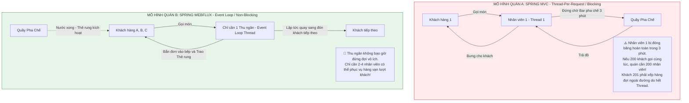
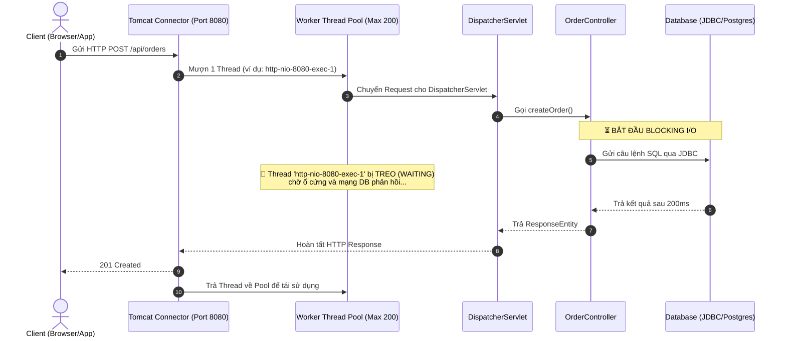
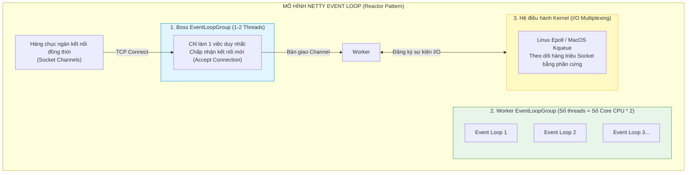
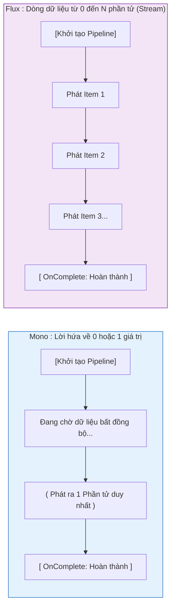
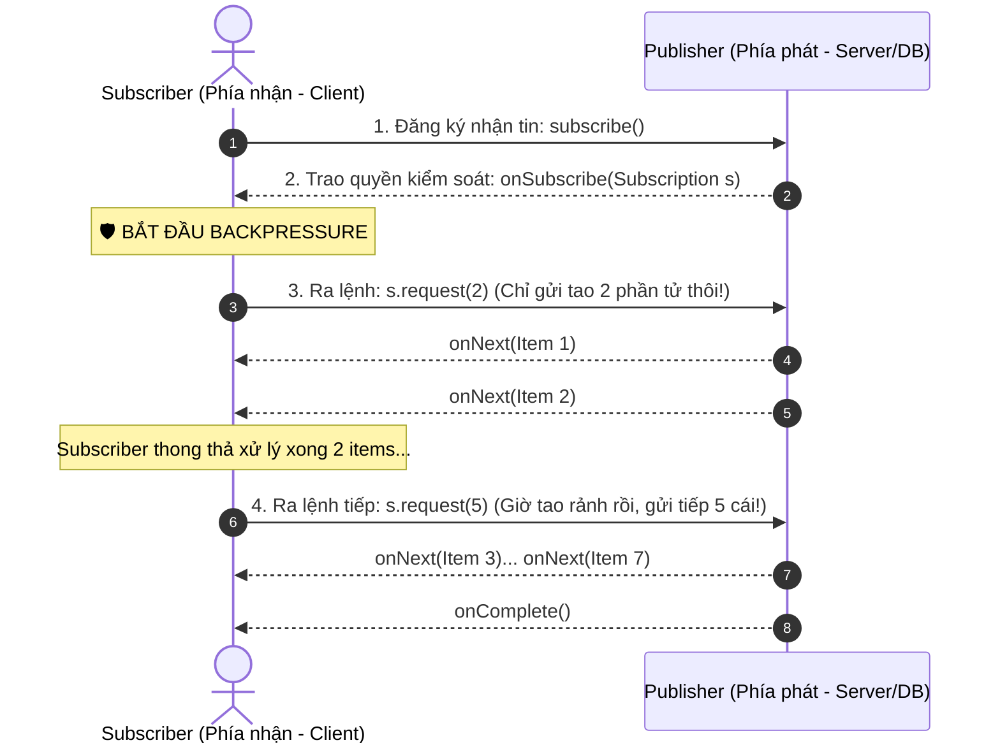
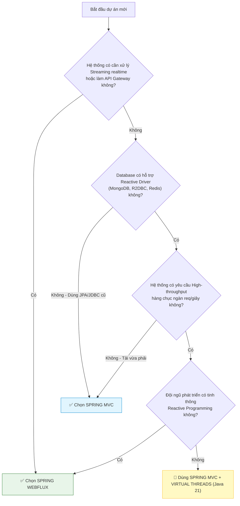

# 🧭 CHUYÊN ĐỀ TOÀN DIỆN: BẢN CHẤT KIẾN TRÚC, CƠ CHẾ I/O & SO SÁNH CHUYÊN SÂU SPRING MVC VS SPRING WEBFLUX

> **Lời mở đầu dành cho bạn:**  
> Trong hệ sinh thái Spring Framework, hầu hết các lập trình viên bắt đầu sự nghiệp với **Spring MVC** và mặc định coi đó là cách duy nhất để viết Web API. Nhưng khi hệ thống đạt ngưỡng quy mô hàng triệu người dùng, yêu cầu xử lý hàng chục ngàn kết nối đồng thời mà không sập bộ nhớ, khái niệm **Spring WebFlux (Reactive Programming)** sẽ lập tức xuất hiện.  
> 
> Chuyên đề này được thiết kế để dẫn bạn đi từ bản chất phần cứng, hệ điều hành (Thread, Socket, I/O multiplexing), qua hai trường phái kiến trúc kinh điển (**Tomcat Servlet Thread-per-request** vs **Netty Event Loop**), phân tích sâu bộ đôi `Mono`/`Flux`, cơ chế `Backpressure`, những **cạm bẫy chết người** khi dùng WebFlux, và góc nhìn hiện đại nhất về **Virtual Threads (Project Loom)** trong Spring Boot 3.x.

---

## 📑 MỤC LỤC

1. [Phần 1: Ẩn Dụ Đời Thực & Nghịch Lý Của Khả Năng Mở Rộng](#phần-1-ẩn-dụ-đời-thực--nghịch-lý-của-khả-năng-mở-rộng)
2. [Phần 2: Kiến Trúc Spring MVC — Bản Chất Servlet & Thread-per-request](#phần-2-kiến-trúc-spring-mvc--bản-chất-servlet--thread-per-request)
3. [Phần 3: Cuộc Cách Mạng Spring WebFlux & Động Cơ Netty Event Loop](#phần-3-cuộc-cách-mạng-spring-webflux--động-cơ-netty-event-loop)
4. [Phần 4: Vũ Khí Cốt Lõi Của Reactive Streams — Mono & Flux](#phần-4-vũ-khí-cốt-lõi-của-reactive-streams--mono--flux)
5. [Phần 5: Kiểm Soát Áp Lực Ngược (Backpressure) — Nghệ Thuật Chống Tràn Bộ Nhớ](#phần-5-kiểm-soát-áp-lực-ngược-backpressure--nghệ-thuật-chống-tràn-bộ-nhớ)
6. [Phần 6: Ma Trận So Sánh Toàn Diện: Spring MVC vs Spring WebFlux](#phần-6-ma-trận-so-sánh-toàn-diện-spring-mvc-vs-spring-webflux)
7. [Phần 7: Những Cạm Bẫy Chết Người (Pitfalls) Khi Bước Vào WebFlux](#phần-7-những-cạm-bẫy-chết-người-pitfalls-khi-bước-vào-webflux)
8. [Phần 8: Cẩm Nang Lựa Chọn Kiến Trúc & Cứu Cánh Virtual Threads (Project Loom)](#phần-8-cẩm-nang-lựa-chọn-kiến-trúc--cứu-cánh-virtual-threads-project-loom)
9. [Phần 9: 10 Câu Hỏi Phỏng Vấn Sát Hạch Senior Về WebFlux & Reactive Systems](#phần-9-10-câu-hỏi-phỏng-vấn-sát-hạch-senior-về-webflux--reactive-systems)

---

## PHẦN 1: ẨN DỤ ĐỜI THỰC & NGHỊCH LÝ CỦA KHẢ NĂNG MỞ RỘNG

### 1.1. Ẩn dụ: Hai mô hình phục vụ tại quán cà phê

Để hiểu bản chất kỹ thuật, hãy đặt mình vào vai người quản lý 2 quán cà phê với 2 triết lý phục vụ hoàn toàn đối lập:



* **Quán A (Spring MVC):** Mỗi khách hàng bước vào cửa được cấp phát **riêng 1 nhân viên phục vụ (1 Thread)**. Nếu khách gọi món cần nấu 10 phút, nhân viên đó phải đứng im nhìn bếp nấu trong 10 phút đó (Blocking I/O). Trong lúc đứng nhìn, nhân viên đó vẫn nhận lương, vẫn chiếm diện tích quán (tiêu tốn RAM & tài nguyên).
* **Quán B (Spring WebFlux):** Thu ngân nhận order trong 2 giây, giao việc cho bếp, phát cho khách một chiếc **"Thẻ rung" (Token/Mono/Flux)**, rồi lập tức đón khách tiếp theo. Khi nào đồ uống pha xong, thẻ rung lên (Event/Callback), khách tự ra quầy nhận đồ. Không một nhân viên nào bị lãng phí thời gian đứng chờ!

### 1.2. Đúc kết bản chất kỹ thuật từ ẩn dụ sang hệ thống phần mềm:
* **Spring MVC (Tomcat):** Áp dụng mô hình **Thread-per-request** (1 Request = 1 Thread). Khi ứng dụng gọi Database hoặc gọi API thanh toán mất 2 giây, thì Thread đó phải **đứng im khóa chặt (Block)** chờ đợi. Khi Tomcat đạt giới hạn 200 threads (`server.tomcat.threads.max=200`), request thứ 201 sẽ bị nghẽn (Timeout hoặc Connection Refused).
* **Spring WebFlux (Netty):** Áp dụng mô hình **Non-blocking Reactive Streams**. Thread tiếp nhận request, giao việc I/O cho hệ điều hành, rồi lập tức quay lại đón request khác. Khi nào dữ liệu từ DB hoặc mạng về tới nơi, hệ điều hành đánh thức Event Loop gọi hàm callback trả dữ liệu cho khách. Nhờ vậy, **chỉ cần số Thread bằng đúng số nhân CPU (ví dụ 4 hoặc 8 threads) là có thể gánh hàng chục ngàn kết nối đồng thời!**

---

## PHẦN 2: KIẾN TRÚC SPRING MVC — BẢN CHẤT SERVLET & THREAD-PER-REQUEST

### 2.1. Nền móng Servlet API & Apache Tomcat
Spring MVC được xây dựng trên nền tảng **Jakarta Servlet API** (trước đây là Java EE Servlet), chạy trên các Servlet Container truyền thống như **Apache Tomcat**, Jetty hoặc Undertow.



### 2.2. Điểm yếu chí mạng của mô hình Thread-per-request:
1. **Tiêu tốn bộ nhớ RAM (Thread Stack Size):** Mỗi một Thread trong hệ điều hành (OS Thread) trên máy ảo JVM mặc định tiêu tốn khoảng **1MB bộ nhớ Stack** (`-Xss1m`). Nếu hệ thống mở 2.000 threads, riêng tiền lưu trữ Stack đã "ngốn" 2GB RAM dù chưa xử lý nghiệp vụ gì!
2. **Chi phí chuyển ngữ cảnh (Context Switching Overhead):** Khi có hàng ngàn threads cùng tranh giành vài chục core CPU, hệ điều hành phải liên tục dừng thread này, lưu trạng thái thanh ghi/bộ nhớ, rồi nạp trạng thái thread khác vào CPU. Quá trình này tiêu tốn 10% - 30% năng lực xử lý của CPU chỉ để "đổi ca" thay vì chạy nghiệp vụ!
3. **Nghẽn Thread Pool (Thread Pool Starvation):** Apache Tomcat mặc định có **200 worker threads** (`server.tomcat.threads.max=200`). Nếu một API ngoài bị chậm (mất 2 giây mới trả về), chỉ cần 200 người dùng bấm cùng lúc $\rightarrow$ Toàn bộ 200 threads bị treo cứng $\rightarrow$ Người dùng thứ 201 gửi request vào sẽ bị từ chối hoặc chờ tới khi Timeout.

---

## PHẦN 3: CUỘC CÁCH MẠNG SPRING WEBFLUX & ĐỘNG CƠ NETTY EVENT LOOP

### 3.1. Spring WebFlux Là Gì? (Định nghĩa chuẩn xác)
> **Spring WebFlux** là một Web Framework được giới thiệu từ **Spring 5.0 (2017)**, hoạt động theo mô hình **Reactive Programming (Lập trình phản ứng)**, hoàn toàn **Bất đồng bộ (Asynchronous)** và **Không chặn luồng (Non-blocking I/O)**.
> 
> Thay vì chạy trên Servlet Container truyền thống (như Apache Tomcat), WebFlux chạy mặc định trên **Netty** — một Network Engine cực kỳ tối ưu cho việc xử lý hàng triệu kết nối đồng thời.

Nhận thấy hạn chế cố hữu của Servlet Blocking, Spring 5.0 (2017) đã mang đến chuẩn **Reactive Streams Specification** và thư viện **Project Reactor** làm nền tảng cho WebFlux.

### 3.2. Netty — Động cơ Event Loop không chặn luồng (Non-blocking I/O)
WebFlux mặc định không chạy trên Tomcat mà chạy trên **Netty** — một framework mạng bất đồng bộ điều khiển theo sự kiện (Event-driven asynchronous network framework).



### 3.3. Bí quyết: Làm thế nào chỉ với 8 Threads mà Netty gánh được 50.000 kết nối?
* Netty tận dụng cơ chế **I/O Multiplexing** của hệ điều hành (**Linux `epoll`**, **macOS `kqueue`**).
* Khi Client gửi dữ liệu lên, Thread của Worker không ngồi đợi từng byte qua dây mạng. Thay vào đó, nó báo với Kernel: *"Khi nào socket này nhận đủ gói tin, hãy gọi cho tao!"*.
* Khi Kernel báo sự kiện `OP_READ` (dữ liệu đã sẵn sàng trong buffer card mạng), Event Loop lập tức thức dậy, đọc dữ liệu, chuyển cho WebFlux xử lý, rồi quay sang socket khác.
* **Không có bất kỳ Thread nào bị rơi vào trạng thái `WAITING` (Block)!**

---

## PHẦN 4: VŨ KHÍ CỐT LÕI CỦA REACTIVE STREAMS — MONO & FLUX

Trong Spring WebFlux, bạn không bao giờ trả về các kiểu dữ liệu trần (như `String`, `User`, `List<Product>`). Toàn bộ luồng dữ liệu được bao bọc trong 2 kiểu dữ liệu phản ứng cốt lõi của thư viện **Project Reactor**:



### 4.1. `Mono<T>` (Tương đương với `CompletableFuture<T>` hoặc `Optional<T>` bất đồng bộ)
Đại diện cho một pipeline xử lý sẽ phát ra **tối đa 1 phần tử** (hoặc rỗng `empty`), sau đó kết thúc hoặc phát ra lỗi.
* Phù hợp cho: Lấy chi tiết 1 đối tượng theo ID, tạo mới 1 bản ghi, kiểm tra tính hợp lệ.

```java
// Ví dụ: Controller lấy thông tin User bằng WebFlux & R2DBC
@GetMapping("/users/{id}")
public Mono<ResponseEntity<UserDto>> getUserById(@PathVariable String id) {
    return userRepository.findById(id) // Trả về Mono<User>
            .map(user -> ResponseEntity.ok(UserMapper.toDto(user)))
            .defaultIfEmpty(ResponseEntity.notFound().build());
}
```

### 4.2. `Flux<T>` (Dòng dữ liệu Stream đa phần tử)
Đại diện cho một chuỗi phát ra từ **0 đến N phần tử** theo thời gian.
* Phù hợp cho: Danh sách dữ liệu lớn, bảng điện chứng khoán realtime, hệ thống chat, dòng dữ liệu từ cảm biến IoT.

```java
// Ví dụ: Bắn dữ liệu giá vàng theo thời gian thực (Server-Sent Events)
@GetMapping(value = "/gold-prices/stream", produces = MediaType.TEXT_EVENT_STREAM_VALUE)
public Flux<GoldPrice> streamGoldPrices() {
    return Flux.interval(Duration.ofSeconds(1)) // Cứ 1 giây phát 1 tick
            .flatMap(tick -> goldPriceService.getLatestPrice());
}
```

### 4.3. NGUYÊN TẮC VÀNG CẦN KHẮC CỐT GHI TÂM:
> ⚠️ **"NOTHING HAPPENS UNTIL YOU SUBSCRIBE!" (Không có gì chạy nếu chưa có ai đăng ký!)**
> 
> Trong lập trình thông thường: Bạn gọi hàm `userRepository.findById(id)` là câu lệnh SQL được bắn xuống DB ngay lập tức.  
> Trong Reactive Programming: Khi bạn viết `Mono<User> userMono = userRepository.findById(id);`, **chưa có bất kỳ kết nối mạng hay câu lệnh SQL nào được chạy cả!** Bạn mới chỉ đang dựng nên một chiếc "đường ống nước" (Pipeline). Chỉ khi nào Spring WebFlux hoặc chính bạn gọi hàm `.subscribe()`, chiếc van nước mới được mở và dữ liệu mới thực sự chảy qua ống!

---

## PHẦN 5: KIỂM SOÁT ÁP LỰC NGƯỢC (BACKPRESSURE) — NGHỆ THUẬT CHỐNG TRÀN BỘ NHỚ

### 5.1. Vấn đề "Nghẹn họng" trong hệ thống truyền thống
Hãy tưởng tượng: Database có thể xuất ra **100.000 bản ghi/giây**, nhưng Client (trình duyệt của người dùng hoặc máy khách yếu) chỉ có thể xử lý và render **500 bản ghi/giây**.
* Trong mô hình Push cũ: Server cứ liên tục nhồi nhét dữ liệu vào bộ nhớ đệm (Buffer). Kết quả: RAM phình to $\rightarrow$ Tràn bộ nhớ (`OutOfMemoryError`) $\rightarrow$ Sập ứng dụng.

### 5.2. Giải pháp Backpressure trong Reactive Streams
Backpressure là cơ chế **Điều tiết lưu lượng dựa trên lực kéo (Pull-based Flow Control)** giữa Bên phát (Publisher) và Bên nhận (Subscriber).



* **Ý nghĩa kiến trúc:** Bên nhận quyết định tốc độ của bên phát. Nếu Subscriber đang bận, nó không gọi `request(n)`, Publisher buộc phải tạm dừng đọc dữ liệu từ nguồn. Hệ thống luôn an toàn tuyệt đối trước nguy cơ tràn RAM!

---

## PHẦN 6: MA TRẬN SO SÁNH TOÀN DIỆN: SPRING MVC VS SPRING WEBFLUX

| Tiêu chí so sánh | Spring MVC (Truyền thống) | Spring WebFlux (Hiện đại / Reactive) |
| :--- | :--- | :--- |
| **Nền tảng kiến trúc** | Servlet API (Servlet 3.1+ có async nhưng nền tảng vẫn là Blocking) | Reactive Streams Specification (Project Reactor) |
| **Web Server mặc định** | **Apache Tomcat** (hoặc Jetty, Undertow) | **Netty** (hoặc Undertow, Tomcat Reactive) |
| **Mô hình luồng (Thread Model)** | **Thread-per-request** (200 threads mặc định) | **Event Loop** (Số threads = Số core CPU * 2) |
| **Bản chất I/O** | **Blocking I/O** (Đồng bộ, luồng chờ I/O xong) | **Non-blocking I/O** (Bất đồng bộ, Event-driven) |
| **Khả năng chịu tải (Concurrency)** | Hạn chế bởi kích thước Thread Pool (khoảng 200 - 1.000 req đồng thời) | Cực cao (hàng chục đến hàng trăm ngàn req đồng thời với ít tài nguyên) |
| **Mức tiêu hao tài nguyên** | Tốn nhiều RAM (mỗi thread ~1MB) và CPU cho Context Switching | Tối ưu tuyệt đối RAM và CPU, chạy mượt trên container nhỏ (512MB RAM) |
| **Kiểu dữ liệu trả về** | `T`, `List<T>`, `ResponseEntity<T>` | `Mono<T>`, `Flux<T>` |
| **Tầng Database tương thích** | **Spring Data JPA (Hibernate, JDBC)**, Spring Data MongoDB | **Spring Data R2DBC**, Spring Data MongoDB Reactive, Redis Reactive |
| **HTTP Client đồng bộ/bất đồng bộ** | `RestTemplate` (cũ), `RestClient` (hiện đại) | `WebClient` |
| **Phong cách viết code** | Mệnh lệnh (Imperative: từ trên xuống dưới, dễ debug) | Khai báo hàm (Functional / Reactive: chain method, khó debug) |
| **Cơ chế Backpressure** | ❌ Không có (Phải tự làm pagination / rate limit) | ✅ Tích hợp sẵn ở mức giao thức kiến trúc |
| **Mức độ phổ biến trong dự án** | Rất cao (~85% - 90% các dự án doanh nghiệp) | Vừa phải (~10% - 15% hệ thống high-throughput, gateway, realtime) |

---

## PHẦN 7: NHỮNG CẠM BẪY CHẾT NGƯỜI (PITFALLS) KHI BƯỚC VÀO WEBFLUX

Rất nhiều lập trình viên nghĩ: *"WebFlux xịn thế này thì dự án mới phải dùng ngay thôi!"*. Hãy cẩn thận, dưới đây là những cái giá cực đắt nếu bạn chưa hiểu bản chất:

### 1. Cạm bẫy số 1: "Block the Event Loop" (Tội đồ làm sập cả hệ thống)
* Hãy nhớ: Netty chỉ có **vài threads duy nhất** (ví dụ máy 4 core CPU $\rightarrow$ 8 threads).
* Nếu trong luồng code WebFlux, bạn vô tình gọi một hàm **Blocking I/O** (như `userRepository.findById(id)` của Spring Data JPA/Hibernate, hoặc `Thread.sleep(1000)`, hoặc gọi thư viện AWS SDK đồng bộ):
  ```java
  // ⚠️ CODE TỰ SÁT TRONG WEBFLUX
  @GetMapping("/user/{id}")
  public Mono<User> getUser(@PathVariable Long id) {
      return Mono.fromCallable(() -> {
          // GỌI JDBC / JPA BLOCKING Ở ĐÂY SẼ KHÓA CHẶT THREAD NETTY!
          return jpaUserRepository.findById(id).orElseThrow(); 
      });
  }
  ```
* **Hậu quả:** 1 trong 8 thread của Netty bị treo. Chỉ cần 8 người dùng bấm cùng lúc, **toàn bộ 8 thread của máy chủ bị đóng băng, ứng dụng sập hoàn toàn**, không thể nhận thêm bất kỳ request nào khác của hàng vạn người dùng còn lại!
* **Quy tắc sinh tử:** Muốn dùng WebFlux, toàn bộ ngăn xếp từ Web $\rightarrow$ Service $\rightarrow$ Network Client $\rightarrow$ Database Driver **bắt buộc phải là Non-blocking (End-to-End Reactive)**.

### 2. Cạm bẫy số 2: Độ phức tạp tư duy (Steep Learning Curve) & Ác mộng Debug
* Trong Spring MVC, code chạy từ dòng 1 đến dòng 10. Khi lỗi ở dòng 5, stack trace sẽ chỉ đích danh `OrderService.java:line 5`.
* Trong WebFlux, bạn chỉ lắp ráp các hàm lambda. Khi runtime ném exception, stack trace có thể dài 300 dòng toàn là các class nội bộ của Project Reactor (`FluxMapFuseable`, `Operators`, `Schedulers`) mà không hề thấy dòng code nào của bạn! Việc debug lỗi logic đòi hỏi phải cài đặt công cụ chuyên dụng như `Hooks.onOperatorDebug()`.

### 3. Cạm bẫy số 3: Lầm tưởng "WebFlux luôn nhanh hơn Spring MVC"
* **Sự thật:** Với các API xử lý nhanh (dưới 10ms), truy vấn database đơn giản và lượng truy cập thấp (vài trăm req/giây), **Spring MVC thực chất chạy nhanh hơn và có độ trễ (latency) thấp hơn WebFlux!**
* Lý do: WebFlux phải tốn thêm chi phí tạo các đối tượng Reactive Publisher, Subscriber, Context Pipeline. WebFlux không làm 1 request nhanh hơn, nó chỉ giúp hệ thống **không bị sập khi có quá nhiều request đồng thời**.

---

## PHẦN 8: CẨM NANG LỰA CHỌN KIẾN TRÚC & CỨU CÁNH VIRTUAL THREADS (PROJECT LOOM)

### 8.1. Cây quyết định kiến trúc (Architecture Decision Tree)



### 8.2. Virtual Threads (Project Loom) trong Java 21 & Spring Boot 3.2+: Bước ngoặt lịch sử!
Nếu bạn thích phong cách viết code dễ đọc, dễ debug tuần tự của **Spring MVC**, nhưng lại thèm muốn khả năng chịu tải hàng chục ngàn kết nối của **WebFlux**, thì đây chính là "vị cứu tinh":

* Kể từ **Java 21** và **Spring Boot 3.2+**, bạn chỉ cần thêm đúng 1 dòng cấu hình trong `application.properties`:
  ```properties
  spring.threads.virtual.enabled=true
  ```
* **Điều kỳ diệu xảy ra:** Tomcat không còn dùng Platform Thread (OS Thread) đắt đỏ nữa! Nó sẽ dùng **Virtual Thread (Luồng ảo)** do JVM tự quản lý trên bộ nhớ Heap.
  * Mỗi Virtual Thread chỉ tốn **vài KB** (thay vì 1MB).
  * Bạn có thể tạo **1.000.000 Virtual Threads** trên 1 chiếc laptop bình thường!
  * Khi code bị block (như gọi JDBC JPA), Virtual Thread tự động nhường CPU cho Virtual Thread khác mà không làm treo hệ điều hành.
  * 👉 **Ý nghĩa:** Bạn giữ nguyên toàn bộ kiến thức Spring MVC, JPA truyền thống nhưng đạt được hiệu năng chịu tải gần tương đương với WebFlux!

---

## PHẦN 9: 10 CÂU HỎI PHỎNG VẤN SÁT HẠCH SENIOR VỀ WEBFLUX & REACTIVE SYSTEMS

### Câu 1: Em hãy giải thích sự khác biệt cốt lõi giữa Spring MVC và Spring WebFlux về mô hình xử lý Thread?
**Đáp án chuẩn:**
* Spring MVC áp dụng mô hình **Thread-per-request** chạy trên Servlet Container (Tomcat). Mỗi HTTP request chiếm dụng 1 Platform Thread (OS thread). Khi gặp I/O (gọi DB, gọi external API), thread đó bị khóa (Blocked) và rơi vào trạng thái chờ, dẫn đến lãng phí RAM và chi phí Context Switching của CPU.
* Spring WebFlux áp dụng mô hình **Event Loop (Reactor Pattern)** chạy trên Netty. WebFlux chỉ sử dụng một số lượng thread rất nhỏ (bằng số core CPU * 2) để tiếp nhận và xử lý sự kiện qua cơ chế I/O Multiplexing (epoll/kqueue). Thread không bao giờ bị khóa chờ I/O, giúp phục vụ hàng chục ngàn kết nối đồng thời với lượng tài nguyên tối thiểu.

---

### Câu 2: `Mono` và `Flux` khác nhau như thế nào? Khi nào dùng cái nào?
**Đáp án chuẩn:**
* Cả hai đều là implementations của `Publisher<T>` trong chuẩn Reactive Streams.
* `Mono<T>` phát ra **0 hoặc tối đa 1 phần tử**, sau đó kết thúc bằng `onComplete` hoặc `onError`. Dùng cho các tác vụ trả về đơn lẻ: tìm User theo ID, cập nhật trạng thái đơn hàng, kiểm tra tính hợp lệ.
* `Flux<T>` phát ra **từ 0 đến N phần tử** (có thể là stream vô hạn). Dùng khi trả về danh sách, stream dữ liệu liên tục thời gian thực (Server-Sent Events, WebSocket, dữ liệu log hoặc chat).

---

### Câu 3: Câu nói "Nothing happens until you subscribe" trong Reactive Programming có nghĩa là gì?
**Đáp án chuẩn:**
* Câu nói này phản ánh tính chất **Lazy Execution (Thực thi lười)** của Reactive Streams.
* Khi ta viết chuỗi method chaining như `userRepository.findById(id).map(...)`, chúng ta mới chỉ đang xây dựng một bản thiết kế đường ống (Execution Plan / Blueprint) chứ chưa có bất kỳ hành động thực tế nào xảy ra (chưa mở connection, chưa gửi câu lệnh SQL).
* Chỉ khi có một `Subscriber` gọi hàm `.subscribe()` (hoặc Spring WebFlux tự động subscribe khi trả `Mono`/`Flux` ra Controller), pipeline mới bắt đầu kích hoạt và dữ liệu mới thực sự được kéo (pull) qua các toán tử.

---

### Câu 4: Backpressure là gì? Nó giải quyết vấn đề gì trong hệ thống phân tán?
**Đáp án chuẩn:**
* **Backpressure** là cơ chế kiểm soát lưu lượng dòng chảy ngược (Flow Control) từ Consumer (bên nhận) sang Producer (bên phát).
* Trong hệ thống truyền thống, nếu Producer bắn dữ liệu quá nhanh mà Consumer xử lý không kịp, Consumer sẽ bị tràn bộ đệm RAM dẫn tới lỗi `OutOfMemoryError`.
* Với Backpressure, Subscriber chủ động phát tín hiệu `Subscription.request(n)` để yêu cầu Publisher chỉ gửi đúng `n` phần tử mà nó có thể tiêu thụ. Nhờ đó, Publisher sẽ tự động điều tiết tốc độ hoặc tạm dừng đọc dữ liệu từ nguồn, bảo vệ hệ thống khỏi tình trạng quá tải.

---

### Câu 5: Nếu trong một dự án Spring WebFlux, em gọi một hàm truy vấn của Spring Data JPA (`userRepository.findById(1L)`), điều gì sẽ xảy ra? Cách khắc phục nếu bắt buộc phải dùng?
**Đáp án chuẩn:**
* **Hậu quả:** Spring Data JPA dựa trên JDBC truyền thống vốn là **Blocking I/O**. Khi gọi hàm này, nó sẽ khóa cứng một Worker Thread của Netty Event Loop. Vì Netty chỉ có số thread rất ít (bằng số core CPU), chỉ cần vài chục request đồng thời gọi vào hàm này sẽ làm tê liệt toàn bộ các Event Loops, khiến toàn bộ ứng dụng WebFlux bị treo cứng (Freeze).
* **Cách khắc phục:**
  1. *Giải pháp triệt để:* Chuyển sang dùng thư viện Reactive Database như **Spring Data R2DBC** hoặc MongoDB Reactive.
  2. *Giải pháp tình thế (Offloading):* Bọc đoạn code blocking đó vào một Thread Pool riêng biệt chuyên xử lý I/O nặng bằng cách sử dụng toán tử `.publishOn(Schedulers.boundedElastic())`. Cách này sẽ giải phóng Netty Event Loop và đẩy tác vụ blocking sang các thread dự phòng của JVM.

---

### Câu 6: Phân biệt `map()` và `flatMap()` trong Project Reactor?
**Đáp án chuẩn:**
* **`map(Function<T, R>)`:** Dùng cho biến đổi đồng bộ 1-1 (Synchronous 1-to-1 transformation). Hàm truyền vào nhận đối tượng `T` và trả về đối tượng `R` trực tiếp.  
  *Ví dụ:* `userMono.map(user -> user.getName())` $\rightarrow$ trả về `Mono<String>`.
* **`flatMap(Function<T, Mono<R>>)`:** Dùng cho biến đổi bất đồng bộ 1-1 hoặc 1-N (Asynchronous transformation). Hàm truyền vào nhận đối tượng `T` và trả về một `Publisher` mới (`Mono<R>` hoặc `Flux<R>`). `flatMap` sẽ tự động "làm phẳng" (flatten) và subscribe vào Publisher bên trong đó.  
  *Ví dụ:* `userMono.flatMap(user -> orderClient.getOrders(user.getId()))` $\rightarrow$ gọi API ngoài và trả về kết quả đã được flatten.

---

### Câu 7: So sánh sự khác nhau giữa `WebClient` và `RestClient` trong Spring 6.1+?
**Đáp án chuẩn:**
* **`WebClient`:** Là HTTP Client Reactive không chặn luồng (Non-blocking), thuộc module `spring-webflux`, trả về `Mono` và `Flux`. Phù hợp cho cả hệ sinh thái WebFlux lẫn MVC khi cần gọi đồng thời nhiều API ngoài với hiệu năng cao.
* **`RestClient`:** Là HTTP Client đồng bộ (Blocking), thuộc module `spring-web` (Spring MVC) từ Spring Boot 3.2. Nó mang phong cách Fluent API hiện đại của `WebClient` nhưng chạy trên cơ chế Blocking I/O truyền thống của Servlet. Phù hợp làm client mặc định cho các ứng dụng Spring MVC thông thường.

---

### Câu 8: Tại sao Spring Cloud Gateway lại được xây dựng trên nền tảng Spring WebFlux thay vì Spring MVC?
**Đáp án chuẩn:**
* API Gateway là cửa ngõ duy nhất đón nhận toàn bộ lượng traffic của toàn bộ hệ thống microservices (hàng chục đến hàng trăm ngàn requests/giây).
* Bản chất công việc của Gateway chủ yếu là: Đọc Header, xác thực Token JWT, kiểm tra Rate Limiting và chuyển tiếp (Reverse Proxy) request sang các microservice nội bộ. Nó hầu như **không truy vấn database quan hệ phức tạp**.
* Do đó, kiến trúc Non-blocking Event Loop của WebFlux là sự lựa chọn hoàn hảo: Gateway có thể duy trì hàng triệu kết nối mở (WebSocket, HTTP long-polling) với lượng RAM cực thấp mà không lo bị nghẽn Thread Pool như Tomcat.

---

### Câu 9: Tính năng Virtual Threads trong Java 21 có thể thay thế hoàn toàn Spring WebFlux không?
**Đáp án chuẩn:**
* **Phần lớn là CÓ đối với các ứng dụng CRUD thông thường:** Virtual Threads giải quyết xuất sắc bài toán mở rộng (Scalability) của Spring MVC bằng cách cho phép tạo hàng triệu luồng nhẹ mà vẫn giữ nguyên cú pháp lập trình tuần tự, tương thích hoàn toàn với Spring Data JPA và hệ sinh thái JDBC cũ.
* **KHÔNG thể thay thế hoàn toàn ở các khía cạnh đặc thù:**
  1. *Streaming Data & Server-Sent Events:* WebFlux và Reactive Streams được thiết kế tự nhiên cho dòng dữ liệu liên tục theo thời gian thực.
  2. *Backpressure:* Virtual Threads vẫn là mô hình Blocking theo luồng, nó không có cơ chế giao thức Backpressure để điều tiết tốc độ giữa Producer và Consumer như Reactive Streams.

---

### Câu 10: Làm thế nào để truyền Context (như Correlation ID hoặc User Authentication) qua các bước trong một pipeline WebFlux mà không dùng `ThreadLocal`?
**Đáp án chuẩn:**
* Trong Spring MVC, dữ liệu ngữ cảnh (như thông tin người dùng từ `SecurityContextHolder`) được lưu trong **`ThreadLocal`** vì mỗi request luôn gắn chặt với 1 Thread duy nhất từ đầu đến cuối.
* Trong WebFlux, một request có thể được thực thi bởi nhiều Thread khác nhau của Netty tại các thời điểm khác nhau, do đó `ThreadLocal` sẽ bị sai lệch hoàn toàn.
* **Giải pháp của WebFlux:** Sử dụng **Reactive Context** (`reactor.util.context.Context`).
  * Context được gắn liền với dòng chảy của Stream (từ Subscriber đi ngược lên Publisher).
  * Lập trình viên sử dụng `.contextWrite(ctx -> ctx.put("KEY", value))` để lưu trữ và toán tử `Mono.deferContextual(ctx -> ...)` để đọc dữ liệu ra một cách bất đồng bộ và an toàn tuyệt đối qua các threads.

---

> 💡 **Lời kết & Lộ trình thực hành:**  
> Đừng cố gượng ép áp dụng WebFlux vào tất cả mọi dự án! Một Senior Engineer giỏi là người biết chọn đúng công cụ cho đúng bài toán:
> * Dùng **Spring MVC (+ Virtual Threads Java 21)** cho 90% dự án nghiệp vụ, thương mại điện tử, ngân hàng dùng SQL Database.
> * Dùng **Spring WebFlux** cho API Gateway, Microservice Proxy, Realtime Chat, IoT Stream và hệ thống chịu tải cực hạn.
