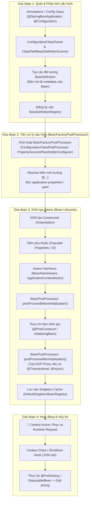
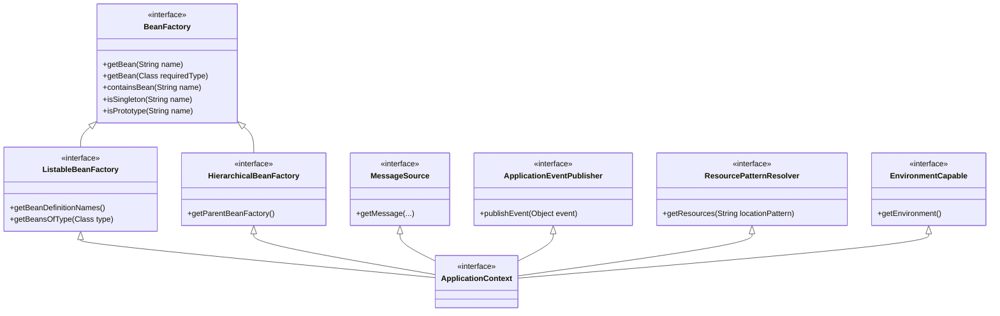
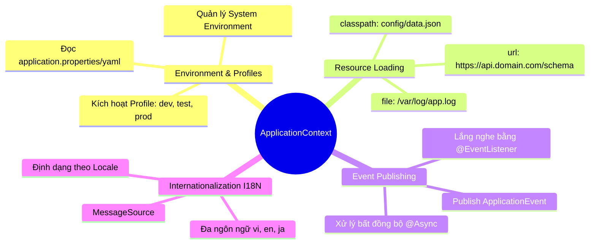

# 🧠 CHUYÊN ĐỀ CHUYÊN SÂU: SPRING CONTEXT & APPLICATIONCONTEXT

> **Chủ đề:** Nền tảng kiến trúc Spring Framework & Spring Boot  
> **Mục tiêu:** Hiểu rõ bản chất kỹ thuật, cấu trúc phân tầng, vòng đời khởi tạo và các tính năng cốt lõi của `ApplicationContext` trong Spring Boot.  
> **Liên kết bài học:** [bai-2-ioc-dependency-injection.md](file:///Users/vovantu/HTML_CSS/JAVA%20/Note/Lesson02/bai-2-ioc-dependency-injection.md) | [bai-2-bo-sung-hieu-sau-di.md](file:///Users/vovantu/HTML_CSS/JAVA%20/Note/Lesson02/bai-2-bo-sung-hieu-sau-di.md)

---

## 📌 PHẦN 1: BẢN CHẤT KỸ THUẬT CỦA SPRING CONTEXT

### 1.1. Khái niệm cốt lõi
Trong hệ sinh thái Spring, **Spring Context** là tên gọi quy ước chỉ **IoC Container hoàn chỉnh** (Inversion of Control Container) của ứng dụng, được đặc tả chính thức thông qua interface:

$$\text{Spring Context} \equiv \texttt{org.springframework.context.ApplicationContext}$$

Về mặt bản chất kỹ thuật:
1. **Metadata-Driven Engine:** Spring Context là một runtime engine hoạt động dựa trên metadata (được định nghĩa qua Annotations như `@Component`, `@Configuration`, `@Bean`, hoặc file cấu hình XML/Java Config).
2. **Bean Lifecycle & Dependency Coordinator:** Chịu trách nhiệm toàn quyền đối với vòng đời của các object được quản lý (gọi là **Spring Beans**): quét mã nguồn (scanning), phân tích phụ thuộc (dependency resolution), khởi tạo (instantiation), cấu hình thuộc tính (population), tiêm phụ thuộc (injection), quản lý bộ nhớ (caching) và giải phóng tài nguyên khi tắt ứng dụng (destruction).
3. **Registry of Singletons:** Về mặt cấu trúc dữ liệu bên dưới JVM heap, Spring Context duy trì các bảng băm (chủ yếu là `ConcurrentHashMap`) lưu trữ các instance đã được tạo sẵn để cung cấp cho bất kỳ thành phần nào yêu cầu.

---

## 🔄 PHẦN 2: KIẾN TRÚC & VÒNG ĐỜI CỦA SPRING CONTEXT

Quá trình Spring Context khởi động (bootstrap) diễn ra qua nhiều giai đoạn chặt chẽ từ lúc đọc mã nguồn cho đến khi ứng dụng sẵn sàng nhận request.



### Các mốc xử lý quan trọng:
* **`BeanDefinition`:** Spring không khởi tạo Java Object ngay lập tức. Bước đầu tiên, nó đọc class và biến thành đối tượng `BeanDefinition` — chứa thông tin: Tên class, scope (Singleton/Prototype), chế độ lazy/eager, constructor arguments, autowire mode.
* **`BeanFactoryPostProcessor` (BFPP):** Can thiệp vào các `BeanDefinition` **trước khi** bất kỳ Bean instance nào được tạo ra. Ví dụ: đọc file `application.properties` để giải quyết các placeholder như `${server.port:8080}`.
* **`BeanPostProcessor` (BPP):** Can thiệp trực tiếp vào từng Bean instance **trong quá trình khởi tạo**. Đây chính là nơi Spring tạo ra các **Dynamic Proxy** để hỗ trợ AOP (Aspect-Oriented Programming) như `@Transactional`, `@Async`, `@Cacheable`.

---

## ⚖️ PHẦN 3: SO SÁNH CHUYÊN SÂU: BEANFACTORY VS APPLICATIONCONTEXT

Interface `ApplicationContext` là một sub-interface trực tiếp mở rộng từ `BeanFactory`.



### Bảng phân tích chi tiết

| Tiêu chí | `BeanFactory` (`org.springframework.beans.factory`) | `ApplicationContext` (`org.springframework.context`) |
| :--- | :--- | :--- |
| **Định vị kiến trúc** | Mức nền tảng cơ bản (Basic IoC Container). | Mức doanh nghiệp hoàn chỉnh (Enterprise Application Context). |
| **Chiến lược nạp Bean** | **Lazy-loading:** Bean chỉ được khởi tạo khi được gọi tường minh bằng `getBean()`. | **Eager-loading (Mặc định):** Tất cả các Singleton Beans được khởi tạo ngay khi context bootstrap. |
| **Phát hiện lỗi (Fail-Fast)** | Chậm: Lỗi thiếu bean hoặc sai cấu hình chỉ phát hiện khi runtime thực thi đến dòng gọi bean đó. | Sớm (Fail-Fast): Ứng dụng dừng và quăng exception ngay khi start app nếu có cấu hình sai hoặc thiếu dependency. |
| **Đăng ký PostProcessor** | Thủ công: Phải gọi code `beanFactory.addBeanPostProcessor(...)`. | Tự động: Tự quét classpath và tự đăng ký mọi `BeanFactoryPostProcessor` và `BeanPostProcessor`. |
| **Hỗ trợ I18N** | Không hỗ trợ. | Tích hợp sẵn interface `MessageSource`. |
| **Hệ thống Sự kiện (Events)** | Không hỗ trợ. | Tích hợp sẵn `ApplicationEventPublisher`. |
| **Truy cập Tài nguyên (Resources)**| Giới hạn, phải inject `ResourceLoader` riêng. | Chính nó là một `ResourcePatternResolver` mạnh mẽ (hỗ trợ `classpath:`, `file:`, `http:`). |
| **Khuyên dùng** | Thiết bị nhúng, IoT với bộ nhớ cực kỳ hạn chế (vài MB RAM). | **Mặc định cho toàn bộ các ứng dụng Spring MVC, Spring Boot, Microservices.** |

---

## ⚡ PHẦN 4: 4 NĂNG LỰC CỐT LÕI CỦA APPLICATIONCONTEXT

Bên cạnh việc thực thi Dependency Injection, `ApplicationContext` tích hợp sẵn 4 hệ thống dịch vụ quan trọng:



### 4.1. Quản lý Môi trường & Profile (`EnvironmentCapable`)
Cung cấp đối tượng `Environment` để truy xuất thuộc tính cấu hình và xác định profile hoạt động:

```java
@Service
public class SystemConfigService {

    private final Environment environment;

    public SystemConfigService(Environment environment) {
        this.environment = environment;
    }

    public void inspectEnvironment() {
        // Đọc giá trị cấu hình kèm kiểu dữ liệu trả về
        Integer port = environment.getProperty("server.port", Integer.class, 8080);
        
        // Kiểm tra profile đang kích hoạt
        String[] activeProfiles = environment.getActiveProfiles();
        boolean isProduction = environment.matchesProfiles("prod");
    }
}
```

### 4.2. Xử lý Tài nguyên đa nguồn (`ResourceLoader` / `ResourcePatternResolver`)
Cho phép load file thống nhất từ nhiều nguồn khác nhau thông qua tiền tố đường dẫn:

```java
@Service
public class TemplateLoaderService {

    private final ResourceLoader resourceLoader;

    public TemplateLoaderService(ResourceLoader resourceLoader) {
        this.resourceLoader = resourceLoader;
    }

    public InputStream loadTemplate(String fileName) throws IOException {
        // Nạp từ classpath bên trong file .jar
        Resource classpathRes = resourceLoader.getResource("classpath:templates/" + fileName);
        
        // Hoặc nạp từ hệ thống file của máy chủ (FileSystem)
        // Resource fileRes = resourceLoader.getResource("file:/etc/app/config.json");
        
        return classpathRes.getInputStream();
    }
}
```

### 4.3. Kiến trúc Hướng Sự kiện Nội bộ (`ApplicationEventPublisher`)
Hỗ trợ Observer Pattern giúp decouple (tách rời) hoàn toàn các module nghiệp vụ trong cùng một service:

```java
// 1. Định nghĩa Sự kiện (Event Object)
public record OrderCreatedEvent(Long orderId, String customerEmail, BigDecimal totalAmount) {}

// 2. Nơi phát sự kiện (Publisher)
@Service
public class OrderService {

    private final ApplicationEventPublisher eventPublisher;

    public OrderService(ApplicationEventPublisher eventPublisher) {
        this.eventPublisher = eventPublisher;
    }

    @Transactional
    public void createOrder(Long orderId, String email, BigDecimal amount) {
        // Lưu đơn hàng vào Database...
        
        // Phát sự kiện thông báo (Decoupled)
        eventPublisher.publishEvent(new OrderCreatedEvent(orderId, email, amount));
    }
}

// 3. Nơi nhận sự kiện (Listener)
@Component
public class NotificationEventListener {

    @EventListener
    public void handleOrderCreated(OrderCreatedEvent event) {
        // Gửi email xác nhận đơn hàng
        System.out.println("Gửi email xác nhận đến: " + event.customerEmail());
    }
}
```

### 4.4. Quốc tế hóa Thông báo (`MessageSource` - I18N)
Cung cấp khả năng định vị ngôn ngữ dựa vào `Locale` của người dùng:

```java
@Service
public class LocalizationService {

    private final MessageSource messageSource;

    public LocalizationService(MessageSource messageSource) {
        this.messageSource = messageSource;
    }

    public String getGreeting(Locale locale) {
        // Đọc từ file messages_en.properties hoặc messages_vi.properties
        return messageSource.getMessage("welcome.message", new Object[]{"Tu Vo"}, locale);
    }
}
```

---

## 🛠️ PHẦN 5: CÁC IMPLEMENTATION PHỔ BIẾN CỦA APPLICATIONCONTEXT

Tùy thuộc vào loại ứng dụng (Standalone, Servlet Web, hay Reactive Web), Spring sẽ khởi tạo các lớp hiện thực khác nhau:

```mermaid
classDiagram
    class ApplicationContext {
        <<interface>>
    }
    class ConfigurableApplicationContext {
        <<interface>>
        +refresh()
        +close()
    }
    class AnnotationConfigApplicationContext {
        (Dùng cho app Console / Desktop)
    }
    class AnnotationConfigServletWebServerApplicationContext {
        (Mặc định trong Spring Boot MVC - Tomcat nhúng)
    }
    class AnnotationConfigReactiveWebServerApplicationContext {
        (Mặc định trong Spring Boot WebFlux - Netty)
    }

    ApplicationContext <|-- ConfigurableApplicationContext
    ConfigurableApplicationContext <|-- AnnotationConfigApplicationContext
    ConfigurableApplicationContext <|-- AnnotationConfigServletWebServerApplicationContext
    ConfigurableApplicationContext <|-- AnnotationConfigReactiveWebServerApplicationContext
```

* **`AnnotationConfigApplicationContext`:** Dùng cho ứng dụng Java độc lập không có web container. Khởi tạo trực tiếp từ các class có `@Configuration`.
* **`AnnotationConfigServletWebServerApplicationContext`:** Được **Spring Boot Starter Web** tự động tạo ra. Nó quản lý thêm Embedded Web Server (Tomcat, Jetty, Undertow) và `DispatcherServlet`.
* **`AnnotationConfigReactiveWebServerApplicationContext`:** Được **Spring Boot Starter WebFlux** kích hoạt khi chạy kiến trúc Reactive (Netty).

---

## 💻 PHẦN 6: CODE MINH HỌA TƯƠNG TÁC VỚI APPLICATIONCONTEXT

### 6.1. Truy xuất ApplicationContext tại điểm khởi đầu (`main`)

```java
package com.example.springbootlearning;

import org.springframework.boot.SpringApplication;
import org.springframework.boot.autoconfigure.SpringBootApplication;
import org.springframework.context.ConfigurableApplicationContext;

@SpringBootApplication
public class SpringbootLearningApplication {

    public static void main(String[] args) {
        // Hàm run() khởi tạo, refresh và trả về instance của ApplicationContext
        ConfigurableApplicationContext context = SpringApplication.run(SpringbootLearningApplication.class, args);

        // In ra tổng số lượng Bean đang tồn tại trong Context
        int totalBeans = context.getBeanDefinitionCount();
        System.out.println("=== TỔNG SỐ BEAN TRONG CONTEXT: " + totalBeans + " ===");

        // Liệt kê tên các bean quan trọng
        for (String beanName : context.getBeanDefinitionNames()) {
            if (beanName.contains("Controller") || beanName.contains("Service")) {
                System.out.println("Managed Bean: " + beanName);
            }
        }
    }
}
```

### 6.2. Inject ApplicationContext vào Spring Service (Khi cần tương tác động)

```java
package com.example.springbootlearning.service;

import org.springframework.context.ApplicationContext;
import org.springframework.stereotype.Service;

@Service
public class DynamicBeanExecutorService {

    private final ApplicationContext applicationContext;

    // Inject trực tiếp ApplicationContext thông qua Constructor Injection
    public DynamicBeanExecutorService(ApplicationContext applicationContext) {
        this.applicationContext = applicationContext;
    }

    public void executeTaskByStrategy(String paymentType) {
        // Lấy Bean động theo tên tại thời điểm runtime (Strategy Pattern)
        PaymentStrategy strategy = applicationContext.getBean(paymentType + "PaymentStrategy", PaymentStrategy.class);
        strategy.processPayment();
    }
}
```

### 6.3. Triển khai `SpringContextHolder` (Static Access Helper)
> [!WARNING]
> Kỹ thuật `SpringContextHolder` giúp truy cập Bean ở những class không được Spring quản lý (ví dụ: JPA Entity Listener, Enum, hoặc Legacy Utility). Tuy nhiên, **không nên lạm dụng** vì nó làm tăng sự phụ thuộc ẩn và gây khó khăn khi viết Unit Test.

```java
package com.example.springbootlearning.config;

import org.springframework.beans.BeansException;
import org.springframework.context.ApplicationContext;
import org.springframework.context.ApplicationContextAware;
import org.springframework.stereotype.Component;

@Component
public class SpringContextHolder implements ApplicationContextAware {

    private static ApplicationContext context;

    @Override
    public void setApplicationContext(ApplicationContext applicationContext) throws BeansException {
        SpringContextHolder.context = applicationContext;
    }

    public static <T> T getBean(Class<T> beanClass) {
        return context.getBean(beanClass);
    }

    public static <T> T getBean(String beanName, Class<T> beanClass) {
        return context.getBean(beanName, beanClass);
    }
}
```

---

## 🏗️ PHẦN 7: DESIGN PATTERNS TRONG SPRING CONTEXT

Hệ thống Spring Context được thiết kế dựa trên các Design Patterns kinh điển của Java:

1. **Factory Pattern & Abstract Factory Pattern:**
   * Thể hiện rõ nhất ở họ interface `BeanFactory` và `FactoryBean<T>`. Tạo đối tượng trừu tượng hóa khỏi logic khởi tạo chi tiết.
2. **Singleton Pattern & Registry of Singletons Pattern:**
   * Mặc định mọi Bean trong Spring Context là Singleton. Tuy nhiên, Spring không dùng từ khóa `private static` hay enum (GoF Singleton), mà dùng `DefaultSingletonBeanRegistry` với cấu trúc `ConcurrentHashMap<String, Object>` để lưu trữ một phiên bản duy nhất trong phạm vi container (Container-managed Singleton).
3. **Observer Pattern:**
   * Kiến trúc sự kiện gồm `ApplicationEventPublisher` (Subject) và `ApplicationListener` / `@EventListener` (Observer).
4. **Strategy Pattern:**
   * Thể hiện qua `ResourceLoader` (chọn thuật toán load tài nguyên dựa vào prefix đường dẫn `classpath:`, `file:`) hoặc `InstantiationStrategy` (chọn cách khởi tạo đối tượng qua Reflection hay CGLIB).
5. **Proxy Pattern (Decorator):**
   * Sử dụng trong `BeanPostProcessor` để bọc Bean gốc vào Dynamic Proxy (JDK Proxy hoặc CGLIB), phục vụ AOP cho `@Transactional`, `@Secured`, `@Cacheable`.

---

## ❓ PHẦN 8: BỘ CÂU HỎI PHỎNG VẤN CHUYÊN SÂU (INTERVIEW QUESTIONS)

### Q1: Điểm khác biệt mấu chốt giữa BeanFactory và ApplicationContext là gì? Khi nào nên dùng loại nào?
**Trả lời:**
* `BeanFactory` chỉ cung cấp tính năng IoC cơ bản với chiến lược **Lazy-loading** (chỉ tạo instance khi được gọi). Phù hợp với hệ thống nhúng có tài nguyên cực kỳ giới hạn.
* `ApplicationContext` kế thừa `BeanFactory`, cung cấp tính năng cấp doanh nghiệp và mặc định sử dụng chiến lược **Eager-loading** cho Singleton Beans (tạo ngay khi khởi động để phát hiện lỗi sớm — fail-fast). Ngoài ra tích hợp sẵn AOP, I18N (`MessageSource`), ResourceLoader và Event Publisher. Trong thực tế 99% dự án Spring/Spring Boot đều dùng `ApplicationContext`.

### Q2: Quá trình Bootstrap của ApplicationContext diễn ra như thế nào? Hàm `refresh()` làm nhiệm vụ gì?
**Trả lời:**
Trái tim của quá trình bootstrap nằm ở phương thức `refresh()` của `ConfigurableApplicationContext`. Phương thức này thực hiện tuần tự:
1. Chuẩn bị môi trường (`prepareRefresh`).
2. Quét classpath, đọc annotations/metadata để tạo các `BeanDefinition` nạp vào `BeanDefinitionRegistry`.
3. Kích hoạt các `BeanFactoryPostProcessor` để phân giải biến môi trường và properties.
4. Đăng ký các `BeanPostProcessor` vào factory.
5. Khởi tạo `MessageSource` (I18N) và `ApplicationEventMulticaster` (Events).
6. Khởi tạo toàn bộ Singleton Beans còn lại (gọi constructor, inject DI, chạy `@PostConstruct`, tạo AOP Proxy qua `BeanPostProcessor`).
7. Hoàn tất và bắn sự kiện `ContextRefreshedEvent`.

### Q3: Singleton trong Spring Context khác gì so với Singleton Pattern của GoF (Gang of Four)?
**Trả lời:**
* **GoF Singleton:** Giới hạn duy nhất 1 instance trên mỗi **ClassLoader** của JVM thông qua `private constructor` và phương thức `getInstance()`. Việc khởi tạo bị gắn chặt cứng vào mã nguồn.
* **Spring Singleton:** Giới hạn duy nhất 1 instance trên mỗi **Spring ApplicationContext**. Mã nguồn của class hoàn toàn là POJO bình thường (public constructor). Nếu một ứng dụng chạy 2 `ApplicationContext` riêng biệt, mỗi Context hoàn toàn có thể sở hữu 1 instance riêng của class đó.

### Q4: Làm cách nào để một Bean có thể truy xuất trực tiếp vào đối tượng `ApplicationContext`?
**Trả lời:**
Có 2 cách chuẩn trong Spring:
1. **Dùng Dependency Injection (Khuyên dùng):** Khai báo `private final ApplicationContext context;` và inject qua constructor.
2. **Implement interface `ApplicationContextAware`:** Triển khai phương thức `setApplicationContext(ApplicationContext context)`. Spring container sẽ tự phát hiện interface này và truyền instance vào trước khi gọi `@PostConstruct`.

### Q5: Spring Context quản lý vòng đời của Bean có Scope Prototype như thế nào?
**Trả lời:**
Spring Context **chỉ chịu trách nhiệm khởi tạo, cấu hình và tiêm phụ thuộc** cho Prototype Bean, sau đó bàn giao trực tiếp instance cho bên gọi mà **KHÔNG quản lý vòng đời tiếp theo** của nó. 
Do đó:
* Phương thức `@PostConstruct` của Prototype Bean vẫn được thực thi.
* Nhưng phương thức `@PreDestroy` sẽ **KHÔNG bao giờ** được Spring gọi tự động khi context shutdown. Client nhận instance phải tự chịu trách nhiệm dọn dẹp tài nguyên.
