# 📘 BÀI 9: SPRING DATA JPA & HIBERNATE — ORM FUNDAMENTALS

> **Mục tiêu bài học:**
> 1. Hiểu **ORM (Object-Relational Mapping)** là gì và tại sao dùng nó thay vì viết SQL thủ công.
> 2. Phân biệt rõ **JPA (Specification)** vs **Hibernate (Implementation)** vs **Spring Data JPA (Abstraction)** — ba tầng kiến trúc.
> 3. Tạo **JPA Entity** với các annotation: `@Entity`, `@Table`, `@Id`, `@GeneratedValue`, `@Column`, `@Enumerated`, `@CreationTimestamp`, `@UpdateTimestamp`.
> 4. Dùng **JpaRepository** interface để CRUD tự động (không viết SQL).
> 5. Kết nối **H2 in-memory database** (phát triển), hiểu cách chuyển sang MySQL/PostgreSQL (production).
> 6. **Refactor** Product API từ in-memory `ArrayList` sang database thật.

---

## 📑 MỤC LỤC

| Phần | Nội dung | Mục tiêu kỹ thuật |
|:---:|:---|:---|
| 1 | 🔌 Nền tảng kết nối: JDBC & JDBC Driver | Cơ chế giao tiếp tầng thấp & Protocol Adapter |
| 2 | 🧬 Bản chất ORM & Cơ chế Hibernate đóng gói JDBC | Tự động hóa JDBC & Kiến trúc 3 tầng |
| 3 | 📐 Entity Mapping — Ánh xạ Object ↔ Table | Annotation chi tiết |
| 4 | 🔌 JpaRepository — CRUD tự động | Không viết SQL |
| 5 | 🗄️ H2 In-Memory Database & Cấu hình kết nối | Database phát triển |
| 6 | 🔄 Refactor Product API: ArrayList → JPA | Code Walkthrough |
| 7 | 🩺 Fix lỗi favicon.ico NoResourceFoundException | Bug Fix |
| 8 | 📚 Kiến thức bổ sung: Persistence Context & Dirty Checking | Deep Dive |
| 9 | 🎯 Tổng kết & So sánh Before/After | Takeaway |
| 10 | 💼 Câu hỏi phỏng vấn (Interview Questions) | Chuẩn bị phỏng vấn |

---

## PHẦN 1: NỀN TẢNG KẾT NỐI DATABASE TRONG JAVA — JDBC & JDBC DRIVER

### 1.1. JDBC (Java Database Connectivity) là gì?

**JDBC (Java Database Connectivity)** là bộ API tiêu chuẩn do Java (Oracle) định nghĩa nằm trong package `java.sql.*` và `javax.sql.*`. JDBC cung cấp một đặc tả giao diện (Interface Specification) thống nhất cho phép ứng dụng Java giao tiếp với mọi hệ quản trị cơ sở dữ liệu quan hệ (RDBMS).

Các Interface cốt lõi của JDBC API:
* **`java.sql.Driver`**: Interface định nghĩa điểm khởi đầu cho việc nạp driver và khởi tạo kết nối.
* **`java.sql.Connection`**: Đại diện cho phiên kết nối vật lý (Physical Session) giữa ứng dụng Java và Database.
* **`java.sql.Statement` / `PreparedStatement`**: Đối tượng biên dịch và thực thi câu lệnh SQL. Trong đó `PreparedStatement` hỗ trợ pre-compile câu lệnh và binding tham số, ngăn chặn hoàn toàn lỗi bảo mật SQL Injection.
* **`java.sql.ResultSet`**: Con trỏ dữ liệu dạng bảng chứa tập kết quả trả về từ câu lệnh `SELECT`.

> [!IMPORTANT]
> **Nguyên lý thiết kế quan trọng:** Bản thân Java SE chỉ cung cấp **tập hợp các Interface trừu tượng (Contracts)**. Java Core hoàn toàn không biết chi tiết giao thức truyền thông mạng (Network Wire Protocol) đặc thù của từng hệ cơ sở dữ liệu (ví dụ: giao thức MySQL trên cổng 3306, PostgreSQL trên cổng 5432, Oracle TNS trên cổng 1521). Để kết nối thực tế được thiết lập, bắt buộc phải có **JDBC Driver**.

---

### 1.2. JDBC Driver là gì? Tại sao mỗi Database cần một Driver riêng?

**JDBC Driver** là thư viện phần mềm cụ thể (**Implementation**) hiện thực hóa các interface của JDBC API, do chính nhà phát triển hệ cơ sở dữ liệu đó xây dựng và cung cấp (dưới dạng các file thư viện `.jar`).

* **Bản chất kỹ thuật:** JDBC Driver hoạt động như một **Bộ chuyển đổi giao thức (Protocol Adapter)**. Nó nhận các lời gọi hàm chuẩn từ JDBC (`connection.prepareStatement(...)`), sau đó mã hóa (serialize) các lệnh đó thành các gói tin mạng nhị phân theo đúng chuẩn giao thức mạng riêng của database server qua kết nối socket TCP/IP.
* **Tính chuyên biệt:** Do cấu trúc lưu trữ nội bộ, cơ chế xác thực bảo mật và wire protocol của các hệ cơ sở dữ liệu hoàn toàn khác biệt nhau, **mỗi hệ quản trị cơ sở dữ liệu bắt buộc phải sử dụng một JDBC Driver riêng biệt**.

#### Bảng thông số kỹ thuật các JDBC Driver phổ biến

| Hệ quản trị CSDL | Dependency Maven | Driver Class FQCN | Cổng TCP mặc định | Định dạng JDBC URL |
| :--- | :--- | :--- | :---: | :--- |
| **H2 Database** | `com.h2database:h2` | `org.h2.Driver` | Embedded / Memory | `jdbc:h2:mem:<dbname>` |
| **MySQL** | `com.mysql:mysql-connector-j` | `com.mysql.cj.jdbc.Driver` | 3306 | `jdbc:mysql://<host>:<port>/<dbname>` |
| **PostgreSQL** | `org.postgresql:postgresql` | `org.postgresql.Driver` | 5432 | `jdbc:postgresql://<host>:<port>/<dbname>` |
| **Oracle Database** | `com.oracle.database.jdbc:ojdbc8` | `oracle.jdbc.OracleDriver` | 1521 | `jdbc:oracle:thin:@<host>:<port>:<sid>` |
| **Microsoft SQL Server** | `com.microsoft.sqlserver:mssql-jdbc` | `com.microsoft.sqlserver.jdbc.SQLServerDriver` | 1433 | `jdbc:sqlserver://<host>:<port>;databaseName=<dbname>` |

---

### 1.3. Nhược điểm khi thao tác trực tiếp với JDBC thuần trong ứng dụng thực tế

Khi thao tác trực tiếp bằng JDBC API thuần, lập trình viên phải tự quản lý toàn bộ các khâu thủ công:

```java
// Thao tác truy vấn bằng JDBC thuần — Rủi ro rò rỉ tài nguyên & Boilerplate code cao
public Product findById(Long id) throws SQLException {
    Connection conn = null;
    PreparedStatement ps = null;
    ResultSet rs = null;
    try {
        conn = DriverManager.getConnection("jdbc:h2:mem:testdb", "sa", "");
        ps = conn.prepareStatement("SELECT id, name, price, category, stock FROM products WHERE id = ?");
        ps.setLong(1, id);
        rs = ps.executeQuery();

        if (rs.next()) {
            Product product = new Product();
            product.setId(rs.getLong("id"));             // Ánh xạ thủ công từng trường
            product.setName(rs.getString("name"));
            product.setPrice(rs.getDouble("price"));
            product.setCategory(rs.getString("category"));
            product.setStock(rs.getInt("stock"));
            return product;
        }
        return null;
    } finally {
        if (rs != null) rs.close();                      // Phải giải phóng tài nguyên thủ công
        if (ps != null) ps.close();
        if (conn != null) conn.close();
    }
}
```

#### Bảng so sánh kỹ thuật: JDBC thuần vs ORM

| Tiêu chí | JDBC thuần | ORM (Hibernate / JPA) |
| :--- | :--- | :--- |
| **Soạn thảo câu lệnh SQL** | Lập trình viên viết thủ công chuỗi SQL trong mã nguồn | ORM tự động sinh SQL tối ưu dựa theo Entity metadata |
| **Ánh xạ dữ liệu (Data Mapping)** | Thủ công từng cột: `rs.getString()`, `rs.getLong()` | Tự động qua các annotation: `@Entity`, `@Column` |
| **Quản lý kết nối (Connection)** | Mở và đóng thủ công (nguy cơ Connection Leak cao) | Tích hợp Connection Pool (HikariCP) tự động quản lý |
| **Kiểm tra kiểu dữ liệu (Type Safety)**| Thấp; lỗi chính tả tên cột chỉ phát hiện lúc Runtime | Cao; phát hiện lỗi ở cấp độ Java Type và Compile-time |
| **Tính độc lập hệ CSDL** | Bị khóa chặt vào cú pháp SQL Dialect của một CSDL | Độc lập; chuyển đổi CSDL chỉ cần thay Driver và Dialect |
| **Khối lượng mã nguồn** | Rất nhiều mã lặp (Boilerplate code) | Tối giản, tập trung vào Business Logic nghiệp vụ |

---

## PHẦN 2: BẢN CHẤT ORM & CƠ CHẾ HIBERNATE ĐÓNG GÓI JDBC

### 2.1. ORM (Object-Relational Mapping) là gì?

**ORM (Object-Relational Mapping)** là kỹ thuật lập trình thực hiện ánh xạ tự động hai chiều giữa hai mô hình dữ liệu khác biệt nhau về mặt triết lý:
1. **Mô hình Hướng đối tượng (OOP trong Java):** Tổ chức theo Class, Object, Thuộc tính, Phương thức, Kế thừa và Đa hình.
2. **Mô hình Quan hệ (Relational Model trong RDBMS):** Tổ chức theo Bảng (Table), Khóa chính (Primary Key), Khóa ngoại (Foreign Key), Hàng (Row) và Cột (Column).

> [!NOTE]
> Mục tiêu cốt lõi của ORM là cho phép lập trình viên làm việc hoàn toàn trên các đối tượng Java (POJO / Entity), trong khi framework ORM (như Hibernate) đảm nhiệm việc dịch chuyển các trạng thái đối tượng thành các câu lệnh SQL tương thích để thao tác xuống database.

---

### 2.2. Sơ đồ kiến trúc toàn cảnh luồng dữ liệu

Dưới đây là sơ đồ kiến trúc các tầng từ Controller đến Cơ sở dữ liệu vật lý:

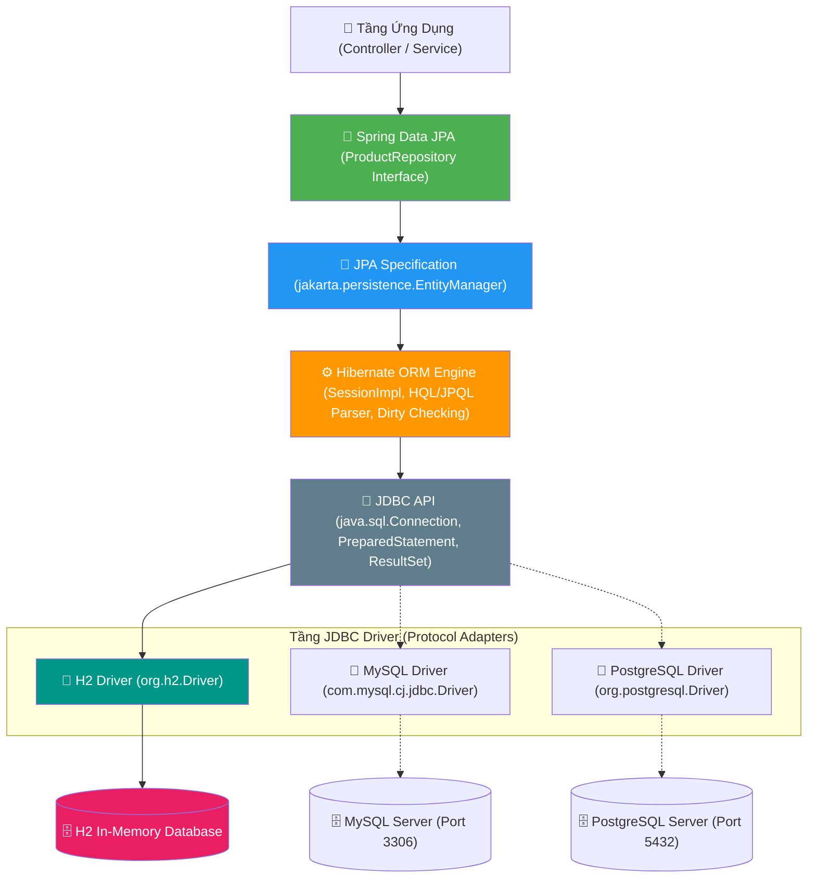

---

### 2.3. Cơ chế Hibernate đóng gói và tự động hóa toàn bộ thao tác JDBC

Framework Hibernate đóng gói (encapsulate) toàn bộ quy trình JDBC phức tạp bên trong. Lập trình viên không cần viết bất kỳ dòng mã nào liên quan đến `Connection`, `PreparedStatement` hay `ResultSet`.

Khi bạn gọi phương thức trong [ProductService.java](file:///Users/vovantu/HTML_CSS/JAVA%20/springboot-learning/src/main/java/com/example/springbootlearning/service/ProductService.java#L138):
```java
Product saved = productRepository.save(product);
```

Hibernate âm thầm điều phối một chuỗi xử lý JDBC hoàn chỉnh sau hậu trường:

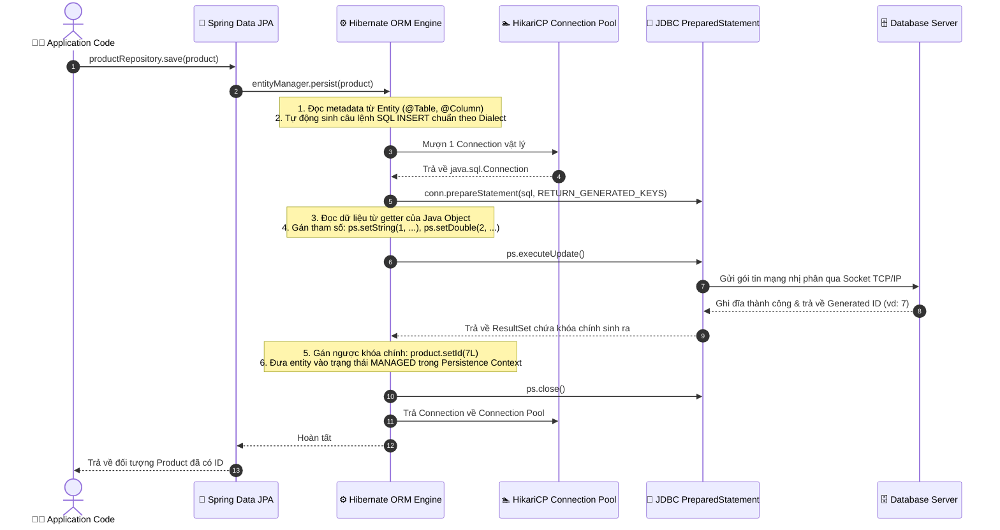

---

### 2.4. Bảng đối chiếu: Thao tác Java vs Thao tác JDBC ngầm vs SQL sinh ra

| Thao tác trên Java Code | Thao tác JDBC do Hibernate tự động thực hiện | Câu lệnh SQL Hibernate tự sinh |
| :--- | :--- | :--- |
| `productRepository.findAll()` | Mở connection, tạo Statement, duyệt con trỏ `while (rs.next())`, khởi tạo các instance `new Product()`, map dữ liệu từng cột vào setter, gom thành `List<Product>`. | `SELECT p.id, p.name, p.price, p.category, p.stock, p.created_at, p.updated_at FROM products p;` |
| `productRepository.findById(1L)` | Mượn connection, tạo `PreparedStatement`, bind tham số `ps.setLong(1, 1L)`, đọc `ResultSet`, đóng gói vào `Optional<Product>`. | `SELECT p.id, p.name, p.price... FROM products p WHERE p.id = ?;` |
| `productRepository.save(product)` *(id = null)* | Mượn connection, bind toàn bộ thuộc tính của entity vào câu INSERT, lấy generated ID từ DB gán ngược lại vào `product.setId(...)`. | `INSERT INTO products (name, description, price, category, stock, created_at, updated_at) VALUES (?, ?, ?, ?, ?, ?, ?);` |
| `productRepository.save(product)` *(id đã tồn tại)* | Kiểm tra bản ghi trong Persistence Context / DB. Nếu đã tồn tại, thực thi câu lệnh UPDATE trên các trường thay đổi. | `UPDATE products SET name = ?, price = ?, updated_at = ? WHERE id = ?;` |
| `productRepository.deleteById(1L)` | Mượn connection, bind ID vào lệnh `DELETE`, thực thi `executeUpdate()`, giải phóng tài nguyên. | `DELETE FROM products WHERE id = ?;` |
| `product.setPrice(1999.0);` *(trong phương thức `@Transactional`)* | **Dirty Checking:** Hibernate so sánh đối tượng Managed với bản Snapshot lúc nạp. Khi transaction kết thúc (commit), Hibernate tự động sinh và gửi lệnh `UPDATE` xuống DB mà **không cần gọi `save()`**. | `UPDATE products SET price = 1999.0, updated_at = ? WHERE id = ?;` |

---

### 2.5. Phân định ranh giới kiến trúc: JPA vs Hibernate vs Spring Data JPA

#### 2.5.1. Bảng phân định chính xác vai trò của 3 thành phần

| Thành phần | Vai trò chuẩn kỹ thuật | Ý nghĩa thực tế |
| :--- | :--- | :--- |
| **JPA** | **Specification** *(Đặc tả tiêu chuẩn)* | Bộ Interface & Annotation chuẩn (`EntityManager`, `@Entity`, `@Id`...). Nó chỉ là "hợp đồng", không có code thực thi bên trong. |
| **Hibernate** | **Implementation** *(Triển khai cụ thể)* | **Chính Hibernate mới là bên hiện thực hóa JPA**. Hibernate viết toàn bộ code logic cho `EntityManager` (thông qua class `SessionImpl`), xử lý Dirty Checking, Session, Caching, sinh câu lệnh SQL. |
| **Spring Data JPA** | **High-level Abstraction** *(Lớp bọc trừu tượng hóa bậc cao)* | **Không phải bên hiện thực hóa JPA**, mà là bên **ĐƠN GIẢN HÓA** việc sử dụng JPA & Hibernate cho lập trình viên. |

#### 2.5.2. Nếu KHÔNG CÓ Spring Data JPA: Thao tác thủ công qua EntityManager

Nếu dự án chỉ có JPA + Hibernate (chưa có Spring Data JPA), mỗi khi muốn thao tác với database, lập trình viên bắt buộc phải tự tay viết class Repository/DAO và tự gọi `EntityManager`:

```java
// ❌ Khi CHƯA CÓ Spring Data JPA: Bạn phải tự viết class triển khai thủ công
@Repository
public class ProductRepositoryImpl {

    @PersistenceContext
    private EntityManager entityManager; // Interface chuẩn của JPA

    public Product findById(Long id) {
        // Phải tự gọi EntityManager của JPA (bên dưới Hibernate thực thi)
        return entityManager.find(Product.class, id); 
    }

    public void save(Product product) {
        entityManager.persist(product);
    }

    public void delete(Long id) {
        Product p = findById(id);
        if (p != null) {
            entityManager.remove(p);
        }
    }
}
```

> [!WARNING]
> Nếu dự án có 10 Entity thì bạn phải viết 10 class DAO/Repository lặp đi lặp lại những hàm `find`, `persist`, `remove` như trên. Đây chính là lượng mã trùng lặp (Boilerplate Code) khổng lồ gây tốn thời gian bảo trì.

#### 2.5.3. Khi CÓ Spring Data JPA: Tự động hóa qua Dynamic Proxy & SimpleJpaRepository

Spring Data JPA ra đời để xóa bỏ toàn bộ mã lặp đó. Bạn chỉ cần viết đúng một dòng khai báo interface:

```java
public interface ProductRepository extends JpaRepository<Product, Long> {
    // Không cần viết bất kỳ dòng mã triển khai nào!
}
```

**Cơ chế hoạt động bên dưới của Spring Data JPA:**
1. Lúc ứng dụng khởi động, Spring Data JPA tạo ra một class đại diện ngầm (**Dynamic Proxy**) implement interface `ProductRepository`. Mặc định, proxy này ủy thác lời gọi cho class `SimpleJpaRepository` có sẵn của Spring.
2. Trong `SimpleJpaRepository`, Spring Data JPA **tự động gọi đến `EntityManager` của JPA**.
3. Do dự án tích hợp Hibernate, **`EntityManager` sẽ gọi trực tiếp đến Hibernate Engine** để sinh SQL và gửi qua JDBC Driver.

#### 2.5.4. Sơ đồ chuỗi gọi hàm thực tế (Call Chain) từ Service xuống Database

Khi lập trình viên gọi `productRepository.save(product)` trong [ProductService.java](file:///Users/vovantu/HTML_CSS/JAVA%20/springboot-learning/src/main/java/com/example/springbootlearning/service/ProductService.java#L138), luồng gọi hàm được chuyển tiếp xuyên suốt các tầng:

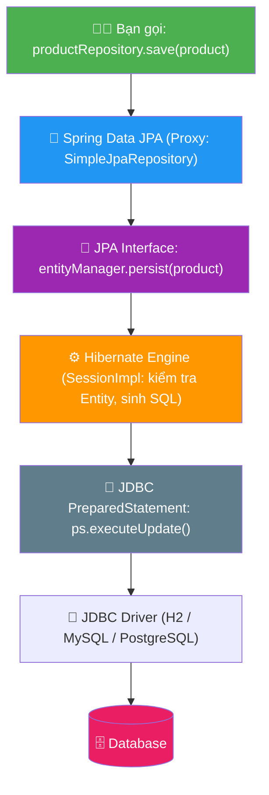

> [!TIP]
> **Đúc kết cốt lõi:**
> * **JPA đặt ra luật chơi:** *"Muốn lưu dữ liệu thì phải có hàm `persist()` trong `EntityManager`"*.
> * **Hibernate thực hiện luật chơi:** *"Tôi viết code xử lý cho hàm `persist()` đó, tự sinh SQL và gửi qua JDBC"*.
> * **Spring Data JPA phục vụ lập trình viên:** *"Bạn thậm chí không cần tự gọi `persist()`, bạn chỉ cần khai báo interface `JpaRepository`, tôi sẽ tự sinh class gọi `persist()` của Hibernate thay bạn!"*.

---

### 2.6. Minh chứng thực tế từ mã nguồn dự án

Kiến trúc trên được triển khai nhất quán và chuẩn xác trong các file mã nguồn của dự án:
1. **Khai báo Driver và ORM Framework:** Trong file [pom.xml](file:///Users/vovantu/HTML_CSS/JAVA%20/springboot-learning/pom.xml#L51-L61), chúng ta khai báo `spring-boot-starter-data-jpa` (kéo theo JPA API + Hibernate Engine) và `h2` (JDBC Driver cho H2 Database).
2. **Cấu hình thông số kết nối và Driver:** Trong file [application.properties](file:///Users/vovantu/HTML_CSS/JAVA%20/springboot-learning/src/main/resources/application.properties#L53-L64), `spring.datasource.driver-class-name=org.h2.Driver` và `spring.datasource.url=jdbc:h2:mem:testdb` chỉ định Driver và URL.
3. **Định nghĩa Entity:** File [Product.java](file:///Users/vovantu/HTML_CSS/JAVA%20/springboot-learning/src/main/java/com/example/springbootlearning/model/Product.java#L25-L65) sử dụng các annotation của JPA (`@Entity`, `@Table`, `@Id`, `@Column`) để khai báo ánh xạ cột dữ liệu.
4. **Data Access Layer:** File [ProductRepository.java](file:///Users/vovantu/HTML_CSS/JAVA%20/springboot-learning/src/main/java/com/example/springbootlearning/repository/ProductRepository.java#L25-L58) kế thừa `JpaRepository<Product, Long>` để Spring Data JPA tự động sinh proxy thực thi.
5. **Business Service Layer:** File [ProductService.java](file:///Users/vovantu/HTML_CSS/JAVA%20/springboot-learning/src/main/java/com/example/springbootlearning/service/ProductService.java#L115-L145) thực hiện các thao tác thuần túy trên Java object và quản lý ranh giới giao dịch bằng `@Transactional`.

---

## PHẦN 3: ENTITY MAPPING — ÁNH XẠ OBJECT ↔ TABLE

### 3.1. Khái niệm Entity

**Entity** = Java class được đánh dấu `@Entity`, đại diện cho **một bảng** trong database.
Mỗi **instance** (object) của Entity = **một hàng (row)** trong bảng đó.
Mỗi **field** của Entity = **một cột (column)** trong bảng.

### 3.2. Sơ đồ ánh xạ: Product.java ↔ products table

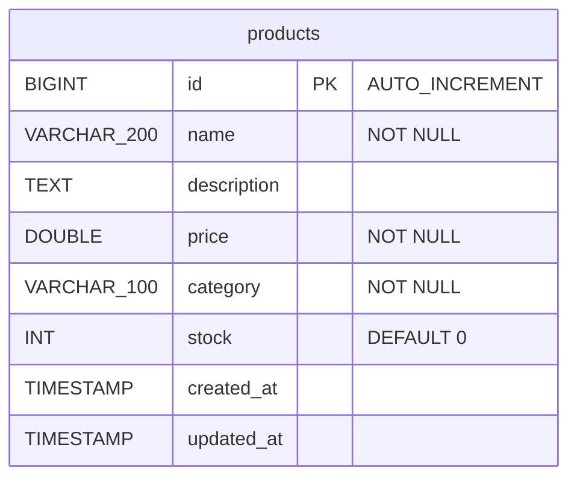

```
Java Entity (Product.java)              ←→    Database Table (products)
━━━━━━━━━━━━━━━━━━━━━━━━━━             ━━━━━━━━━━━━━━━━━━━━━━━━━━━
@Entity                                 TABLE products
@Table(name = "products")               
─────────────────────────               ───────────────────────────
@Id                                     id BIGINT PRIMARY KEY
@GeneratedValue(IDENTITY)               AUTO_INCREMENT
─────────────────────────               ───────────────────────────
@Column(nullable=false, length=200)     name VARCHAR(200) NOT NULL
private String name;                    
─────────────────────────               ───────────────────────────
private String description;             description TEXT (nullable)
─────────────────────────               ───────────────────────────
@Column(nullable=false)                 price DOUBLE NOT NULL
private Double price;                   
```

### 3.3. Bảng annotation chi tiết

| Annotation | Vị trí | Chức năng | Bắt buộc? |
|:---|:---|:---|:---:|
| `@Entity` | Class | Đánh dấu class là JPA Entity (ánh xạ tới table) | ✅ |
| `@Table(name = "...")` | Class | Chỉ định tên bảng (mặc định = tên class) | ❌ |
| `@Id` | Field | Đánh dấu khóa chính (Primary Key) | ✅ |
| `@GeneratedValue(strategy)` | Field | Chiến lược sinh ID tự động | ❌ |
| `@Column(...)` | Field | Tùy chỉnh cột: name, nullable, length, unique | ❌ |
| `@Enumerated(EnumType.STRING)` | Field | Lưu enum dưới dạng String (thay vì ordinal) | ❌ |
| `@CreationTimestamp` | Field | Tự động gán thời gian khi INSERT | ❌ |
| `@UpdateTimestamp` | Field | Tự động cập nhật thời gian khi UPDATE | ❌ |

### 3.4. `@GeneratedValue` — Các chiến lược sinh ID

| Strategy | SQL tương ứng | Database hỗ trợ | Ưu/Nhược |
|:---|:---|:---|:---|
| `IDENTITY` | `AUTO_INCREMENT` | MySQL, H2, PostgreSQL | ✅ Đơn giản, ❌ Không batch insert |
| `SEQUENCE` | `CREATE SEQUENCE` | PostgreSQL, Oracle | ✅ Batch insert tốt, ❌ Cần tạo sequence |
| `TABLE` | Dùng bảng riêng lưu ID | Mọi DB | ❌ Chậm (pessimistic lock) |
| `AUTO` | Hibernate tự chọn | Mọi DB | ⚠️ Kết quả phụ thuộc DB |

> [!TIP]
> **Quy tắc thực tế:** Dùng `IDENTITY` cho MySQL/H2, dùng `SEQUENCE` cho PostgreSQL. `AUTO` gây bất ngờ (có thể chọn TABLE strategy → chậm).

### 3.5. `@Column` — Tùy chỉnh chi tiết cột

```java
@Column(
    name = "product_name",     // Tên cột trong DB (mặc định = tên field)
    nullable = false,          // NOT NULL constraint
    length = 200,              // VARCHAR(200) — chỉ áp dụng cho String
    unique = true,             // UNIQUE constraint
    columnDefinition = "TEXT"  // Override hoàn toàn kiểu cột
)
private String name;
```

### 3.6. Quy tắc bắt buộc của JPA Entity

JPA **bắt buộc** Entity class phải có:

| Yêu cầu | Lý do |
|:---|:---|
| `@Entity` annotation | Hibernate mới nhận diện đây là Entity |
| `@Id` trên một field | Mỗi Entity phải có Primary Key |
| **No-args constructor** (public hoặc protected) | Hibernate cần tạo instance qua reflection |
| **Không được final** class | Hibernate tạo proxy subclass cho Lazy Loading |

> [!WARNING]
> **Constructor mặc định là BẮT BUỘC!** Hibernate tạo entity instance bằng `Class.newInstance()` (reflection) → cần no-args constructor. Bạn có thể thêm constructor khác, nhưng phải giữ no-args constructor.

---

## PHẦN 4: JpaRepository — CRUD TỰ ĐỘNG

### 4.1. Cây kế thừa Repository

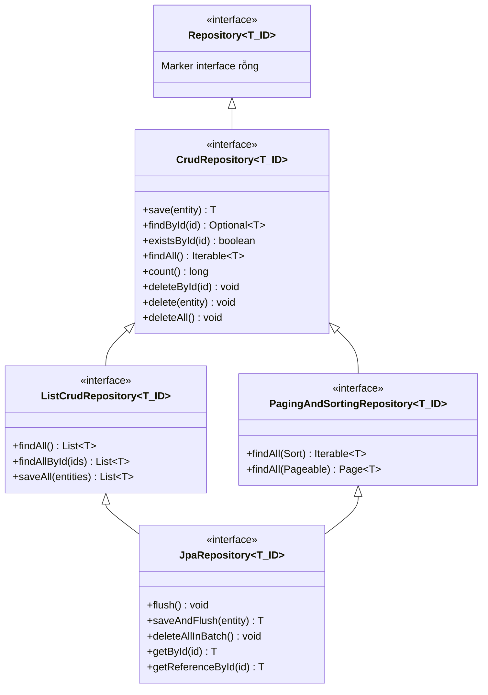

### 4.2. Cách sử dụng — Chỉ khai báo interface!

```java
// 📘 BÀI 9: CHỈ CẦN 1 DÒNG → có 40+ phương thức CRUD miễn phí!
public interface ProductRepository extends JpaRepository<Product, Long> {
    // ↑ Product = kiểu Entity
    //            ↑ Long = kiểu Primary Key

    // Không cần viết gì! Spring Data JPA tự tạo implementation class lúc runtime.
}
```

### 4.3. Bảng phương thức có sẵn từ JpaRepository

| Method | Mô tả | SQL tương đương |
|:---|:---|:---|
| `save(entity)` | Tạo mới hoặc cập nhật (nếu đã có ID) | `INSERT` hoặc `UPDATE` |
| `saveAll(entities)` | Lưu danh sách | Batch `INSERT/UPDATE` |
| `findById(id)` | Tìm theo ID, trả `Optional<T>` | `SELECT * WHERE id = ?` |
| `findAll()` | Lấy tất cả | `SELECT *` |
| `findAllById(ids)` | Lấy theo danh sách ID | `SELECT * WHERE id IN (...)` |
| `existsById(id)` | Kiểm tra tồn tại | `SELECT COUNT(*) WHERE id = ?` |
| `count()` | Đếm tổng số record | `SELECT COUNT(*)` |
| `deleteById(id)` | Xóa theo ID | `DELETE WHERE id = ?` |
| `delete(entity)` | Xóa entity | `DELETE WHERE id = ?` |
| `deleteAll()` | Xóa tất cả | `DELETE FROM products` |
| `flush()` | Đẩy thay đổi vào DB ngay | Force sync to DB |
| `saveAndFlush(entity)` | Save + flush ngay | `INSERT/UPDATE` ngay lập tức |

### 4.4. `save()` vừa INSERT vừa UPDATE — Phép thuật gì?

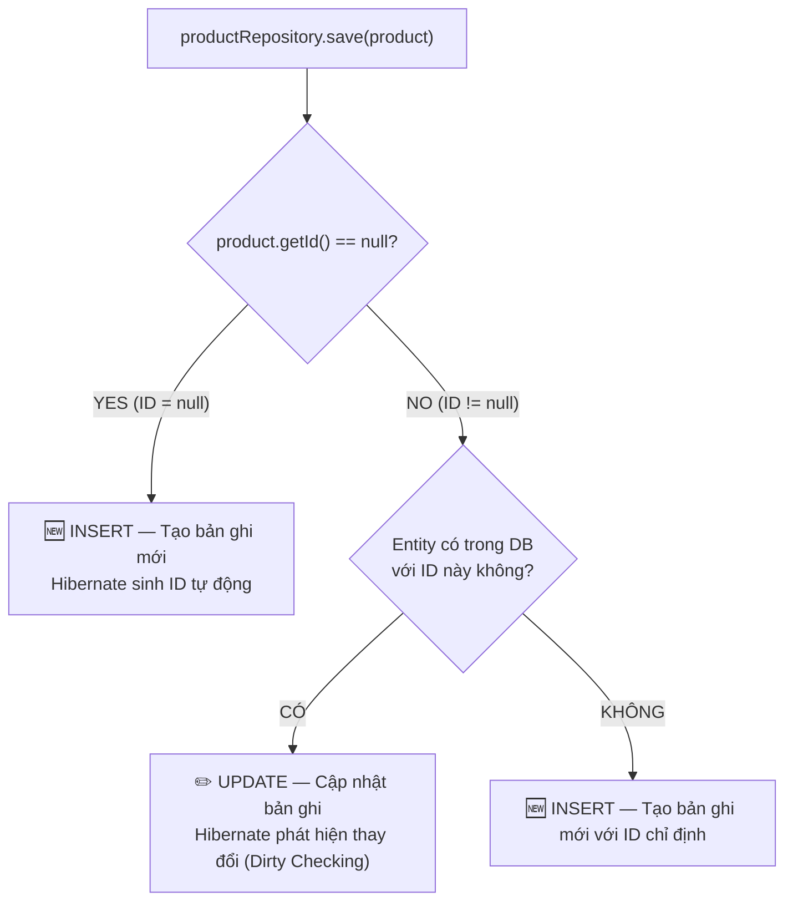

> [!NOTE]
> **Hibernate dùng `merge()` strategy:** Nếu entity có ID → Hibernate SELECT trước để check tồn tại → nếu có thì UPDATE, nếu không thì INSERT. Đây gọi là **upsert behavior**.

---

## PHẦN 5: H2 IN-MEMORY DATABASE & CẤU HÌNH KẾT NỐI

### 5.1. Tại sao dùng H2 cho phát triển?

| Tiêu chí | H2 In-Memory | MySQL/PostgreSQL |
|:---|:---|:---|
| **Cài đặt** | Không cần cài — chạy trong JVM | Phải cài + cấu hình riêng |
| **Tốc độ** | Siêu nhanh (RAM) | Phụ thuộc disk I/O |
| **Dữ liệu** | Mất khi restart app | Lưu trữ vĩnh viễn |
| **Phù hợp** | Development, Testing | Staging, Production |
| **Dependency** | `com.h2database:h2` | `mysql-connector-j` / `postgresql` |

### 5.2. Dependency cần thêm

```xml
<!-- 📘 BÀI 9: Spring Data JPA + H2 Database -->
<dependency>
    <groupId>org.springframework.boot</groupId>
    <artifactId>spring-boot-starter-data-jpa</artifactId>
</dependency>
<dependency>
    <groupId>com.h2database</groupId>
    <artifactId>h2</artifactId>
    <scope>runtime</scope>
</dependency>
```

### 5.3. Cấu hình `application.properties`

```properties
# ===================================================
# 📘 BÀI 9: Spring Data JPA — H2 Database
# ===================================================

# Datasource — H2 in-memory (tên database: springbootlearning)
spring.datasource.url=jdbc:h2:mem:springbootlearning
spring.datasource.driver-class-name=org.h2.Driver
spring.datasource.username=sa
spring.datasource.password=

# JPA / Hibernate
# ddl-auto = create-drop → Tạo table khi start, xóa khi stop
#   Các giá trị: none | validate | update | create | create-drop
spring.jpa.hibernate.ddl-auto=create-drop
spring.jpa.show-sql=true
spring.jpa.properties.hibernate.format_sql=true

# H2 Console — truy cập http://localhost:8080/h2-console
spring.h2.console.enabled=true
spring.h2.console.path=/h2-console
```

### 5.4. `ddl-auto` — Các chế độ quan trọng

| Giá trị | Hành vi | Khi nào dùng |
|:---|:---|:---|
| `create-drop` | Tạo table khi start → Xóa khi stop | ✅ Development, Testing |
| `create` | Tạo table khi start (không xóa khi stop) | Testing cần giữ data |
| `update` | Cập nhật schema (thêm cột mới, không xóa cột cũ) | ⚠️ Development (cẩn thận) |
| `validate` | Chỉ kiểm tra schema khớp Entity | ✅ Production |
| `none` | Không làm gì | ✅ Production (dùng Flyway/Liquibase) |

> [!CAUTION]
> **KHÔNG BAO GIỜ dùng `create-drop` hoặc `create` trong Production!** Nó sẽ XÓA TOÀN BỘ dữ liệu. Production nên dùng `validate` + database migration tool (Flyway — Bài 12).

### 5.5. Luồng khởi động sau khi thêm JPA

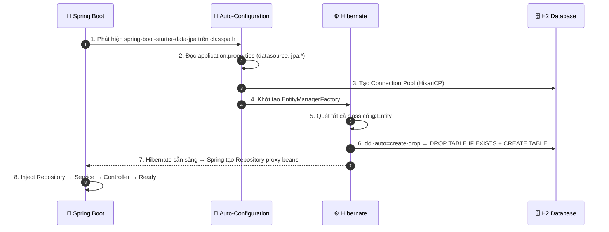

---

## PHẦN 6: REFACTOR PRODUCT API — ARRAYLIST → JPA

### 6.1. Sơ đồ thay đổi Before/After

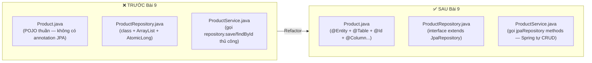

### 6.2. Bước 1: Chuyển `Product.java` POJO → JPA Entity

**Trước (Bài 4):** Product chỉ là POJO thuần — không có annotation JPA nào.

**Sau (Bài 9):** Thêm `@Entity`, `@Table`, `@Id`, `@GeneratedValue`, `@Column`, `@CreationTimestamp`, `@UpdateTimestamp`.

```java
@Entity
@Table(name = "products")
public class Product {

    @Id
    @GeneratedValue(strategy = GenerationType.IDENTITY)
    private Long id;

    @Column(nullable = false, length = 200)
    private String name;

    @Column(columnDefinition = "TEXT")
    private String description;

    @Column(nullable = false)
    private Double price;

    @Column(nullable = false, length = 100)
    private String category;

    @Column(nullable = false)
    private Integer stock = 0;

    @CreationTimestamp
    @Column(updatable = false)    // Không cho UPDATE cột này
    private LocalDateTime createdAt;

    @UpdateTimestamp
    private LocalDateTime updatedAt;

    // No-args constructor — BẮT BUỘC cho JPA/Hibernate
    public Product() { }

    // Getters & Setters (giữ nguyên)...
}
```

### 6.3. Bước 2: Chuyển `ProductRepository` class → interface

**Trước (Bài 4):** ProductRepository là **class** với `ArrayList`, `AtomicLong`, và 7 phương thức viết tay.

**Sau (Bài 9):** ProductRepository là **interface** extends `JpaRepository` — 1 dòng code, 40+ phương thức miễn phí!

```java
// 📘 BÀI 9: Từ ~100 dòng code → 1 dòng interface!
public interface ProductRepository extends JpaRepository<Product, Long> {
    // Spring Data JPA tự tạo implementation class lúc runtime.
    // Đã có sẵn: save, findById, findAll, deleteById, count, existsById...

    // Custom query methods (Spring tự sinh SQL từ tên method)
    List<Product> findByCategoryIgnoreCase(String category);
    List<Product> findByNameContainingIgnoreCase(String keyword);
    List<Product> findByPriceBetween(Double minPrice, Double maxPrice);
    boolean existsByNameIgnoreCase(String name);
}
```

### 6.4. Bước 3: Refactor `ProductService`

Service thay đổi chủ yếu ở các chỗ gọi repository. JPA `save()` vừa INSERT vừa UPDATE, `deleteById()` tự xóa.

Các thay đổi chính:
- `productRepository.save(product)` → **giữ nguyên** tên method (JPA save = INSERT hoặc UPDATE)
- `productRepository.findById(id)` → **giữ nguyên** (đã trả `Optional<Product>`)
- `productRepository.findAll()` → **giữ nguyên** (JPA cũng trả `List<Product>`)
- `productRepository.update(id, product)` → **XÓA** (JPA dùng `save()` cho cả UPDATE)
- `productRepository.deleteById(id)` → **giữ nguyên** tên method
- `productRepository.existsByName(name)` → `existsByNameIgnoreCase(name)` (query method)

### 6.5. Bước 4: Seed Data với `data.sql`

Khi dùng JPA, không nên seed data trong constructor repository nữa. Dùng file `data.sql`:

```sql
-- src/main/resources/data.sql
-- Hibernate chạy file này SAU KHI tạo xong bảng (ddl-auto = create-drop)

INSERT INTO products (name, description, price, category, stock, created_at, updated_at)
VALUES ('MacBook Pro M3', 'Laptop cao cấp của Apple', 2499.99, 'Laptop', 25, NOW(), NOW());

INSERT INTO products (name, description, price, category, stock, created_at, updated_at)
VALUES ('iPhone 16 Pro', 'Điện thoại flagship Apple', 1199.99, 'Smartphone', 100, NOW(), NOW());
-- ...
```

Cần thêm config để Hibernate chạy `data.sql` sau khi khởi tạo schema:

```properties
# Chạy data.sql SAU KHI Hibernate tạo schema (ddl-auto)
spring.jpa.defer-datasource-initialization=true
```

---

## PHẦN 7: FIX LỖI FAVICON.ICO NORESOURCEFOUNDEXCEPTION

### 7.1. Nguyên nhân

Khi truy cập Swagger UI, trình duyệt tự động request `GET /favicon.ico`. Spring MVC không tìm thấy file `favicon.ico` → ném `NoResourceFoundException` → `GlobalExceptionHandler` catch-all trả `500`.

### 7.2. Cách fix

Thêm handler riêng cho `NoResourceFoundException` vào `GlobalExceptionHandler`:

```java
@ExceptionHandler(NoResourceFoundException.class)
public ResponseEntity<ApiResponse<?>> handleNoResourceFound(NoResourceFoundException ex) {
    log.debug("Resource not found: {}", ex.getMessage());
    return ResponseEntity
            .status(HttpStatus.NOT_FOUND)
            .body(ApiResponse.error(404, "Không tìm thấy tài nguyên: " + ex.getResourcePath()));
}
```

---

## PHẦN 8: KIẾN THỨC CHUYÊN SÂU — PERSISTENCE CONTEXT & DIRTY CHECKING

### 8.1. Bản chất kỹ thuật của Persistence Context

**Persistence Context** là một **vùng đệm nhớ tạm thời (First-Level Cache / Identity Map)** được quản lý bởi `EntityManager` (trong JPA) hoặc `Session` (trong Hibernate). 

> [!IMPORTANT]
> **Quy tắc cốt lõi về vòng đời:**
> 1. **Ranh giới tồn tại:** Persistence Context **gắn liền với phạm vi của một Transaction (`@Transactional`)**, KHÔNG PHẢI chỉ tồn tại trong chốc lát khi gọi một phương thức repository rồi tắt ngay.
> 2. **Cơ chế hoãn thực thi (Write-Behind Pattern):** Khi lập trình viên gọi các phương thức sửa đổi dữ liệu trên Java Object, **câu lệnh SQL thường CHƯA HỀ ĐƯỢC CHẠY NGAY XUỐNG DATABASE**. Hibernate lưu tạm các thay đổi trên RAM, tối ưu hóa lại và chỉ xả (`flush`) toàn bộ câu lệnh SQL xuống database vào thời điểm kết thúc Transaction (ngay trước khi `commit`).

```
Bắt đầu @Transactional ➔ Khởi tạo Persistence Context (First-Level Cache)
     │
     ├── 1. Nạp/Lưu Entity vào vùng nhớ (trở thành MANAGED)
     ├── 2. Thay đổi thuộc tính Java Object (Hibernate âm thầm ghi nhận trên RAM)
     ├── 3. Thay đổi tiếp thuộc tính khác (VẪN CHƯA BẮN LỆNH SQL XUỐNG DB!)
     │
Kết thúc @Transactional ➔ Chuẩn bị Commit
     │
     ├── 4. BƯỚC FLUSH: Dirty Checking (đối chiếu snapshot) ➔ Bắn SQL xuống Database
     └── 5. COMMIT DATABASE ➔ Đóng Persistence Context ➔ Entity chuyển sang DETACHED
```

---

### 8.2. Vòng đời và 4 trạng thái của Entity (Entity Lifecycle States)

Mỗi Entity instance trong JPA luôn nằm ở một trong 4 trạng thái xác định đối với Persistence Context:

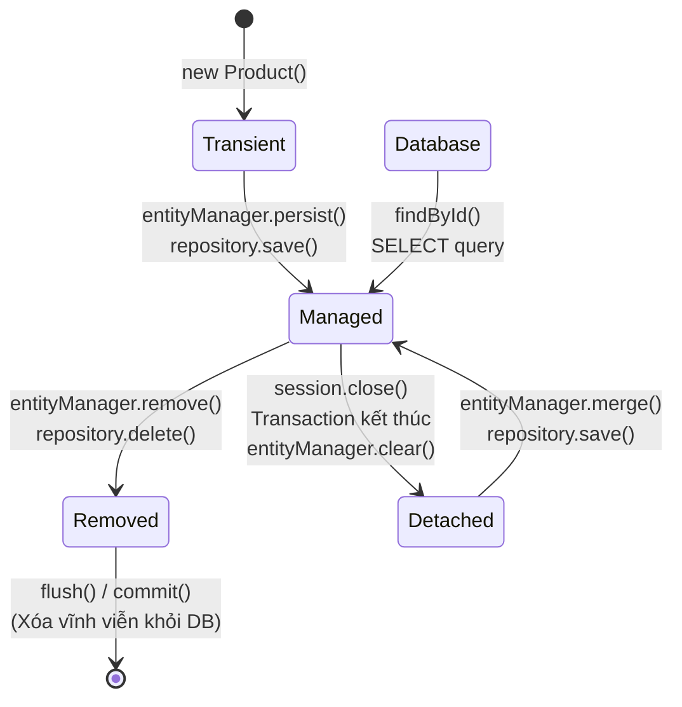

#### Bảng tổng hợp chi tiết 4 trạng thái Entity

| Trạng thái | Vị trí lưu trữ | Tồn tại trong DB? | Được Hibernate theo dõi (Tracked)? | Phương thức kích hoạt |
| :--- | :--- | :---: | :---: | :--- |
| **Transient (New)** | Chỉ nằm trong heap memory của JVM | ❌ Chưa có | ❌ Không | Vừa khởi tạo bằng từ khóa `new Product()` |
| **Managed (Persistent)** | **Đang nằm trong Persistence Context** | ⏳ Sắp có (hoặc đã có) | ✅ **Có, theo dõi từng thuộc tính** | Sau khi gọi `save()`, `persist()`, hoặc truy vấn `findById()`, `findAll()` |
| **Detached** | Nằm ngoài Persistence Context (Transaction đã đóng) | ✅ Đã lưu trong DB | ❌ Ngừng theo dõi | Sau khi phương thức Service kết thúc, dữ liệu trả về Controller |
| **Removed** | Nằm trong Persistence Context nhưng bị đánh dấu xóa | ⏳ Sắp bị xóa | ✅ Theo dõi để chuẩn bị xóa | Sau khi gọi `delete()`, `remove()` |

---

### 8.3. Cơ chế hoạt động của Persistence Context trong một Transaction

Để hiểu rõ cách thức Persistence Context "hoãn" thực thi SQL và tự động phát hiện thay đổi (Dirty Checking), hãy xem xét phương thức `updateProduct` trong [ProductService.java](file:///Users/vovantu/HTML_CSS/JAVA%20/springboot-learning/src/main/java/com/example/springbootlearning/service/ProductService.java#L154):

```java
@Transactional // 🟢 1. BẮT ĐẦU TRANSACTION: Khởi tạo Persistence Context
public ProductResponse updateProduct(Long id, ProductUpdateRequest request) {

    // 🟢 2. Tải Entity từ Database lên:
    // Hibernate nạp Product vào Persistence Context và tạo 2 bản ghi trong RAM:
    //   - Bản 1: Managed Entity (đối tượng đang thao tác)
    //   - Bản 2: Snapshot Record (bản chụp dữ liệu gốc ban đầu)
    Product product = productRepository.findById(id)
            .orElseThrow(() -> new ResourceNotFoundException("Product", "id", id));

    // 🟢 3. Thao tác trên đối tượng Java:
    product.setName(request.getName());   // ⚠️ LÚC NÀY CHƯA CÓ SQL NÀO CHẠY!
    product.setPrice(request.getPrice()); // ⚠️ VẪN CHƯA CÓ SQL NÀO CHẠY!
    product.setStock(50);                 // ⚠️ VẪN CHƯA CÓ SQL NÀO CHẠY!

    // Đối với Managed Entity trong @Transactional, thậm chí KHÔNG CẦN gọi save():
    // productRepository.save(product); // Có thể bỏ qua nhờ Dirty Checking!

    return ProductResponse.fromEntity(product);

} // 🔴 4. KẾT THÚC TRANSACTION: Kích hoạt quá trình Flush và Commit!
```

#### Sơ đồ trình tự diễn giải chi tiết (Sequence Diagram)

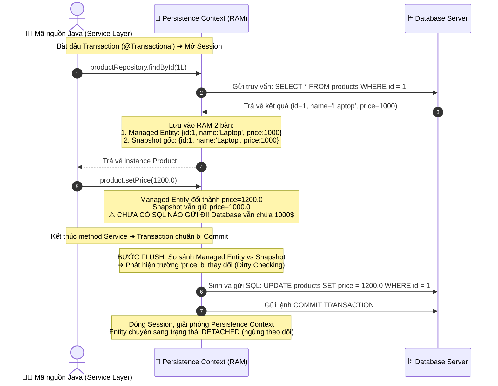

---

### 8.4. Ba lợi ích kỹ thuật cốt lõi của Persistence Context

Hibernate thiết kế cơ chế Persistence Context nhằm giải quyết 3 bài toán hiệu năng quan trọng trong các hệ thống doanh nghiệp:

#### ① Giảm tải số lượng truy vấn mạng (Write-Behind & SQL Batching)
Nếu trong một quy trình nghiệp vụ phức tạp, bạn cập nhật thuộc tính của một sản phẩm 5 lần liên tiếp:
* **JDBC thuần:** Bắt buộc gửi 5 câu lệnh `UPDATE` độc lập qua giao thức mạng TCP/IP, gây nghẽn I/O.
* **Hibernate với Persistence Context:** Mọi thay đổi chỉ diễn ra cục bộ trên RAM. Đến cuối giao dịch, Hibernate tổng hợp trạng thái cuối cùng và **chỉ phát sinh đúng 1 câu lệnh `UPDATE` duy nhất**.

#### ② Bộ nhớ đệm cấp 1 (First-Level Cache / Repeatable Read in Session)
Trong phạm vi cùng một Transaction, nếu mã nguồn gọi `productRepository.findById(1L)` ở 3 tầng nghiệp vụ khác nhau:
* **Lần 1:** Hibernate truy vấn trực tiếp từ Database và lưu kết quả vào Persistence Context.
* **Lần 2 và 3:** Hibernate kiểm tra ID = 1 đã tồn tại trong vùng nhớ Persistence Context ➔ **Trả ngay đối tượng trong RAM về, hoàn toàn không tốn thêm bất kỳ truy vấn SQL nào xuống Database**.

#### ③ Tự động đồng bộ trạng thái (Automatic Dirty Checking)
Nhờ cơ chế so sánh liên tục giữa Managed Entity và bản Snapshot lưu trữ trong RAM:
* Lập trình viên chỉ cần tập trung thao tác nghiệp vụ trên các phương thức domain (như `product.setPrice()`, `product.setStock()`).
* Không cần phải gọi thủ công các phương thức lưu (`save()`, `update()`), loại bỏ hoàn toàn nguy cơ quên cập nhật dữ liệu.

---

### 8.5. Cấu hình `spring.jpa.open-in-view` (OSIV) và khuyến nghị Production

Spring Boot **mặc định kích hoạt** cấu hình:
```properties
spring.jpa.open-in-view=true
```

* **Cơ chế hoạt động:** Giữ Persistence Context (và giữ kết nối Database Connection) mở liên tục trong suốt vòng đời của HTTP Request — từ Servlet Filter, Controller, cho đến khi render xong Response trả về cho Client.
* **Ưu điểm:** Giúp lập trình viên không bao giờ bị lỗi `LazyInitializationException` khi truy cập các thuộc tính Lazy trong Controller.
* **Nhược điểm nghiêm trọng:** Giữ Connection quá lâu khiến Connection Pool (HikariCP) bị cạn kiệt nhanh chóng khi hệ thống có tải lượng truy cập cao (High Concurrency).

> [!TIP]
> **Khuyến nghị chuẩn Production:** Luôn tắt OSIV trong [application.properties](file:///Users/vovantu/HTML_CSS/JAVA%20/springboot-learning/src/main/resources/application.properties#L77):
> ```properties
> spring.jpa.open-in-view=false
> ```
> Việc truy xuất dữ liệu Lazy cần được kiểm soát chặt chẽ trong tầng Service bằng các kỹ thuật `JOIN FETCH` hoặc `@EntityGraph`.

---

## PHẦN 9: TỔNG KẾT & SO SÁNH BEFORE/AFTER

### 9.1. Kiến trúc tổng quan sau Bài 1-9

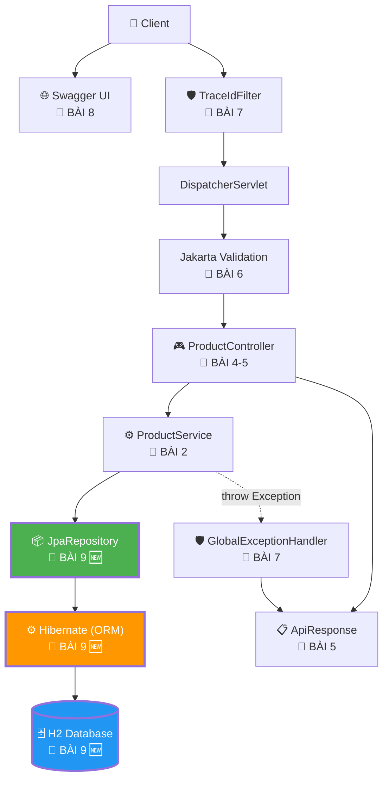

### 9.2. So sánh ProductRepository: Before vs After

| | Trước Bài 9 (In-Memory) | Sau Bài 9 (JPA) |
|:---|:---|:---|
| **Kiểu** | `class ProductRepository` | `interface ProductRepository extends JpaRepository` |
| **Dòng code** | ~110 dòng | ~10 dòng (chỉ khai báo query methods) |
| **Lưu trữ** | `ArrayList` trong RAM | H2/MySQL/PostgreSQL |
| **ID sinh** | `AtomicLong` | `@GeneratedValue(IDENTITY)` |
| **Dữ liệu** | Mất khi restart | Lưu trữ vĩnh viễn (trừ H2 in-memory) |
| **CRUD** | Viết thủ công 7 method | 40+ method có sẵn từ JpaRepository |
| **Query** | Stream API filter | Spring tự sinh SQL từ method name |
| **Thread-safe** | Phải tự quản lý | Database + Transaction tự lo |

### 9.3. ✅ Checklist hoàn thành Bài 9

- [ ] Thêm dependencies: `spring-boot-starter-data-jpa`, `h2`
- [ ] Cấu hình `application.properties`: datasource, jpa, h2-console
- [ ] Chuyển `Product.java` POJO → JPA Entity (`@Entity`, `@Table`, `@Id`, `@Column`...)
- [ ] Chuyển `ProductRepository` class → interface extends `JpaRepository`
- [ ] Refactor `ProductService` dùng JPA methods
- [ ] Tạo `data.sql` seed data
- [ ] Fix `NoResourceFoundException` cho favicon.ico
- [ ] Chạy ứng dụng, truy cập `http://localhost:8080/h2-console`
- [ ] Test CRUD qua Swagger UI, kiểm tra data trong H2 Console

---

## PHẦN 10: CÂU HỎI PHỎNG VẤN (INTERVIEW QUESTIONS)

### Câu 1: Phân biệt JPA, Hibernate, và Spring Data JPA?
**Trả lời:**
- **JPA** (Jakarta Persistence API): Đặc tả (specification) định nghĩa API chuẩn cho ORM trong Java. Nó chỉ là tập hợp interface và annotation, không thể chạy độc lập.
- **Hibernate**: Thư viện (implementation) triển khai cụ thể JPA specification. Nó là ORM framework thực sự chạy SQL, quản lý Entity lifecycle, caching, lazy loading.
- **Spring Data JPA**: Lớp trừu tượng (abstraction) đơn giản hóa việc dùng JPA. Bạn chỉ khai báo interface extends `JpaRepository`, Spring tự tạo implementation class lúc runtime — không cần viết code CRUD.

### Câu 2: `@Entity` class bắt buộc phải có gì?
**Trả lời:**
4 yêu cầu bắt buộc:
1. Annotation `@Entity` trên class
2. Một field đánh dấu `@Id` (primary key)
3. **No-args constructor** (public hoặc protected) — Hibernate dùng reflection để tạo instance
4. Class **không được `final`** — Hibernate cần tạo proxy subclass cho Lazy Loading

### Câu 3: `save()` trong JpaRepository khi nào INSERT, khi nào UPDATE?
**Trả lời:**
- Nếu entity **chưa có ID** (id = null) → `save()` thực hiện **INSERT** (tạo mới).
- Nếu entity **đã có ID** → Hibernate SELECT kiểm tra record có tồn tại trong DB không:
  - Tồn tại → **UPDATE** (merge)
  - Không tồn tại → **INSERT**

Đây gọi là **upsert behavior** của Spring Data JPA.

### Câu 4: `ddl-auto=update` có an toàn cho Production không?
**Trả lời:**
**KHÔNG!** `update` có thể:
- Thêm cột mới → OK
- Nhưng **không bao giờ xóa** cột cũ (dù entity đã bỏ field) → schema drift
- Không hỗ trợ rename column, change data type → phải thủ công
- Không có rollback mechanism

Production nên dùng `validate` + database migration tool (Flyway/Liquibase) để quản lý schema thay đổi một cách kiểm soát, có version, có rollback.

### Câu 5: Persistence Context là gì? Dirty Checking hoạt động thế nào?
**Trả lời:**
- **Persistence Context** (hay Session) = vùng bộ nhớ Hibernate dùng để theo dõi (track) các entity. Mỗi entity được load từ DB sẽ ở trạng thái **Managed** trong Persistence Context.
- **Dirty Checking**: Hibernate giữ bản sao (snapshot) của entity khi load lần đầu. Khi transaction commit hoặc EntityManager flush, Hibernate so sánh entity hiện tại với snapshot — nếu có field thay đổi → tự sinh `UPDATE` SQL.
- Lợi ích: không cần gọi `save()` rõ ràng cho entity Managed — chỉ cần `setXxx()` rồi commit.

### Câu 6: `GenerationType.IDENTITY` vs `SEQUENCE` — khi nào dùng cái nào?
**Trả lời:**
- **IDENTITY** (`AUTO_INCREMENT`): Đơn giản, MySQL/H2 hỗ trợ native. Nhược điểm: Hibernate **không thể batch insert** vì phải chờ DB trả ID sau mỗi INSERT (phá vỡ JDBC batching).
- **SEQUENCE**: Hibernate có thể **allocate ID trước** từ sequence → hỗ trợ batch insert hiệu quả. PostgreSQL, Oracle hỗ trợ native.
- Quy tắc: MySQL → `IDENTITY`, PostgreSQL → `SEQUENCE`, nếu cần batch insert performance → `SEQUENCE` (hoặc `@GenericGenerator` pool).

### Câu 7: Tại sao Entity class không được khai báo `final`?
**Trả lời:**
Hibernate dùng **CGLIB/ByteBuddy** để tạo **proxy subclass** cho Lazy Loading. Ví dụ: khi một entity khác reference `@ManyToOne(fetch = LAZY) Product product`, Hibernate tạo `Product$HibernateProxy` extends `Product` — proxy này chỉ chứa ID, khi access `product.getName()` mới thực sự query DB. Nếu `Product` là `final`, không thể extends → không tạo được proxy → Lazy Loading không hoạt động.

### Câu 8: `spring.jpa.open-in-view=true` (mặc định) có vấn đề gì?
**Trả lời:**
**OSIV (Open Session In View)** giữ Persistence Context (và database connection) mở suốt vòng đời request — từ Controller đến View rendering. Ưu điểm: không bị `LazyInitializationException` khi access lazy data trong Controller. Nhược điểm nghiêm trọng:
- Giữ connection lâu → **connection pool exhaustion** khi traffic cao
- Vi phạm **Separation of Concerns**: Controller/View có thể trigger query bất ngờ (N+1 problem)
- Best practice production: tắt OSIV (`false`) và xử lý lazy loading rõ ràng trong Service layer (dùng `JOIN FETCH` hoặc `@EntityGraph`).

### Câu 9: `@Column(updatable = false)` dùng khi nào?
**Trả lời:**
Dùng cho field **chỉ ghi một lần khi INSERT, không bao giờ thay đổi khi UPDATE**. Ví dụ: `createdAt`, `createdBy`. Hibernate sẽ **loại field này** khỏi `UPDATE` SQL.

```java
@CreationTimestamp
@Column(updatable = false)  // Không bao giờ bị UPDATE
private LocalDateTime createdAt;
```

### Câu 10: Spring Data JPA tạo implementation class lúc runtime bằng cách nào?
**Trả lời:**
Spring sử dụng **JDK Dynamic Proxy** (hoặc CGLIB proxy) + **SimpleJpaRepository** class:
1. Lúc startup, Spring quét tất cả interface extends `Repository`/`JpaRepository`
2. Tạo proxy bean implement interface đó
3. Mỗi method gọi được route đến `SimpleJpaRepository` (implementation mặc định)
4. Với query method tùy chỉnh (vd `findByNameContaining`), Spring parse method name → sinh JPQL → Hibernate chuyển thành SQL
5. Kết quả: bạn khai báo interface, Spring tạo implementation class hoàn chỉnh lúc runtime — đây là "magic" của Spring Data.

---

## 📚 TÀI LIỆU LIÊN KẾT LIÊN QUAN TRONG DỰ ÁN

- [Product.java](file:///Users/vovantu/HTML_CSS/JAVA%20/springboot-learning/src/main/java/com/example/springbootlearning/model/Product.java) — JPA Entity
- [ProductRepository.java](file:///Users/vovantu/HTML_CSS/JAVA%20/springboot-learning/src/main/java/com/example/springbootlearning/repository/ProductRepository.java) — JpaRepository interface
- [ProductService.java](file:///Users/vovantu/HTML_CSS/JAVA%20/springboot-learning/src/main/java/com/example/springbootlearning/service/ProductService.java) — Service refactored cho JPA
- [GlobalExceptionHandler.java](file:///Users/vovantu/HTML_CSS/JAVA%20/springboot-learning/src/main/java/com/example/springbootlearning/exception/GlobalExceptionHandler.java) — Fix NoResourceFoundException
- [application.properties](file:///Users/vovantu/HTML_CSS/JAVA%20/springboot-learning/src/main/resources/application.properties) — Cấu hình JPA + H2
- [data.sql](file:///Users/vovantu/HTML_CSS/JAVA%20/springboot-learning/src/main/resources/data.sql) — Seed data
- [pom.xml](file:///Users/vovantu/HTML_CSS/JAVA%20/springboot-learning/pom.xml) — Dependencies
- [Bài 8: API Documentation](file:///Users/vovantu/HTML_CSS/JAVA%20/Note/Lesson08/bai-8-api-documentation-swagger-openapi.md) — Bài trước
