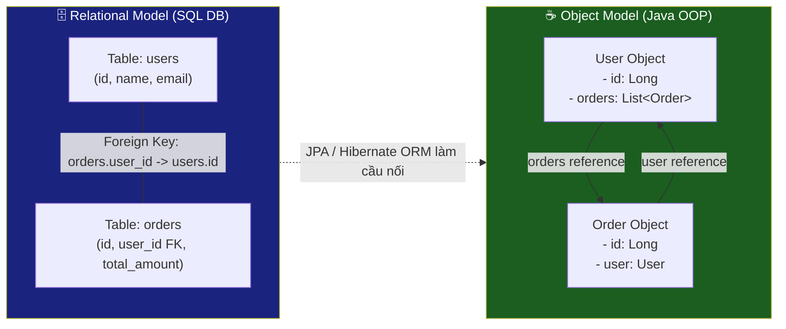
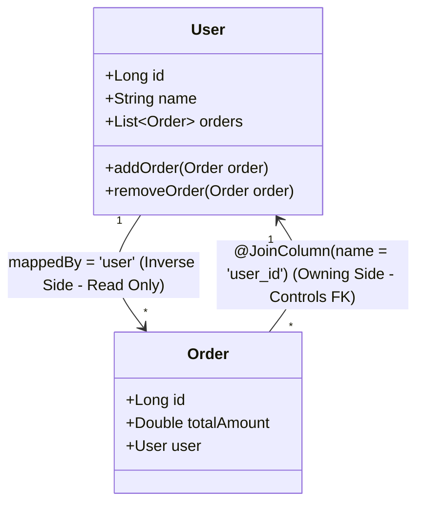
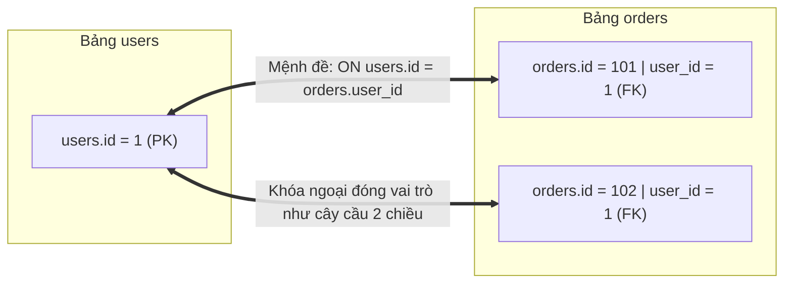
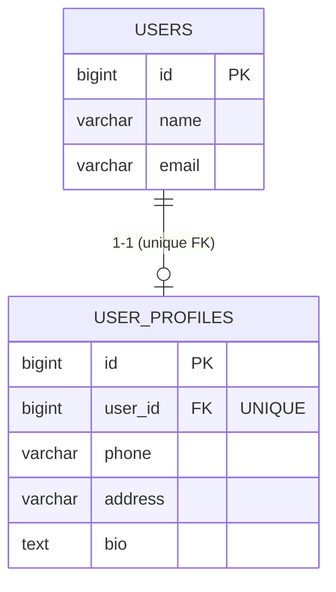
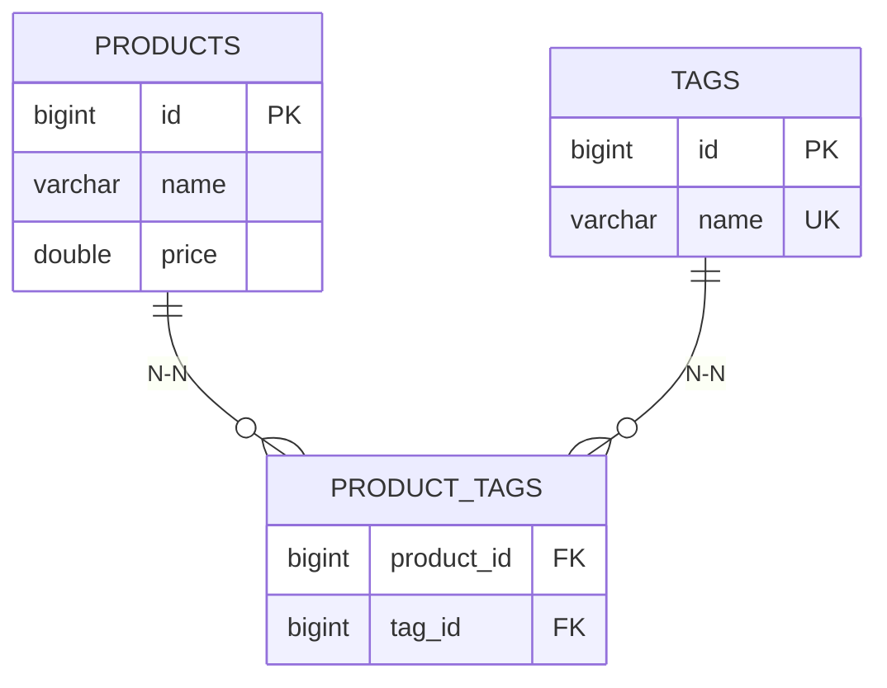
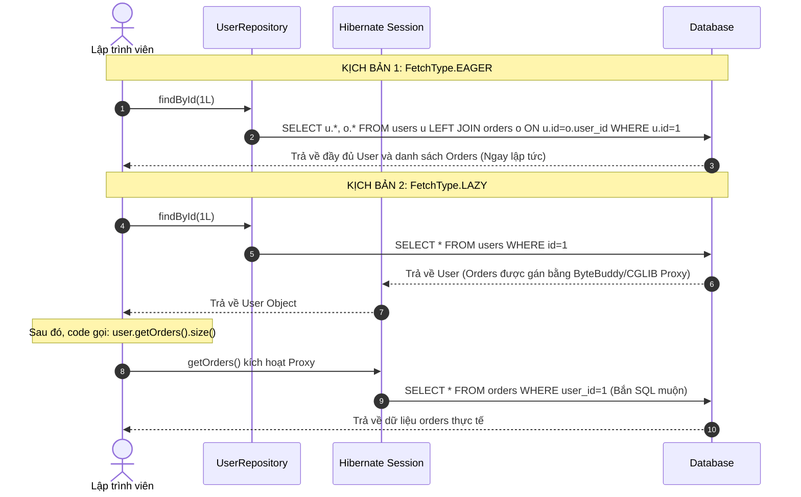
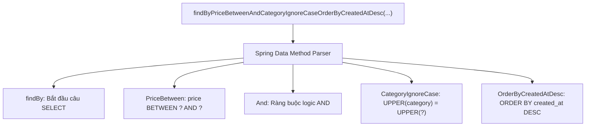
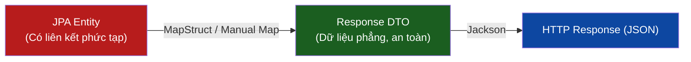

# 📘 BÀI 10: ENTITY RELATIONSHIPS & QUERY METHODS (SPRING DATA JPA & HIBERNATE)

> **Mục tiêu bài học:**
> 1. Hiểu **bản chất khóa ngoại (Foreign Key)** trong RDBMS và cách JPA ánh xạ sang **Object Reference** trong Java.
> 2. Phân biệt và làm chủ **Owning Side** vs **Inverse Side** (vai trò sống còn của `mappedBy`).
> 3. Triển khai chuẩn xác 4 loại quan hệ: `@ManyToOne`, `@OneToMany`, `@OneToOne`, `@ManyToMany`.
> 4. Hiểu sâu cơ chế **`FetchType.LAZY` vs `FetchType.EAGER`** và bẫy kinh điển **N+1 Query Problem**.
> 5. Nắm vững **Cascade Types** (`PERSIST`, `MERGE`, `REMOVE`...) và **`orphanRemoval`**.
> 6. Khai thác sức mạnh **Derived Query Methods** (Spring Data JPA tự sinh SQL).
> 7. Tối ưu truy vấn phức tạp bằng **`@Query` (JPQL & Native SQL)**, **`JOIN FETCH`** và **`@EntityGraph`**.
> 8. Chinh phục bộ câu hỏi phỏng vấn kiến trúc Data Access từ Junior đến Senior.

---

## 📑 MỤC LỤC

| STT | Chuyên đề | Trọng tâm kiến thức |
|:---:|:---|:---|
| 1 | 🔍 Vấn đề: Trở ngại không khớp mô hình (Impedance Mismatch) | Object Reference vs Foreign Key |
| 2 | 🧬 Bản chất Owning Side vs Inverse Side | `mappedBy`, ai ghi Foreign Key xuống DB? |
| 3 | 📐 Quan hệ 1-N & N-1 (`@OneToMany` & `@ManyToOne`) | Cặp đôi phổ biến nhất trong hệ thống thực tế |
| 4 | 📐 Quan hệ 1-1 (`@OneToOne`) | Tách bảng hiệu năng, `@MapsId` tối ưu |
| 5 | 📐 Quan hệ N-N (`@ManyToMany`) | Bảng trung gian, tại sao bắt buộc dùng `Set`? |
| 6 | ⚡ FetchType: LAZY vs EAGER & Bẫy N+1 Query | Cơ chế Proxy, Hibernate Session & N+1 |
| 7 | 🔗 Cascade Operations & `orphanRemoval` | Vòng đời phụ thuộc, dọn dẹp entity mồ côi |
| 8 | 🔎 Spring Data JPA Query Methods | Derived Queries: Cú pháp, từ khóa & quy ước |
| 9 | 📝 `@Query`: JPQL vs Native SQL | Viết query linh hoạt, tham số `@Param`, `@Modifying` |
| 10 | 🚀 3 Vũ khí diệt N+1 Query | `JOIN FETCH`, `@EntityGraph`, `@BatchSize` |
| 11 | 🛠️ Thực hành: Triển khai quan hệ & Query vào dự án | Cập nhật Entities, Repositories, Seed Data H2 |
| 12 | 🎯 Best Practices & Anti-patterns cần tránh | 10 nguyên tắc vàng thiết kế JPA Entity |
| 13 | 💼 Bộ câu hỏi phỏng vấn tuyển dụng (Interview Q&A) | Junior, Mid-level, Senior |
| 14 | 📚 Kiến thức chuyên sâu: Java Core & Design Patterns | `equals/hashCode`, Circular JSON, DTO Projection |

---

## PHẦN 1: 🔍 VẤN ĐỀ: IMPEDANCE MISMATCH (OBJECT VS RELATIONAL)

Trong công nghệ phần mềm, **Object-Relational Impedance Mismatch** là thuật ngữ chỉ sự xung đột bản chất giữa mô hình hướng đối tượng (Java) và mô hình dữ liệu quan hệ (RDBMS).



### So sánh bản chất quan hệ giữa 2 thế giới:

| Đặc điểm | Cơ sở dữ liệu quan hệ (RDBMS) | Lập trình hướng đối tượng (Java) |
|:---|:---|:---|
| **Cơ chế liên kết** | Khóa ngoại (**Foreign Key - FK**) | Tham chiếu con trỏ vùng nhớ (**Object Reference**) |
| **Tính định hướng** | **Vô hướng (Directionless):** Chỉ cần có FK, câu lệnh `JOIN` có thể xuất phát từ bảng bất kỳ. | **Có hướng (Directional):** Muốn từ User sang Order thì User phải có biến `orders`. Muốn ngược lại thì Order phải có biến `user`. |
| **Quan hệ N-N** | Bắt buộc tạo **bảng nối trung gian (Join Table)**. | Dùng các collection: `Set<T>` hoặc `List<T>`. |
| **Tính đa hình** | Không hỗ trợ nguyên bản (chỉ có bảng và cột thô). | Hỗ trợ kế thừa, đóng gói, đa hình đầy đủ. |

---

## PHẦN 2: 🧬 BẢN CHẤT OWNING SIDE VS INVERSE SIDE

### 2.1. Nguồn gốc của sự "bối rối" trong JPA/Hibernate
Khi bạn tạo một quan hệ hai chiều (**Bidirectional Relationship**) trong Java, bạn sẽ gặp một mâu thuẫn lớn giữa **Tư duy Cơ sở dữ liệu (SQL)** và **Tư duy Lập trình Hướng đối tượng (Java)**:

* **🔹 Trong Cơ sở dữ liệu quan hệ (RDBMS):**
  * Quan hệ 1 - N giữa bảng `users` và bảng `orders`: Bảng `orders` có cột khóa ngoại **`user_id`**.
  * Bảng `users` **không có cột nào** chứa danh sách order cả (vì Database không thể lưu cả mảng con trỏ vào một ô).
  * 👉 **Chân lý duy nhất trong Database:** Muốn biết đơn hàng này của ai, chỉ cần nhìn vào cột **`orders.user_id`**.
* **🔹 Trong Java (OOP):**
  * Để lập trình viên thao tác thuận tiện theo cả hai chiều trên bộ nhớ RAM, bạn khai báo:
    * Class `Order` có biến: `private User user;`
    * Class `User` có biến: `private List<Order> orders;`
  * Cả 2 đối tượng đều trỏ tới nhau trên bộ nhớ RAM.

> [!IMPORTANT]
> **"Hibernate bối rối" nghĩa là gì?**  
> Khi cả 2 đối tượng đều trỏ tới nhau trong Java, nếu lập trình viên vô tình gán mâu thuẫn (hoặc chỉ gán 1 bên), **Hibernate không biết phải dựa vào biến của Entity nào (`User` hay `Order`) để quyết định cập nhật giá trị cho cột khóa ngoại `user_id` trong Database**.  
> Do đó, JPA đưa ra quy tắc: **Phải dùng `mappedBy` để chỉ định rõ ràng Entity nào là người có tiếng nói duy nhất (Single Source of Truth).**



---

### 2.2. Định nghĩa kỹ thuật: Owning Side vs Inverse Side

| Tiêu chí | Owning Side (Bên sở hữu) | Inverse Side (Bên bị sở hữu / Mirror Side) |
| :--- | :--- | :--- |
| **Entity đại diện** | `Order` | `User` |
| **Thuộc tính khai báo** | `@ManyToOne`<br>`@JoinColumn(name = "user_id")` | `@OneToMany(mappedBy = "user")` |
| **Bản chất** | **Nắm giữ cột Foreign Key vật lý trong Database**. Mọi thay đổi trên field của Owning Side sẽ kích hoạt câu lệnh `INSERT` hoặc `UPDATE` khóa ngoại xuống database. | **Bên gương soi (Read-Only đối với khóa ngoại)**: Dùng để duyệt object thuận tiện trên RAM. Hoàn toàn vô hình đối với việc sinh câu lệnh SQL ghi Foreign Key. |
| **Dấu hiệu nhận biết** | Có `@JoinColumn` hoặc `@JoinTable`, **KHÔNG** có thuộc tính `mappedBy`. | **Luôn luôn có `mappedBy = "<tên field bên owning side>"`**. |

---

### 2.3. Giải đáp thắc mắc: "Bên User không có khóa ngoại thì truy vấn & tham chiếu kiểu gì?"

#### 1. Câu lệnh SQL từ bảng `users` JOIN sang bảng `orders`
Dù bảng `users` **không hề có khóa ngoại**, câu lệnh SQL vẫn cực kỳ đơn giản:

```sql
SELECT 
    u.id AS user_id,
    u.name AS user_name,
    o.id AS order_id,
    o.total_amount
FROM users u
LEFT JOIN orders o ON u.id = o.user_id   -- <-- CHÍNH LÀ CHỖ NÀY!
WHERE u.id = 1;
```
*(Thường dùng `LEFT JOIN` để nếu User đó chưa mua đơn hàng nào thì thông tin của User vẫn hiển thị ra).*

#### 2. Bên `users` không có khóa ngoại, vậy tham chiếu kiểu gì?
Trong thế giới Cơ sở dữ liệu quan hệ (RDBMS): **Khóa ngoại KHÔNG PHẢI là mũi tên 1 chiều**, mà nó là **một chiếc cầu nối 2 chiều bình đẳng**.

Hãy nhìn dữ liệu thực tế:

**Bảng `users` (Chỉ có Khóa chính `id`)**:
| id (PK) | name |
| :--- | :--- |
| **1** | Alice |
| **2** | Bob |

**Bảng `orders` (Có Khóa ngoại `user_id`)**:
| id | total_amount | user_id (FK) |
| :--- | :--- | :--- |
| 101 | 250.0 | **1** |
| 102 | 100.0 | **1** |
| 103 | 50.0 | **2** |

Khi thực hiện phép `JOIN`:
* Database không quan tâm ai là "chủ" hay ai có "khóa ngoại".
* Database chỉ làm một phép toán logic so khớp: *"Tìm tất cả các dòng ở bảng `orders` mà có `orders.user_id = users.id`"*.
* Dù bạn đứng từ `users` nhìn sang `orders`, hay từ `orders` nhìn về `users`, thì biểu thức so sánh **vẫn y hệt nhau**: 
  $$\text{users.id} == \text{orders.user_id}$$



#### 3. Vậy Hibernate làm thế nào để biết cách sinh câu SQL đó?
Chính là nhờ thuộc tính **`mappedBy = "user"`** mà bạn khai báo ở class `User`!

```java
@Entity
public class User {
    @Id
    private Long id;

    // mappedBy = "user" báo cho Hibernate biết:
    // "Muốn tìm orders của tôi, hãy sang bảng Order và tìm theo trường 'user'!"
    @OneToMany(mappedBy = "user") 
    private List<Order> orders;
}
```

Khi bạn viết mã Java:
```java
User user = userRepository.findById(1L).get();
List<Order> orders = user.getOrders(); // Bạn gọi hàm lấy orders
```

Hibernate nhìn vào thuộc tính `mappedBy = "user"`, nó tự hiểu:
1. À, `User` muốn lấy danh sách `orders`.
2. Ta sẽ sang class `Order`, xem trường `user` đang ánh xạ vào cột nào trong DB (đó là cột `user_id` nhờ `@JoinColumn(name = "user_id")`).
3. Hibernate liền tự động sinh câu lệnh SQL:
   ```sql
   SELECT * FROM orders WHERE user_id = 1;
   ```

> [!TIP]
> **💡 Tóm tắt ngắn gọn:**
> * **Ở Database:** Khóa ngoại `orders.user_id` tạo thành chiếc cầu nối giữa 2 bảng. Đứng ở bảng nào bạn cũng `JOIN` được nhờ điều kiện `u.id = o.user_id`.
> * **Ở Hibernate:** Thuộc tính `mappedBy = "user"` chính là chiếc "biển chỉ đường" để Hibernate biết đường sang bảng `orders` tìm những dòng có `user_id = user.id`.

---

### 2.4. Quy tắc ghi nhớ sống còn & Hệ quả thực tế khi code

> [!CAUTION]
> **Nếu bạn chỉ gán ở Inverse Side mà quên gán ở Owning Side, Hibernate SẼ KHÔNG BAO GIỜ lưu khóa ngoại vào database!**
> ```java
> // ❌ SAI: Chỉ add vào User, nhưng order.getUser() vẫn là null
> user.getOrders().add(newOrder);
> orderRepository.save(newOrder); 
> // -> Kết quả trong DB: cột `orders.user_id` sẽ bị NULL, vì Hibernate không quan tâm biến `orders` của User!
> 
> // ✅ ĐÚNG: Gán cho Owning Side (Order)
> newOrder.setUser(user);        // Dòng này mới là dòng quyết định lưu user_id vào DB!
> user.getOrders().add(newOrder); // Dòng này giúp đồng bộ dữ liệu trên RAM
> ```

---

## PHẦN 3: 📐 QUAN HỆ 1-N & N-1 (`@OneToMany` & `@ManyToOne`)

Đây là cặp quan hệ chiếm hơn 80% cấu trúc của các hệ thống doanh nghiệp (Ví dụ: 1 Khách hàng có nhiều Đơn hàng, 1 Danh mục có nhiều Sản phẩm, 1 Lớp học có nhiều Học viên).

### 3.1. Thiết kế Database Schema
```sql
CREATE TABLE users (
    id BIGINT AUTO_INCREMENT PRIMARY KEY,
    name VARCHAR(100) NOT NULL,
    email VARCHAR(150) NOT NULL UNIQUE
);

CREATE TABLE orders (
    id BIGINT AUTO_INCREMENT PRIMARY KEY,
    description VARCHAR(500),
    total_amount DOUBLE NOT NULL,
    status VARCHAR(50) NOT NULL,
    user_id BIGINT NOT NULL,
    created_at TIMESTAMP,
    CONSTRAINT fk_orders_user FOREIGN KEY (user_id) REFERENCES users(id)
);
```

### 3.2. Cấu hình Owning Side: `Order.java`
```java
package com.example.springbootlearning.model;

import jakarta.persistence.*;
import org.hibernate.annotations.CreationTimestamp;
import java.time.LocalDateTime;

@Entity
@Table(name = "orders") // "order" là từ khóa cấm trong SQL nên bắt buộc đổi thành "orders"
public class Order {

    @Id
    @GeneratedValue(strategy = GenerationType.IDENTITY)
    private Long id;

    @Column(name = "description", length = 500)
    private String description;

    @Column(name = "total_amount", nullable = false)
    private Double totalAmount;

    @Column(name = "status", nullable = false, length = 50)
    private String status;

    @CreationTimestamp
    @Column(name = "created_at", updatable = false)
    private LocalDateTime createdAt;

    // ========================================================
    // 🔑 OWNING SIDE: Cột FK "user_id" nằm ở bảng này
    // ========================================================
    @ManyToOne(fetch = FetchType.LAZY, optional = false)
    @JoinColumn(name = "user_id", nullable = false)
    private User user;

    public Order() {}

    public Order(String description, Double totalAmount, String status, User user) {
        this.description = description;
        this.totalAmount = totalAmount;
        this.status = status;
        this.user = user;
    }

    // Getters and Setters...
    public Long getId() { return id; }
    public void setId(Long id) { this.id = id; }
    public String getDescription() { return description; }
    public void setDescription(String description) { this.description = description; }
    public Double getTotalAmount() { return totalAmount; }
    public void setTotalAmount(Double totalAmount) { this.totalAmount = totalAmount; }
    public String getStatus() { return status; }
    public void setStatus(String status) { this.status = status; }
    public LocalDateTime getCreatedAt() { return createdAt; }
    public User getUser() { return user; }
    public void setUser(User user) { this.user = user; }
}
```

### 3.3. Cấu hình Inverse Side: `User.java` với Convenience Helper Methods
```java
package com.example.springbootlearning.model;

import jakarta.persistence.*;
import java.util.ArrayList;
import java.util.List;

@Entity
@Table(name = "users")
public class User {

    @Id
    @GeneratedValue(strategy = GenerationType.IDENTITY)
    private Long id;

    @Column(name = "name", nullable = false, length = 100)
    private String name;

    @Column(name = "email", nullable = false, unique = true, length = 150)
    private String email;

    // ========================================================
    // 📖 INVERSE SIDE: mappedBy trỏ chính xác vào field 'user' bên Order
    // ========================================================
    @OneToMany(
        mappedBy = "user",
        cascade = CascadeType.ALL,
        orphanRemoval = true,
        fetch = FetchType.LAZY
    )
    private List<Order> orders = new ArrayList<>();

    public User() {}

    public User(Long id, String name, String email) {
        this.id = id;
        this.name = name;
        this.email = email;
    }

    // ===== CONVENIENCE HELPER METHODS (Đồng bộ 2 chiều chuẩn Enterprise) =====
    public void addOrder(Order order) {
        this.orders.add(order);
        order.setUser(this); // Đảm bảo Owning Side luôn nhận được entity cha
    }

    public void removeOrder(Order order) {
        this.orders.remove(order);
        order.setUser(null);
    }

    // Getters and Setters...
    public Long getId() { return id; }
    public void setId(Long id) { this.id = id; }
    public String getName() { return name; }
    public void setName(String name) { this.name = name; }
    public String getEmail() { return email; }
    public void setEmail(String email) { this.email = email; }
    public List<Order> getOrders() { return orders; }
    public void setOrders(List<Order> orders) { this.orders = orders; }
}
```

---

## PHẦN 4: 📐 QUAN HỆ 1-1 (`@OneToOne`)

Ví dụ: Mỗi tài khoản người dùng (`User`) có duy nhất 1 hồ sơ cá nhân mở rộng (`UserProfile`) chứa địa chỉ, số điện thoại, tiểu sử.



### Code Implementation:
```java
@Entity
@Table(name = "user_profiles")
public class UserProfile {

    @Id
    @GeneratedValue(strategy = GenerationType.IDENTITY)
    private Long id;

    @Column(length = 20)
    private String phone;

    @Column(length = 500)
    private String address;

    @Column(columnDefinition = "TEXT")
    private String bio;

    // Owning side: Chứa cột user_id kèm ràng buộc UNIQUE để đảm bảo quan hệ 1-1
    @OneToOne(fetch = FetchType.LAZY)
    @JoinColumn(name = "user_id", unique = true, nullable = false)
    private User user;

    // Constructors, Getters & Setters...
}
```

> [!TIP]
> **Kỹ thuật tối ưu `@MapsId` cho `@OneToOne`:**
> Thay vì tạo cột `id` riêng cho `UserProfile` và thêm cột `user_id`, ta có thể để `UserProfile` dùng chung luôn khóa chính của `User`:
> ```java
> @Entity
> public class UserProfile {
>     @Id
>     private Long id; // Không có @GeneratedValue
>
>     @OneToOne(fetch = FetchType.LAZY)
>     @MapsId // Biến id của UserProfile thành chính id của User
>     @JoinColumn(name = "id")
>     private User user;
> }
> ```
> Ưu điểm: Không tốn thêm index cho FK, tiết kiệm bộ nhớ, tăng tốc độ truy vấn JOIN.

---

## PHẦN 5: 📐 QUAN HỆ N-N (`@ManyToMany`)

Ví dụ: Một sản phẩm (`Product`) có thể gắn nhiều thẻ phân loại (`Tag`), và một thẻ có thể gắn cho nhiều sản phẩm.



### 5.1. Entity Tag (`Tag.java` - Inverse Side)
```java
package com.example.springbootlearning.model;

import jakarta.persistence.*;
import java.util.HashSet;
import java.util.Set;

@Entity
@Table(name = "tags")
public class Tag {

    @Id
    @GeneratedValue(strategy = GenerationType.IDENTITY)
    private Long id;

    @Column(nullable = false, unique = true, length = 50)
    private String name;

    @ManyToMany(mappedBy = "tags", fetch = FetchType.LAZY)
    private Set<Product> products = new HashSet<>();

    public Tag() {}
    public Tag(String name) { this.name = name; }

    // Getters and Setters...
    public Long getId() { return id; }
    public void setId(Long id) { this.id = id; }
    public String getName() { return name; }
    public void setName(String name) { this.name = name; }
    public Set<Product> getProducts() { return products; }
    public void setProducts(Set<Product> products) { this.products = products; }

    @Override
    public boolean equals(Object o) {
        if (this == o) return true;
        if (!(o instanceof Tag tag)) return false;
        return id != null && id.equals(tag.getId());
    }

    @Override
    public int hashCode() {
        return getClass().hashCode();
    }
}
```

### 5.2. Cấu hình Owning Side trong `Product.java`
```java
// Trong Product.java:
@ManyToMany(fetch = FetchType.LAZY)
@JoinTable(
    name = "product_tags",
    joinColumns = @JoinColumn(name = "product_id"),
    inverseJoinColumns = @JoinColumn(name = "tag_id")
)
private Set<Tag> tags = new HashSet<>();

// Helper method đồng bộ
public void addTag(Tag tag) {
    this.tags.add(tag);
    tag.getProducts().add(this);
}

public void removeTag(Tag tag) {
    this.tags.remove(tag);
    tag.getProducts().remove(this);
}
```

> [!WARNING]
> **Tại sao @ManyToMany BẮT BUỘC dùng `Set` thay vì `List`?**
> Nếu dùng `List<Tag>`, mỗi khi bạn remove 1 Tag khỏi Product, Hibernate sẽ thực thi cơ chế tồi tệ nhất: **Xóa sạch toàn bộ các dòng của Product đó trong bảng `product_tags` (DELETE ALL), sau đó INSERT lại toàn bộ các phần tử còn lại**. Với `Set`, Hibernate sinh đúng 1 câu lệnh `DELETE ... WHERE product_id = ? AND tag_id = ?`.

---

## PHẦN 6: ⚡ FETCHTYPE: LAZY VS EAGER & BẪY N+1 QUERY

### 6.1. So sánh cơ chế hoạt động



| Tiêu chí | `FetchType.LAZY` | `FetchType.EAGER` |
|:---|:---|:---|
| **Cơ chế tải** | Trì hoãn cho đến khi gọi getter đầu tiên (thông qua Proxy) | Nạp ngay lập tức tại thời điểm query cha |
| **Giá trị mặc định** | `@OneToMany`, `@ManyToMany` | `@ManyToOne`, `@OneToOne` |
| **Rủi ro tiềm ẩn** | `LazyInitializationException` nếu Session đã đóng | Tốn RAM, nghẽn mạng do nạp thừa dữ liệu, gây N+1 |
| **Khuyến nghị kiến trúc** | **100% các quan hệ nên đặt LAZY** | Hạn chế tối đa sử dụng trong thực tế |

### 6.2. Thảm họa N+1 Query Problem là gì?
Giả sử hệ thống có 100 khách hàng (`User`), mỗi khách hàng có nhiều `Order`.
Bạn viết code:
```java
List<User> users = userRepository.findAll(); // Câu lệnh 1: SELECT * FROM users (trả về 100 dòng)

for (User user : users) {
    System.out.println(user.getName() + " có " + user.getOrders().size() + " đơn hàng");
    // Với mỗi vòng lặp, Hibernate âm thầm bắn 1 câu lệnh:
    // SELECT * FROM orders WHERE user_id = ?
}
```
* **Số câu lệnh SQL phát sinh:** **1** (lấy danh sách users) + **100** (lấy orders cho từng user) = **101 queries!**
* Nếu hệ thống có 10,000 users, cơ sở dữ liệu sẽ sập do chịu tải 10,001 truy vấn đồng thời.

---

## PHẦN 7: 🔗 CASCADE OPERATIONS & `orphanRemoval`

### 7.1. Bảng phân loại `CascadeType`
Cascade là cơ chế lan truyền thao tác quản lý vòng đời từ **Entity cha sang Entity con**:

| Loại Cascade | Khi Entity cha thực hiện | Entity con sẽ | Ứng dụng thực tế |
|:---|:---|:---|:---|
| `CascadeType.PERSIST` | `persist()` / `save()` mới | Tự động được lưu mới | Tạo Order cùng danh sách OrderItems |
| `CascadeType.MERGE` | `merge()` / cập nhật | Tự động cập nhật thuộc tính | Sửa thông tin User kèm Profile |
| `CascadeType.REMOVE` | `remove()` / `delete()` | Tự động bị xóa khỏi DB | Xóa Bài viết thì xóa toàn bộ Comment |
| `CascadeType.REFRESH` | `refresh()` đọc lại DB | Tự nạp lại dữ liệu mới | Đồng bộ dữ liệu real-time |
| `CascadeType.ALL` | Bao gồm toàn bộ các thao tác trên | Lan truyền toàn bộ | Chỉ dùng cho quan hệ Cha - Con sống còn |

### 7.2. So sánh `CascadeType.REMOVE` vs `orphanRemoval = true`
Đây là câu hỏi phân loại ứng viên cực kỳ phổ biến trong các buổi phỏng vấn:

```java
@OneToMany(mappedBy = "user", cascade = CascadeType.ALL, orphanRemoval = true)
private List<Order> orders = new ArrayList<>();
```

* **`CascadeType.REMOVE`:** Chỉ kích hoạt khi bạn **xóa thẳng User**: `userRepository.delete(user)`. Toàn bộ `orders` thuộc user đó sẽ bị xóa theo. Nhưng nếu bạn chỉ gỡ 1 order ra khỏi List: `user.getOrders().remove(0);`, Hibernate **KHÔNG XÓA** dòng đó trong database (nó chỉ cập nhật `user_id = NULL`).
* **`orphanRemoval = true`:** Khi một Entity con bị cắt đứt tham chiếu khỏi Collection của Entity cha (`user.getOrders().remove(order)`), Hibernate coi nó là "đứa trẻ mồ côi" và **tự động bắn lệnh `DELETE FROM orders WHERE id = ?` xuống database**.

---

## PHẦN 8: 🔎 SPRING DATA JPA QUERY METHODS (DERIVED QUERIES)

Spring Data JPA có khả năng phân tích cú pháp (Method Name Parsing) dựa trên quy tắc tiền tố để tự động sinh ra truy vấn SQL chính xác:



### Các từ khóa thông dụng nhất:
```java
public interface OrderRepository extends JpaRepository<Order, Long> {

    // 1. Tìm kiếm theo thuộc tính quan hệ (user.id)
    List<Order> findByUserId(Long userId);

    // 2. Kết hợp điều kiện AND, so sánh chuỗi
    List<Order> findByUserIdAndStatus(Long userId, String status);

    // 3. So sánh số (GreaterThan, LessThanEqual)
    List<Order> findByTotalAmountGreaterThan(Double amount);

    // 4. Khoảng giá trị (Between) và Thời gian
    List<Order> findByCreatedAtBetween(LocalDateTime from, LocalDateTime to);

    // 5. Kiểm tra tồn tại (Exists) và Đếm (Count)
    boolean existsByUserIdAndStatus(Long userId, String status);
    long countByStatus(String status);

    // 6. Giới hạn số lượng (Top/First) và Sắp xếp
    List<Order> findTop5ByOrderByTotalAmountDesc();
}
```

---

## PHẦN 9: 📝 `@QUERY`: JPQL VS NATIVE SQL

Khi câu truy vấn có logic nghiệp vụ phức tạp (nhiều bảng JOIN, nhóm GROUP BY, hàm thống kê), việc đặt tên hàm theo Derived Query sẽ khiến tên method dài hàng trăm ký tự. Lúc này, `@Query` là giải pháp tối ưu.

### 9.1. JPQL (Java Persistence Query Language)
* Truy vấn trên **Entity class** và **Object field**, hoàn toàn độc lập với hệ quản trị cơ sở dữ liệu bên dưới (Portable SQL).

```java
public interface OrderRepository extends JpaRepository<Order, Long> {

    // JPQL chuẩn: Dùng tên Entity (Order, User) và tên biến (totalAmount, status)
    @Query("SELECT o FROM Order o WHERE o.user.id = :userId AND o.totalAmount >= :minAmount ORDER BY o.createdAt DESC")
    List<Order> findHighValueOrders(
        @Param("userId") Long userId, 
        @Param("minAmount") Double minAmount
    );

    // Thống kê doanh thu theo trạng thái
    @Query("SELECT o.status, COUNT(o), SUM(o.totalAmount) FROM Order o GROUP BY o.status")
    List<Object[]> getOrderStatisticsByStatus();
}
```

### 9.2. Native SQL
* Truy vấn trực tiếp bằng cú pháp SQL thô của hệ quản trị cơ sở dữ liệu (MySQL, PostgreSQL, Oracle). Bật `nativeQuery = true`.

```java
public interface OrderRepository extends JpaRepository<Order, Long> {

    @Query(value = "SELECT * FROM orders WHERE created_at >= NOW() - INTERVAL 7 DAY", nativeQuery = true)
    List<Order> findRecentOrdersNative();
}
```

### 9.3. Cập nhật dữ liệu hàng loạt với `@Modifying`
Khi viết câu lệnh `UPDATE` hoặc `DELETE` tùy chỉnh bằng `@Query`, bắt buộc phải có annotation `@Modifying`:

```java
@Modifying(clearAutomatically = true) // Xóa sạch bộ nhớ First-level Cache tránh data cũ
@Transactional
@Query("UPDATE Order o SET o.status = :newStatus WHERE o.status = :oldStatus")
int updateOrderStatusBatch(@Param("oldStatus") String oldStatus, @Param("newStatus") String newStatus);
```

---

## PHẦN 10: 🚀 3 VŨ KHÍ DIỆT N+1 QUERY TRONG SPRING DATA JPA

Để giải quyết triệt để vấn đề N+1 Query đã nêu ở Phần 6, lập trình viên chuyên nghiệp sử dụng 3 kỹ thuật sau:

### 10.1. Vũ khí 1: `JOIN FETCH` (JPQL)
Bắt buộc Hibernate phải dùng câu lệnh `JOIN` để lấy cả Entity cha lẫn Collection con trong **1 câu SQL duy nhất**.

```java
public interface UserRepository extends JpaRepository<User, Long> {

    // 🚀 Dùng LEFT JOIN FETCH để lấy cả những user chưa có order nào
    // ⚠️ Bắt buộc có DISTINCT để loại bỏ các bản ghi User bị trùng lặp do kết quả phép JOIN tạo ra
    @Query("SELECT DISTINCT u FROM User u LEFT JOIN FETCH u.orders")
    List<User> findAllUsersWithOrders();

    @Query("SELECT u FROM User u LEFT JOIN FETCH u.orders WHERE u.id = :id")
    Optional<User> findByIdWithOrders(@Param("id") Long id);
}
```

### 10.2. Vũ khí 2: `@EntityGraph` (JPA 2.1+)
Cách giải quyết thanh lịch hơn mà không cần viết lại toàn bộ câu lệnh JPQL:

```java
public interface UserRepository extends JpaRepository<User, Long> {

    // Override lại hàm findAll() mặc định nhưng nạp EAGER cho quan hệ 'orders'
    @Override
    @EntityGraph(attributePaths = {"orders"})
    List<User> findAll();

    // Áp dụng linh hoạt trên Derived Query Method
    @EntityGraph(attributePaths = {"orders"})
    List<User> findByNameContainingIgnoreCase(String name);
}
```

### 10.3. Vũ khí 3: `@BatchSize` (Hibernate Specific)
Khi bạn có phân trang (Pagination) phức tạp mà `JOIN FETCH` không thể phân trang an toàn ở cấp độ SQL (gây ra cảnh báo *HHH000104: firstResult/maxResults specified with collection fetch; applying in memory!*), hãy dùng `@BatchSize`.

```java
// Trong User.java:
@OneToMany(mappedBy = "user", fetch = FetchType.LAZY)
@org.hibernate.annotations.BatchSize(size = 30) // Gom cụm 30 users trong 1 câu lệnh IN (...)
private List<Order> orders = new ArrayList<>();
```
* **Kết quả:** Thay vì bắn 100 câu truy vấn lẻ tẻ, Hibernate sẽ gom lại thành:
  `SELECT * FROM orders WHERE user_id IN (?, ?, ?, ... 30 ids ...)`
  → Giảm từ 101 câu query xuống còn khoảng **4 câu query**!

---

## PHẦN 11: 🛠️ THỰC HÀNH: TRIỂN KHAI QUAN HỆ & QUERY VÀO DỰ ÁN

Mô hình thực tế chúng ta triển khai vào dự án Spring Boot hiện tại:

```
[User] 1 <---> N [Order]
[Product] N <---> N [Tag]
```

### 11.1. Cập nhật `Order.java` và `Tag.java`
Tạo mới hai Entity [Order.java](file:///Users/vovantu/HTML_CSS/JAVA%20/springboot-learning/src/main/java/com/example/springbootlearning/model/Order.java) và [Tag.java](file:///Users/vovantu/HTML_CSS/JAVA%20/springboot-learning/src/main/java/com/example/springbootlearning/model/Tag.java) trong package model.

### 11.2. Mở rộng `User.java` và `Product.java`
- Thêm `List<Order> orders` vào [User.java](file:///Users/vovantu/HTML_CSS/JAVA%20/springboot-learning/src/main/java/com/example/springbootlearning/model/User.java).
- Thêm `Set<Tag> tags` vào [Product.java](file:///Users/vovantu/HTML_CSS/JAVA%20/springboot-learning/src/main/java/com/example/springbootlearning/model/Product.java).

### 11.3. Khởi tạo `OrderRepository.java` và `TagRepository.java`
Xây dựng repository chứa đầy đủ các Derived Query Methods và JPQL tối ưu.

### 11.4. Bổ sung Seed Data trong `data.sql`
Đảm bảo khi ứng dụng khởi động, dữ liệu mẫu của bảng `orders`, `tags`, và bảng trung gian `product_tags` được tự động nạp vào H2 in-memory database để sẵn sàng kiểm thử.

---

## PHẦN 12: 🎯 BEST PRACTICES & ANTI-PATTERNS CẦN TRÁNH

```
┌────────────────────────────────────────────────────────────────────────┐
│              10 NGUYÊN TẮC VÀNG VỀ JPA RELATIONSHIPS                  │
├────────────────────────────────────────────────────────────────────────┤
│ 1. Luôn dùng FetchType.LAZY cho mọi quan hệ (@ManyToOne, @OneToMany...).│
│ 2. Luôn xác định rõ Owning Side và viết Convenience Helper Methods.    │
│ 3. Tuyệt đối không dùng List cho @ManyToMany, bắt buộc dùng Set.       │
│ 4. Không dùng CascadeType.ALL cho @ManyToMany (tránh xóa nhầm tag).    │
│ 5. Tránh đặt quan hệ 2 chiều nếu nghiệp vụ chỉ cần duyệt 1 chiều.      │
│ 6. Luôn override equals() và hashCode() theo business key hoặc id.     │
│ 7. Không serialize trực tiếp Entity ra JSON để tránh lặp vô tận.       │
│ 8. Dùng JOIN FETCH hoặc @EntityGraph khi cần giải quyết N+1.           │
│ 9. Dùng @BatchSize khi cần load danh sách con kết hợp phân trang.      │
│ 10. Bật `spring.jpa.show-sql=true` và log bind params khi phát triển.  │
└────────────────────────────────────────────────────────────────────────┘
```

---

## PHẦN 13: 💼 BỘ CÂU HỎI PHỎNG VẤN TUYỂN DỤNG (INTERVIEW Q&A)

### 🟢 Cấp độ Junior
**Câu 1: Phân biệt `mappedBy` và `@JoinColumn`?**
* **Trả lời:** `@JoinColumn` được đặt ở **Owning Side** để chỉ định tên cột vật lý của khóa ngoại trong bảng database. Ngược lại, `mappedBy` được đặt ở **Inverse Side** để chỉ định tên của biến (field) bên phía Owning Side chịu trách nhiệm quản lý quan hệ. Bên có `mappedBy` không bao giờ sinh ra cột khóa ngoại.

**Câu 2: Tại sao quan hệ `@ManyToOne` mặc định là `EAGER` lại tiềm ẩn nguy cơ hiệu năng?**
* **Trả lời:** Vì khi load 1 danh sách 100 entity con, nếu quan hệ tới cha là EAGER, Hibernate có thể phát sinh thêm 100 câu query để lấy thông tin entity cha nếu không thực hiện phép JOIN chuẩn. Do đó, chuẩn thiết kế dự án luôn yêu cầu đổi tường minh sang `fetch = FetchType.LAZY`.

---

### 🟡 Cấp độ Mid-Level
**Câu 3: Làm thế nào để giải quyết triệt để lỗi `LazyInitializationException: could not initialize proxy - no Session`?**
* **Trả lời:** Lỗi này xảy ra khi truy cập vào một thuộc tính LAZY sau khi Hibernate Session (Persistence Context) đã đóng (thường là ngoài phạm vi của `@Transactional`).
  * **Cách giải quyết đúng:** 
    1. Dùng `JOIN FETCH` hoặc `@EntityGraph` để nạp dữ liệu cần thiết ngay từ tầng Service (khi Session còn mở).
    2. Map Entity sang DTO ngay tại Service Layer trước khi trả về Controller.
  * **Cách sai cần tránh:** Bật `spring.jpa.open-in-view=true` (OSIV) vì sẽ giữ connection DB mở quá lâu đến tận View layer, gây kiệt quệ Connection Pool.

**Câu 4: So sánh `CascadeType.REMOVE` và `orphanRemoval = true`?**
* **Trả lời:**
  * `CascadeType.REMOVE`: Kích hoạt khi thực hiện xóa Entity cha → tự động xóa các con.
  * `orphanRemoval = true`: Bao gồm cả hành vi trên, VÀ thêm hành vi: khi một Entity con bị gỡ khỏi Collection của cha (`parent.getChildren().remove(child)`), Hibernate sẽ tự động xóa dòng con đó khỏi DB.

---

### 🔴 Cấp độ Senior
**Câu 5: Tại sao việc kết hợp `JOIN FETCH` trên Collection với phân trang (`Pageable`) trong Hibernate lại là một Anti-Pattern nguy hiểm?**
* **Trả lời:** Trong cơ sở dữ liệu quan hệ, phép JOIN với bảng 1-N sẽ nhân bản số dòng của bảng cha. Nếu thực hiện `LIMIT / OFFSET` ở cấp độ SQL, database sẽ phân trang sai (ví dụ 1 user có 5 order, limit 5 sẽ chỉ lấy được 1 user thay vì 5 user).
  Hibernate khắc phục bằng cách tải **TOÀN BỘ dữ liệu vào bộ nhớ RAM của ứng dụng rồi mới phân trang bằng Java** (*In-Memory Pagination*), kèm cảnh báo log `HHH000104`. Nếu bảng có hàng triệu dòng, điều này sẽ gây tràn bộ nhớ (**OutOfMemoryError - OOM**).
  * **Giải pháp Senior:** Dùng phân trang không có `JOIN FETCH`, và kích hoạt `@BatchSize` trên collection con để tải lười theo lô hiệu năng cao!

**Câu 6: Cơ chế hoạt động bên dưới của Hibernate Proxy là gì?**
* **Trả lời:** Khi nạp một thực thể dạng `LAZY`, Hibernate không trả về đối tượng gốc mà trả về một lớp con động được tạo thông qua thư viện ByteBuddy (hoặc CGLIB ngày trước). Proxy này chỉ chứa duy nhất giá trị khóa chính (`Id`). Khi bất kỳ phương thức getter nào (ngoài `getId()`) được gọi, Proxy sẽ kiểm tra xem Session còn mở không, nếu còn nó sẽ phát câu lệnh SQL xuống DB để nạp dữ liệu thật và gán vào target instance (quá trình này gọi là *Lazy Loading Initialization*).

---

## PHẦN 14: 📚 KIẾN THỨC CHUYÊN SÂU: JAVA CORE & DESIGN PATTERNS

### 14.1. Bản chất `equals()` và `hashCode()` cho JPA Entity
Trong Java Core, `Set` và `Map` xác định sự trùng lặp dựa trên cặp hàm `equals()` và `hashCode()`.
Với JPA Entity, khóa chính `id` thường chỉ được sinh ra **sau khi entity đã được lưu xuống database** (`GenerationType.IDENTITY`).
* **Lỗi kinh điển khi dùng Lombok `@Data`:** Lombok sinh `equals()` và `hashCode()` dựa trên mọi trường. Trước khi lưu (`id = null`) và sau khi lưu (`id = 1`), mã băm `hashCode()` của đối tượng bị thay đổi! Nếu bạn đưa entity vào `HashSet` trước khi save, sau khi save bạn sẽ không thể tìm lại hoặc xóa nó khỏi `Set` nữa vì nó nằm sai hash bucket.
* **Chuẩn triển khai:**
```java
@Override
public boolean equals(Object o) {
    if (this == o) return true;
    if (!(o instanceof Tag tag)) return false;
    return id != null && id.equals(tag.getId());
}

@Override
public int hashCode() {
    return getClass().hashCode(); // Trả về hằng số cố định theo class
}
```

### 14.2. Vấn đề lặp vô tận khi Serialize JSON (Circular Dependency)
Khi hai Entity trỏ lẫn nhau (`User -> orders -> Order -> user`), thư viện Jackson sẽ duyệt đệ quy vô tận và ném ra lỗi `StackOverflowError`.
* **Quy tắc bất biến:** **Không bao giờ trả Entity trực tiếp ra Controller!**
* Luôn chuyển đổi sang **DTO (Data Transfer Object)** tại tầng Service:



---
*📅 Bản quyền tài liệu thuộc về Lộ trình Master Spring Boot Enterprise.*
