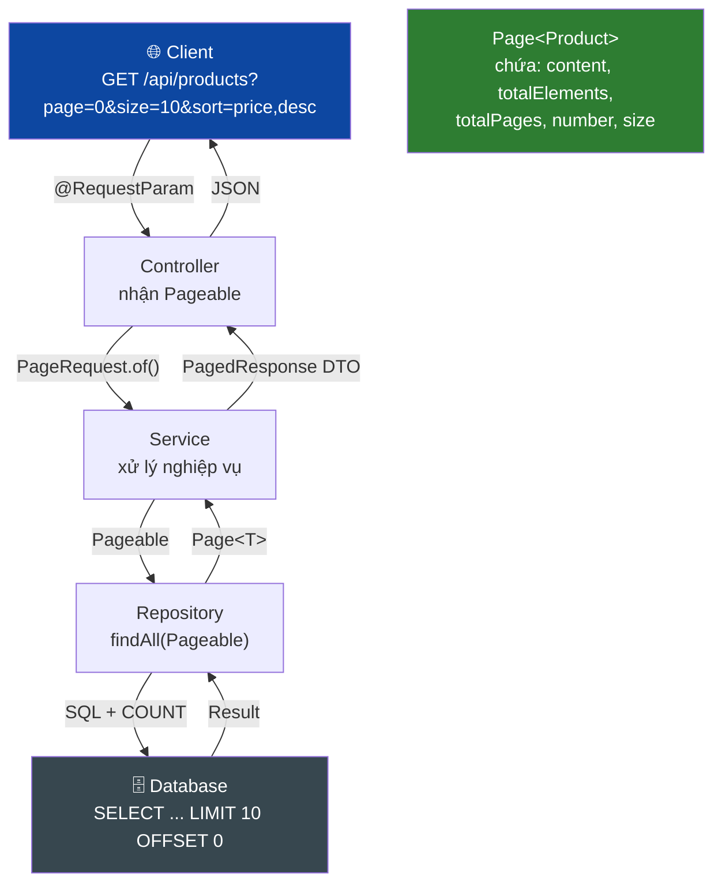
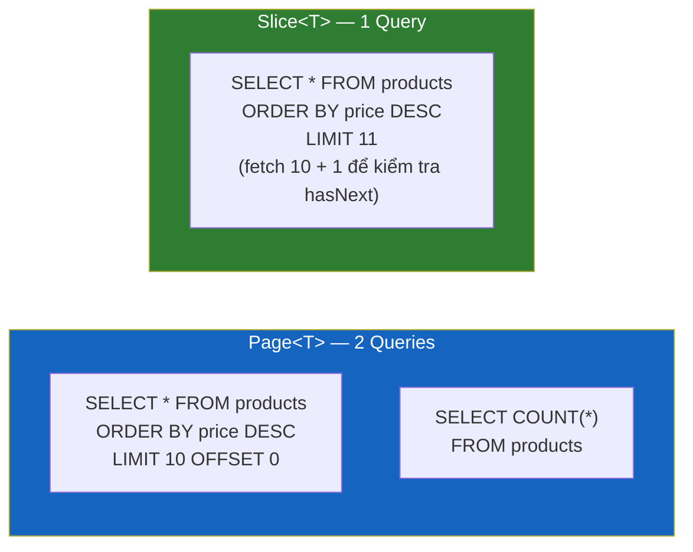
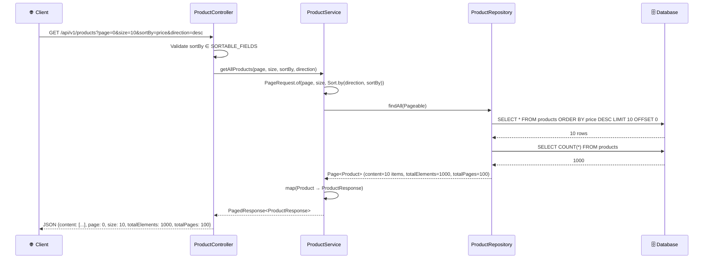
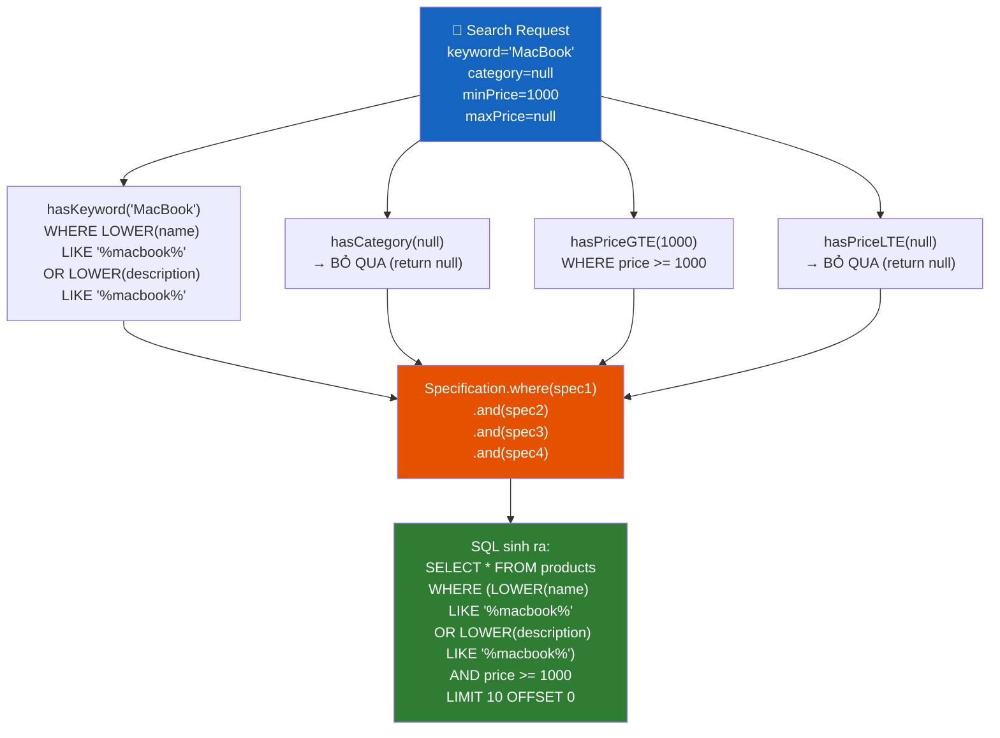
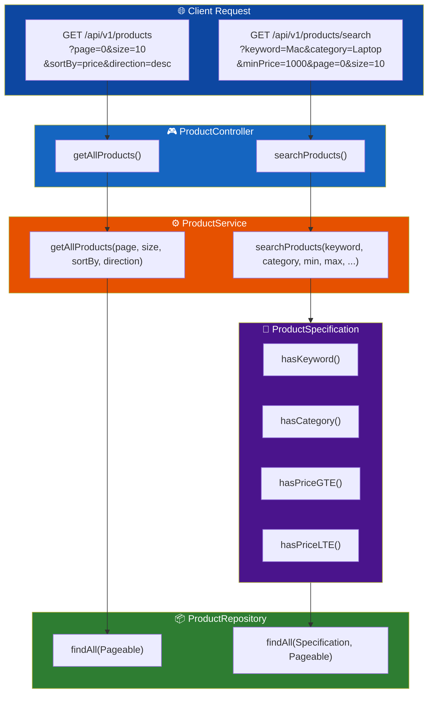
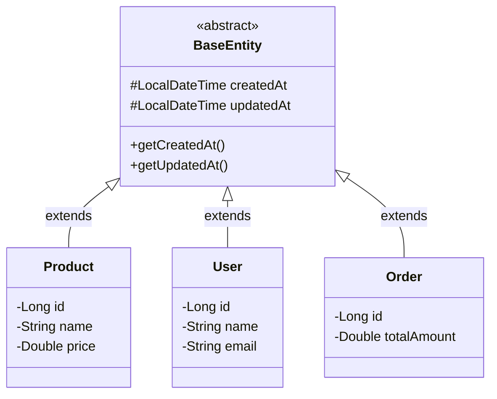

# 📘 BÀI 11: PAGINATION, SORTING & SPECIFICATIONS — TRUY VẤN DỮ LIỆU CHUYÊN NGHIỆP

> **Mục tiêu bài học:**
> 1. Hiểu **tại sao phân trang (Pagination)** là bắt buộc trong mọi hệ thống production — nguy cơ `OutOfMemoryError` khi dùng `findAll()`.
> 2. Thành thạo **`Pageable`**, **`PageRequest`**, **`Page<T>`**, **`Slice<T>`** — bộ API phân trang của Spring Data JPA.
> 3. Kết hợp **`Sort`** để sắp xếp dữ liệu linh hoạt theo nhiều tiêu chí.
> 4. Nắm vững **Specification Pattern** (JPA Criteria API) — xây dựng **Dynamic Query** cho tìm kiếm nâng cao.
> 5. Áp dụng **JPA Auditing** — tự động ghi `createdDate`, `lastModifiedDate`, `createdBy`, `lastModifiedBy`.
> 6. Triển khai API **phân trang + sắp xếp + lọc động** hoàn chỉnh vào dự án.

---

## 📑 MỤC LỤC

| Phần | Nội dung | Mục tiêu |
|:---:|:---|:---|
| 1 | 🔍 Vấn đề — Tại sao `findAll()` là "bom nổ chậm"? | Nhận diện Pain Point |
| 2 | 📐 Kiến trúc Phân Trang: `Pageable`, `Page<T>`, `Slice<T>` | Core API |
| 3 | 🔄 Sắp xếp dữ liệu với `Sort` | Sorting API |
| 4 | 🛠️ Tích hợp Pagination + Sorting vào Controller → Service → Repository | Code Walkthrough |
| 5 | 📦 Response DTO cho Phân Trang: `PagedResponse<T>` | API Design Pattern |
| 6 | 🔎 Specification Pattern — Dynamic Query Builder | JPA Criteria API |
| 7 | 📝 JPA Auditing — Tự động ghi thời gian & người thao tác | Cross-Cutting Concern |
| 8 | 💻 Thực hành — Triển khai vào dự án | Hands-on |
| 9 | 🔬 SQL mà Hibernate sinh ra khi phân trang | Deep Dive |
| 10 | 🎯 Best Practices & Anti-Patterns | Takeaway |
| 11 | 💼 Câu hỏi phỏng vấn (Interview Questions) | Chuẩn bị phỏng vấn |
| 12 | 📚 Kiến thức bổ sung: Java Core & Design Patterns | Nâng cao |
| 13 | 🔗 Tài liệu liên kết | References |

---

## PHẦN 1: 🔍 VẤN ĐỀ — TẠI SAO `findAll()` LÀ "BOM NỔ CHẬM"?

### 1.1. Kịch bản thực tế

```java
// ❌ Code "đơn giản" nhưng CỰC KỲ NGUY HIỂM trong production:
@GetMapping
public List<ProductResponse> getAllProducts() {
    return productRepository.findAll().stream()  // Load TOÀN BỘ 10 triệu sản phẩm vào RAM!
            .map(ProductResponse::fromEntity)
            .collect(Collectors.toList());
}
```

```
┌──────────────────────────────────────────────────────────────────────────┐
│  📊 Khi bảng products có 10,000,000 dòng:                              │
│                                                                          │
│  findAll() sẽ:                                                          │
│    1. Hibernate phát: SELECT * FROM products  (không LIMIT)             │
│    2. JDBC ResultSet trả về 10,000,000 rows                            │
│    3. Hibernate map mỗi row → 1 Product object (trong Persistence Context) │
│    4. Tổng RAM tiêu tốn: ~10M × 200 bytes/object ≈ 2GB RAM            │
│    5. Kết quả: 💀 java.lang.OutOfMemoryError: Java heap space          │
│                                                                          │
│  Thời gian phản hồi: 30-120 giây (nếu không OOM trước)                 │
│  Network payload: ~500MB JSON → Client timeout                         │
└──────────────────────────────────────────────────────────────────────────┘
```

### 1.2. So sánh: Không phân trang vs Có phân trang

| | ❌ Không phân trang (`findAll()`) | ✅ Có phân trang (`findAll(Pageable)`) |
|:---|:---|:---|
| **SQL** | `SELECT * FROM products` | `SELECT * FROM products LIMIT 20 OFFSET 0` |
| **Dữ liệu trả về** | 10,000,000 rows | 20 rows |
| **RAM tiêu tốn** | ~2GB | ~4KB |
| **Thời gian** | 30-120 giây | <50ms |
| **UX** | Client treo, timeout | Mượt mà, responsive |
| **Khả năng mở rộng** | ❌ Không thể scale | ✅ Scale tới hàng tỷ records |

---

## PHẦN 2: 📐 KIẾN TRÚC PHÂN TRANG: `Pageable`, `Page<T>`, `Slice<T>`

### 2.1. Sơ đồ kiến trúc tổng quan



### 2.2. Các thành phần cốt lõi

| Interface / Class | Package | Vai trò |
|:---|:---|:---|
| **`Pageable`** | `org.springframework.data.domain` | **Interface** mô tả yêu cầu phân trang: page number, page size, sort |
| **`PageRequest`** | `org.springframework.data.domain` | **Implementation** cụ thể của `Pageable` — dùng `PageRequest.of()` để tạo |
| **`Page<T>`** | `org.springframework.data.domain` | **Kết quả trả về** — chứa dữ liệu trang hiện tại + metadata (tổng số phần tử, tổng số trang...) |
| **`Slice<T>`** | `org.springframework.data.domain` | Phiên bản **"nhẹ"** của `Page` — **KHÔNG** đếm tổng số phần tử (không chạy `COUNT`) |
| **`Sort`** | `org.springframework.data.domain` | Mô tả tiêu chí sắp xếp: field name, direction (ASC/DESC) |

### 2.3. `Page<T>` — Phân tích chi tiết

```java
Page<Product> page = productRepository.findAll(
    PageRequest.of(0, 10, Sort.by("price").descending())
);

// === Metadata của Page ===
page.getContent();       // List<Product> — dữ liệu trang hiện tại (tối đa 10 phần tử)
page.getTotalElements(); // long — TỔNG SỐ phần tử trong DB (ví dụ: 1000)
page.getTotalPages();    // int — tổng số trang (ví dụ: 1000/10 = 100)
page.getNumber();        // int — số trang hiện tại (0-indexed: 0, 1, 2...)
page.getSize();          // int — kích thước mỗi trang (10)
page.getNumberOfElements(); // int — số phần tử thực tế trong trang hiện tại
page.hasNext();          // boolean — có trang tiếp theo không?
page.hasPrevious();      // boolean — có trang trước không?
page.isFirst();          // boolean — đây có phải trang đầu tiên?
page.isLast();           // boolean — đây có phải trang cuối cùng?
page.getSort();          // Sort — thông tin sắp xếp đã áp dụng
```

### 2.4. `Page<T>` vs `Slice<T>` — Khi nào dùng cái nào?

| | `Page<T>` | `Slice<T>` |
|:---|:---|:---|
| **SQL phát ra** | 2 câu: `SELECT ... LIMIT` + `SELECT COUNT(*)` | 1 câu: `SELECT ... LIMIT (size+1)` |
| **Có `totalElements`?** | ✅ Có | ❌ Không |
| **Có `totalPages`?** | ✅ Có | ❌ Không |
| **Có `hasNext()`?** | ✅ Có (dựa trên totalPages) | ✅ Có (dựa trên fetch thêm 1 phần tử) |
| **Performance** | Chậm hơn (vì query COUNT thêm) | Nhanh hơn |
| **Use case** | UI cần hiển thị "Trang 1/100" | Infinite scroll, "Load More" button |

```java
// Slice<T> — KHÔNG chạy COUNT, chỉ kiểm tra hasNext bằng cách fetch thêm 1 phần tử
public interface ProductRepository extends JpaRepository<Product, Long> {

    // Trả về Slice thay vì Page → KHÔNG phát COUNT query
    Slice<Product> findByCategoryIgnoreCase(String category, Pageable pageable);
}
```



---

## PHẦN 3: 🔄 SẮP XẾP DỮ LIỆU VỚI `Sort`

### 3.1. Các cách tạo `Sort`

```java
// ① Sắp xếp theo 1 field
Sort sortByPrice = Sort.by("price");                      // ASC (mặc định)
Sort sortByPriceDesc = Sort.by("price").descending();     // DESC
Sort sortByPriceAsc = Sort.by("price").ascending();       // ASC (tường minh)

// ② Sắp xếp theo NHIỀU field (multi-column sort)
Sort sortByMultiple = Sort.by("category").ascending()
                          .and(Sort.by("price").descending());
// SQL: ORDER BY category ASC, price DESC

// ③ Tạo Sort từ Direction enum
Sort sortFromDirection = Sort.by(Sort.Direction.DESC, "createdAt");

// ④ Kết hợp với PageRequest
Pageable pageable = PageRequest.of(0, 20, Sort.by("price").descending());
// SQL: SELECT * FROM products ORDER BY price DESC LIMIT 20 OFFSET 0

// ⑤ Sort.unsorted() — không sắp xếp
Pageable noSort = PageRequest.of(0, 10, Sort.unsorted());
```

### 3.2. Sắp xếp an toàn — Whitelist Pattern

```java
// ❌ NGUY HIỂM: Client gửi thẳng tên cột → SQL Injection risk
@GetMapping
public Page<Product> getProducts(@RequestParam String sortBy) {
    return repo.findAll(PageRequest.of(0, 10, Sort.by(sortBy)));
    // Nếu sortBy = "price; DROP TABLE products--" → THẢM HỌA!
}

// ✅ AN TOÀN: Whitelist các field được phép sort
private static final Set<String> SORTABLE_FIELDS = Set.of(
    "id", "name", "price", "category", "stock", "createdAt"
);

public Sort createSort(String sortBy, String direction) {
    if (!SORTABLE_FIELDS.contains(sortBy)) {
        throw new IllegalArgumentException("Không hỗ trợ sắp xếp theo: " + sortBy);
    }
    Sort.Direction dir = Sort.Direction.fromOptionalString(direction)
                              .orElse(Sort.Direction.ASC);
    return Sort.by(dir, sortBy);
}
```

---

## PHẦN 4: 🛠️ TÍCH HỢP PAGINATION + SORTING VÀO CONTROLLER → SERVICE → REPOSITORY

### 4.1. Luồng dữ liệu hoàn chỉnh



### 4.2. Code: Controller Layer

```java
@Tag(name = "📦 Product Management", description = "CRUD API quản lý sản phẩm")
@RestController
@RequestMapping("/api/v1/products")
public class ProductController {

    private final ProductService productService;

    // ================================================================
    // GET — Lấy sản phẩm có PHÂN TRANG + SẮP XẾP (Bài 11)
    // ================================================================
    //
    // GET /api/v1/products?page=0&size=10&sortBy=price&direction=desc
    //
    @Operation(summary = "Lấy danh sách sản phẩm (phân trang + sắp xếp)")
    @GetMapping
    public ResponseEntity<ApiResponse<PagedResponse<ProductResponse>>> getAllProducts(
            @RequestParam(defaultValue = "0") int page,
            @RequestParam(defaultValue = "10") int size,
            @RequestParam(defaultValue = "id") String sortBy,
            @RequestParam(defaultValue = "asc") String direction
    ) {
        PagedResponse<ProductResponse> result = productService.getAllProducts(page, size, sortBy, direction);
        return ResponseEntity.ok(ApiResponse.success("Lấy danh sách sản phẩm thành công", result));
    }

    // ================================================================
    // GET — Tìm kiếm nâng cao (Specification + Phân trang) (Bài 11)
    // ================================================================
    @Operation(summary = "Tìm kiếm sản phẩm nâng cao (lọc động)")
    @GetMapping("/search")
    public ResponseEntity<ApiResponse<PagedResponse<ProductResponse>>> searchProducts(
            @RequestParam(required = false) String keyword,
            @RequestParam(required = false) String category,
            @RequestParam(required = false) Double minPrice,
            @RequestParam(required = false) Double maxPrice,
            @RequestParam(defaultValue = "0") int page,
            @RequestParam(defaultValue = "10") int size,
            @RequestParam(defaultValue = "id") String sortBy,
            @RequestParam(defaultValue = "asc") String direction
    ) {
        PagedResponse<ProductResponse> result = productService.searchProducts(
                keyword, category, minPrice, maxPrice, page, size, sortBy, direction
        );
        return ResponseEntity.ok(ApiResponse.success("Tìm kiếm sản phẩm thành công", result));
    }
}
```

### 4.3. Code: Service Layer

```java
@Service
public class ProductService {

    private static final Set<String> SORTABLE_FIELDS = Set.of(
        "id", "name", "price", "category", "stock", "createdAt", "updatedAt"
    );

    /**
     * 📘 BÀI 11 — Lấy danh sách sản phẩm có phân trang + sắp xếp.
     */
    @Transactional(readOnly = true)
    public PagedResponse<ProductResponse> getAllProducts(int page, int size, String sortBy, String direction) {
        validateSortField(sortBy);
        Sort sort = Sort.by(Sort.Direction.fromString(direction), sortBy);
        Pageable pageable = PageRequest.of(page, size, sort);

        Page<Product> productPage = productRepository.findAll(pageable);

        List<ProductResponse> content = productPage.getContent().stream()
                .map(ProductResponse::fromEntity)
                .collect(Collectors.toList());

        return PagedResponse.of(content, productPage);
    }

    /**
     * 📘 BÀI 11 — Tìm kiếm nâng cao với Specification + Phân trang.
     */
    @Transactional(readOnly = true)
    public PagedResponse<ProductResponse> searchProducts(
            String keyword, String category, Double minPrice, Double maxPrice,
            int page, int size, String sortBy, String direction
    ) {
        validateSortField(sortBy);
        Sort sort = Sort.by(Sort.Direction.fromString(direction), sortBy);
        Pageable pageable = PageRequest.of(page, size, sort);

        Specification<Product> spec = Specification
                .where(ProductSpecification.hasKeyword(keyword))
                .and(ProductSpecification.hasCategory(category))
                .and(ProductSpecification.hasPriceGreaterThanOrEqual(minPrice))
                .and(ProductSpecification.hasPriceLessThanOrEqual(maxPrice));

        Page<Product> productPage = productRepository.findAll(spec, pageable);

        List<ProductResponse> content = productPage.getContent().stream()
                .map(ProductResponse::fromEntity)
                .collect(Collectors.toList());

        return PagedResponse.of(content, productPage);
    }

    private void validateSortField(String sortBy) {
        if (!SORTABLE_FIELDS.contains(sortBy)) {
            throw new IllegalArgumentException(
                "Không hỗ trợ sắp xếp theo field: '" + sortBy +
                "'. Các field hợp lệ: " + SORTABLE_FIELDS
            );
        }
    }
}
```

---

## PHẦN 5: 📦 RESPONSE DTO CHO PHÂN TRANG: `PagedResponse<T>`

### 5.1. Tại sao không trả thẳng `Page<T>` ra Controller?

| | ❌ Trả `Page<T>` trực tiếp | ✅ Dùng `PagedResponse<T>` |
|:---|:---|:---|
| **JSON output** | Quá nhiều field thừa (`pageable`, `sort`...) | Chỉ các field cần thiết cho frontend |
| **Entity exposure** | `Page<Product>` → Entity lộ ra ngoài | `PagedResponse<ProductResponse>` → chỉ DTO |
| **Customization** | Không kiểm soát được JSON structure | Toàn quyền kiểm soát |
| **Consistency** | JSON format khác nhau giữa các endpoint | Thống nhất tất cả endpoint |

### 5.2. Code: `PagedResponse<T>` Generic DTO

```java
package com.example.springbootlearning.dto.response;

import org.springframework.data.domain.Page;

import java.util.List;

/**
 * 📘 BÀI 11 — Generic Pagination Response DTO
 *
 * Dùng cho TẤT CẢ các API phân trang, không phụ thuộc kiểu dữ liệu.
 * Record Java — immutable, auto-generated equals/hashCode/toString.
 *
 * @param <T> Kiểu dữ liệu của phần tử (ProductResponse, UserResponse, OrderResponse...)
 */
public record PagedResponse<T>(
        List<T> content,       // Danh sách dữ liệu trang hiện tại
        int page,              // Số trang hiện tại (0-indexed)
        int size,              // Kích thước mỗi trang
        long totalElements,    // Tổng số phần tử trong DB
        int totalPages,        // Tổng số trang
        boolean isFirst,       // Có phải trang đầu tiên?
        boolean isLast         // Có phải trang cuối cùng?
) {
    /**
     * Factory method — chuyển từ Spring Page<Entity> + List<DTO> → PagedResponse<DTO>.
     *
     * @param content  Danh sách DTO đã map từ Entity
     * @param page     Page<Entity> chứa metadata phân trang
     */
    public static <T> PagedResponse<T> of(List<T> content, Page<?> page) {
        return new PagedResponse<>(
                content,
                page.getNumber(),
                page.getSize(),
                page.getTotalElements(),
                page.getTotalPages(),
                page.isFirst(),
                page.isLast()
        );
    }
}
```

### 5.3. JSON Response mẫu

```json
{
  "status": 200,
  "message": "Lấy danh sách sản phẩm thành công",
  "data": {
    "content": [
      { "id": 1, "name": "MacBook Pro M3", "price": 2499.99, "category": "Laptop" },
      { "id": 4, "name": "Dell XPS 15", "price": 1799.99, "category": "Laptop" }
    ],
    "page": 0,
    "size": 10,
    "totalElements": 6,
    "totalPages": 1,
    "isFirst": true,
    "isLast": true
  },
  "timestamp": "2026-10-12T00:45:00"
}
```

---

## PHẦN 6: 🔎 SPECIFICATION PATTERN — DYNAMIC QUERY BUILDER

### 6.1. Vấn đề: Tìm kiếm với nhiều điều kiện tuỳ chọn

Trong thực tế, API tìm kiếm sản phẩm có thể nhận **bất kỳ tổ hợp** nào của các bộ lọc:
- Chỉ theo keyword
- Chỉ theo category
- Theo cả keyword + khoảng giá
- Theo tất cả tiêu chí

```java
// ❌ Cách KHÔNG DUY TRÌ ĐƯỢC — viết N method cho N tổ hợp:
List<Product> findByName(String name);
List<Product> findByCategory(String category);
List<Product> findByNameAndCategory(String name, String category);
List<Product> findByNameAndCategoryAndPriceBetween(String name, String category, Double min, Double max);
// ... và hàng trăm tổ hợp khác! 💀
```

### 6.2. Giải pháp: JPA Specification (Criteria API)



### 6.3. Bản chất Interface `Specification<T>`

```java
// Specification là 1 Functional Interface chỉ có 1 method trừu tượng:
@FunctionalInterface
public interface Specification<T> {

    /**
     * @param root   Đại diện cho Entity gốc (Product) — dùng để truy cập field
     * @param query  Đại diện cho câu truy vấn (SELECT, GROUP BY...)
     * @param cb     CriteriaBuilder — nhà máy tạo các điều kiện (like, equal, between...)
     * @return Predicate — một điều kiện WHERE trong SQL
     */
    Predicate toPredicate(Root<T> root, CriteriaQuery<?> query, CriteriaBuilder cb);
}
```

| Tham số | Vai trò | Ví dụ |
|:---|:---|:---|
| **`Root<T>`** | Đại diện Entity, dùng để **lấy field** | `root.get("name")` → cột `name` |
| **`CriteriaQuery<?>`** | Đại diện **câu query** (SELECT, GROUP BY...) | Hiếm khi dùng trực tiếp |
| **`CriteriaBuilder`** | **Nhà máy** tạo điều kiện | `cb.like()`, `cb.equal()`, `cb.between()`, `cb.greaterThan()`... |
| **`Predicate`** | **Kết quả**: 1 điều kiện WHERE | `WHERE price >= 1000` |

### 6.4. Code: `ProductSpecification.java`

```java
package com.example.springbootlearning.specification;

import com.example.springbootlearning.model.Product;
import org.springframework.data.jpa.domain.Specification;

/**
 * 📘 BÀI 11 — Product Specification (Dynamic Query Builder)
 *
 * Mỗi static method trả về 1 Specification<Product> = 1 điều kiện WHERE.
 * Kết hợp bằng Specification.where(...).and(...).or(...).
 *
 * ⚠️ Nếu giá trị filter = null → return null → Spring Data JPA BỎ QUA điều kiện đó.
 * Đây là pattern chuẩn để xây dựng Dynamic Query.
 */
public class ProductSpecification {

    /**
     * Tìm kiếm theo từ khóa trong TÊN hoặc MÔ TẢ (case-insensitive).
     * SQL: WHERE LOWER(name) LIKE '%keyword%' OR LOWER(description) LIKE '%keyword%'
     */
    public static Specification<Product> hasKeyword(String keyword) {
        return (root, query, cb) -> {
            if (keyword == null || keyword.isBlank()) return null;
            String pattern = "%" + keyword.toLowerCase() + "%";
            return cb.or(
                cb.like(cb.lower(root.get("name")), pattern),
                cb.like(cb.lower(root.get("description")), pattern)
            );
        };
    }

    /**
     * Lọc theo danh mục (case-insensitive, exact match).
     * SQL: WHERE LOWER(category) = LOWER('Laptop')
     */
    public static Specification<Product> hasCategory(String category) {
        return (root, query, cb) -> {
            if (category == null || category.isBlank()) return null;
            return cb.equal(cb.lower(root.get("category")), category.toLowerCase());
        };
    }

    /**
     * Lọc giá >= minPrice.
     * SQL: WHERE price >= 1000
     */
    public static Specification<Product> hasPriceGreaterThanOrEqual(Double minPrice) {
        return (root, query, cb) -> {
            if (minPrice == null) return null;
            return cb.greaterThanOrEqualTo(root.get("price"), minPrice);
        };
    }

    /**
     * Lọc giá <= maxPrice.
     * SQL: WHERE price <= 2500
     */
    public static Specification<Product> hasPriceLessThanOrEqual(Double maxPrice) {
        return (root, query, cb) -> {
            if (maxPrice == null) return null;
            return cb.lessThanOrEqualTo(root.get("price"), maxPrice);
        };
    }

    /**
     * Lọc sản phẩm còn hàng (stock > 0).
     * SQL: WHERE stock > 0
     */
    public static Specification<Product> isInStock() {
        return (root, query, cb) -> cb.greaterThan(root.get("stock"), 0);
    }
}
```

### 6.5. Kích hoạt Specification trong Repository

```java
// Repository PHẢI extends thêm JpaSpecificationExecutor<T>:
public interface ProductRepository
        extends JpaRepository<Product, Long>,
                JpaSpecificationExecutor<Product> {  // ← BẮT BUỘC cho Specification
    // ... các method khác giữ nguyên
}
```

> [!IMPORTANT]
> **`JpaSpecificationExecutor<T>`** cung cấp các method:
> - `findAll(Specification<T> spec)` → `List<T>`
> - `findAll(Specification<T> spec, Pageable pageable)` → `Page<T>` ← **Quan trọng nhất!**
> - `findOne(Specification<T> spec)` → `Optional<T>`
> - `count(Specification<T> spec)` → `long`
> - `exists(Specification<T> spec)` → `boolean`

---

## PHẦN 7: 📝 JPA AUDITING — TỰ ĐỘNG GHI THỜI GIAN & NGƯỜI THAO TÁC

### 7.1. Vấn đề

Trong mọi hệ thống doanh nghiệp, mỗi record cần biết:
- **Ai** tạo? **Khi nào** tạo?
- **Ai** sửa lần cuối? **Khi nào** sửa lần cuối?

```sql
-- Mọi bảng đều cần 4 cột audit:
created_at      TIMESTAMP NOT NULL DEFAULT CURRENT_TIMESTAMP,
updated_at      TIMESTAMP NOT NULL DEFAULT CURRENT_TIMESTAMP,
created_by      VARCHAR(100),
last_modified_by VARCHAR(100)
```

### 7.2. Kích hoạt JPA Auditing

**Bước 1:** Bật `@EnableJpaAuditing` trong Configuration:

```java
@Configuration
@EnableJpaAuditing  // ← Kích hoạt cơ chế Auditing
public class JpaAuditingConfig {
    // Cấu hình AuditorAware nếu cần ghi createdBy/lastModifiedBy
    // (sẽ học chi tiết khi tích hợp Spring Security ở Bài 18-20)
}
```

**Bước 2:** Tạo `BaseEntity` abstract class:

```java
package com.example.springbootlearning.model;

import jakarta.persistence.*;
import org.springframework.data.annotation.CreatedDate;
import org.springframework.data.annotation.LastModifiedDate;
import org.springframework.data.jpa.domain.support.AuditingEntityListener;

import java.time.LocalDateTime;

/**
 * 📘 BÀI 11 — Base Entity cho JPA Auditing
 *
 * @MappedSuperclass: Không tạo bảng riêng, nhưng các field được kế thừa sang Entity con.
 * @EntityListeners(AuditingEntityListener.class): Bật listener tự động ghi audit fields.
 */
@MappedSuperclass
@EntityListeners(AuditingEntityListener.class)
public abstract class BaseEntity {

    @CreatedDate
    @Column(name = "created_at", updatable = false)
    private LocalDateTime createdAt;

    @LastModifiedDate
    @Column(name = "updated_at")
    private LocalDateTime updatedAt;

    // Getters & Setters
    public LocalDateTime getCreatedAt() { return createdAt; }
    public void setCreatedAt(LocalDateTime createdAt) { this.createdAt = createdAt; }
    public LocalDateTime getUpdatedAt() { return updatedAt; }
    public void setUpdatedAt(LocalDateTime updatedAt) { this.updatedAt = updatedAt; }
}
```

### 7.3. So sánh `@CreatedDate` (JPA Auditing) vs `@CreationTimestamp` (Hibernate)

| | `@CreatedDate` / `@LastModifiedDate` | `@CreationTimestamp` / `@UpdateTimestamp` |
|:---|:---|:---|
| **Thuộc về** | **Spring Data JPA** (`org.springframework.data.annotation`) | **Hibernate** (`org.hibernate.annotations`) |
| **Yêu cầu cấu hình** | Phải bật `@EnableJpaAuditing` + `@EntityListeners` | Không cần cấu hình thêm |
| **Hỗ trợ `createdBy`** | ✅ Có (`@CreatedBy` + `AuditorAware`) | ❌ Không |
| **Portable** | ✅ Chuẩn Spring — đổi ORM vẫn hoạt động | ❌ Chỉ Hibernate |
| **Khuyến nghị** | ✅ Production (khi cần audit đầy đủ) | ✅ Dev/prototype (đơn giản, nhanh) |

> [!TIP]
> Trong project hiện tại, `Product.java` đang dùng `@CreationTimestamp`/`@UpdateTimestamp` của Hibernate. Đây hoàn toàn ổn cho giai đoạn học tập. Khi làm dự án production, nên chuyển sang `@CreatedDate` + `@EnableJpaAuditing` để hỗ trợ cả `@CreatedBy` (ai tạo) khi tích hợp Spring Security.

---

## PHẦN 8: 💻 THỰC HÀNH — TRIỂN KHAI VÀO DỰ ÁN

### 8.1. Danh sách file cần tạo/sửa

| File | Hành động | Mô tả |
|:---|:---|:---|
| `dto/response/PagedResponse.java` | 🆕 Tạo mới | Generic DTO phân trang |
| `specification/ProductSpecification.java` | 🆕 Tạo mới | Dynamic Query Builder cho Product |
| `repository/ProductRepository.java` | ✏️ Sửa | Thêm `JpaSpecificationExecutor<Product>` |
| `service/ProductService.java` | ✏️ Sửa | Thêm method phân trang + search |
| `controller/ProductController.java` | ✏️ Sửa | Thêm endpoint phân trang + search |

### 8.2. Sơ đồ tổng quan thiết kế



---

## PHẦN 9: 🔬 SQL MÀ HIBERNATE SINH RA KHI PHÂN TRANG

### 9.1. Với H2 Database

```sql
-- PageRequest.of(0, 10, Sort.by("price").descending())
-- Hibernate sinh 2 câu SQL:

-- Câu 1: Lấy dữ liệu
SELECT p.id, p.name, p.description, p.price, p.category, p.stock, p.created_at, p.updated_at
FROM products p
ORDER BY p.price DESC
LIMIT 10 OFFSET 0;

-- Câu 2: Đếm tổng (cho totalElements, totalPages)
SELECT COUNT(*)
FROM products;
```

### 9.2. Với Specification (Dynamic WHERE)

```sql
-- searchProducts(keyword="Mac", category=null, minPrice=1000, maxPrice=null)
-- Specification chỉ thêm WHERE cho các filter KHÔNG NULL:

SELECT p.id, p.name, p.description, p.price, p.category, p.stock, p.created_at, p.updated_at
FROM products p
WHERE (LOWER(p.name) LIKE '%mac%' OR LOWER(p.description) LIKE '%mac%')
  AND p.price >= 1000
ORDER BY p.price DESC
LIMIT 10 OFFSET 0;

SELECT COUNT(*)
FROM products p
WHERE (LOWER(p.name) LIKE '%mac%' OR LOWER(p.description) LIKE '%mac%')
  AND p.price >= 1000;
```

### 9.3. Phân trang trên các RDBMS khác nhau

| Database | Cú pháp phân trang | JPA/Hibernate tự xử lý? |
|:---|:---|:---|
| **H2** | `LIMIT ? OFFSET ?` | ✅ |
| **PostgreSQL** | `LIMIT ? OFFSET ?` | ✅ |
| **MySQL** | `LIMIT ?, ?` (offset, count) | ✅ |
| **Oracle** | `FETCH FIRST ? ROWS ONLY OFFSET ?` (12c+) | ✅ |
| **SQL Server** | `OFFSET ? ROWS FETCH NEXT ? ROWS ONLY` | ✅ |

> [!NOTE]
> **Đây là sức mạnh của JPA/Hibernate:** Bạn viết code Java **1 lần**, Hibernate tự sinh **SQL đúng dialect** cho mỗi loại database. Đổi từ H2 sang PostgreSQL → chỉ cần đổi driver + connection URL trong `application.properties`.

---

## PHẦN 10: 🎯 BEST PRACTICES & ANTI-PATTERNS

```
┌─────────────────────────────────────────────────────────────────────────┐
│          8 QUY TẮC VÀNG VỀ PHÂN TRANG & TRUY VẤN ĐỘNG                │
├─────────────────────────────────────────────────────────────────────────┤
│  1. KHÔNG BAO GIỜ dùng findAll() trả về toàn bộ dữ liệu trong       │
│     production. Luôn phân trang.                                       │
│                                                                         │
│  2. Giới hạn size tối đa (max 100). Client không được request 10000.   │
│     Validate: Math.min(requestedSize, MAX_PAGE_SIZE).                  │
│                                                                         │
│  3. Whitelist các field cho Sort. KHÔNG cho client truyền tên cột      │
│     tuỳ ý → nguy cơ SQL injection.                                     │
│                                                                         │
│  4. Dùng Slice<T> thay vì Page<T> cho infinite scroll. Tiết kiệm      │
│     1 query COUNT.                                                      │
│                                                                         │
│  5. Dùng Specification cho tìm kiếm động. KHÔNG viết hàng trăm         │
│     method findByAAndBAndC...                                          │
│                                                                         │
│  6. Không bao giờ trả thẳng Page<Entity> ra Controller. Luôn map        │
│     sang DTO (PagedResponse).                                          │
│                                                                         │
│  7. Dùng @Transactional(readOnly = true) cho TẤT CẢ các query đọc.    │
│     Hibernate skip Dirty Checking → tăng performance.                  │
│                                                                         │
│  8. Đảm bảo cột sort có INDEX trong database. Sort trên cột không     │
│     có index → full table scan → chậm.                                 │
└─────────────────────────────────────────────────────────────────────────┘
```

### Anti-Patterns cần tránh

| Anti-Pattern | Vấn đề | Giải pháp |
|:---|:---|:---|
| `findAll()` không phân trang | OOM, response timeout | Luôn dùng `Pageable` |
| Cho phép `size=999999` | Gần như tương đương `findAll()` | `size = Math.min(size, 100)` |
| Sort theo field từ client không validate | SQL injection / lỗi field không tồn tại | Whitelist pattern |
| Trả `Page<Entity>` trực tiếp | Entity lộ ra ngoài, Lazy proxy serialization | Map sang DTO |
| `JOIN FETCH` + `Page<T>` | In-memory pagination, cảnh báo HHH000104 | Dùng `@BatchSize` hoặc tách query |
| Viết N method cho N tổ hợp filter | Không maintainable | Dùng Specification |

---

## PHẦN 11: 💼 CÂU HỎI PHỎNG VẤN (INTERVIEW QUESTIONS)

### 🟢 Mức Cơ Bản (Junior)

**Câu 1: `Page<T>` và `Slice<T>` khác nhau thế nào? Khi nào dùng cái nào?**

> **Trả lời:** `Page<T>` phát **2 query** (data + COUNT) và cung cấp `totalElements`, `totalPages` — phù hợp khi UI cần hiển thị "Trang 1/100". `Slice<T>` chỉ phát **1 query** (fetch size+1 phần tử, dùng phần tử thừa để xác định `hasNext()`) — phù hợp cho infinite scroll / "Load More" vì không cần biết tổng số trang.

**Câu 2: Phân trang trong Spring Data JPA sử dụng index bắt đầu từ 0 hay 1?**

> **Trả lời:** **0-indexed.** `PageRequest.of(0, 10)` = trang đầu tiên. Cần lưu ý khi frontend truyền page=1 cho trang đầu tiên → phải trừ 1 ở backend hoặc config `spring.data.web.pageable.one-indexed-parameters=true`.

**Câu 3: `Pageable` là interface hay class? Tạo instance bằng cách nào?**

> **Trả lời:** `Pageable` là **interface**. Implementation thường dùng là `PageRequest`. Tạo bằng `PageRequest.of(page, size)` hoặc `PageRequest.of(page, size, Sort)`.

---

### 🟡 Mức Trung Bình (Mid-level)

**Câu 4: Specification Pattern giải quyết vấn đề gì? Bản chất kỹ thuật của nó?**

> **Trả lời:** Specification giải quyết vấn đề **Dynamic Query** — khi số lượng tổ hợp điều kiện WHERE không cố định. Bản chất: Specification là **Functional Interface** wrap quanh **JPA Criteria API**. Mỗi Specification trả về 1 `Predicate` (1 điều kiện WHERE). Kết hợp nhiều Specification bằng `.where().and().or()` → JPA tự tạo câu SQL hoàn chỉnh. Khi giá trị filter = null → return null → Spring bỏ qua điều kiện đó.

**Câu 5: Tại sao KHÔNG nên kết hợp `JOIN FETCH` với `Pageable` trên Collection?**

> **Trả lời:** Khi JOIN FETCH 1-N collection, mỗi entity cha bị nhân bản thành N rows (1 user có 5 orders → 5 rows user). Nếu LIMIT/OFFSET ở cấp SQL, database phân trang trên rows đã nhân bản → kết quả sai. Hibernate khắc phục bằng **in-memory pagination** — load TOÀN BỘ dữ liệu vào RAM rồi cắt trang bằng Java. Cảnh báo `HHH000104`. Với bảng lớn → `OutOfMemoryError`.
> **Giải pháp:** Phân trang trên entity cha (không JOIN FETCH), rồi dùng `@BatchSize` hoặc `@EntityGraph` để load collection con hiệu quả.

**Câu 6: Làm thế nào để tạo sắp xếp theo nhiều cột cùng lúc?**

> **Trả lời:** Dùng `Sort.by("col1").ascending().and(Sort.by("col2").descending())` hoặc `Sort.by(Order.asc("col1"), Order.desc("col2"))`. SQL sinh ra: `ORDER BY col1 ASC, col2 DESC`. Cũng có thể truyền từ Controller qua `@RequestParam` và parse dynamic.

---

### 🔴 Mức Nâng Cao (Senior)

**Câu 7: Phân trang dựa trên OFFSET có nhược điểm gì khi dữ liệu quá lớn? Giải pháp thay thế?**

> **Trả lời:** OFFSET-based pagination (LIMIT 10 OFFSET 10000) buộc database phải **đọc rồi bỏ qua 10,000 rows** trước khi trả về 10 rows tiếp theo → chậm tuyến tính khi offset lớn (**O(n)** seek time).
> **Giải pháp:** **Cursor-based pagination (Keyset Pagination):**
> ```sql
> -- Thay vì: SELECT * FROM products ORDER BY id LIMIT 10 OFFSET 10000
> -- Dùng:    SELECT * FROM products WHERE id > :lastSeenId ORDER BY id LIMIT 10
> ```
> Ưu điểm: Performance không đổi dù ở trang thứ 1 hay trang thứ 10,000 (**O(1)** seek time). Nhược điểm: không hỗ trợ "nhảy" tới trang bất kỳ.

**Câu 8: Specification Pattern có hỗ trợ JOIN với Entity liên quan không? Ví dụ?**

> **Trả lời:** Có. Dùng `root.join("relationshipField")` hoặc `root.fetch("relationshipField")`:
> ```java
> // Tìm Product có Tag tên = "Flagship"
> public static Specification<Product> hasTag(String tagName) {
>     return (root, query, cb) -> {
>         if (tagName == null) return null;
>         Join<Product, Tag> tagJoin = root.join("tags"); // JOIN bảng tags
>         return cb.equal(cb.lower(tagJoin.get("name")), tagName.toLowerCase());
>     };
> }
> ```
> Lưu ý: Cần xử lý distinct nếu JOIN nhiều-nhiều tạo duplicate rows.

**Câu 9: So sánh Specification với QueryDSL. Khi nào dùng cái nào?**

> **Trả lời:**
> | | JPA Specification | QueryDSL |
> |:---|:---|:---|
> | Cú pháp | `cb.equal(root.get("name"), value)` — string-based, dễ typo | `product.name.eq(value)` — type-safe, IDE auto-complete |
> | Setup | Không cần dependency thêm | Cần thêm `querydsl-jpa` + annotation processor |
> | Compile-time safety | ❌ Không (string field name) | ✅ Có (generated Q-class) |
> | Khuyến nghị | Dự án nhỏ-trung bình | Dự án lớn, query phức tạp |

---

## PHẦN 12: 📚 KIẾN THỨC BỔ SUNG: JAVA CORE & DESIGN PATTERNS

### 12.1. 🧩 Functional Interface & Lambda trong Specification

`Specification<T>` là một **Functional Interface** — interface chỉ có đúng 1 abstract method. Trong Java 8+, bạn có thể implement bằng **Lambda Expression**:

```java
// ① Cách truyền thống: Anonymous Inner Class
Specification<Product> spec = new Specification<Product>() {
    @Override
    public Predicate toPredicate(Root<Product> root, CriteriaQuery<?> query, CriteriaBuilder cb) {
        return cb.equal(root.get("category"), "Laptop");
    }
};

// ② Cách ngắn gọn: Lambda Expression (từ Java 8)
Specification<Product> spec = (root, query, cb) -> cb.equal(root.get("category"), "Laptop");

// ③ Cách tổ chức tốt nhất: Static Factory Method trong class riêng
// → Xem ProductSpecification.java ở Phần 6.4
```

### 12.2. 📏 Builder Pattern — Xây dựng Specification linh hoạt

```java
// Kết hợp Specification giống Builder Pattern:
Specification<Product> spec = Specification
    .where(ProductSpecification.hasKeyword("MacBook"))    // Bắt đầu chuỗi
    .and(ProductSpecification.hasCategory("Laptop"))      // AND thêm điều kiện
    .and(ProductSpecification.hasPriceGreaterThanOrEqual(1000.0))  // AND tiếp
    .and(ProductSpecification.isInStock());                // AND cuối

// ⚠️ Quy tắc: null Specification tự động bị BỎ QUA
// Nếu hasCategory(null) return null → AND(null) → Spring bỏ qua
// → Chính vì vậy mới gọi là "Dynamic Query"!
```

### 12.3. 🔄 `@MappedSuperclass` — Tái sử dụng field qua kế thừa



`@MappedSuperclass` **KHÔNG tạo bảng riêng** trong database. Các field `createdAt`, `updatedAt` được **"nhúng"** vào mỗi bảng con (`products`, `users`, `orders`). Đây là cách DRY (Don't Repeat Yourself) cho audit fields.

---

## PHẦN 13: 🔗 TÀI LIỆU LIÊN KẾT TRONG DỰ ÁN

- [ProductRepository.java](file:///Users/vovantu/HTML_CSS/JAVA%20/springboot-learning/src/main/java/com/example/springbootlearning/repository/ProductRepository.java) — Repository có `JpaSpecificationExecutor`
- [ProductService.java](file:///Users/vovantu/HTML_CSS/JAVA%20/springboot-learning/src/main/java/com/example/springbootlearning/service/ProductService.java) — Service với phân trang + search
- [ProductController.java](file:///Users/vovantu/HTML_CSS/JAVA%20/springboot-learning/src/main/java/com/example/springbootlearning/controller/ProductController.java) — Controller endpoints
- [ProductSpecification.java](file:///Users/vovantu/HTML_CSS/JAVA%20/springboot-learning/src/main/java/com/example/springbootlearning/specification/ProductSpecification.java) — Dynamic Query Builder
- [PagedResponse.java](file:///Users/vovantu/HTML_CSS/JAVA%20/springboot-learning/src/main/java/com/example/springbootlearning/dto/response/PagedResponse.java) — Generic Pagination DTO
- [application.properties](file:///Users/vovantu/HTML_CSS/JAVA%20/springboot-learning/src/main/resources/application.properties) — Cấu hình JPA
- [Bài 10: Entity Relationships](file:///Users/vovantu/HTML_CSS/JAVA%20/Note/Lesson10/bai-10-entity-relationships-query-methods.md) — Bài trước
