# 📘 BÀI 12: TRANSACTION MANAGEMENT — ĐẢM BẢO TOÀN VẸN DỮ LIỆU TRONG HỆ THỐNG

> **Mục tiêu bài học:**
> 1. Hiểu **ACID Properties** — 4 tính chất nền tảng đảm bảo tính toàn vẹn dữ liệu trong mọi hệ thống.
> 2. Nắm vững cơ chế hoạt động của **`@Transactional`** — Spring AOP Proxy, PlatformTransactionManager.
> 3. Hiểu sâu **Rollback Rules**: khi nào rollback tự động, khi nào KHÔNG, và cách tùy chỉnh.
> 4. Thành thạo **Propagation Levels** (7 mức) — chiến lược quản lý transaction lồng nhau (nested).
> 5. Phân biệt **Isolation Levels** (4 mức) — chống xung đột khi nhiều transaction truy cập đồng thời.
> 6. Tránh được **5 bẫy chết người** thường gặp với `@Transactional` (Self-Invocation, Checked Exception, private method...).
> 7. Hiểu **giới hạn** của `@Transactional` với hệ thống phân tán (Distributed Transaction) và các giải pháp nâng cao (Saga, Outbox Pattern).
> 8. Triển khai **OrderService** hoàn chỉnh với transaction đảm bảo tính toàn vẹn: tạo đơn hàng + giảm tồn kho trong cùng 1 transaction.

---

## 📑 MỤC LỤC

| Phần | Nội dung | Mục tiêu |
|:---:|:---|:---|
| 1 | 💥 Vấn đề — Tại sao cần Transaction? | Nhận diện Pain Point |
| 2 | 🧱 ACID Properties — 4 tính chất nền tảng | Kiến thức lý thuyết cốt lõi |
| 3 | ⚙️ Spring `@Transactional` — Cơ chế Proxy bên dưới | Hiểu bản chất hoạt động |
| 4 | 🔄 Rollback Rules — Khi nào rollback, khi nào không? | Rollback behavior |
| 5 | 📖 `readOnly = true` — Tối ưu hiệu năng cho READ | Performance optimization |
| 6 | 🌊 Propagation Levels — 7 chiến lược transaction lồng nhau | Nested transaction |
| 7 | 🔒 Isolation Levels — 4 mức cô lập dữ liệu | Concurrent access |
| 8 | 🪤 Self-Invocation Trap — Bẫy chết người của Spring Proxy | Tránh bug hóc búa |
| 9 | ⚠️ 5 lỗi phổ biến nhất với `@Transactional` | Anti-patterns |
| 10 | 🌐 Distributed Transaction — Giới hạn của `@Transactional` | Hệ thống phân tán |
| 11 | 💻 Thực hành — Triển khai OrderService với Transaction | Hands-on coding |
| 12 | 🎯 Best Practices & Anti-Patterns | Takeaway |
| 13 | 💼 Câu hỏi phỏng vấn (Interview Questions) | Chuẩn bị phỏng vấn |
| 14 | 📚 Kiến thức bổ sung: Java Core & Design Patterns | Nâng cao |
| 15 | 🔗 Tài liệu liên kết | References |

---

## PHẦN 1: 💥 VẤN ĐỀ — TẠI SAO CẦN TRANSACTION?

### 1.1. Kịch bản thực tế: Chuyển tiền ngân hàng

Giả sử bạn viết hệ thống chuyển tiền:

```java
// ❌ CODE NGUY HIỂM — KHÔNG CÓ TRANSACTION
public void transferMoney(Long fromAccountId, Long toAccountId, Double amount) {
    Account fromAccount = accountRepository.findById(fromAccountId).orElseThrow();
    Account toAccount = accountRepository.findById(toAccountId).orElseThrow();

    // Bước 1: Trừ tiền người gửi
    fromAccount.setBalance(fromAccount.getBalance() - amount);
    accountRepository.save(fromAccount);  // ✅ SQL UPDATE thành công

    // 💀 ĐÚNG LÚC NÀY — server bị crash, mất điện, network timeout...

    // Bước 2: Cộng tiền người nhận — KHÔNG BAO GIỜ ĐƯỢC THỰC THI!
    toAccount.setBalance(toAccount.getBalance() + amount);
    accountRepository.save(toAccount);     // ❌ Không bao giờ chạy đến đây!
}
```

```
┌──────────────────────────────────────────────────────────────────────┐
│  💀 KẾT QUẢ KHI KHÔNG CÓ TRANSACTION:                              │
│                                                                      │
│  • Người gửi A: bị trừ 1,000,000đ ✅ (đã save vào DB)              │
│  • Người nhận B: KHÔNG được cộng tiền ❌ (server crash trước khi save)│
│  • 1,000,000đ "BỐC HƠI" khỏi hệ thống! 💸                         │
│                                                                      │
│  → Vi phạm ACID: Atomicity bị phá vỡ                                │
│  → Dữ liệu ở trạng thái INCONSISTENT (không nhất quán)              │
└──────────────────────────────────────────────────────────────────────┘
```

### 1.2. Giải pháp: Gói trong Transaction

```java
// ✅ CODE AN TOÀN — CÓ TRANSACTION
@Transactional  // ← Tất cả hoặc không gì cả (All or Nothing)
public void transferMoney(Long fromAccountId, Long toAccountId, Double amount) {
    Account fromAccount = accountRepository.findById(fromAccountId).orElseThrow();
    Account toAccount = accountRepository.findById(toAccountId).orElseThrow();

    // Bước 1: Trừ tiền người gửi
    fromAccount.setBalance(fromAccount.getBalance() - amount);

    // Bước 2: Cộng tiền người nhận
    toAccount.setBalance(toAccount.getBalance() + amount);

    // Hibernate Dirty Checking: cả 2 thay đổi được flush cùng lúc khi commit
    // Nếu BẤT KỲ lỗi nào xảy ra → ROLLBACK toàn bộ → không ai mất tiền
}
```

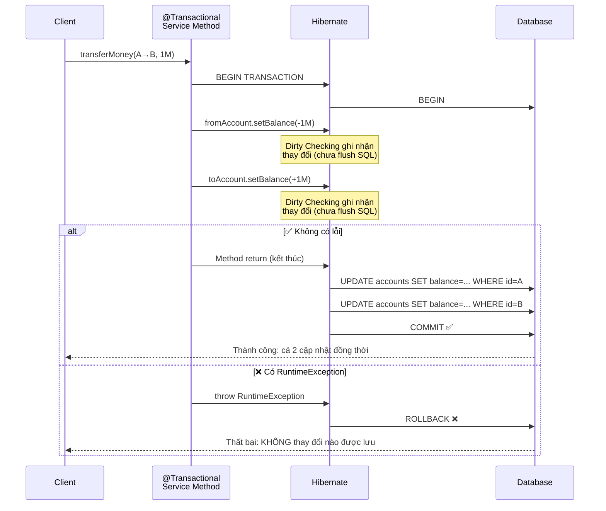

### 1.3. Thắc mắc 1: Có phải các bước trong Transaction sẽ không gọi liền mà gom lại bắn 1 lượt xuống DB?

Nhiều lập trình viên thắc mắc: *"Ví dụ bên trong method có 3 bước thao tác DB thì Hibernate sẽ không gọi liền từng bước mà gom cả 3 bước đó bắn cùng 1 lượt xuống Database đúng không?"*

👉 **Câu trả lời:** Bạn hiểu đúng khoảng 80% về mặt hành vi kỹ thuật, nhưng bản chất thực sự của `@Transactional` rộng và quan trọng hơn thế. Cần tách rõ **2 khái niệm**:

#### 1. Bản chất cốt lõi của `@Transactional`: "Tất cả hoặc không có gì" (All or Nothing)
Mục đích sinh ra `@Transactional` không phải chỉ để gom lệnh, mà là để **bảo vệ tính toàn vẹn dữ liệu (Tính Atomicity trong ACID)**:
* **Bước 1:** Trừ tiền ví khách hàng ($100).
* **Bước 2:** Giảm số lượng tồn kho sản phẩm (1 cái).
* **Bước 3:** Tạo bản ghi Đơn hàng mới.

```mermaid
flowchart TD
    Start([Bắt đầu Transaction]) --> S1[1. Trừ tiền ví: Thành công]
    S1 --> S2[2. Giảm tồn kho: Thành công]
    S2 --> S3[3. Tạo đơn hàng: BỊ LỖI!]
    S3 --> Err{Phát hiện Exception}
    Err -->|@Transactional kích hoạt| Rollback[💥 ROLLBACK: Hủy bỏ Bước 1 & Bước 2! Dữ liệu trở về như chưa có gì xảy ra]
```

* **Nếu KHÔNG có `@Transactional`:** Bước 1 và Bước 2 đã trừ tiền và trừ kho xong, đến bước 3 server bị sập hoặc lỗi mạng $\rightarrow$ Khách bị mất tiền nhưng không có đơn hàng!
* **CÓ `@Transactional`:** Dù có bao nhiêu bước đi nữa, chỉ cần **1 bước bị lỗi**, toàn bộ các bước trước đó đều bị **`ROLLBACK`** (Hủy bỏ hoàn toàn).

#### 2. Kỹ thuật "không gọi liền mà gom lại bắn một lượt" là gì?
Đó chính là cơ chế **"Write-Behind Cache"** và **"Flush"** của Hibernate khi chạy bên trong một Transaction:
* **Bước 1:** `user.setBalance(...)` $\rightarrow$ Hibernate **chưa gửi lệnh SQL ngay xuống DB**. Nó chỉ ghi nhận thay đổi này vào bộ nhớ đệm RAM (*Persistence Context / Hàng đợi ActionQueue*).
* **Bước 2:** `product.setStock(...)` $\rightarrow$ Hibernate vẫn giữ trên RAM.
* **Bước 3:** `orderRepository.save(order)` $\rightarrow$ Tiếp tục xếp hàng trên RAM.

👉 **Thời điểm "Gom một lượt" (FLUSH):**  
Chỉ khi phương thức chạy đến dòng cuối cùng (kết thúc transaction chuẩn bị `COMMIT`), Hibernate mới thực hiện hành động gọi là **`FLUSH`**:
* Nó gom toàn bộ các thay đổi trên RAM lại.
* Tự động sắp xếp thứ tự tối ưu nhất (ví dụ: các lệnh `INSERT` trước, `UPDATE` sau).
* Bắn một loạt các câu SQL (`UPDATE accounts...`, `UPDATE products...`, `INSERT INTO orders...`) xuống Database cùng một đợt!

> [!WARNING]
> **Có trường hợp nào Hibernate PHẢI bắn SQL ngay mà không chờ gom không?**
> 1. **Khóa chính tự tăng (`IDENTITY`):** Nếu bạn tạo Entity mới và dùng `@GeneratedValue(strategy = GenerationType.IDENTITY)`, Hibernate **buộc phải chạy lệnh `INSERT` ngay lập tức** để Database sinh ra mã `ID` trả về cho Java gán vào biến đối tượng.
> 2. **Khi bạn SELECT dữ liệu ở giữa chừng (Auto-Flush):** Ví dụ Bước 1 bạn sửa giá sản phẩm. Sang Bước 2 bạn lại viết câu truy vấn `SELECT * FROM products WHERE price = ...`. Lúc này Hibernate sẽ tự động **Flush ngay lập tức** bước 1 xuống DB để câu SELECT ở bước 2 đọc được dữ liệu mới nhất.

---

### 1.4. Thắc mắc 2: Cơ chế Snapshot trên RAM & Phân biệt giữa FLUSH vs COMMIT

*"Có nghĩa là các bước sẽ được giữ lại trên RAM so sánh với snapshot lúc ban đầu khi chưa thực hiện step nào, sau đó commit/flush thì mới bắn câu lệnh xuống database?"*

👉 **Chính xác 100%!** Bạn vừa miêu tả đúng cơ chế kinh điển của Hibernate gọi là: **Dirty Checking (Cơ chế kiểm tra dữ liệu bẩn thông qua Snapshot)**.

#### 1. Cơ chế chụp ảnh (Snapshot) trên RAM
Khi bạn đọc dữ liệu từ Database lên (ví dụ: `productRepository.findById(1L)`), Hibernate đưa Entity vào vùng nhớ **Persistence Context** trên RAM và âm thầm tạo ra **2 bản sao**:
1. **Bản Entity thực tế:** Đưa cho bạn dùng trong code Java để bạn gọi các hàm `setter`.
2. **Bản chụp Snapshot (Loaded State):** Bản sao nguyên gốc lúc vừa tải từ Database lên, Hibernate giữ kín để làm căn cứ đối chiếu.

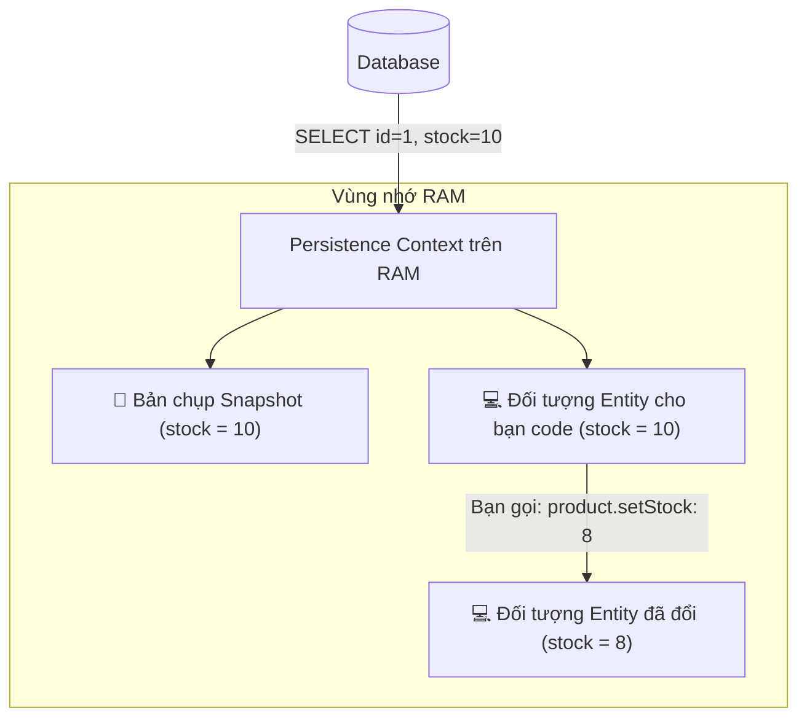

#### 2. Đến lúc FLUSH / COMMIT: So sánh đối chiếu (Dirty Checking)
Khi phương thức kết thúc (chuẩn bị kết thúc Transaction), Hibernate kích hoạt Dirty Checking:
* Hibernate lấy **đối tượng Entity hiện tại** đem đi **so khớp từng trường với Bản chụp Snapshot ban đầu**.
* **Nếu có khác biệt (Dữ liệu bị "bẩn" - Dirty):** Hibernate phát hiện: *"À! Trường `stock` ban đầu là 10, bây giờ là 8"* $\rightarrow$ Nó lập tức tự động sinh ra câu lệnh:
  ```sql
  UPDATE products SET stock = 8 WHERE id = 1;
  ```
* **Nếu KHÔNG có gì thay đổi:** (Giả sử bạn lấy ra xem nhưng không gọi setter nào, hoặc đổi rồi lại gán về giá trị cũ) $\rightarrow$ Trùng khớp với Snapshot $\rightarrow$ **Hibernate KHÔNG thèm sinh ra câu lệnh UPDATE nào cả!** (Cực kỳ tối ưu hiệu năng).

#### 3. Phân biệt rõ ràng giữa FLUSH và COMMIT:

| Bước | Tên gọi | Hành động thực tế |
| :---: | :--- | :--- |
| **1** | **FLUSH** | So sánh Entity với Snapshot $\rightarrow$ **Bắn toàn bộ các câu lệnh SQL (`INSERT`, `UPDATE`, `DELETE`) xuống Database**. Database đã nhận lệnh nhưng **chưa chốt sổ vĩnh viễn** (vẫn đang nằm trong transaction tạm, có thể rollback bất cứ lúc nào). |
| **2** | **COMMIT** | Database gửi tín hiệu: *"Mọi thứ đều ổn"* $\rightarrow$ Database chính thức **chốt ghi vĩnh viễn vào ổ cứng** (Hoàn tất giao dịch). |

---

### 1.5. Thắc mắc 3: "Trong Service gọi findById xong chỉ dùng setter là tự động ghi xuống Database rồi hả?"

Nhiều lập trình viên thắc mắc: *"Trong Service, ta gọi `findById()`, sau đó chỉ dùng các hàm `set...` là tự động ghi thẳng xuống database rồi hả?"*

👉 **Câu trả lời:** ĐÚNG, NHƯNG BẮT BUỘC PHẢI CÓ `@Transactional`!

#### 🔹 Kịch bản 1: Có `@Transactional` (Tự động cập nhật không cần gọi `.save()`)
```java
@Service
public class ProductService {

    @Transactional // 👈 BẮT BUỘC PHẢI CÓ ANNOTATION NÀY!
    public void updatePrice(Long id, Double newPrice) {
        // 1. Lấy entity lên -> Hibernate đưa vào trạng thái "Managed" và chụp Snapshot
        Product product = productRepository.findById(id)
                .orElseThrow(() -> new RuntimeException("Not found"));

        // 2. Chỉ cần gọi hàm SET
        product.setPrice(newPrice);

        // ❌ HOÀN TOÀN KHÔNG CẦN GỌI: productRepository.save(product);
        // (Dòng gọi .save() ở đây là thừa thãi 100%)
    } // 👈 KHI HÀM KẾT THÚC: Hibernate tự động so sánh Snapshot và sinh câu SQL UPDATE!
}
```

**👉 Cơ chế:**
* Khi có `@Transactional`, đối tượng `product` lấy từ `findById` sẽ nằm trong trạng thái được Hibernate giám sát (**Managed**).
* Khi hàm chạy đến dấu đóng ngoặc nhọn `}` cuối cùng, Transaction kết thúc $\rightarrow$ Hibernate kích hoạt **Dirty Checking** (so sánh với Snapshot ban đầu) $\rightarrow$ Thấy `price` bị đổi $\rightarrow$ Tự động bắn SQL `UPDATE products SET price = ? WHERE id = ?` xuống Database!

#### 🔹 Kịch bản 2: KHÔNG CÓ `@Transactional` (Sẽ KHÔNG lưu gì cả!)
```java
@Service
public class ProductService {

    // ❌ KHÔNG CÓ @Transactional
    public void updatePrice(Long id, Double newPrice) {
        Product product = productRepository.findById(id)
                .orElseThrow(() -> new RuntimeException("Not found"));

        product.setPrice(newPrice);
        // Kết thúc hàm: Dữ liệu biến mất, DB KHÔNG ĐỔI GÌ CẢ!
    }
}
```

**👉 Lý do:**
* Vì không có `@Transactional`, hàm `findById` chỉ mở kết nối SELECT xong là đóng lại ngay.
* Đối tượng `product` lúc này trở thành **Detached** (bị tách rời, không còn ai giám sát, không còn snapshot).
* Lúc này bạn có gọi bao nhiêu hàm `set...` thì nó cũng chỉ thay đổi trên bộ nhớ RAM tạm thời của biến đó rồi biến mất.
* Muốn lưu trong kịch bản này, bạn bắt buộc phải gọi tay: `productRepository.save(product)`.

---

## PHẦN 2: 🧱 ACID PROPERTIES — 4 TÍNH CHẤT NỀN TẢNG

### 2.1. Bảng tổng hợp ACID

| Tính chất | Ý nghĩa | Ví dụ cụ thể trong dự án | Ai đảm bảo? |
|:---:|:---|:---|:---|
| **🔷 Atomicity** (Nguyên tử) | Tất cả hoặc Không gì cả. Không có trạng thái "nửa vời" | Tạo Order + Giảm Stock = 1 đơn vị công việc. Nếu giảm stock fail → Order cũng bị hủy | **Transaction Manager** |
| **🔷 Consistency** (Nhất quán) | Dữ liệu luôn ở trạng thái hợp lệ trước & sau transaction | Tổng stock trước = tổng stock sau + quantity đã bán. Không bao giờ âm | **Business Logic** + **DB Constraints** |
| **🔷 Isolation** (Cô lập) | Các transaction đồng thời không ảnh hưởng lẫn nhau | 2 khách mua cùng sản phẩm cuối cùng → chỉ 1 người thành công | **Isolation Level** |
| **🔷 Durability** (Bền vững) | Dữ liệu đã COMMIT sẽ tồn tại vĩnh viễn, kể cả server crash | Sau khi đơn hàng xác nhận → dù restart server, data vẫn còn | **Database Engine** (WAL, fsync) |

### 2.2. Sơ đồ trực quan ACID

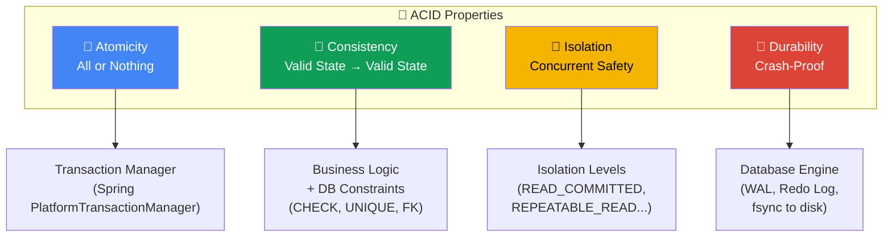

### 2.3. Ví dụ ACID trong dự án springboot-learning

```java
/**
 * Kịch bản: Khách hàng đặt mua 3 sản phẩm MacBook Pro M3 (stock = 25)
 *
 * ATOMICITY:
 *   - Tạo Order (INSERT orders)
 *   - Giảm stock Product (UPDATE products SET stock = stock - 3)
 *   → Cả 2 phải cùng thành công hoặc cùng thất bại
 *
 * CONSISTENCY:
 *   - Trước: Product.stock = 25
 *   - Sau: Product.stock = 22  (không bao giờ = -1)
 *   - Order.totalAmount = 3 × 2499.99 = 7499.97 (phải đúng)
 *
 * ISOLATION:
 *   - 2 khách cùng đặt mua 24 chiếc MacBook (stock = 25)
 *   - Chỉ 1 người thành công, người kia nhận lỗi "Hết hàng"
 *
 * DURABILITY:
 *   - Sau khi đơn hàng COMMIT → dù restart server, data vẫn còn
 */
```

---

## PHẦN 3: ⚙️ SPRING `@TRANSACTIONAL` — CƠ CHẾ PROXY BÊN DƯỚI

### 3.1. Bản chất: Spring AOP Proxy

Khi bạn gắn `@Transactional` lên method, Spring **KHÔNG** thay đổi code gốc. Thay vào đó, Spring tạo một **Proxy object** bọc quanh bean thật:

```
┌───────────────────────────────────────────────────────────────────┐
│  🧩 LUỒNG GỌI METHOD @Transactional                              │
│                                                                   │
│  Controller gọi:  orderService.createOrder(request)              │
│                           │                                       │
│                           ▼                                       │
│  ┌─────────────────────────────────────────────────────┐         │
│  │  🔮 Spring AOP PROXY (OrderService$$SpringCGLIB)    │         │
│  │                                                     │         │
│  │  1. Kiểm tra @Transactional annotation              │         │
│  │  2. Lấy PlatformTransactionManager                  │         │
│  │  3. txManager.getTransaction(definition)             │         │
│  │     → Hibernate: Session.beginTransaction()          │         │
│  │     → JDBC: connection.setAutoCommit(false)          │         │
│  │                                                     │         │
│  │  4. ┌─────────────────────────────────┐              │         │
│  │     │  📦 GỌI METHOD THẬT:            │              │         │
│  │     │  orderService.createOrder(req)  │              │         │
│  │     └─────────────────────────────────┘              │         │
│  │                                                     │         │
│  │  5a. ✅ Không có exception:                          │         │
│  │      txManager.commit(status)                       │         │
│  │      → Hibernate flush + JDBC COMMIT                │         │
│  │                                                     │         │
│  │  5b. ❌ RuntimeException:                            │         │
│  │      txManager.rollback(status)                     │         │
│  │      → JDBC ROLLBACK                                │         │
│  └─────────────────────────────────────────────────────┘         │
└───────────────────────────────────────────────────────────────────┘
```

### 3.2. Sơ đồ Proxy Pattern (Mermaid)

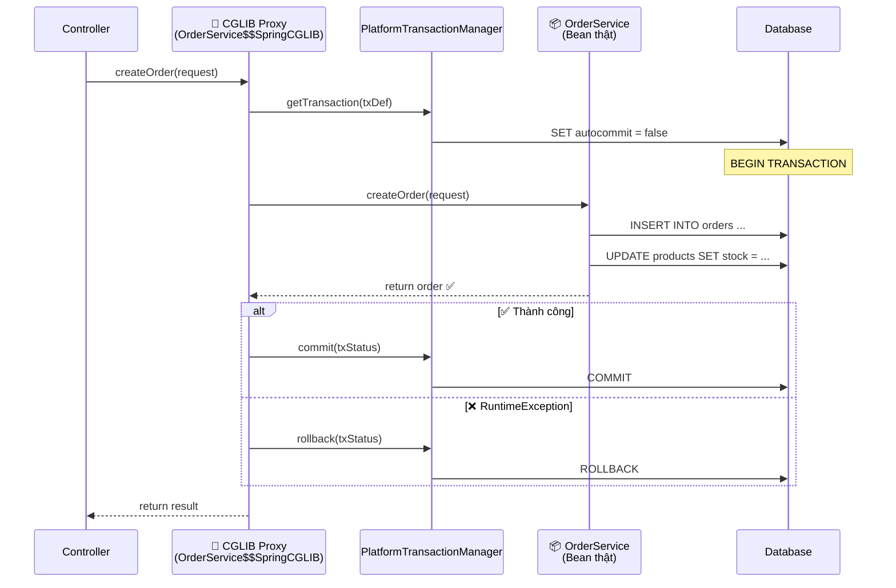

### 3.3. PlatformTransactionManager — Trái tim của Transaction

Spring sử dụng **Strategy Pattern** để trừu tượng hóa quản lý transaction:

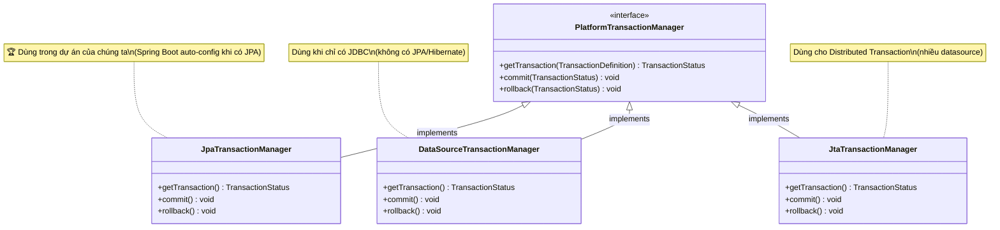

> [!NOTE]
> **Spring Boot tự động cấu hình `JpaTransactionManager`** khi phát hiện JPA dependency trong classpath. Bạn không cần khai báo bean thủ công — đây chính là sức mạnh của Auto-Configuration (đã học ở Bài 1).

### 3.4. Pseudo-code mà Spring Proxy thực sự làm

```java
// 🎯 Đây chính là code mà Spring AOP Proxy sinh ra "đằng sau" @Transactional
public class OrderService$$SpringCGLIB extends OrderService {

    private final PlatformTransactionManager txManager;

    @Override
    public Order createOrder(OrderRequest request) {
        // 1. Tạo TransactionDefinition từ @Transactional attributes
        TransactionDefinition def = new DefaultTransactionDefinition();
        // def.setPropagation(REQUIRED);
        // def.setIsolationLevel(DEFAULT);
        // def.setReadOnly(false);

        // 2. Bắt đầu transaction
        TransactionStatus status = txManager.getTransaction(def);

        try {
            // 3. Gọi method thật (bean gốc, KHÔNG phải proxy)
            Order result = super.createOrder(request);

            // 4. Commit nếu thành công
            txManager.commit(status);
            return result;

        } catch (RuntimeException ex) {
            // 5. Rollback nếu unchecked exception
            txManager.rollback(status);
            throw ex;
        }
        // ⚠️ Chú ý: Checked Exception KHÔNG rollback theo mặc định!
    }
}
```

---

## PHẦN 4: 🔄 ROLLBACK RULES — KHI NÀO ROLLBACK, KHI NÀO KHÔNG?

### 4.1. Bản chất cơ chế Rollback bên dưới (Database vs Bộ nhớ RAM)

Nhiều lập trình viên lầm tưởng rằng khi Rollback, Hibernate sẽ "sửa ngược" lại các giá trị biến Java trên RAM về như ban đầu. **Thực tế hoàn toàn không phải như vậy!**

Cơ chế Rollback là sự phối hợp giữa **Spring + Hibernate (Tầng Java)** và **Database Engine (MySQL, PostgreSQL...)**:

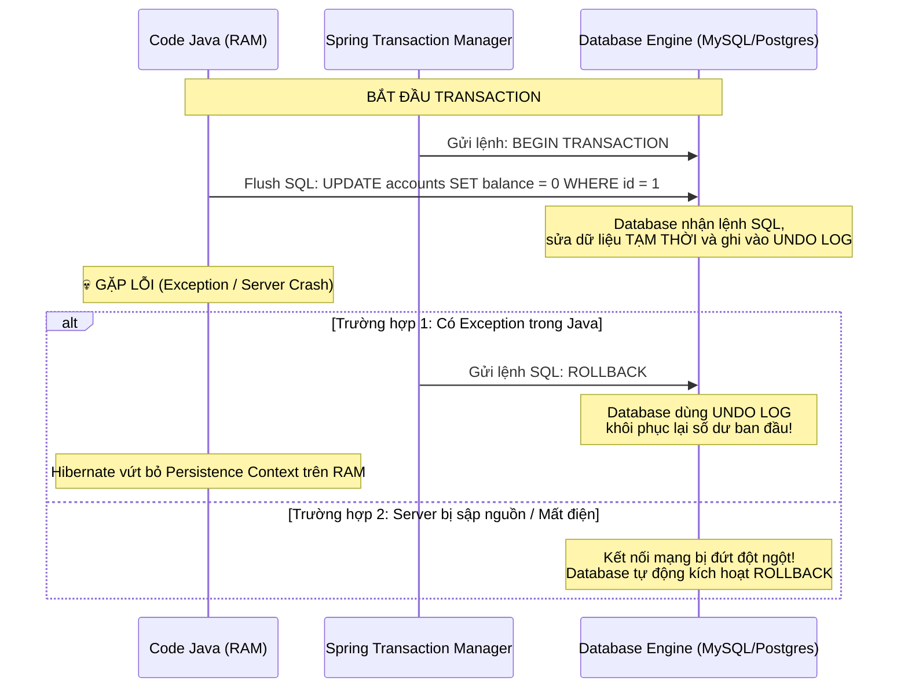

#### 🔹 1. "Rollback có nghĩa là không gửi câu lệnh xuống Database hả?"
* **Với các lệnh chưa Flush (đang nằm trong hàng đợi ActionQueue của Hibernate):** Hibernate đơn giản là **hủy bỏ**, không gửi các câu lệnh SQL này xuống Database nữa.
* **Với các lệnh ĐÃ Flush xuống Database:** Database đã nhận lệnh SQL và sửa tạm trong buffer pool. Nhưng vì chưa nhận được lệnh `COMMIT`, nên khi Spring gửi tín hiệu `ROLLBACK;`, Database sẽ **hủy bỏ và hoàn tác** toàn bộ các thay đổi đó.

#### 🔹 2. "Có phải Rollback bằng cách đưa dữ liệu trên RAM về trạng thái Snapshot ban đầu?"
* **HOÀN TOÀN KHÔNG!** Hibernate **không hề** sửa ngược lại các đối tượng Java trên RAM! Nếu bạn vừa gọi `user.setBalance(0)`, thì trên RAM biến `user` đó vẫn mang số dư là `0`.
* Thay vào đó: **Hibernate vứt bỏ luôn cả phiên làm việc (đóng/clear Persistence Context)**. Toàn bộ đối tượng trên RAM bị coi như "hết hạn sử dụng" (stale/detached). Lần sau nếu cần dữ liệu, hệ thống bắt buộc phải `SELECT` lại từ Database (nơi dữ liệu đã được bảo vệ toàn vẹn).

#### 🔹 3. Tầng Database làm sao để "quay ngược thời gian"? (Undo Log)
Khi Database nhận câu lệnh `UPDATE` hay `DELETE`:
1. Database không ghi đè ngay lên ổ đĩa chính mà ghi vào một cuốn nhật ký đặc biệt gọi là **Undo Log**:  
   *"Trước khi sửa, tài khoản id=1 có số dư cũ là 1.000.000đ"*.
2. Khi nhận lệnh `ROLLBACK;` (hoặc khi app bị sập làm đứt kết nối mạng): Database mở **Undo Log** ra, đọc lại giá trị cũ và **phục hồi dữ liệu về chính xác 1.000.000đ** như trước khi giao dịch bắt đầu.

| Nơi lưu trữ | Trạng thái trước khi Rollback | Khi xảy ra Rollback |
| :--- | :--- | :--- |
| **Hàng đợi SQL của Hibernate (RAM)** | Chứa các câu SQL đang chờ bắn | **Bị xóa bỏ hoàn toàn**, không gửi xuống DB nữa. |
| **Các Object Java (RAM)** | `user.getBalance()` đang bằng 0 | **Vẫn bằng 0**, nhưng Persistence Context bị đóng lại/vứt bỏ để tránh bị dùng nhầm. |
| **Dữ liệu trong Database (Ổ cứng/Buffer)** | Đã nhận một số lệnh SQL tạm thời | Nhận lệnh `ROLLBACK` $\rightarrow$ Dùng **Undo Log** đảo ngược toàn bộ dữ liệu về trạng thái ban đầu 100%. |

---

### 4.2. Quy tắc Rollback mặc định của `@Transactional`

```
┌──────────────────────────────────────────────────────────────────────────┐
│  📜 QUY TẮC ROLLBACK MẶC ĐỊNH CỦA @Transactional:                      │
│                                                                          │
│  ✅ ROLLBACK khi:                                                        │
│     • RuntimeException (unchecked) — và tất cả subclass                  │
│     • Error (OutOfMemoryError, StackOverflowError...)                    │
│                                                                          │
│  ❌ KHÔNG ROLLBACK khi:                                                  │
│     • Checked Exception (IOException, SQLException, ParseException...)   │
│     • Method return bình thường (dù data logic sai)                      │
│                                                                          │
│  → Đây là quy tắc "mặc định" — có thể tùy chỉnh bằng attribute         │
└──────────────────────────────────────────────────────────────────────────┘
```

---

### 4.3. Phân loại Exception trong Java (Java Core Knowledge)

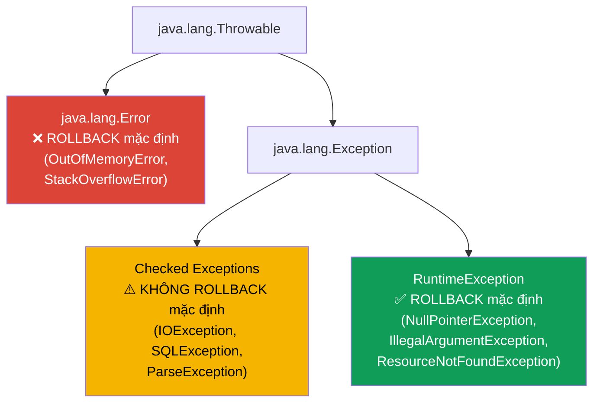

---

### 4.4. Tùy chỉnh Rollback Rules (`rollbackFor`, `noRollbackFor`)

```java
// ✅ 1. Rollback cho TẤT CẢ exception (cả Checked Exception)
@Transactional(rollbackFor = Exception.class)
public void processPayment(PaymentRequest req) throws PaymentException {
    // PaymentException (checked) sẽ gây rollback
}

// ✅ 2. Rollback cho exception cụ thể
@Transactional(rollbackFor = {PaymentException.class, InsufficientStockException.class})
public Order createOrderWithPayment(OrderRequest req) throws PaymentException {
    // ...
}

// ✅ 3. KHÔNG rollback cho exception cụ thể (dù là RuntimeException)
@Transactional(noRollbackFor = EmailSendingException.class)
public void createOrderAndNotify(OrderRequest req) {
    orderRepository.save(order);           // rollback nếu fail
    emailService.sendConfirmation(order);  // EmailSendingException → KHÔNG rollback
    // Order vẫn được lưu dù gửi email thất bại
}

// ✅ 4. Kết hợp cả hai
@Transactional(
    rollbackFor = Exception.class,
    noRollbackFor = NotificationException.class
)
public void complexBusinessLogic() {
    // Rollback cho mọi exception, TRỪ NotificationException
}
```

---

### 4.5. Bảng so sánh Rollback Behavior

| Exception loại | Mặc định | Với `rollbackFor = Exception.class` |
| :--- | :---: | :---: |
| `RuntimeException` (unchecked) | ✅ Rollback | ✅ Rollback |
| `Error` | ✅ Rollback | ✅ Rollback |
| `IOException` (checked) | ❌ Commit | ✅ Rollback |
| `SQLException` (checked) | ❌ Commit | ✅ Rollback |
| Custom `BusinessException extends RuntimeException` | ✅ Rollback | ✅ Rollback |

> [!IMPORTANT]
> **Best practice trong dự án của chúng ta:** Tất cả custom exception đã kế thừa `RuntimeException` (thông qua `BusinessException`):
> - `ResourceNotFoundException extends BusinessException extends RuntimeException`
> - `DuplicateResourceException extends BusinessException extends RuntimeException`
> 
> → **Luôn tự động rollback theo mặc định!** Đây là thiết kế chuẩn từ Bài 7.

---

### 4.6. Chạy đến cuối Transaction thì chắc chắn dữ liệu được commit thành công?

**KHÔNG HẲN!** Chạy hết dòng code Java cuối cùng **CHƯA CÓ NGHĨA** là 100% dữ liệu đã được lưu an toàn vào Database.

Thực tế, **thời điểm kết thúc phương thức mới chính là lúc "sóng gió" nhất**! Bởi vì đây là lúc Hibernate bắt đầu gọi **FLUSH** và Database bắt đầu gọi **COMMIT**.

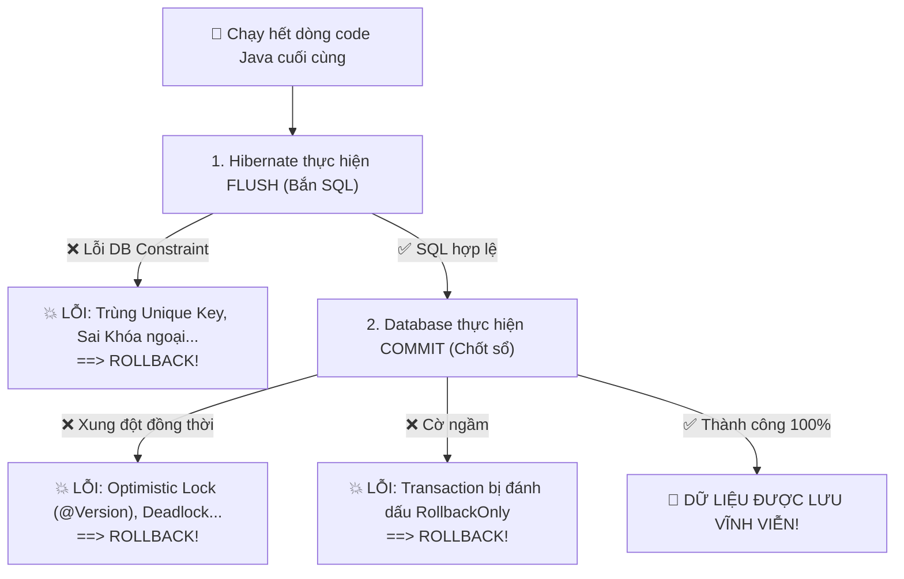

Dữ liệu vẫn có thể bị "lật kèo" và **bị ROLLBACK ngay tại vạch đích** vì 3 lý do:

#### 1. Bị "văng" ngay lúc FLUSH: Vi phạm ràng buộc Database (DB Constraints)
Suốt quá trình chạy trong Java, bạn mới chỉ gọi các hàm `setter` trên RAM. Đến cuối hàm, Hibernate bắn một loạt SQL xuống thì Database mới phát hiện:
* **Trùng khóa Unique (`DataIntegrityViolationException`):** Ví dụ bạn set `email = "admin@gmail.com"`, nhưng đúng lúc đó có người khác vừa đăng ký email này trước bạn 1 mili-giây $\rightarrow$ Database từ chối câu lệnh $\rightarrow$ **ROLLBACK toàn bộ!**
* **Vi phạm Khóa ngoại (Foreign Key):** `order.setUserId(9999L)` nhưng User 9999 không tồn tại trong DB.
* **Cột bị `NOT NULL`:** Bạn quên set một trường bắt buộc trong DB.
* **Dữ liệu quá dài:** Cột `VARCHAR(50)` nhưng bạn đưa chuỗi 100 ký tự.

#### 2. Bị "lật kèo" ngay lúc COMMIT: Xung đột dữ liệu đồng thời (Concurrency / Locks)
* **Xung đột Khóa Lạc Quan (Optimistic Lock - `@Version`):** Hai nhân viên cùng mở sản phẩm và sửa tồn kho. Người A commit trước thành công (`v1` $\rightarrow$ `v2`). Đến lượt người B (đang giữ `v1`), khi commit Hibernate thấy version trong DB đã là `v2` $\rightarrow$ Ném `OptimisticLockException` $\rightarrow$ **Người B bị ROLLBACK hoàn toàn!**
* **Bế tắc khóa dữ liệu (Deadlock):** Hai transaction giữ khóa chéo nhau, Database Engine phát hiện Deadlock và sẽ chọn 1 trong 2 transaction làm "nạn nhân" (victim) $\rightarrow$ **Ép buộc hủy bỏ và ROLLBACK transaction đó.**

#### 3. Cái bẫy ngầm trong Spring: `setRollbackOnly()`
Giả sử trong phương thức của bạn có gọi một phương thức của Service khác:
```java
@Transactional
public void parentMethod() {
    // 1. Làm việc A
    
    try {
        childService.doSomething(); // Phương thức này bị lỗi bên trong và ném RuntimeException
    } catch (Exception e) {
        // Bạn cố tình try-catch nuốt lỗi để code chạy tiếp đến cuối!
    }

    // 2. Làm việc B
} // 👈 Đến đây chạy hết hàm bình thường, KHÔNG có Exception nào văng ra ngoài!
```
❓ **Dữ liệu có được commit không?**  
👉 **KHÔNG!** Dù bạn đã `try-catch` nuốt lỗi và chạy hết hàm, nhưng khi `childService` gặp lỗi, Spring đã âm thầm đánh dấu transaction này là **`RollbackOnly`** (Chỉ được phép hủy). Khi `parentMethod` kết thúc, Spring thấy cờ này sẽ lập tức gọi `ROLLBACK` và ném lỗi:  
`UnexpectedRollbackException: Transaction silently rolled back because it has been marked as rollback-only`.

---

### 4.7. Vậy khi nào dữ liệu mới thực sự ghi xuống Database thành công 100%?

Dữ liệu chỉ được coi là **ghi xuống Database thành công 100%** khi thỏa mãn đồng thời cả 2 điều kiện ở tầng **Database** và tầng **Java**:

#### 1. Thời điểm chính xác: "Khoảnh khắc vàng"
> 🎯 **Dữ liệu được ghi thành công khi và chỉ khi:**  
> Lệnh **`COMMIT`** được Database Engine thực thi trọn vẹn, ghi nhận vào ổ đĩa và gửi tín hiệu phản hồi **thành công (ACK)** ngược lại cho Spring Boot mà **không có bất kỳ Exception nào bị ném ra**.

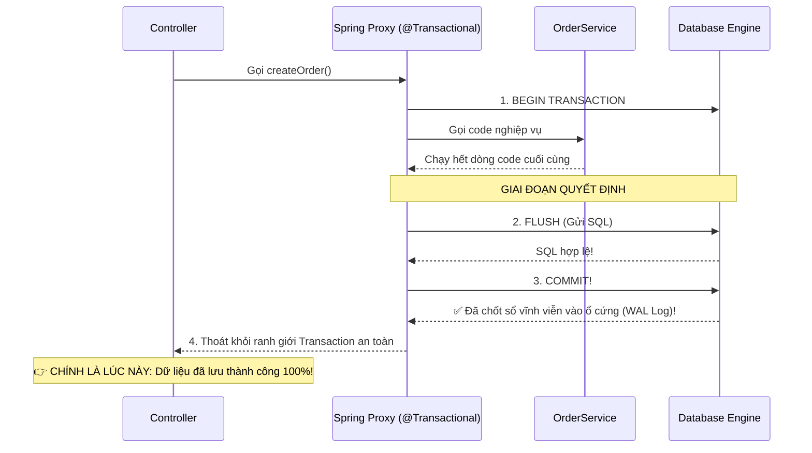

#### 2. Dấu hiệu nhận biết trong Code thực tế
Hãy nhìn vào tầng **Controller**:
```java
@PostMapping("/orders")
public ResponseEntity<?> createOrder(@RequestBody OrderRequest request) {

    // 1. Gọi Service (phương thức này có @Transactional)
    OrderResponse response = orderService.createOrder(request);

    // 👉 KHI CODE CHẠM ĐƯỢC ĐẾN DÒNG NÀY:
    // Chắc chắn 100% dữ liệu ĐÃ LƯU THÀNH CÔNG xuống Database!
    // Bởi vì nếu có bất kỳ lỗi nào ở bước FLUSH hay COMMIT,
    // dòng trên sẽ ném Exception ngay lập tức và code không bao giờ chạy xuống đây.

    return ResponseEntity.ok(response);
}
```

#### 3. Về mặt vật lý (Phần cứng Database): Tính Durability (Bền vững)
Khi lệnh `COMMIT` hoàn tất, Database đã ghi dữ liệu vào **Redo Log / WAL (Write-Ahead Logging)** trên ổ cứng:
* Kể cả 1 mili-giây sau khi COMMIT, toàn bộ trung tâm dữ liệu bị mất điện đột ngột: Khi khởi động lại, Database sẽ đọc WAL log và **khôi phục lại 100% dữ liệu đã commit**, không bao giờ bị mất.

#### 4. Kinh nghiệm thực chiến đắt giá: Khi nào nên Gửi Email / Bắn Notification?
```java
// ❌ SAI LẦM: Gửi email trực tiếp trong @Transactional
@Transactional
public void createOrder(...) {
    orderRepository.save(order);
    emailService.sendOrderConfirmation(order); 
    // 💀 Nếu sau dòng này, đến cuối hàm DB bị lỗi trùng mã đơn -> ROLLBACK!
    // Khách đã nhận được email nhưng trong DB lại KHÔNG CÓ đơn hàng nào!
}
```

✅ **Cách làm chuẩn trong Spring Boot:**  
Chỉ gửi email **SAU KHI CHẮC CHẮN COMMIT THÀNH CÔNG** bằng cách dùng `@TransactionalEventListener`:

```java
// Spring sẽ chỉ kích hoạt hàm này SAU KHI Database đã COMMIT thành công 100%!
@TransactionalEventListener(phase = TransactionPhase.AFTER_COMMIT)
public void handleOrderCreatedEvent(OrderCreatedEvent event) {
    emailService.sendOrderConfirmation(event.getOrder());
}
```

---

## PHẦN 5: 📖 `readOnly = true` — TỐI ƯU HIỆU NĂNG CHO READ

### 5.1. readOnly = true làm gì bên dưới?

```java
@Transactional(readOnly = true)
public List<ProductResponse> getAllProducts() {
    return productRepository.findAll().stream()
            .map(ProductResponse::fromEntity)
            .collect(Collectors.toList());
}
```

Khi `readOnly = true`, Hibernate thực hiện **3 tối ưu hóa** quan trọng:

```
┌───────────────────────────────────────────────────────────────────────┐
│  📖 readOnly = true — Hibernate Optimizations:                       │
│                                                                       │
│  1. ❌ SKIP Dirty Checking:                                           │
│     Hibernate KHÔNG tạo snapshot copy của entity                     │
│     → Tiết kiệm RAM (đặc biệt khi load nhiều entity)                │
│     → Tiết kiệm CPU (không so sánh field khi flush)                  │
│                                                                       │
│  2. ❌ SKIP Flush tự động:                                            │
│     FlushMode = MANUAL → không tự flush trước query                  │
│     → Giảm roundtrip tới database                                    │
│                                                                       │
│  3. 📡 Database hint:                                                  │
│     JDBC: connection.setReadOnly(true)                               │
│     → Database có thể route query tới READ REPLICA                   │
│     → PostgreSQL: tránh WAL overhead                                  │
│     → MySQL: có thể bypass locking overhead                          │
└───────────────────────────────────────────────────────────────────────┘
```

### 5.2. So sánh readOnly = false vs true

| Tiêu chí | `readOnly = false` (mặc định) | `readOnly = true` |
|:---|:---:|:---:|
| Dirty Checking | ✅ Bật (tạo snapshot) | ❌ Tắt (không tạo snapshot) |
| Flush Mode | AUTO (flush trước mỗi query) | MANUAL (không auto flush) |
| RAM usage | Cao (2x entity size cho snapshot) | Thấp (1x entity size) |
| Có thể UPDATE/INSERT? | ✅ Có | ⚠️ Vẫn chạy nhưng **bị bỏ qua khi flush** |
| JDBC hint | `connection.setReadOnly(false)` | `connection.setReadOnly(true)` |
| Use case | CREATE, UPDATE, DELETE | SELECT, COUNT, AGGREGATE |

### 5.3. Pattern trong dự án springboot-learning

```java
@Service
public class ProductService {

    // ✅ READ method → readOnly = true
    @Transactional(readOnly = true)
    public List<ProductResponse> getAllProducts() { ... }

    @Transactional(readOnly = true)
    public ProductResponse getProductById(Long id) { ... }

    @Transactional(readOnly = true)
    public PagedResponse<ProductResponse> getProductsPaged(Pageable pageable) { ... }

    // ✅ WRITE method → readOnly = false (mặc định)
    @Transactional
    public ProductResponse createProduct(ProductCreateRequest request) { ... }

    @Transactional
    public ProductResponse updateProduct(Long id, ProductUpdateRequest request) { ... }

    @Transactional
    public void deleteProduct(Long id) { ... }
}
```

> [!TIP]
> **Pattern hay:** Đặt `@Transactional(readOnly = true)` ở **class level**, rồi override bằng `@Transactional` cho từng write method. Spring sẽ ưu tiên annotation trên method:
>
> ```java
> @Service
> @Transactional(readOnly = true) // Mặc định: tất cả method là read-only
> public class ProductService {
>
>     public List<ProductResponse> getAllProducts() { ... }  // Kế thừa: readOnly = true
>
>     @Transactional // Override: readOnly = false (cho write)
>     public ProductResponse createProduct(...) { ... }
> }
> ```

---

## PHẦN 6: 🌊 PROPAGATION LEVELS — 7 CHIẾN LƯỢC TRANSACTION LỒNG NHAU

### 6.1. Vấn đề: Method A (có transaction) gọi Method B (cũng có transaction)

```java
@Transactional
public void methodA() {
    // Đang trong transaction A
    methodB();  // ← B cũng có @Transactional → tạo transaction mới hay dùng chung?
}

@Transactional
public void methodB() {
    // Transaction nào sẽ được sử dụng ở đây?
}
```

→ Câu trả lời phụ thuộc vào **Propagation Level**.

### 6.2. Bảng tổng hợp 7 Propagation Levels

| Propagation | Hành vi | Khi nào dùng? | Tần suất sử dụng |
|:---|:---|:---|:---:|
| **`REQUIRED`** (mặc định) | Có TX → dùng chung. Chưa có → tạo mới | **90% use case**: mọi business method thông thường | ⭐⭐⭐⭐⭐ |
| **`REQUIRES_NEW`** | **Luôn** tạo TX mới, tạm dừng TX cũ | Audit log, notification — phải persist dù TX chính fail | ⭐⭐⭐ |
| **`NESTED`** | Tạo **savepoint** trong TX hiện tại. Rollback savepoint không rollback TX cha | Thử các thao tác phụ, nếu fail thì chỉ rollback phần phụ | ⭐⭐ |
| **`SUPPORTS`** | Có TX → dùng. Không có → chạy không TX | Method hoạt động OK cả có lẫn không có TX (hiếm dùng) | ⭐ |
| **`NOT_SUPPORTED`** | **Tạm dừng** TX hiện tại, chạy không TX | Gọi hệ thống ngoài (external API) không cần TX | ⭐ |
| **`MANDATORY`** | **Bắt buộc** phải có TX sẵn, nếu không → ném exception | Enforce: method này PHẢI được gọi trong TX | ⭐ |
| **`NEVER`** | **Bắt buộc** KHÔNG có TX, nếu có → ném exception | Enforce: method này KHÔNG ĐƯỢC nằm trong TX | ⭐ |

### 6.3. Sơ đồ trực quan REQUIRED vs REQUIRES_NEW

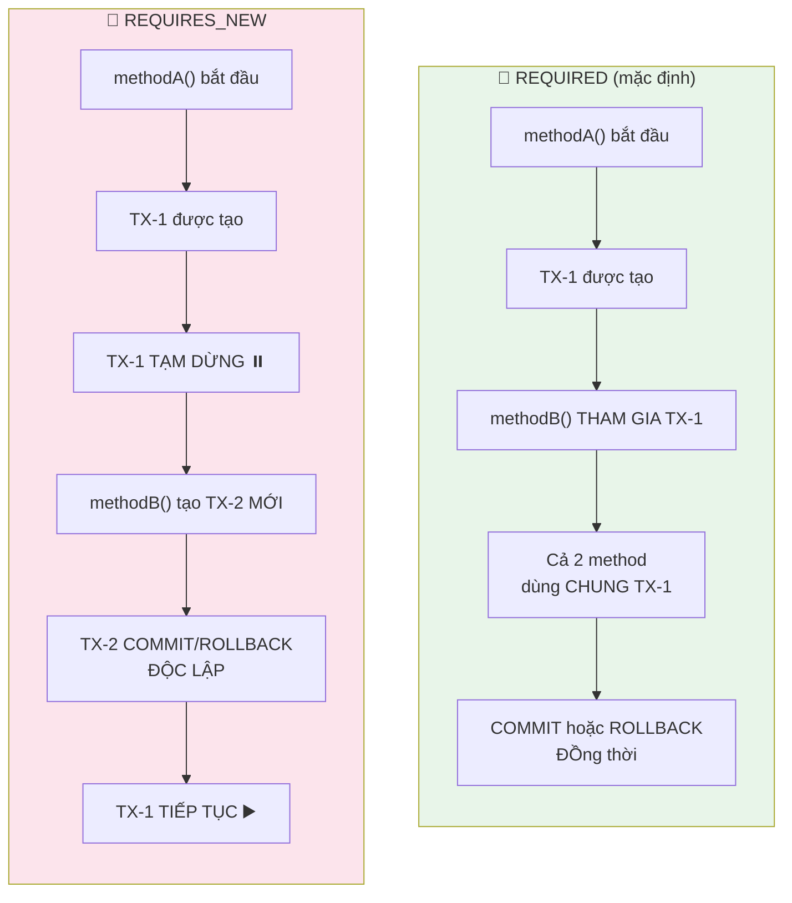

### 6.4. Ví dụ thực tế: REQUIRES_NEW cho Audit Log

```java
@Service
public class OrderService {

    private final AuditLogService auditLogService;

    @Transactional
    public Order createOrder(OrderRequest request) {
        // 1. Validate & tạo order
        Order order = orderRepository.save(buildOrder(request));

        // 2. Giảm stock
        productService.reduceStock(request.getProductId(), request.getQuantity());

        // 3. Ghi audit log — PHẢI persist dù order fail
        auditLogService.logAction("CREATE_ORDER", order.getId());
        // ↑ Nếu sau dòng này có exception → order rollback
        //   nhưng audit log PHẢI VẪN CÒN (để trace lỗi)

        return order;
    }
}

@Service
public class AuditLogService {

    @Transactional(propagation = Propagation.REQUIRES_NEW)
    // ↑ Tạo transaction MỚI, ĐỘC LẬP với transaction của OrderService
    public void logAction(String action, Long entityId) {
        AuditLog log = new AuditLog(action, entityId, LocalDateTime.now());
        auditLogRepository.save(log);
        // Transaction này COMMIT ngay lập tức, không bị ảnh hưởng
        // nếu transaction của OrderService rollback sau đó
    }
}
```

### 6.5. Ví dụ thực tế: NESTED với Savepoint

```java
@Service
public class OrderService {

    @Transactional
    public Order createOrderWithBonusAttempt(OrderRequest request) {
        // 1. Tạo order (TX chính)
        Order order = orderRepository.save(buildOrder(request));

        // 2. THỬ tặng bonus — nếu fail thì chỉ bỏ bonus, order vẫn OK
        try {
            bonusService.tryAwardBonus(order.getUser(), order.getTotalAmount());
        } catch (Exception e) {
            log.warn("Bonus thất bại, nhưng order vẫn tiếp tục: {}", e.getMessage());
            // Savepoint đã rollback → bonus không được tạo
            // Nhưng TX chính (order) vẫn chạy tiếp
        }

        return order; // ← Order vẫn COMMIT thành công
    }
}

@Service
public class BonusService {

    @Transactional(propagation = Propagation.NESTED)
    // ↑ Tạo SAVEPOINT trong TX chính
    public void tryAwardBonus(User user, Double orderAmount) {
        if (orderAmount < 100) {
            throw new RuntimeException("Đơn hàng quá nhỏ để tặng bonus");
            // → Rollback đến SAVEPOINT, KHÔNG rollback TX chính
        }
        bonusRepository.save(new Bonus(user, calculateBonus(orderAmount)));
    }
}
```

> [!WARNING]
> **`NESTED` chỉ hoạt động với `JpaTransactionManager`** (JDBC savepoint). Với `JtaTransactionManager`, `NESTED` sẽ ném `NestedTransactionNotSupportedException`.

---

## PHẦN 7: 🔒 ISOLATION LEVELS — 4 MỨC CÔ LẬP DỮ LIỆU

### 7.1. Vấn đề: Concurrent Access & 4 Hiện tượng bất thường (Anomalies)

Khi hàng nghìn transaction chạy song song cùng truy cập vào cùng các dòng dữ liệu, có thể xảy ra **4 hiện tượng bất thường (anomalies)** từ nhẹ đến đặc biệt nghiêm trọng:

| Hiện tượng (Anomaly) | Mô tả bản chất | Ví dụ thực tế |
|:---|:---|:---|
| 🔸 **Dirty Read** *(Đọc rác)* | Đọc phải dữ liệu đang sửa đổi mà transaction khác **CHƯA COMMIT**. | TX-A giảm số dư từ 1.000.000đ về 0đ (chưa commit). TX-B vào đọc thấy 0đ $\rightarrow$ từ chối thanh toán. Sau đó TX-A bị lỗi Rollback về 1.000.000đ. TX-B đã đọc phải dữ liệu "bóng ma" sai sự thật! |
| 🔸 **Non-Repeatable Read** *(Đọc không lặp lại)* | Đọc cùng 1 dòng dữ liệu 2 lần trong cùng một Transaction nhưng nhận về **2 giá trị khác nhau** (do có TX khác xen vào UPDATE và COMMIT). | TX-A đọc số dư tài khoản = 1.000.000đ. TX-B trừ phí tài khoản 50.000đ và COMMIT. TX-A đọc lại dòng đó thì thấy = 950.000đ! |
| 🔸 **Phantom Read** *(Đọc bóng ma)* | Thực hiện cùng 1 câu truy vấn điều kiện 2 lần nhưng **số lượng dòng trả về khác nhau** (do có TX khác INSERT thêm hoặc DELETE bớt dòng thỏa mãn). | TX-A: `SELECT COUNT(*) WHERE price > 500` $\rightarrow$ ra 5 sản phẩm. TX-B INSERT thêm 1 sản phẩm giá 600 và COMMIT. TX-A đếm lại $\rightarrow$ ra 6 sản phẩm (dòng mới xuất hiện như "ma")! |
| 🔸 **Write Skew** *(Lệch ghi)* | Hai transaction cùng đọc một tập dữ liệu, dựa trên điều kiện hợp lệ để cập nhật 2 dòng dữ liệu khác nhau, nhưng kết quả kết hợp lại **vi phạm ràng buộc logic toàn cục**. | Hai bác sĩ cùng trực ca, cùng bấm xin nghỉ trực vì thấy người kia còn trực $\rightarrow$ cuối cùng không còn ai trực! |

---

### 7.2. Bảng tổng hợp 4 mức cô lập (Isolation Levels)

| Mức độ cô lập | Dirty Read | Non-Repeatable Read | Phantom Read | Hiệu năng (Throughput) | Môi trường áp dụng |
|:---|:---:|:---:|:---:|:---:|:---|
| **`READ_UNCOMMITTED`** | ⚠️ Bị dính | ⚠️ Bị dính | ⚠️ Bị dính | 🟢 Nhanh nhất (gần như không khóa) | Hầu như bị cấm trong thực tế sản xuất |
| **`READ_COMMITTED`** ⭐ | ✅ Chặn | ⚠️ Bị dính | ⚠️ Bị dính | 🟡 Tốt, cân bằng hoàn hảo | **Default** (PostgreSQL, Oracle, SQL Server) |
| **`REPEATABLE_READ`** | ✅ Chặn | ✅ Chặn | ⚠️ Có thể bị *(MySQL InnoDB chặn được)* | 🟠 Khá | **Default** của MySQL InnoDB |
| **`SERIALIZABLE`** | ✅ Chặn | ✅ Chặn | ✅ Chặn (chặn cả Write Skew) | 🔴 Chậm nhất (khóa hoặc abort cao) | Nghiệp vụ tài chính, ngân hàng, sàn chứng khoán |

---

### 7.3. Sơ đồ trực quan quan hệ đánh đổi: Performance vs Consistency

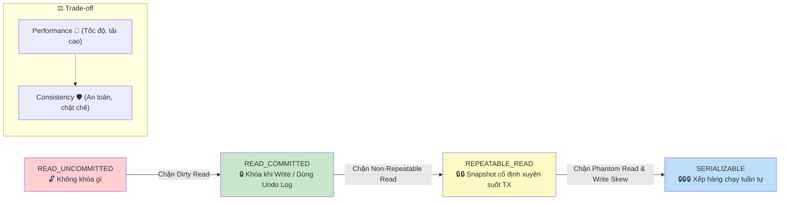

---

### 7.4. Chi tiết từng Isolation Level: Cơ chế & Ví dụ thực chiến

#### 7.4.1. `READ_UNCOMMITTED` (Đọc dữ liệu chưa commit — Cực kỳ nguy hiểm)
* **Bản chất:** Transaction đọc thẳng dữ liệu đang nằm trên Buffer Pool của Database mà các transaction khác đang sửa dở, **chưa hề COMMIT**.
* **Ví dụ thực tế:**
  ```
  1. Transaction A: Khách hàng A nạp 500k -> UPDATE balance = 500k (CHƯA COMMIT).
  2. Transaction B: Hệ thống quét định kỳ thấy balance = 500k -> Kích hoạt gửi quà tặng.
  3. Transaction A: Bị lỗi mạng thẻ ngân hàng -> ROLLBACK số dư về 0k.
  ==> Hậu quả: Khách A nhận được quà miễn phí dù tiền chưa vào tài khoản (Dirty Read)!
  ```
* **Khi nào dùng:** Hầu như không bao giờ dùng trong nghiệp vụ thương mại/tài chính. Chỉ chấp nhận ở các hệ thống log thô không quan trọng độ chính xác.

---

#### 7.4.2. `READ_COMMITTED` (Đọc dữ liệu đã commit — Chuẩn mực phổ biến nhất)
* **Bản chất:** Chỉ cho phép đọc các bản ghi **ĐÃ COMMIT**. Nếu một transaction khác đang sửa dở, Database **không khóa chờ** mà áp dụng cơ chế **MVCC (Multi-Version Concurrency Control)**: lấy bản snapshot cũ gần nhất từ **Undo Log** đưa cho người đọc.
  > 👉 **Nguyên lý:** *"Người Đọc không chặn Người Ghi, Người Ghi không chặn Người Đọc!"*
* **Ví dụ thực tế:**
  ```mermaid
  sequenceDiagram
      participant A as TX-A (Đang chuyển tiền)
      participant DB as Database (Buffer + Undo Log)
      participant B as TX-B (Đang xem số dư)

      Note over DB: Ban đầu: balance = 1.000.000đ
      A->>DB: UPDATE balance = 0đ (CHƯA COMMIT)
      Note over DB: Sửa tạm = 0đ, lưu 1.000.000đ vào Undo Log
      B->>DB: SELECT balance WHERE id = 1
      Note over DB: Lấy 1.000.000đ từ Undo Log trả về cho B!
      DB-->>B: Kết quả: 1.000.000đ (An toàn, không bị Dirty Read!)
  ```
* **Hạn chế:** Vẫn bị **Non-Repeatable Read**: Nếu TX-A commit thành công, sau đó TX-B query lại lần 2 thì sẽ thấy con số 0đ (khác lần 1).

---

#### 7.4.3. `REPEATABLE_READ` (Đọc lặp lại nhất quán)
* **Bản chất:** Đảm bảo trong suốt vòng đời của Transaction, dù bạn có `SELECT` lại dòng dữ liệu đó bao nhiêu lần đi nữa thì **kết quả luôn luôn giống hệt nhau**, bất chấp có transaction khác xen vào UPDATE và COMMIT.
* **Cơ chế:** Database tạo một **Snapshot bất biến** ngay tại thời điểm câu lệnh `SELECT` đầu tiên chạy. Toàn bộ các câu `SELECT` sau đều đọc từ Snapshot này.
* **Ví dụ thực tế (Xuất báo cáo tài chính):**
  ```java
  @Transactional(isolation = Isolation.REPEATABLE_READ)
  public void exportFinancialReport(Long storeId) {
      // 1. Tính tổng doanh thu sáng nay: 50.000.000đ
      BigDecimal revenue = storeRepo.calculateRevenue(storeId);

      // (Trong lúc báo cáo đang tính toán, có đơn hàng mới được thanh toán và COMMIT...)

      // 2. Kiểm tra lại để đối chiếu thuế: VẪN ĐỌC RA ĐÚNG 50.000.000đ!
      BigDecimal checkRevenue = storeRepo.calculateRevenue(storeId);
      // Hai con số khớp nhau hoàn toàn -> Báo cáo tài chính không bị lệch số liệu!
  }
  ```

> [!TIP]
> **3 Cách giải quyết Non-Repeatable Read trong thực tế:**
> 1. **Dùng `REPEATABLE_READ`:** Cấu hình qua annotation `@Transactional(isolation = Isolation.REPEATABLE_READ)`.
> 2. **Dùng Khóa bi quan (Pessimistic Lock):** `@Lock(LockModeType.PESSIMISTIC_WRITE)` (`SELECT ... FOR UPDATE`), khóa cứng dòng dữ liệu bắt người khác phải chờ.
> 3. **Dùng Khóa lạc quan (Optimistic Lock) ⭐:** Thêm trường `@Version` vào Entity (hiệu năng cao nhất, không khóa DB).

---

#### 7.4.4. `SERIALIZABLE` (Tuần tự hóa tuyệt đối — An toàn cấp cao nhất)
* **Bản chất:** Mức độ nghiêm ngặt nhất. Database đảm bảo kết quả giống hệt như các Transaction được **xếp hàng chạy lần lượt từng cái một**.
* **Giải quyết triệt để lỗi "Write Skew" (Bài toán Bác sĩ trực ca):**
  * **Quy tắc bệnh viện:** *"Phòng cấp cứu luôn phải có ÍT NHẤT 1 bác sĩ trực ca!"*
  * Đang có 2 bác sĩ: Alice và Bob.
  * Cùng 1 giây, cả 2 bác sĩ cùng mở máy bấm nút "Xin nghỉ trực":
  
  ```mermaid
  sequenceDiagram
      participant Alice as TX-Alice (Xin nghỉ)
      participant DB as Database Engine
      participant Bob as TX-Bob (Xin nghỉ)

      Note over DB: Ban đầu: 2 bác sĩ đang trực (Alice, Bob)
      Alice->>DB: 1. SELECT COUNT(*) WHERE on_call=true -> Ra 2 người
      Bob->>DB: 2. SELECT COUNT(*) WHERE on_call=true -> Ra 2 người

      Alice->>DB: 3. Thấy 2 >= 2 -> UPDATE Alice.on_call = false
      Bob->>DB: 4. Thấy 2 >= 2 -> UPDATE Bob.on_call = false

      alt Ở mức REPEATABLE READ thông thường
          Alice->>DB: COMMIT thành công
          Bob->>DB: COMMIT thành công
          Note over DB: 💀 THẢM HỌA: Cả 2 cùng nghỉ, số bác sĩ trực = 0!
      else Ở mức SERIALIZABLE ⭐
          Alice->>DB: COMMIT thành công (Alice được nghỉ)
          Bob->>DB: COMMIT thất bại!
          Note over DB: DB phát hiện phụ thuộc xung đột (Serialization Failure)<br/>Ép ROLLBACK Bob! Bác sĩ trực vẫn còn 1 người (Bob)!
      end
  ```

* **Code Java xử lý:**
  ```java
  @Transactional(isolation = Isolation.SERIALIZABLE)
  public void requestDoctorLeave(String doctorName) {
      long count = doctorRepository.countByOnCallTrue();
      if (count <= 1) {
          throw new BusinessException("Không thể nghỉ! Phải có ít nhất 1 bác sĩ trực.");
      }
      doctorRepository.setDoctorOnCall(doctorName, false);
  }
  ```
* **⚠️ Cái giá phải trả khi dùng `SERIALIZABLE`:**
  * **Tốc độ chậm:** Database phải dùng khóa khoảng (Range Lock) hoặc thuật toán kiểm tra phụ thuộc rất tốn CPU/RAM.
  * **Dễ bị ép Rollback:** Các transaction đồng thời rất dễ bị văng lỗi `SerializationFailureException` $\rightarrow$ Lập trình viên bắt buộc phải viết thêm cơ chế **Retry** tự động.

---

### 7.5. Cách khai báo Isolation Level trong Spring & Lời khuyên thực chiến

```java
// 1. Sử dụng Isolation Level cụ thể
@Transactional(isolation = Isolation.READ_COMMITTED)
public ProductResponse getProductById(Long id) { ... }

// 2. Cho các giao dịch tài chính nghiêm ngặt chống xung đột chéo
@Transactional(isolation = Isolation.SERIALIZABLE)
public void transferSpecialAssets(...) { ... }

// 3. DEFAULT = Kế thừa Isolation Level mặc định của Database đang dùng
@Transactional(isolation = Isolation.DEFAULT)
public Order createOrder(OrderRequest request) { ... }
```

> [!TIP]
> **Lời khuyên vàng khi đi làm:**
> * **Hơn 90% hệ thống thực tế:** Giữ nguyên mức mặc định `READ_COMMITTED` (hoặc `REPEATABLE_READ`), và giải quyết bài toán đồng thời bằng **Optimistic Locking (`@Version`)** hoặc **Pessimistic Locking (`@Lock`)**. Cách này giúp hệ thống đạt hàng chục nghìn lượt truy cập/giây mà không bị nghẽn mạng.
> * **Chỉ dùng `SERIALIZABLE`:** Cho các nghiệp vụ tài chính đặc thù, khớp lệnh chứng khoán, hoặc quy tắc nghiệp vụ phức tạp liên quan đến tính toán chéo nhiều bảng/nhiều dòng mà không thể ràng buộc bằng Foreign Key/Check Constraint.

---

## PHẦN 8: 🪤 SELF-INVOCATION TRAP — BẪY CHẾT NGƯỜI CỦA SPRING PROXY

### 8.1. Vấn đề: Gọi @Transactional method từ CÙNG class

```java
@Service
public class OrderService {

    // ❌ BUG: @Transactional KHÔNG HOẠT ĐỘNG ở đây!
    public void processOrder(OrderRequest request) {
        // Đây là "self-invocation" — gọi method trong cùng class
        this.createOrder(request);
        // ↑ this.createOrder() → gọi TRỰC TIẾP method, BYPASS proxy!
        // → @Transactional bị bỏ qua hoàn toàn!
    }

    @Transactional  // ← Annotation này BỊ IGNORE khi gọi từ processOrder()
    public Order createOrder(OrderRequest request) {
        orderRepository.save(order);
        productService.reduceStock(...);
        // Nếu exception ở đây → KHÔNG rollback vì KHÔNG có transaction!
        return order;
    }
}
```

### 8.2. Giải thích bằng sơ đồ

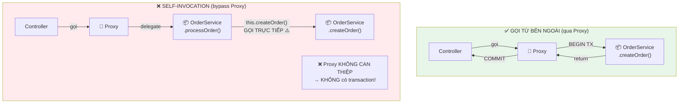

```
┌──────────────────────────────────────────────────────────────────────┐
│  🪤 TẠI SAO SELF-INVOCATION BYPASS PROXY?                           │
│                                                                      │
│  Khi bạn viết: this.createOrder(request)                            │
│                                                                      │
│  • "this" ở đây = chính bean THẬT (OrderService instance)           │
│  • KHÔNG PHẢI proxy (OrderService$$SpringCGLIB)                     │
│  • → Proxy không can thiệp → không có BEGIN TX / COMMIT / ROLLBACK  │
│                                                                      │
│  Chỉ khi gọi từ BÊN NGOÀI (Controller → Proxy → Bean thật)        │
│  thì Proxy mới can thiệp được                                       │
└──────────────────────────────────────────────────────────────────────┘
```

### 8.3. Giải pháp cho Self-Invocation

```java
// ✅ GIẢI PHÁP 1: Tách logic sang class khác (KHUYẾN NGHỊ)
@Service
public class OrderFacadeService {

    private final OrderService orderService;

    public void processOrder(OrderRequest request) {
        // Gọi qua proxy của OrderService → @Transactional hoạt động!
        orderService.createOrder(request);
    }
}

@Service
public class OrderService {

    @Transactional
    public Order createOrder(OrderRequest request) {
        // Transaction hoạt động đúng vì được gọi qua proxy
        return orderRepository.save(buildOrder(request));
    }
}
```

```java
// ✅ GIẢI PHÁP 2: Inject chính mình (Self-injection) — ít dùng hơn
@Service
public class OrderService {

    @Lazy
    @Autowired
    private OrderService self;  // Inject PROXY của chính mình

    public void processOrder(OrderRequest request) {
        self.createOrder(request);  // Gọi qua PROXY → TX hoạt động
    }

    @Transactional
    public Order createOrder(OrderRequest request) {
        return orderRepository.save(buildOrder(request));
    }
}
```

> [!CAUTION]
> **Giải pháp 1 (tách class) là best practice** vì tuân thủ Single Responsibility Principle. Giải pháp 2 tạo circular dependency (dù `@Lazy` giải quyết được) nhưng code khó đọc và maintain.

---

## PHẦN 9: ⚠️ 5 LỖI PHỔ BIẾN NHẤT VỚI `@Transactional`

### Lỗi #1: Self-Invocation (đã trình bày ở Phần 8)

### Lỗi #2: `@Transactional` trên method `private`

```java
@Service
public class OrderService {

    @Transactional  // ❌ BỊ IGNORE! Spring Proxy không override được private method
    private Order internalCreateOrder(OrderRequest req) {
        return orderRepository.save(buildOrder(req));
    }
}
```

> **Lý do**: CGLIB Proxy tạo subclass → không thể override `private` method → annotation bị bỏ qua hoàn toàn.
> **Fix**: Đổi sang `public` hoặc `protected`.

### Lỗi #3: Checked Exception không rollback

```java
@Transactional  // ❌ Checked Exception → COMMIT (không rollback)!
public void sendInvoice(Long orderId) throws MessagingException {
    Order order = orderRepository.findById(orderId).orElseThrow();
    order.setStatus("INVOICED");
    orderRepository.save(order);  // ← Đã save

    emailService.send(order);     // ← throw MessagingException (checked)
    // → Status "INVOICED" vẫn COMMIT dù email gửi thất bại!
}

// ✅ FIX: Khai báo rollbackFor
@Transactional(rollbackFor = MessagingException.class)
public void sendInvoice(Long orderId) throws MessagingException {
    // Bây giờ MessagingException sẽ gây rollback
}
```

### Lỗi #4: Catch exception rồi nuốt (swallow)

```java
@Transactional
public void createOrder(OrderRequest req) {
    Order order = orderRepository.save(buildOrder(req));
    try {
        productService.reduceStock(req.getProductId(), req.getQuantity());
    } catch (RuntimeException e) {
        log.error("Lỗi giảm stock: {}", e.getMessage());
        // ❌ NUỐT EXCEPTION! → Transaction COMMIT bình thường
        // → Order được tạo NHƯNG stock KHÔNG bị giảm → DATA INCONSISTENT!
    }
}

// ✅ FIX: Re-throw exception hoặc đừng catch
@Transactional
public void createOrder(OrderRequest req) {
    Order order = orderRepository.save(buildOrder(req));
    try {
        productService.reduceStock(req.getProductId(), req.getQuantity());
    } catch (RuntimeException e) {
        log.error("Lỗi giảm stock: {}", e.getMessage());
        throw e;  // ← RE-THROW để transaction rollback!
    }
}
```

### Lỗi #5: `@Transactional` trên class KHÔNG phải Spring Bean

```java
// ❌ KHÔNG CÓ @Service / @Component → Spring không quản lý
// → @Transactional bị bỏ qua hoàn toàn
public class OrderHelper {

    @Transactional
    public void processOrder(OrderRequest req) {
        // Không có transaction vì class này không phải Spring Bean!
    }
}
```

> **Fix**: Thêm `@Service` hoặc `@Component` để Spring quản lý lifecycle.

### Tổng hợp 5 lỗi

| # | Lỗi | Triệu chứng | Fix |
|:---:|:---|:---|:---|
| 1 | Self-Invocation | `@Transactional` bị ignore khi gọi từ cùng class | Tách sang class khác |
| 2 | Private method | `@Transactional` trên `private` bị ignore | Đổi sang `public` |
| 3 | Checked Exception | Không rollback cho checked exception | `rollbackFor = Exception.class` |
| 4 | Swallow Exception | Catch exception rồi không re-throw | Re-throw hoặc không catch |
| 5 | Non-Spring Bean | Class không có `@Service`/`@Component` | Thêm annotation để Spring quản lý |

---

## PHẦN 10: 🌐 DISTRIBUTED TRANSACTION — GIỚI HẠN CỦA `@TRANSACTIONAL`

### 10.1. Vấn đề: @Transactional chỉ kiểm soát 1 database

```java
@Transactional
public Order createOrderWithExternalPayment(OrderRequest request) {
    // 1. Lưu Order vào DB ← @Transactional kiểm soát được ✅
    Order order = orderRepository.save(buildOrder(request));

    // 2. Gọi Payment Gateway (Stripe, VNPay) ← NGOÀI tầm kiểm soát ❌
    PaymentResult result = paymentGatewayClient.charge(
        request.getAmount(), request.getCardToken()
    );
    // → Tiền ĐÃ bị trừ trên hệ thống Stripe!

    // 3. Cập nhật trạng thái ← @Transactional kiểm soát được ✅
    order.setPaymentId(result.getTransactionId());
    order.setStatus("PAID");

    // 💥 Nếu exception xảy ra ở đây (ví dụ DB constraint violation):
    //    → DB ROLLBACK: Order bị xóa ✅
    //    → Stripe: Tiền ĐÃ BỊ TRỪ và KHÔNG TỰ ROLLBACK ❌
    //    → Khách hàng mất tiền mà không nhận được hàng! 💀
    inventoryService.reduceStock(request.getProductId(), request.getQuantity());

    return order;
}
```

### 10.2. Sơ đồ vấn đề Distributed Transaction

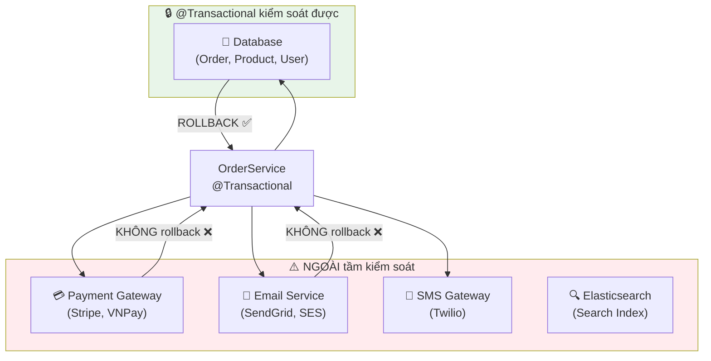

### 10.3. Giải pháp: Đặt External Call SAU cùng

```java
@Transactional
public Order createOrderSafer(OrderRequest request) {
    // 1. Validate tất cả business rules TRƯỚC
    validateRequest(request);
    Product product = findAndValidateProduct(request.getProductId());
    validateStock(product, request.getQuantity());

    // 2. Thực hiện TẤT CẢ thao tác DB trước
    Order order = orderRepository.save(buildOrder(request));
    productRepository.reduceStockAtomic(product.getId(), request.getQuantity());

    // 3. Gọi external service SAU CÙNG (giảm thiểu cửa sổ rủi ro)
    // Nếu bước 2 fail → rollback TRƯỚC KHI gọi external
    PaymentResult result = paymentGatewayClient.charge(request.getAmount());

    // 4. Cập nhật kết quả từ external
    order.setPaymentId(result.getTransactionId());
    order.setStatus("PAID");

    return order;
    // ⚠️ Vẫn chưa 100% an toàn: nếu COMMIT thất bại sau khi charge payment
    // → Cần giải pháp nâng cao hơn
}
```

### 10.4. Giải pháp nâng cao (Preview — sẽ học kỹ ở Giai đoạn 8)

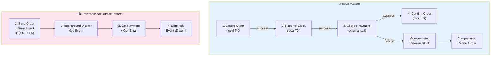

| Giải pháp | Mô tả | Độ phức tạp |
|:---|:---|:---:|
| **Đặt external call sau cùng** | Giảm cửa sổ rủi ro (chưa 100% an toàn) | ⭐ |
| **Idempotency Key** | Đảm bảo retry an toàn (gọi lại không tạo side effect mới) | ⭐⭐ |
| **Transactional Outbox** | Ghi event vào DB cùng TX → worker riêng xử lý | ⭐⭐⭐ |
| **Saga Pattern** | Chuỗi local TX + compensating actions | ⭐⭐⭐⭐ |
| **2PC (Two-Phase Commit)** | Coordinator điều phối nhiều database | ⭐⭐⭐⭐⭐ |

> [!NOTE]
> **Trong dự án học tập hiện tại**, chúng ta chỉ sử dụng 1 database (H2) → `@Transactional` đã đủ mạnh. Các giải pháp nâng cao như Saga, Outbox sẽ được tìm hiểu khi học Microservices (Giai đoạn 8).

---

## PHẦN 11: 💻 THỰC HÀNH — TRIỂN KHAI ORDER SERVICE VỚI TRANSACTION

### 11.1. Kịch bản nghiệp vụ

```
┌──────────────────────────────────────────────────────────────────┐
│  📦 Quy trình đặt hàng (Create Order):                          │
│                                                                  │
│  1. Validate: User tồn tại? Product tồn tại? Stock đủ?         │
│  2. Tạo Order entity (status = "PENDING")                        │
│  3. Giảm stock Product (atomic update)                           │
│  4. Cập nhật status Order → "CONFIRMED"                          │
│                                                                  │
│  → Tất cả trong 1 Transaction:                                   │
│    ✅ Thành công → COMMIT tất cả                                 │
│    ❌ Bất kỳ bước nào fail → ROLLBACK tất cả                    │
│    → Đảm bảo: KHÔNG BAO GIỜ có Order mà stock không giảm       │
│    → Đảm bảo: KHÔNG BAO GIỜ có stock giảm mà không có Order    │
└──────────────────────────────────────────────────────────────────┘
```

### 11.2. OrderCreateRequest DTO

```java
package com.example.springbootlearning.dto.request;

import jakarta.validation.constraints.*;

/**
 * 📘 BÀI 12 — Request DTO cho tạo đơn hàng
 */
public record OrderCreateRequest(
        @NotNull(message = "userId không được null")
        Long userId,

        @NotNull(message = "productId không được null")
        Long productId,

        @NotNull(message = "quantity không được null")
        @Min(value = 1, message = "Số lượng phải lớn hơn 0")
        @Max(value = 100, message = "Số lượng tối đa là 100")
        Integer quantity,

        @Size(max = 500, message = "Mô tả tối đa 500 ký tự")
        String description
) {}
```

### 11.3. OrderService — Trái tim của Transaction

```java
package com.example.springbootlearning.service;

import com.example.springbootlearning.dto.request.OrderCreateRequest;
import com.example.springbootlearning.exception.ResourceNotFoundException;
import com.example.springbootlearning.model.Order;
import com.example.springbootlearning.model.Product;
import com.example.springbootlearning.model.User;
import com.example.springbootlearning.repository.OrderRepository;
import com.example.springbootlearning.repository.ProductRepository;
import com.example.springbootlearning.repository.UserRepository;
import org.slf4j.Logger;
import org.slf4j.LoggerFactory;
import org.springframework.stereotype.Service;
import org.springframework.transaction.annotation.Transactional;

/**
 * 📘 BÀI 12 — OrderService (Transaction Management)
 *
 * Minh họa:
 *   ✅ @Transactional đảm bảo Atomicity: tạo Order + giảm Stock cùng thành công/thất bại
 *   ✅ @Transactional(readOnly = true) cho các thao tác đọc
 *   ✅ Rollback tự động khi RuntimeException (ResourceNotFoundException, IllegalStateException)
 *   ✅ Atomic SQL update tránh race condition khi giảm stock
 */
@Service
@Transactional(readOnly = true) // Mặc định: tất cả method là read-only
public class OrderService {

    private static final Logger log = LoggerFactory.getLogger(OrderService.class);

    private final OrderRepository orderRepository;
    private final ProductRepository productRepository;
    private final UserRepository userRepository;

    public OrderService(OrderRepository orderRepository,
                        ProductRepository productRepository,
                        UserRepository userRepository) {
        this.orderRepository = orderRepository;
        this.productRepository = productRepository;
        this.userRepository = userRepository;
    }

    // ================================================================
    // WRITE — Tạo đơn hàng (Transaction đảm bảo Atomicity)
    // ================================================================

    @Transactional // Override readOnly → readOnly = false cho WRITE
    public Order createOrder(OrderCreateRequest request) {
        log.info("📥 Bắt đầu tạo đơn hàng: userId={}, productId={}, qty={}",
                request.userId(), request.productId(), request.quantity());

        // ── Bước 1: Validate User tồn tại ──
        User user = userRepository.findById(request.userId())
                .orElseThrow(() -> {
                    log.warn("⚠️ User không tồn tại: id={}", request.userId());
                    return new ResourceNotFoundException("User", "id", request.userId());
                    // → RuntimeException → ROLLBACK (dù chưa có gì để rollback)
                });

        // ── Bước 2: Validate Product tồn tại ──
        Product product = productRepository.findById(request.productId())
                .orElseThrow(() -> {
                    log.warn("⚠️ Product không tồn tại: id={}", request.productId());
                    return new ResourceNotFoundException("Product", "id", request.productId());
                });

        // ── Bước 3: Validate stock đủ ──
        if (product.getStock() < request.quantity()) {
            log.warn("⚠️ Không đủ hàng: stock={}, requested={}",
                    product.getStock(), request.quantity());
            throw new IllegalStateException(
                    String.format("Không đủ hàng trong kho. Tồn kho: %d, Yêu cầu: %d",
                            product.getStock(), request.quantity())
            );
            // → RuntimeException → ROLLBACK
        }

        // ── Bước 4: Tạo Order ──
        double totalAmount = product.getPrice() * request.quantity();
        Order order = new Order(
                request.description() != null ? request.description()
                        : "Đơn hàng " + product.getName() + " x" + request.quantity(),
                totalAmount,
                "CONFIRMED",
                user
        );
        order = orderRepository.save(order);
        log.info("✅ Order đã lưu: id={}, totalAmount={}", order.getId(), totalAmount);

        // ── Bước 5: Giảm stock (Atomic SQL Update) ──
        int updatedRows = productRepository.reduceStockAtomic(
                product.getId(), request.quantity()
        );
        if (updatedRows == 0) {
            // Race condition: ai đó đã mua hết stock trước chúng ta
            log.error("💥 Race condition! Stock đã hết khi cố giảm: productId={}",
                    product.getId());
            throw new IllegalStateException(
                    "Sản phẩm đã hết hàng (race condition detected)"
            );
            // → RuntimeException → ROLLBACK cả Order ở bước 4!
            // → Đây chính là sức mạnh của ATOMICITY
        }
        log.info("✅ Stock đã giảm: productId={}, quantity=-{}",
                product.getId(), request.quantity());

        log.info("🎉 Đơn hàng tạo thành công: orderId={}, userId={}, productId={}",
                order.getId(), user.getId(), product.getId());
        return order;
    }

    // ================================================================
    // READ — Các phương thức đọc (kế thừa readOnly = true từ class)
    // ================================================================

    public java.util.List<Order> getOrdersByUserId(Long userId) {
        log.debug("Lấy danh sách orders của userId={}", userId);
        return orderRepository.findByUserId(userId);
    }

    public Order getOrderById(Long id) {
        return orderRepository.findById(id)
                .orElseThrow(() -> new ResourceNotFoundException("Order", "id", id));
    }

    public java.util.List<Order> getOrdersByStatus(String status) {
        return orderRepository.findByStatusIgnoreCase(status);
    }

    // ================================================================
    // WRITE — Hủy đơn hàng (Rollback stock)
    // ================================================================

    @Transactional
    public Order cancelOrder(Long orderId) {
        log.info("📥 Hủy đơn hàng: orderId={}", orderId);

        Order order = orderRepository.findById(orderId)
                .orElseThrow(() -> new ResourceNotFoundException("Order", "id", orderId));

        if ("CANCELLED".equalsIgnoreCase(order.getStatus())) {
            throw new IllegalStateException("Đơn hàng đã bị hủy trước đó");
        }

        // Hoàn trả stock (logic đơn giản cho learning)
        // Trong production: cần parse quantity từ order items
        order.setStatus("CANCELLED");
        orderRepository.save(order);

        log.info("✅ Đơn hàng đã hủy: orderId={}", orderId);
        return order;
    }
}
```

### 11.4. Luồng chạy Transaction của createOrder()

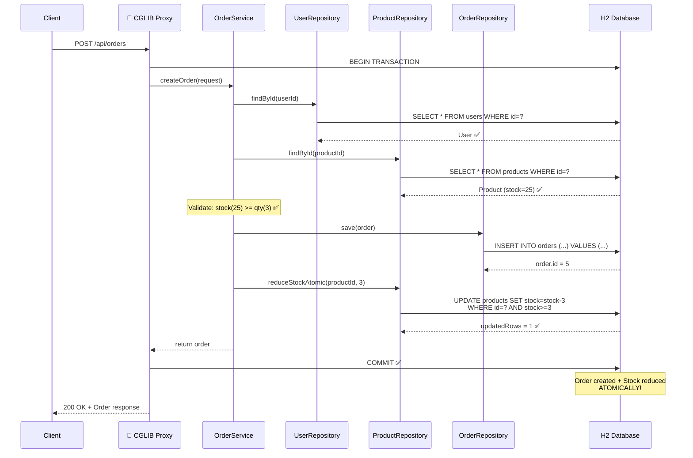

### 11.5. Kịch bản ROLLBACK

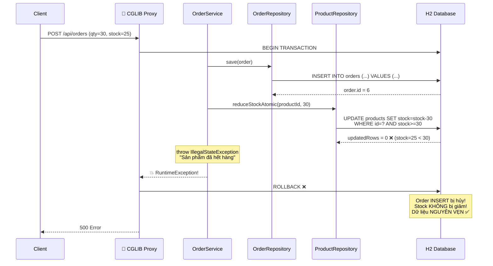

### 11.6. OrderController

```java
package com.example.springbootlearning.controller;

import com.example.springbootlearning.dto.request.OrderCreateRequest;
import com.example.springbootlearning.dto.response.ApiResponse;
import com.example.springbootlearning.model.Order;
import com.example.springbootlearning.service.OrderService;
import io.swagger.v3.oas.annotations.Operation;
import io.swagger.v3.oas.annotations.tags.Tag;
import jakarta.validation.Valid;
import org.slf4j.Logger;
import org.slf4j.LoggerFactory;
import org.springframework.http.HttpStatus;
import org.springframework.http.ResponseEntity;
import org.springframework.web.bind.annotation.*;

import java.util.List;

/**
 * 📘 BÀI 12 — Order REST Controller (Transaction Demo)
 */
@RestController
@RequestMapping("/api/v1/orders")
@Tag(name = "Order API", description = "Quản lý đơn hàng (Transaction Management - Bài 12)")
public class OrderController {

    private static final Logger log = LoggerFactory.getLogger(OrderController.class);
    private final OrderService orderService;

    public OrderController(OrderService orderService) {
        this.orderService = orderService;
    }

    @Operation(summary = "Tạo đơn hàng mới (Transaction: Order + Stock giảm)")
    @PostMapping
    public ResponseEntity<ApiResponse<Order>> createOrder(
            @Valid @RequestBody OrderCreateRequest request) {
        log.info("📥 POST /api/v1/orders — userId={}, productId={}, qty={}",
                request.userId(), request.productId(), request.quantity());
        Order order = orderService.createOrder(request);
        return ResponseEntity
                .status(HttpStatus.CREATED)
                .body(ApiResponse.created("Đơn hàng đã tạo thành công", order));
    }

    @Operation(summary = "Lấy danh sách đơn hàng theo User ID")
    @GetMapping("/user/{userId}")
    public ResponseEntity<ApiResponse<List<Order>>> getOrdersByUser(
            @PathVariable Long userId) {
        List<Order> orders = orderService.getOrdersByUserId(userId);
        return ResponseEntity.ok(
                ApiResponse.success("Lấy đơn hàng thành công", orders));
    }

    @Operation(summary = "Lấy đơn hàng theo ID")
    @GetMapping("/{id}")
    public ResponseEntity<ApiResponse<Order>> getOrderById(@PathVariable Long id) {
        Order order = orderService.getOrderById(id);
        return ResponseEntity.ok(
                ApiResponse.success("Lấy đơn hàng thành công", order));
    }

    @Operation(summary = "Hủy đơn hàng")
    @PatchMapping("/{id}/cancel")
    public ResponseEntity<ApiResponse<Order>> cancelOrder(@PathVariable Long id) {
        log.info("📥 PATCH /api/v1/orders/{}/cancel", id);
        Order order = orderService.cancelOrder(id);
        return ResponseEntity.ok(
                ApiResponse.success("Đơn hàng đã hủy thành công", order));
    }
}
```

---

## PHẦN 12: 🎯 BEST PRACTICES & ANTI-PATTERNS

### ✅ Best Practices

| # | Practice | Giải thích |
|:---:|:---|:---|
| 1 | **Đặt `@Transactional` ở Service layer** (KHÔNG ở Controller/Repository) | Service = nơi chứa business logic = nơi xác định ranh giới transaction |
| 2 | **`readOnly = true` cho mọi method đọc** | Hibernate skip dirty checking → tiết kiệm RAM & CPU |
| 3 | **Dùng `rollbackFor = Exception.class`** cho nghiệp vụ quan trọng | Tránh bỏ sót checked exception |
| 4 | **Giữ transaction ngắn nhất có thể** | Transaction dài = giữ lock lâu = bottleneck |
| 5 | **Không gọi external API trong transaction** | External call chậm + không rollback được |
| 6 | **Dùng Atomic SQL thay vì read-modify-write** | `UPDATE ... SET stock = stock - :qty WHERE stock >= :qty` thay vì load → setStock → save |
| 7 | **`@Transactional(readOnly = true)` ở class level** + override cho write | Pattern sạch, mặc định an toàn |
| 8 | **Log trước khi throw exception** | Dễ debug khi rollback xảy ra |

### ❌ Anti-Patterns

| # | Anti-Pattern | Vấn đề |
|:---:|:---|:---|
| 1 | `@Transactional` trên Controller | Controller không phải nơi quản lý business transaction |
| 2 | Transaction quá lớn (God Transaction) | Giữ lock lâu, ảnh hưởng throughput |
| 3 | Gọi REST API/gửi email TRONG transaction | External call KHÔNG rollback được |
| 4 | Catch exception rồi nuốt (swallow) | Transaction KHÔNG rollback → data inconsistent |
| 5 | Self-invocation (`this.method()`) | Bypass proxy → `@Transactional` bị ignore |
| 6 | `@Transactional` trên `private` method | CGLIB proxy không override được |

---

## PHẦN 13: 💼 CÂU HỎI PHỎNG VẤN (INTERVIEW QUESTIONS)

### Câu 1: ACID là gì? Giải thích từng tính chất với ví dụ cụ thể.
**Trả lời:**
ACID là 4 tính chất đảm bảo tính toàn vẹn của database transaction:
- **Atomicity**: Tất cả thao tác trong transaction cùng thành công hoặc cùng thất bại. VD: Chuyển tiền A→B: trừ A + cộng B phải xảy ra đồng thời.
- **Consistency**: Dữ liệu chuyển từ trạng thái hợp lệ này sang trạng thái hợp lệ khác. VD: Tổng tiền trước và sau chuyển khoản phải bằng nhau.
- **Isolation**: Transaction đang chạy không nhìn thấy thay đổi chưa commit của transaction khác. VD: 2 người cùng mua sản phẩm cuối → chỉ 1 người thành công.
- **Durability**: Dữ liệu đã commit sẽ tồn tại vĩnh viễn, kể cả server crash. Database đảm bảo bằng WAL (Write-Ahead Logging).

### Câu 2: `@Transactional` hoạt động như thế nào bên dưới? Tại sao self-invocation không hoạt động?
**Trả lời:**
Spring sử dụng **AOP Proxy** (CGLIB hoặc JDK Dynamic Proxy) để bọc quanh bean. Khi method được gọi từ bên ngoài, request đi qua Proxy → Proxy bắt đầu transaction → gọi method thật → commit/rollback. Khi self-invocation (`this.method()`), gọi trực tiếp trên bean thật mà không qua Proxy → `@Transactional` bị bỏ qua. Giải pháp: tách method sang class khác, hoặc inject self (`@Lazy @Autowired private MyService self`).

### Câu 3: `@Transactional(readOnly = true)` làm gì? Có thực sự chỉ đọc không?
**Trả lời:**
`readOnly = true` gợi ý (hint) cho Hibernate và JDBC driver:
1. **Hibernate**: Tắt dirty checking (không tạo snapshot) → tiết kiệm RAM. Đặt flush mode = MANUAL → giảm roundtrip DB.
2. **JDBC**: `connection.setReadOnly(true)` → database có thể route query tới read replica.
Tuy nhiên, nó KHÔNG ngăn cản ghi. Nếu gọi `save()` trong readOnly method, Hibernate vẫn cho phép nhưng thay đổi sẽ bị bỏ qua khi flush (vì flush mode = MANUAL). Một số database (PostgreSQL) sẽ ném exception nếu có INSERT/UPDATE trong read-only transaction.

### Câu 4: Phân biệt Propagation REQUIRED vs REQUIRES_NEW. Khi nào dùng REQUIRES_NEW?
**Trả lời:**
- **REQUIRED** (mặc định): Nếu đã có transaction → tham gia. Chưa có → tạo mới. Cả method A và B dùng chung 1 transaction → rollback 1 là rollback cả 2.
- **REQUIRES_NEW**: Luôn tạo transaction MỚI, tạm dừng (suspend) transaction cũ. 2 transaction hoàn toàn độc lập.
Dùng `REQUIRES_NEW` khi muốn method B persist dữ liệu ĐỘC LẬP, không bị ảnh hưởng nếu method A rollback. VD: Ghi audit log (phải lưu được dù business logic fail), ghi lỗi vào bảng error_log.

### Câu 5: Tại sao checked exception không rollback theo mặc định? Thiết kế này hợp lý hay bất hợp lý?
**Trả lời:**
Spring tuân theo quy ước của **EJB (Enterprise JavaBeans)**: checked exception thường đại diện cho **business error** có thể phục hồi (recoverable) → commit là hợp lý. Unchecked exception (RuntimeException) đại diện cho **programming error** không thể phục hồi → rollback.
Tuy nhiên, trong thực tế hiện đại, ranh giới này không rõ ràng. Best practice: dùng `rollbackFor = Exception.class` cho các method quan trọng, hoặc chỉ dùng unchecked exception trong toàn bộ ứng dụng (như dự án của chúng ta với `BusinessException extends RuntimeException`).

### Câu 6: Giải thích Dirty Read, Non-Repeatable Read, Phantom Read.
**Trả lời:**
- **Dirty Read**: TX-A đọc dữ liệu mà TX-B chưa commit. Nếu TX-B rollback → TX-A đã đọc "dữ liệu bẩn" không tồn tại.
- **Non-Repeatable Read**: TX-A đọc cùng 1 row 2 lần, nhưng giữa 2 lần đọc, TX-B đã UPDATE row đó và commit → TX-A đọc ra giá trị khác lần 1.
- **Phantom Read**: TX-A chạy cùng 1 query 2 lần, nhưng giữa 2 lần, TX-B đã INSERT/DELETE rows mới → TX-A nhận được số lượng rows khác lần 1 (rows "ma" xuất hiện/biến mất).

### Câu 7: READ_COMMITTED vs REPEATABLE_READ — khi nào dùng cái nào?
**Trả lời:**
- **READ_COMMITTED** (PostgreSQL default): Chỉ đọc dữ liệu đã commit. Mỗi câu SELECT thấy snapshot mới nhất tại thời điểm đó. Đủ tốt cho 90% ứng dụng.
- **REPEATABLE_READ** (MySQL InnoDB default): Đọc snapshot cố định từ lúc bắt đầu transaction. Mọi SELECT trong cùng TX luôn thấy cùng dữ liệu. Dùng khi cần đọc nhất quán (report generation, tính toán phụ thuộc vào nhiều query).
Trade-off: REPEATABLE_READ an toàn hơn nhưng giữ lock lâu hơn, giảm throughput.

### Câu 8: `@Transactional` có hoạt động trên private method không? Tại sao?
**Trả lời:**
**KHÔNG.** Spring sử dụng CGLIB Proxy để tạo subclass. CGLIB proxy override method bằng cách tạo subclass (extends). Theo quy tắc Java, `private` method không thể bị override → proxy không thể thêm logic transaction vào. `@Transactional` trên `private` method sẽ bị **im lặng bỏ qua** (không có warning hay error). Fix: đổi sang `public` hoặc `protected`.

### Câu 9: Có thể dùng `@Transactional` để rollback external API call (Stripe, SMS) không?
**Trả lời:**
**KHÔNG.** `@Transactional` chỉ kiểm soát database transaction (qua JDBC connection). External API call (HTTP request, message queue, email) hoàn toàn nằm ngoài tầm kiểm soát. Nếu database rollback, external service đã thực thi rồi (tiền đã trừ, SMS đã gửi).
Giải pháp: (1) Đặt external call sau cùng trong transaction để giảm cửa sổ rủi ro. (2) Idempotency key: đảm bảo retry an toàn. (3) Saga Pattern: chuỗi local transaction + compensating action. (4) Transactional Outbox: ghi event vào DB cùng TX, worker riêng xử lý bất đồng bộ.

### Câu 10: Khi nào KHÔNG nên dùng `@Transactional`?
**Trả lời:**
1. **Method chỉ đọc 1 câu query đơn giản**: Spring Data JPA method `findById()` đã chạy trong auto-commit transaction. Thêm `@Transactional(readOnly = true)` vẫn OK cho optimization nhưng không bắt buộc.
2. **Khi gọi external API/service dài**: Transaction giữ database connection → connection pool exhaustion nếu external call chậm.
3. **Batch processing lớn**: Transaction quá lớn giữ lock và RAM → chia nhỏ thành nhiều transaction.

### Câu 11: `@Transactional` ở class level vs method level — cái nào ưu tiên?
**Trả lời:**
**Method level ưu tiên hơn class level.** Đây là quy tắc "most specific wins" của Spring. Pattern phổ biến: đặt `@Transactional(readOnly = true)` ở class level (mặc định read), rồi override bằng `@Transactional` ở method level cho các write method.

### Câu 12: Timeout trong `@Transactional(timeout = 30)` có ý nghĩa gì?
**Trả lời:**
`timeout` (giây) đặt giới hạn thời gian cho transaction. Nếu transaction chưa hoàn thành sau timeout → tự động rollback + ném `TransactionTimedOutException`. Mặc định = -1 (không timeout, phụ thuộc database). Dùng để ngăn transaction bị treo do query chậm, deadlock, hoặc external call timeout.

### Câu 13: Explain Optimistic Locking vs Pessimistic Locking.
**Trả lời:**
- **Optimistic Locking** (`@Version`): Không khóa row khi đọc. Khi commit, kiểm tra version number. Nếu version đã thay đổi → `OptimisticLockException` → retry. Phù hợp: ít conflict (read-heavy workload).
- **Pessimistic Locking** (`@Lock(PESSIMISTIC_WRITE)`): Khóa row ngay khi đọc (`SELECT ... FOR UPDATE`). Transaction khác phải chờ. Phù hợp: nhiều conflict (write-heavy workload), critical sections.

### Câu 14: Tại sao nên dùng Atomic SQL (`UPDATE ... SET stock = stock - :qty WHERE stock >= :qty`) thay vì read-modify-write?
**Trả lời:**
Pattern read-modify-write (load → setStock → save) có **race condition**: 2 transaction đọc stock = 25 cùng lúc → cả 2 setStock(22) → chỉ giảm 3 thay vì 6. Atomic SQL thực hiện đọc + ghi trong **1 câu SQL duy nhất** → database đảm bảo serialization ở row level. Thêm `WHERE stock >= :qty` ngăn stock âm. Kiểm tra `updatedRows == 0` để phát hiện conflict.

### Câu 15: Giải thích Transactional Outbox Pattern.
**Trả lời:**
Outbox Pattern giải quyết vấn đề "dual write" (ghi database + gửi event/message phải đồng bộ):
1. Trong CÙNG 1 database transaction: save business data + save event vào bảng `outbox_events`.
2. Background worker (CDC hoặc polling) đọc bảng `outbox_events`.
3. Worker gửi event tới message broker (Kafka, RabbitMQ) hoặc gọi external API.
4. Sau khi gửi thành công → đánh dấu event đã xử lý.
Ưu điểm: đảm bảo at-least-once delivery, không bao giờ mất event (vì event nằm trong cùng TX với business data). Nhược điểm: tăng độ trễ (latency), cần worker bổ sung.

---

## PHẦN 14: 📚 KIẾN THỨC BỔ SUNG: JAVA CORE & DESIGN PATTERNS

### 14.1. Proxy Pattern (Java Core & Design Pattern)

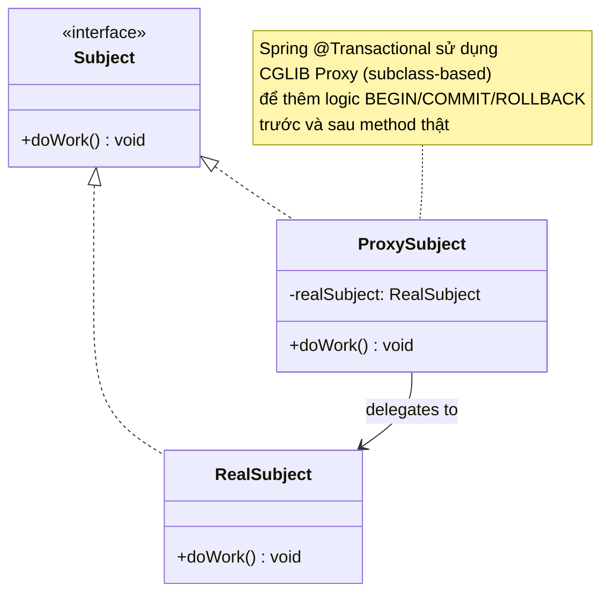

**Proxy Pattern** là 1 trong 23 GoF Design Patterns:
- **Intent**: Cung cấp đại diện (surrogate) cho object khác để kiểm soát truy cập.
- **Trong Spring**: CGLIB Proxy extends class gốc, override public method, thêm AOP logic (transaction, caching, security).
- **Java JDK Dynamic Proxy**: Chỉ áp dụng cho interface (`InvocationHandler`). Spring Data JPA repository sử dụng cơ chế này.

### 14.2. Strategy Pattern (PlatformTransactionManager)

Spring `PlatformTransactionManager` là ví dụ điển hình của **Strategy Pattern**:
- **Context**: `TransactionInterceptor` (AOP advice)
- **Strategy interface**: `PlatformTransactionManager`
- **Concrete strategies**: `JpaTransactionManager`, `DataSourceTransactionManager`, `JtaTransactionManager`

→ Bạn có thể swap transaction manager mà không thay đổi business logic.

### 14.3. Template Method Pattern (TransactionTemplate)

Ngoài `@Transactional` (declarative), Spring còn hỗ trợ **programmatic transaction** qua `TransactionTemplate`:

```java
@Service
public class OrderService {

    private final TransactionTemplate transactionTemplate;

    public OrderService(PlatformTransactionManager txManager) {
        this.transactionTemplate = new TransactionTemplate(txManager);
    }

    public Order createOrderProgrammatic(OrderCreateRequest request) {
        return transactionTemplate.execute(status -> {
            // Tất cả code ở đây nằm trong transaction
            Order order = orderRepository.save(buildOrder(request));
            productRepository.reduceStockAtomic(request.productId(), request.quantity());
            return order;
            // Nếu exception → tự rollback
            // Có thể gọi status.setRollbackOnly() để force rollback
        });
    }
}
```

| Tiêu chí | Declarative (`@Transactional`) | Programmatic (`TransactionTemplate`) |
|:---|:---:|:---:|
| Cách dùng | Annotation trên method | Code Java trực tiếp |
| Linh hoạt | Thấp (cấu hình qua annotation) | Cao (có thể if/else trong TX) |
| Dễ đọc | ✅ Rất dễ | ⚠️ Verbose hơn |
| Self-invocation | ❌ Bị bypass | ✅ Hoạt động bình thường |
| Use case | 95% trường hợp | Cần kiểm soát chi tiết transaction boundary |

### 14.4. Exception Hierarchy trong Java

```
java.lang.Throwable
├── java.lang.Error                    ← JVM error, không bắt được
│   ├── OutOfMemoryError
│   ├── StackOverflowError
│   └── ...
└── java.lang.Exception                ← Application error
    ├── IOException                    ← Checked (phải try-catch hoặc throws)
    ├── SQLException                   ← Checked
    ├── ParseException                 ← Checked
    └── java.lang.RuntimeException     ← Unchecked (không bắt buộc try-catch)
        ├── NullPointerException
        ├── IllegalArgumentException
        ├── IllegalStateException
        └── com.example...BusinessException  ← Custom exception trong dự án
            ├── ResourceNotFoundException
            └── DuplicateResourceException
```

> **Quy ước trong dự án**: Tất cả custom exception kế thừa `RuntimeException` → tự động rollback `@Transactional`.

---

## PHẦN 15: 🔗 TÀI LIỆU LIÊN KẾT

### File liên quan trong dự án

- [Order.java](file:///Users/vovantu/HTML_CSS/JAVA%20/springboot-learning/src/main/java/com/example/springbootlearning/model/Order.java) — Order Entity
- [Product.java](file:///Users/vovantu/HTML_CSS/JAVA%20/springboot-learning/src/main/java/com/example/springbootlearning/model/Product.java) — Product Entity (BaseAuditableEntity)
- [User.java](file:///Users/vovantu/HTML_CSS/JAVA%20/springboot-learning/src/main/java/com/example/springbootlearning/model/User.java) — User Entity
- [OrderRepository.java](file:///Users/vovantu/HTML_CSS/JAVA%20/springboot-learning/src/main/java/com/example/springbootlearning/repository/OrderRepository.java) — Order Repository
- [ProductRepository.java](file:///Users/vovantu/HTML_CSS/JAVA%20/springboot-learning/src/main/java/com/example/springbootlearning/repository/ProductRepository.java) — Product Repository (reduceStockAtomic)
- [ProductService.java](file:///Users/vovantu/HTML_CSS/JAVA%20/springboot-learning/src/main/java/com/example/springbootlearning/service/ProductService.java) — ProductService (pattern @Transactional)
- [ResourceNotFoundException.java](file:///Users/vovantu/HTML_CSS/JAVA%20/springboot-learning/src/main/java/com/example/springbootlearning/exception/ResourceNotFoundException.java) — Custom exception (extends RuntimeException)
- [application.properties](file:///Users/vovantu/HTML_CSS/JAVA%20/springboot-learning/src/main/resources/application.properties) — JPA + H2 configuration

### Bài giảng liên quan

- [Bài 9: Spring Data JPA & Hibernate ORM](file:///Users/vovantu/HTML_CSS/JAVA%20/Note/Lesson09/bai-9-spring-data-jpa-hibernate-orm.md) — ORM, Entity, Persistence Context
- [Bài 10: Entity Relationships & Query Methods](file:///Users/vovantu/HTML_CSS/JAVA%20/Note/Lesson10) — @ManyToOne, @OneToMany, N+1 Query
- [Bài 11: Pagination, Sorting & Specifications](file:///Users/vovantu/HTML_CSS/JAVA%20/Note/Lesson11/bai-11-pagination-sorting-specifications.md) — Pageable, Specification Pattern
- [Implementation Plan](file:///Users/vovantu/.gemini/antigravity-ide/brain/efda256c-57a1-492b-a7c0-e53fec100685/implementation_plan.md) — Lộ trình tổng thể
