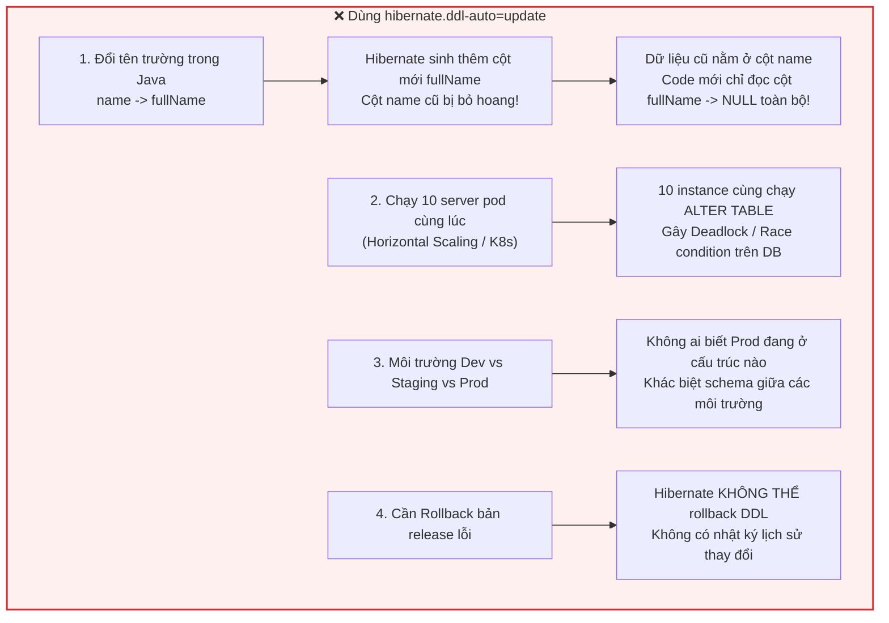
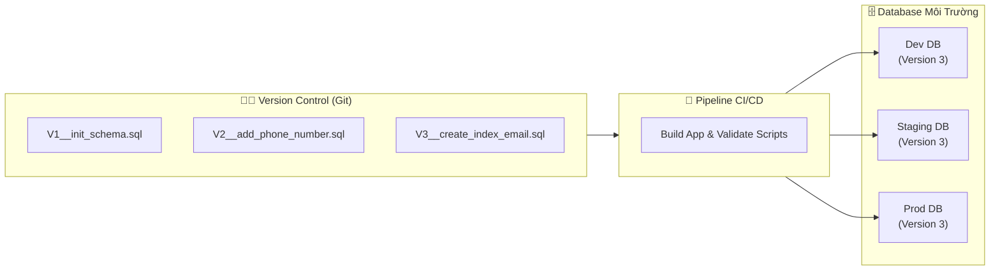
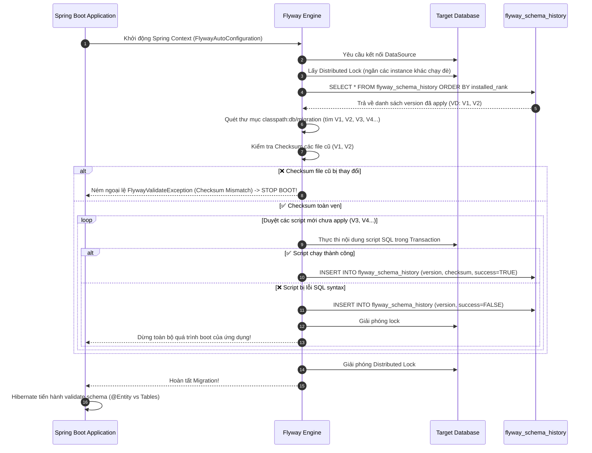
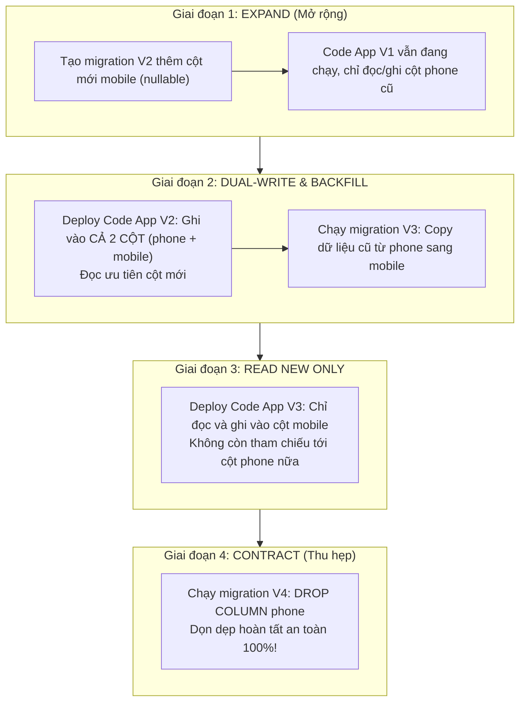

# 📘 BÀI 13: DATABASE MIGRATION VỚI FLYWAY — QUẢN LÝ SCHEMA TIẾN HÓA CHUYÊN NGHIỆP

> **Mục tiêu bài học:**
> 1. Hiểu rõ **tại sao `hibernate.ddl-auto=update` bị cấm tuyệt đối** trong môi trường Production và rủi ro mất dữ liệu nghiêm trọng.
> 2. Nắm vững triết lý **Database Migration as Code** và quản lý phiên bản cơ sở dữ liệu bằng Version Control (Git).
> 3. Hiểu tường tận **cơ chế hoạt động của Flyway**: bảng metadata `flyway_schema_history`, thuật toán tính Checksum, Distributed Schema Locking.
> 4. Phân biệt và làm chủ 3 loại Migration scripts: **Versioned (`V`)**, **Repeatable (`R`)**, và **Undo (`U`)**.
> 5. Nắm vững **Zero-Downtime Migration Pattern** (Expand and Contract Pattern) áp dụng cho hệ thống High Availability phục vụ hàng triệu người dùng.
> 6. Giải quyết triệt để các sự cố vận hành kinh điển: **Checksum Mismatch**, **Failed Migration**, **Out-of-Order Migration**, và kỹ thuật `flyway:repair`.
> 7. Tích hợp thực tế vào dự án Spring Boot: chuyển đổi sang `ddl-auto=validate`, viết toàn bộ chuỗi migration cho các Entity `User`, `Product`, `Order`, `Tag`, `AuditLog`.
> 8. Chinh phục **10 câu hỏi phỏng vấn tuyển dụng** hóc búa về Database Migration & Flyway.

---

## 📑 MỤC LỤC

| Phần | Nội dung chính | Mục tiêu đạt được |
|:---:|:---|:---|
| 1 | 💥 Vấn đề — Thảm họa khi dùng `ddl-auto=update` | Nhận diện rủi ro môi trường Production |
| 2 | 🆚 Flyway vs Liquibase vs Hibernate Auto DDL | So sánh công nghệ toàn diện |
| 3 | ⚙️ Cơ chế hoạt động cốt lõi của Flyway | `flyway_schema_history`, Checksum, Locking |
| 4 | 🏷️ Quy ước đặt tên & Phân loại Scripts | Versioned (`V`), Repeatable (`R`), Undo (`U`) |
| 5 | 🔄 Zero Downtime Database Migration Pattern | Chiến lược Expand & Contract Pattern |
| 6 | 🧱 Baseline Database hiện hữu | Xử lý database đã có sẵn dữ liệu thực tế |
| 7 | 🛠️ Cấu hình Flyway trong Spring Boot 3 & 4 | Tích hợp Maven, Properties & `ddl-auto=validate` |
| 8 | 🚨 Xử lý sự cố (Troubleshooting & Disaster Recovery) | Checksum Mismatch, Failed Migration & Repair |
| 9 | 💻 Triển khai thực hành trong dự án `springboot-learning` | Viết migration scripts từ V1 đến V7 + REST Demo |
| 10 | 🎯 Best Practices & Anti-Patterns trong Enterprise | Kinh nghiệm thực chiến khi làm việc nhóm |
| 11 | 💼 10 Câu hỏi phỏng vấn tuyển dụng (Interview Q&A) | Tự tin giải thích kiến trúc khi phỏng vấn |
| 12 | 📚 Kiến thức nâng cao: Java Core & Software Patterns | Command Pattern, Strategy & Transactional DDL |

---

## PHẦN 1: 💥 VẤN ĐỀ — THẢM HỌA KHI DÙNG `ddl-auto=update`

### 1.1. Kịch bản thực tế: Lỗi kinh điển trong dự án không dùng Migration Tool

Khi mới học Spring Data JPA, chúng ta thường cấu hình trong file `application.properties`:

```properties
# ❌ CỰC KỲ NGUY HIỂM KHI ĐƯA LÊN PRODUCTION HOẶC LÀM VIỆC THEO TEAM!
spring.jpa.hibernate.ddl-auto=update
```

Nhiều lập trình viên lầm tưởng rằng: *"Hibernate tự sinh bảng, tự thêm cột khi mình sửa class Java, tiện lợi thế này thì cần gì công cụ khác?"*

Hãy xem 4 thảm kịch xảy ra trong dự án thực tế:



### 1.2. Bảng phân tích chi tiết các rủi ro của `ddl-auto=update`

| Tình huống thực tế | Hành vi của `ddl-auto=update` | Hậu quả cho hệ thống |
|:---|:---|:---|
| **Đổi tên cột** (`user_name` ➔ `username`) | Hibernate không biết đây là đổi tên. Nó tạo cột mới `username` và giữ nguyên cột cũ `user_name`. | Toàn bộ dữ liệu của hàng triệu users nằm ở cột cũ, code mới đọc cột mới bị `null`. |
| **Xóa cột / Xóa thuộc tính** | Hibernate **không bao giờ xóa cột** cũ (vì sợ mất dữ liệu). | Bảng tích tụ hàng chục cột rác (dead columns), gây tốn bộ nhớ và lệch logic. |
| **Đổi kiểu dữ liệu** (`VARCHAR(50)` ➔ `VARCHAR(255)`) | Tùy database và dialect, nhiều trường hợp Hibernate không thay đổi được hoặc gây lock bảng toàn bộ. | Treo ứng dụng (Downtime). |
| **Tạo Index, View, Trigger, Procedure** | Hibernate hoàn toàn bất lực trong việc quản lý trigger, complex index, stored procedure, custom sequence. | Không thể tối ưu performance cơ sở dữ liệu. |
| **Clustered / Microservices (Nhiều Pods)** | Khi deploy 5 pods cùng khởi động, cả 5 pods cùng cố gắng thực thi DDL script lên 1 DB. | Metadata Lock, Deadlock, ứng dụng không thể boot. |
| **Audit & Version Control** | Không có lịch sử ghi chép: Ai đã đổi cột? Đổi vào ngày nào? Release phiên bản nào sinh ra cột đó? | Không thể điều tra nguyên nhân (Root Cause Analysis). |

### 1.3. Giải pháp chuẩn công nghiệp: Database Migration as Code



> [!IMPORTANT]
> **Nguyên tắc vàng của kiến trúc Backend chuyên nghiệp:**
> 1. Mã nguồn cơ sở dữ liệu (DDL, DML) là **First-Class Citizen** giống như mã nguồn Java. Phải được lưu trữ trên Git, được Code Review, được chạy qua pipeline CI/CD.
> 2. Cấu hình Hibernate luôn là: **`spring.jpa.hibernate.ddl-auto=validate`**.
>    - **Flyway** chịu trách nhiệm duy nhất: kiến tạo và thay đổi schema.
>    - **Hibernate** chịu trách nhiệm đối chiếu: kiểm tra xem Java Entity có khớp 100% với schema dưới DB hay không. Nếu lệch ➔ Ngắt ứng dụng ngay khi khởi động để cảnh báo lập trình viên!

---

## PHẦN 2: 🆚 SO SÁNH FLYWAY VS LIQUIBASE VS HIBERNATE DDL

Trong hệ sinh thái Java & Spring Boot, hai giải pháp quản lý Database Migration phổ biến nhất là **Flyway** và **Liquibase**.

```
┌────────────────────────────────────────────────────────────────────────┐
│             SO SÁNH 3 PHƯƠNG PHÁP QUẢN LÝ DATABASE SCHEMA             │
├─────────────────────┬───────────────────┬──────────────────────────────┤
│ Tiêu chí            │ Flyway 🚀        │ Liquibase 🐘                 │
├─────────────────────┼───────────────────┼──────────────────────────────┤
│ Định dạng script    │ SQL thuần (Native)│ XML, YAML, JSON hoặc SQL     │
├─────────────────────┼───────────────────┼──────────────────────────────┤
│ Độ dốc học tập      │ Rất thấp (Dễ học) │ Trung bình - Cao             │
├─────────────────────┼───────────────────┼──────────────────────────────┤
│ Tận dụng tính năng  │ Tối đa (Viết SQL  │ Bị giới hạn bởi các tag trừu │
│ riêng của từng DB   │ riêng cho PG/MySQL│ tượng nếu dùng XML/YAML      │
├─────────────────────┼───────────────────┼──────────────────────────────┤
│ Hỗ trợ Rollback     │ Bản Enterprise/Pro│ Miễn phí (Rollback tag)      │
│ tự động             │ (Community dùng Fwd)                             │
├─────────────────────┼───────────────────┼──────────────────────────────┤
│ Bảng Metadata       │ flyway_schema_    │ DATABASECHANGELOG            │
│                     │ history           │ DATABASECHANGELOGLOCK        │
├─────────────────────┼───────────────────┼──────────────────────────────┤
│ Mức độ ưa chuộng    │ Cực kỳ phổ biến   │ Phổ biến trong dự án cần     │
│ trong Spring Boot   │ trong Microservice│ độc lập DB tuyệt đối         │
└─────────────────────┴───────────────────┴──────────────────────────────┘
```

> [!TIP]
> **Khi nào chọn Flyway?**
> - Dự án đã xác định rõ hệ quản trị cơ sở dữ liệu (ví dụ PostgreSQL hoặc MySQL).
> - Đội ngũ lập trình viên thông thạo SQL và muốn kiểm soát 100% từng câu lệnh DDL, Index, CTE, Partitioning mà không bị trừu tượng hóa bởi XML.
> - Cần cấu hình gọn gàng, khởi động nhanh, tích hợp mượt mà với Spring Boot.

---

## PHẦN 3: ⚙️ CƠ CHẾ HOẠT ĐỘNG CỐT LÕI CỦA FLYWAY

### 3.1. Bảng Metadata: `flyway_schema_history`

Khi ứng dụng Spring Boot tích hợp Flyway khởi động lần đầu tiên, Flyway sẽ tự động tạo một bảng đặc biệt trong database mang tên: **`flyway_schema_history`**.

Cấu trúc các cột trong bảng này bao gồm:

```sql
-- Cấu trúc bảng flyway_schema_history do Flyway tự động khởi tạo
CREATE TABLE flyway_schema_history (
    installed_rank  INT NOT NULL PRIMARY KEY, -- Thứ tự thực thi (1, 2, 3...)
    version         VARCHAR(50),              -- Số phiên bản (ví dụ '1', '1.1', '2')
    description     VARCHAR(200) NOT NULL,    -- Tên mô tả (lấy từ tên file script)
    type            VARCHAR(20) NOT NULL,     -- SQL, JDBC, BASELINE...
    script          VARCHAR(1000) NOT NULL,   -- Tên file script (VD: V1__create_users.sql)
    checksum        INT,                      -- Mã băm kiểm tra tính toàn vẹn file
    installed_by    VARCHAR(100) NOT NULL,    -- User DB đã chạy script
    installed_on    TIMESTAMP DEFAULT CURRENT_TIMESTAMP, -- Thời điểm apply
    execution_time  INT NOT NULL,             -- Thời gian chạy script (milliseconds)
    success         BOOLEAN NOT NULL          -- Kết quả: TRUE (thành công) / FALSE (lỗi)
);
```

### 3.2. Vòng đời thực thi Migration khi Spring Boot Bootstrapping



### 3.3. Checksum — Chốt chặn bảo vệ tính bất biến

**Checksum** là mã băm CRC32 (hoặc tương đương) được tính toán dựa trên **toàn bộ nội dung văn bản** của file migration (từng ký tự, khoảng trắng, xuống dòng).

```
File V1__create_users.sql trên ổ cứng
          │
          ▼
Flyway tính Hash (CRC32) ➔ Ví dụ: -1827491028
          │
          ▼
So sánh với checksum trong flyway_schema_history
┌────────────────────────────────────────────────────────┐
│ Nếu Checksum Trùng Khớp: ✅ Hợp lệ                     │
│ Nếu Ai Đó Sửa File (Dù chỉ thêm dấu cách):              │
│ Checksum Bị Khác ➔ 💥 BÁO LỖI NGAY LẬP TỨC:             │
│ "Migration checksum mismatch for migration version 1"   │
└────────────────────────────────────────────────────────┘
```

> [!CAUTION]
> **Quy tắc bất biến:** Một khi file Migration Versioned (`V...`) đã được apply lên môi trường Staging/Production, **TUYỆT ĐỐI KHÔNG ĐƯỢC PHÉP CHỈNH SỬA FILE ĐÓ NỮA**. Muốn sửa schema? Hãy tạo một file version tiếp theo (ví dụ `V2`, `V3`)!

---

## PHẦN 4: 🏷️ QUY ƯỚC ĐẶT TÊN & PHÂN LOẠI MIGRATION SCRIPTS

Flyway hỗ trợ 3 loại migration script chính:

```
src/main/resources/db/migration/
├── V1__create_users_table.sql      <-- Versioned Migration (Chạy 1 lần)
├── V2__create_products_table.sql   <-- Versioned Migration
├── V2.1__add_stock_to_products.sql <-- Sub-version hỗ trợ dấu chấm
├── R__create_vw_order_summary.sql  <-- Repeatable Migration (Chạy lại khi sửa file)
└── U2__undo_products_table.sql     <-- Undo Migration (Bản Pro/Enterprise)
```

```
┌─────────────────────────────────────────────────────────────────────────────────┐
│                    QUY TẮC CÚ PHÁP TÊN FILE FLYWAY                              │
│                                                                                 │
│      V    1_2__add_status_column . sql                                         │
│      │    ──┬─ ──────────────────   ───                                         │
│   Prefix    │       Description    Extension                                    │
│             │                                                                   │
│          Version                                                                │
│   (Dùng số nguyên hoặc chấm                                                     │
│    phân tách: 1, 1.1, 2026.10.14)                                               │
│                                                                                 │
│   👉 Chú ý: Dấu phân cách BẮT BUỘC là HAI DẤU GẠCH DƯỚI: `__` (double underscore)│
└─────────────────────────────────────────────────────────────────────────────────┘
```

### 4.1. Versioned Migration (`V`)
- **Đặc điểm:** Chạy **duy nhất 1 lần**. Có số thứ tự tăng dần.
- **Ứng dụng:** Các thay đổi làm biến đổi cấu trúc bảng: `CREATE TABLE`, `ALTER TABLE`, `ADD COLUMN`, `CREATE INDEX`, hoặc data migration khởi tạo.
- **Quy tắc đánh version:** Có 2 trường phái:
  1. *Số tăng dần đơn giản:* `V1__...`, `V2__...`, `V3__...` (phù hợp dự án vừa và nhỏ, ít nhánh tính năng song song).
  2. *Timestamp:* `V20261014120000__create_users.sql` (phù hợp dự án lớn, nhiều team merge code song song, tránh conflict số version).

### 4.2. Repeatable Migration (`R`)
- **Đặc điểm:** **Không có version**. Sẽ tự động thực thi lại mỗi khi nội dung file bị thay đổi (tức Checksum thay đổi) sau khi toàn bộ script `V` đã chạy xong.
- **Ứng dụng cực kỳ hoàn hảo cho:**
  - `CREATE OR REPLACE VIEW`
  - Stored Procedures, Triggers, Custom Database Functions.
- **Lợi ích:** Bạn không cần phải tạo `V10__update_view.sql`, `V15__update_view_again.sql`. Bạn chỉ cần duy trì đúng 1 file `R__order_summary_view.sql` trên Git!

### 4.3. Undo Migration (`U`)
- **Đặc điểm:** Script dùng để hoàn tác version tương ứng (VD `U2` hoàn tác cho `V2`).
- **Lưu ý:** Chỉ có sẵn trên phiên bản thương mại (Flyway Teams / Enterprise). Ở phiên bản Community nguồn mở, chiến lược tiêu chuẩn của các kỹ sư là **Forward-Only Migration** (tạo `V3` để fix lỗi hoặc undo `V2`).

---

## PHẦN 5: 🔄 ZERO DOWNTIME DATABASE MIGRATION (EXPAND & CONTRACT PATTERN)

Trong hệ thống Enterprise hoạt động 24/7 (ngân hàng, thương mại điện tử), bạn không thể tắt server bảo trì chỉ để đổi tên 1 cột hoặc xóa 1 bảng. Nếu bạn chạy câu lệnh `ALTER TABLE users RENAME COLUMN phone TO mobile;` trong khi 50 server backend đang chạy code cũ, hệ thống sẽ sụp đổ ngay lập tức!

Để đạt được **Zero Downtime Migration**, chúng ta áp dụng mẫu thiết kế: **Expand and Contract Pattern** (hay còn gọi là *Parallel Run*).

### Quy trình 4 bước đổi tên cột không gián đoạn hệ thống:



> [!TIP]
> **Bài học kiến trúc đắt giá:**
> Không bao giờ xóa cột hoặc đổi tên cột trực tiếp trong 1 bước duy nhất trên Production! Luôn chia làm tối thiểu 2 đến 3 release:
> 1. Thêm mới ➔ 2. Đồng bộ dữ liệu & Chuyển luồng đọc ➔ 3. Xóa cái cũ.

---

## PHẦN 6: 🧱 BASELINE DATABASE HIỆN HỮU

Một câu hỏi thực tế rất lớn: *"Dự án của tôi đã chạy 3 năm nay, database trên Production đã có sẵn 50 bảng và 10 triệu records, giờ tích hợp Flyway vào thì nó có xóa sạch DB hay báo lỗi không?"*

👉 **Câu trả lời:** Flyway giải quyết vấn đề này bằng tính năng **Baseline**.

```properties
# Cấu hình Baseline trong application.properties
spring.flyway.baseline-on-migrate=true
spring.flyway.baseline-version=1
spring.flyway.baseline-description=Existing Database Baseline
```

### Cơ chế hoạt động:
1. Khi `baseline-on-migrate=true`, nếu Flyway thấy database đích đã có sẵn các bảng khác nhưng chưa có bảng `flyway_schema_history`:
2. Nó sẽ tạo ra bảng `flyway_schema_history` và ghi một dòng đánh dấu: `version = 1`, `type = BASELINE`, `description = Existing Database Baseline`.
3. Sau đó, nó bỏ qua script `V1` và chỉ bắt đầu chạy các script từ `V2` trở đi!
4. Giúp bạn tích hợp Flyway vào hệ thống legacy một cách an toàn mà không ảnh hưởng tới dữ liệu lịch sử.

---

## PHẦN 7: 🛠️ CẤU HÌNH FLYWAY TRONG SPRING BOOT 3 & 4

### 7.1. Cấu hình Maven (`pom.xml`)

Trong file [pom.xml](file:///Users/vovantu/HTML_CSS/JAVA%20/springboot-learning/pom.xml), thêm dependency chính thức:

```xml
<!-- 📘 BÀI 13: Database Migration với Flyway -->
<dependency>
    <groupId>org.flywaydb</groupId>
    <artifactId>flyway-core</artifactId>
</dependency>
```

*(Lưu ý: Đối với Spring Boot 3.x+ sử dụng MySQL hoặc PostgreSQL, Flyway 10+ tách riêng module database, ví dụ `flyway-database-postgresql` hoặc `flyway-mysql`. Với H2 in-memory, `flyway-core` đã tích hợp sẵn hỗ trợ đầy đủ).*

### 7.2. Cấu hình `application.properties`

```properties
# ===========================================
# 📘 BÀI 13: Flyway & Hibernate Validation Configuration
# ===========================================

# 1. BẮT BUỘC: Chuyển ddl-auto sang validate
# Không để Hibernate tự tạo/sửa bảng nữa, nhường quyền cho Flyway
spring.jpa.hibernate.ddl-auto=validate

# 2. Bật tính năng tự động chạy Flyway khi ứng dụng khởi động
spring.flyway.enabled=true

# 3. Đường dẫn thư mục chứa các file SQL migration
spring.flyway.locations=classpath:db/migration

# 4. Tự động baseline nếu database đã có bảng từ trước
spring.flyway.baseline-on-migrate=true
spring.flyway.baseline-version=0

# 5. Cho phép migration out of order (khi nhiều nhánh git merge không theo thứ tự thời gian)
spring.flyway.out-of-order=false

# 6. Tắt khởi tạo datasource mặc định cũ (vì Flyway sẽ quản lý toàn bộ DDL & seed data)
spring.jpa.defer-datasource-initialization=false
spring.sql.init.mode=never
```

---

## PHẦN 8: 🚨 XỬ LÝ SỰ CỐ (TROUBLESHOOTING & DISASTER RECOVERY)

Khi làm việc với Flyway, bạn chắc chắn sẽ gặp 2 lỗi kinh điển sau:

### 8.1. Lỗi 1: `FlywayValidateException: Migration checksum mismatch`

#### 🔴 Hiện tượng:
Ứng dụng bị sập khi khởi động với thông báo log đỏ:
```
Caused by: org.flywaydb.core.api.exception.FlywayValidateException: 
Validate failed: Migrations have failed validation
Migration checksum mismatch for migration version 1
-> Applied to database : -1892841029
-> Resolved locally    : 491028472
```

#### 🔍 Nguyên nhân:
Ai đó đã mở file `V1__create_users_table.sql` ra sửa (dù chỉ là sửa 1 chữ, thêm 1 dấu cách hoặc đổi comment) sau khi script này đã được chạy và lưu checksum vào database.

#### 🛠️ Cách khắc phục chuẩn Enterprise:
1. **Trên môi trường Production / Staging:**
   - Hoàn tác file `V1` trong mã nguồn về đúng trạng thái ban đầu để checksum khớp lại.
   - Viết một file migration mới (VD `V8__fix_user_table.sql`) để thực hiện thay đổi mong muốn.
2. **Trên môi trường Local Development (nếu bạn chỉ vô tình format code):**
   - Chạy lệnh `Flyway.repair()` để Flyway tính toán lại mã băm mới và ghi đè vào cột `checksum` của `flyway_schema_history`.

### 8.2. Lỗi 2: `Migration failed! Table 'users' already exists` hoặc Lỗi Cú pháp SQL

#### 🔴 Hiện tượng:
Khi viết script bị sai cú pháp SQL, Flyway chạy dở dang và ghi nhận dòng đó vào bảng metadata với trạng thái:
`success = FALSE`.
Từ lúc này, bạn khởi động lại ứng dụng bao nhiêu lần thì nó vẫn **từ chối chạy tiếp**, báo lỗi:
```
Found failed migration in metadata table: version 3. Please remove the failure or repair it before migrating.
```

#### 🔍 Nguyên nhân:
Flyway phát hiện lần chạy trước bị hỏng nên nó **dừng toàn bộ hệ thống** để bảo vệ tính toàn vẹn, tránh tình trạng "lỗi chồng lỗi".

#### 🛠️ Các bước xử lý phục hồi (Disaster Recovery Step-by-Step):
1. **Kiểm tra Database:**
   - Trên PostgreSQL (hỗ trợ Transactional DDL): Khi script lỗi, PG tự rollback sạch sẽ cấu trúc bảng.
   - Trên MySQL/Oracle (không hỗ trợ Transactional DDL cho `CREATE/ALTER TABLE`): Các bảng tạo dở dang vẫn nằm trong DB! Bạn phải dùng DBeaver / DataGrip xóa các bảng tạo dở đi.
2. **Sửa lỗi cú pháp SQL** trong file script migration.
3. **Chạy Repair Command:**
   - Gọi `flyway.repair()` qua code Java hoặc Flyway Maven Plugin (`mvn flyway:repair`).
   - Lệnh repair sẽ tự động xóa dòng có `success = false` trong bảng `flyway_schema_history`.
4. **Khởi động lại ứng dụng:** Flyway sẽ chạy lại script vừa sửa một cách trơn tru!

---

## PHẦN 9: 💻 TRIỂN KHAI THỰC HÀNH TRONG DỰ ÁN `springboot-learning`

Trong dự án thực tế của chúng ta, các Entity bao gồm:
- [User.java](file:///Users/vovantu/HTML_CSS/JAVA%20/springboot-learning/src/main/java/com/example/springbootlearning/model/User.java) (`users`)
- [Product.java](file:///Users/vovantu/HTML_CSS/JAVA%20/springboot-learning/src/main/java/com/example/springbootlearning/model/Product.java) (`products`)
- [Order.java](file:///Users/vovantu/HTML_CSS/JAVA%20/springboot-learning/src/main/java/com/example/springbootlearning/model/Order.java) (`orders`)
- [Tag.java](file:///Users/vovantu/HTML_CSS/JAVA%20/springboot-learning/src/main/java/com/example/springbootlearning/model/Tag.java) (`tags`)
- Bảng trung gian `@ManyToMany`: `product_tags`
- [AuditLog.java](file:///Users/vovantu/HTML_CSS/JAVA%20/springboot-learning/src/main/java/com/example/springbootlearning/model/AuditLog.java) (`audit_logs`)

Chúng ta sẽ chuyển toàn bộ cấu trúc này thành chuỗi 7 Migration scripts chuyên nghiệp trong thư mục `src/main/resources/db/migration/`:

```
src/main/resources/db/migration/
├── V1__create_users_table.sql
├── V2__create_products_table.sql
├── V3__create_orders_table.sql
├── V4__create_tags_table.sql
├── V5__create_product_tags_table.sql
├── V6__create_audit_logs_table.sql
└── V7__seed_initial_data.sql
```

Đồng thời triển khai:
- [FlywayMigrationController.java](file:///Users/vovantu/HTML_CSS/JAVA%20/springboot-learning/src/main/java/com/example/springbootlearning/controller/FlywayMigrationController.java): Cung cấp REST API cho phép lập trình viên và Admin theo dõi danh sách migration, version hiện tại, checksum, thời gian thực thi ngay trên Swagger UI!

---

## PHẦN 10: 🎯 BEST PRACTICES & ANTI-PATTERNS TRONG ENTERPRISE

### ✅ Best Practices:
1. **Mỗi migration chỉ làm một việc duy nhất:** Tránh gộp tạo 10 bảng vào 1 file migration. Hãy chia nhỏ theo nghiệp vụ (VD: `V1__create_users.sql`, `V2__create_orders.sql`).
2. **Đặt tên file có ý nghĩa cao:** Tên file phản ánh chính xác hành động: `V3__add_index_users_email.sql`, `V4__increase_product_price_precision.sql`.
3. **Thêm Index song song với ForeignKey:** Luôn tạo index trên các cột khóa ngoại (VD: `CREATE INDEX idx_orders_user_id ON orders(user_id);`) để tối ưu hiệu năng phép JOIN.
4. **Idempotent Scripts khi có thể:** Sử dụng cú pháp an toàn như `CREATE TABLE IF NOT EXISTS` hoặc `DROP VIEW IF EXISTS`.
5. **Cấu hình `out-of-order = true` cho team đông thành viên:** Khi nhánh A tạo `V3`, nhánh B tạo `V4` và nhánh B merge trước, cờ `out-of-order=true` cho phép nhánh A sau khi merge vẫn được thực thi bình thường.

### ❌ Anti-Patterns (Cần tránh):
1. **Sửa file migration đã commit vào Git:** Đây là lỗi số 1 gây vỡ pipeline CI/CD.
2. **Chạy DDL khóa bảng nặng vào giờ cao điểm:** Các câu lệnh như `ALTER TABLE ADD COLUMN NOT NULL DEFAULT ...` trên bảng 50 triệu dòng có thể khóa bảng hàng giờ. Cần kết hợp migration không downtime.
3. **Lẫn lộn giữa DDL (Cấu trúc) và DML (Dữ liệu lớn):** Không bao giờ nhét script insert 500,000 dòng dữ liệu vào file migration. Dữ liệu lớn nên được migrate qua batch job / script riêng.

---

## PHẦN 11: 💼 10 CÂU HỎI PHỎNG VẤN TUYỂN DỤNG (INTERVIEW QUESTIONS & ANSWERS)

### ❓ Q1: Tại sao chúng ta không nên dùng `hibernate.ddl-auto=update` trên môi trường Production?
> **Trả lời:**
> `ddl-auto=update` chỉ phù hợp cho local prototype vì 4 lý do chính:
> 1. Nó không bao giờ xóa hoặc đổi tên cột khi Java code thay đổi mà chỉ tạo thêm cột mới, làm sai lệch dữ liệu logic.
> 2. Không kiểm soát được phiên bản (versioning) và không có lịch sử audit thay đổi.
> 3. Khi chạy môi trường cluster nhiều Pods (Kubernetes), nhiều instance cùng chạy DDL đồng thời gây deadlock hoặc race condition metadata.
> 4. Không thể rollback và không thể áp dụng các chiến lược Zero-downtime migration.

---

### ❓ Q2: Bảng `flyway_schema_history` lưu trữ những thông tin gì và mục đích của nó là gì?
> **Trả lời:**
> Đây là bảng metadata của Flyway để theo dõi tình trạng database. Các cột quan trọng gồm:
> - `version`: Mã phiên bản của script.
> - `checksum`: Mã băm nội dung file để phát hiện chỉnh sửa trái phép.
> - `installed_rank`: Thứ tự áp dụng migration.
> - `execution_time`: Thời gian chạy (ms).
> - `success`: Đánh dấu migration thành công (`TRUE`) hay thất bại (`FALSE`).
> Mục đích: Giúp Flyway biết script nào đã chạy, script nào chưa chạy và kiểm tra tính toàn vẹn của mã nguồn SQL.

---

### ❓ Q3: Điều gì xảy ra nếu lập trình viên cố tình sửa nội dung một file `V1__...sql` đã apply lên database? Cách xử lý?
> **Trả lời:**
> - **Hệ quả:** Khi khởi động, Flyway tính toán lại Checksum của file trên đĩa và thấy khác với giá trị trong `flyway_schema_history`. Flyway lập tức ném ngoại lệ `FlywayValidateException` và ngắt quá trình khởi động của Spring Boot.
> - **Cách xử lý:**
>   - Trên Production: Hoàn tác file `V1` về như cũ và tạo file `V_new` để sửa.
>   - Trên Local: Nếu chỉ format code mà không đổi logic, có thể chạy lệnh `Flyway.repair()` để cập nhật lại checksum mới.

---

### ❓ Q4: Phân biệt Versioned Migration (`V`) và Repeatable Migration (`R`). Khi nào dùng loại nào?
> **Trả lời:**
> - **Versioned Migration (`V`):** Có phiên bản, chạy duy nhất 1 lần, bất biến. Dùng cho các thay đổi cấu trúc bảng (`CREATE TABLE`, `ALTER TABLE`, `ADD INDEX`).
> - **Repeatable Migration (`R`):** Không có phiên bản, chạy lại mỗi khi nội dung file thay đổi (sau khi toàn bộ script `V` chạy xong). Dùng cho các đối tượng có thể thay thế được như SQL Views (`CREATE OR REPLACE VIEW`), Stored Procedures, Functions, Triggers.

---

### ❓ Q5: Transactional DDL là gì? PostgreSQL và MySQL xử lý thế nào khi migration script bị lỗi giữa chừng?
> **Trả lời:**
> - **Transactional DDL:** Khả năng bọc các câu lệnh DDL (`CREATE`, `ALTER`, `DROP`) vào trong một Database Transaction (`BEGIN ... COMMIT / ROLLBACK`).
> - **PostgreSQL:** Hỗ trợ Transactional DDL hoàn hảo. Nếu script 10 câu lệnh bị lỗi ở câu thứ 8, toàn bộ 7 câu lệnh trước tự động ROLLBACK về trạng thái ban đầu sạch sẽ.
> - **MySQL / Oracle:** KHÔNG hỗ trợ Transactional DDL (mỗi câu lệnh DDL tự động commit ngầm). Nếu lỗi ở câu thứ 8, 7 câu trước vẫn tồn tại trong DB ➔ Bắt buộc DBA/Dev phải can thiệp thủ công để drop các bảng/cột tạo dở trước khi chạy `flyway:repair`.

---

### ❓ Q6: Làm thế nào để thực hiện Zero Downtime Migration khi cần đổi tên một cột trong bảng đang có hàng triệu người dùng?
> **Trả lời:**
> Áp dụng **Expand and Contract Pattern** qua 4 giai đoạn:
> 1. **Expand:** Tạo migration thêm cột mới (nullable).
> 2. **Dual-write & Backfill:** Cập nhật code ứng dụng ghi đồng thời cả 2 cột. Chạy batch script copy dữ liệu cũ sang mới.
> 3. **Contract code:** Chuyển toàn bộ code sang đọc và ghi ở cột mới.
> 4. **Contract DB:** Tạo migration drop cột cũ sau khi xác nhận an toàn.

---

### ❓ Q7: Cờ cấu hình `spring.flyway.baseline-on-migrate` dùng để làm gì trong dự án thực tế?
> **Trả lời:**
> Dùng khi tích hợp Flyway vào một Database **đã có sẵn schema và dữ liệu từ trước** (chưa từng quản lý bằng Flyway).
> Khi bật cờ này, Flyway sẽ tạo bảng metadata và đánh dấu database hiện tại là một Baseline (thường là version 0 hoặc 1), sau đó chỉ thực thi các migration mới có version lớn hơn version baseline, tránh việc Flyway cố gắng chạy lại các script tạo bảng từ đầu gây lỗi table already exists.

---

### ❓ Q8: Khi 2 lập trình viên cùng tạo ra file `V5__...sql` trên 2 nhánh Git khác nhau và cùng merge vào main, Flyway sẽ xử lý thế nào?
> **Trả lời:**
> Flyway sẽ phát hiện 2 script có **trùng version (Duplicate version 5)** và ném ngoại lệ dừng khởi động ngay lập tức.
> **Cách phòng tránh:**
> 1. Đội ngũ quy ước sử dụng Timestamp làm version (VD: `V20261014153000__...`).
> 2. Bật cờ `spring.flyway.out-of-order=true` và đổi tên một trong hai file sang version tiếp theo trước khi merge.

---

### ❓ Q9: Lệnh `Flyway.repair()` làm chính xác những công việc gì?
> **Trả lời:**
> `Flyway.repair()` thực hiện 2 nhiệm vụ cốt lõi:
> 1. Xóa các dòng ghi nhận migration bị thất bại (`success = false`) trong bảng `flyway_schema_history`.
> 2. Cập nhật (re-align) lại Checksum của các file migration hiện tại với giá trị lưu trong database nếu có sự sai lệch nhưng cấu trúc DB đã được kiểm chứng an toàn.

---

### ❓ Q10: Tại sao trong Spring Boot ta nên đặt `spring.jpa.hibernate.ddl-auto=validate` khi đã có Flyway?
> **Trả lời:**
> Vì tuân thủ nguyên tắc **Single Responsibility Principle (Đơn nhiệm)**:
> - **Flyway** là nguồn chân lý duy nhất (Single Source of Truth) quyết định cấu trúc database.
> - **Hibernate `validate`** đóng vai trò là "lớp bảo vệ cuối cùng" (Safety Net). Nó kiểm tra xem các Annotation `@Entity`, `@Column`, kiểu dữ liệu trong Java có khớp hoàn toàn với những gì Flyway đã tạo dưới DB hay không. Nếu phát hiện lập trình viên gõ sai tên cột trong Entity, ứng dụng sẽ báo lỗi ngay khi boot thay vì đợi đến lúc chạy câu query mới văng lỗi 500 runtime.

---

## PHẦN 12: 📚 KIẾN THỨC NÂNG CAO: JAVA CORE & SOFTWARE PATTERNS TRONG FLYWAY

### 12.1. Design Patterns được Flyway sử dụng
1. **Command Pattern:** Mỗi file migration đại diện cho một Command object (`MigrationInfo`, `SqlScriptFlywayCallback`). Flyway quản lý hàng đợi và thực thi tuần tự các Command này.
2. **Strategy Pattern:** Flyway hỗ trợ nhiều loại database dialect khác nhau (PostgresDatabase, H2Database, MySQLDatabase). Mỗi database có chiến lược khóa (Locking Strategy) và thực thi script riêng.
3. **Template Method Pattern:** Quy trình migration chuẩn hóa thành khung mẫu: `Check Lock -> Read History -> Validate -> Execute -> Record -> Release Lock`. Các lớp con chỉ cần ghi đè các bước đặc thù.

### 12.2. Distributed Locking trong Flyway
Khi ứng dụng của bạn chạy trên hạ tầng Kubernetes với 10 Pods cùng start một lúc, Flyway sử dụng cơ chế **Database-Level Locking**:
- Trên PostgreSQL: Sử dụng `pg_advisory_lock`.
- Trên MySQL: Sử dụng `GET_LOCK()`.
- Trên H2/Oracle: Sử dụng bảng hoặc khóa độc quyền trên bảng `flyway_schema_history`.
Chỉ có **duy nhất 1 pod** giữ được lock để chạy migration; 9 pods còn lại sẽ rơi vào trạng thái chờ (wait/block). Khi pod đầu tiên chạy xong và nhả lock, 9 pods còn lại nhận thấy version đã được update nên bỏ qua và tiếp tục boot bình thường!

---

## 🔗 TÀI LIỆU THAM KHẢO & LIÊN KẾT
- [Official Flyway Documentation](https://documentation.red-gate.com/fd)
- [Spring Boot Flyway Integration Guide](https://docs.spring.io/spring-boot/docs/current/reference/html/howto.html#howto.data-initialization.migration-tool.flyway)
- [Martin Fowler: Evolutionary Database Design & Expand-Contract](https://martinfowler.com/articles/evodb.html)
- Code thực hành trong dự án:
  - Scripts: `src/main/resources/db/migration/`
  - Controller: [FlywayMigrationController.java](file:///Users/vovantu/HTML_CSS/JAVA%20/springboot-learning/src/main/java/com/example/springbootlearning/controller/FlywayMigrationController.java)
  - Cấu hình: [application.properties](file:///Users/vovantu/HTML_CSS/JAVA%20/springboot-learning/src/main/resources/application.properties)
