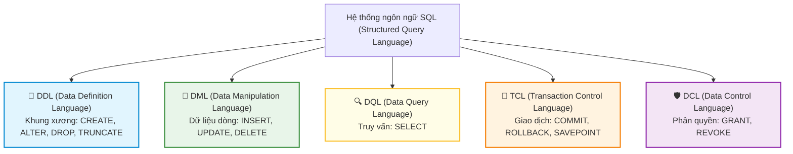
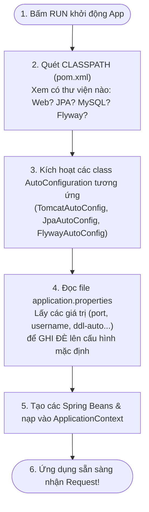
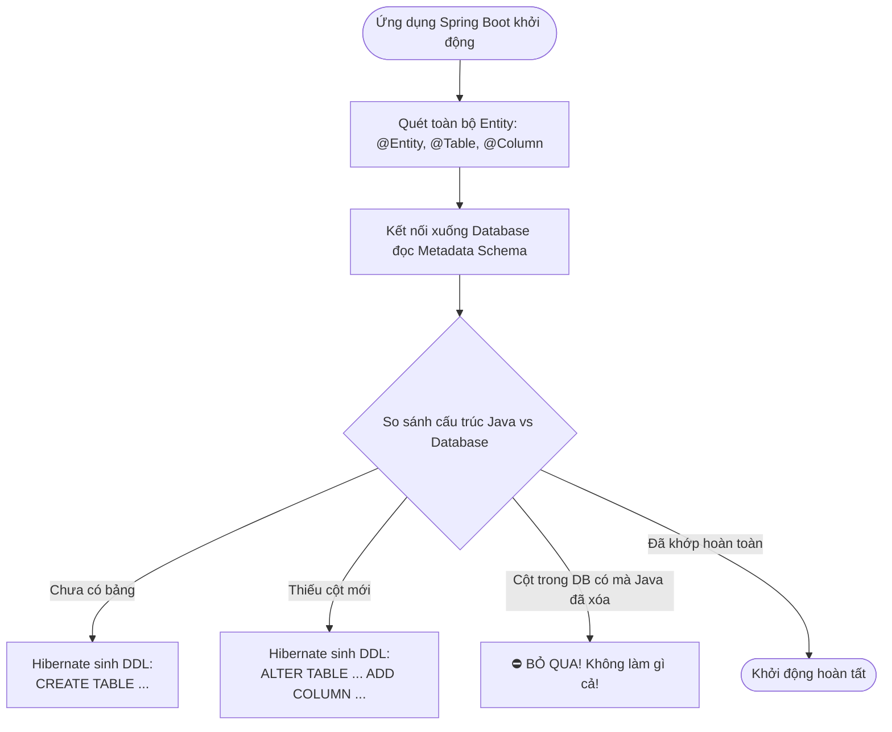
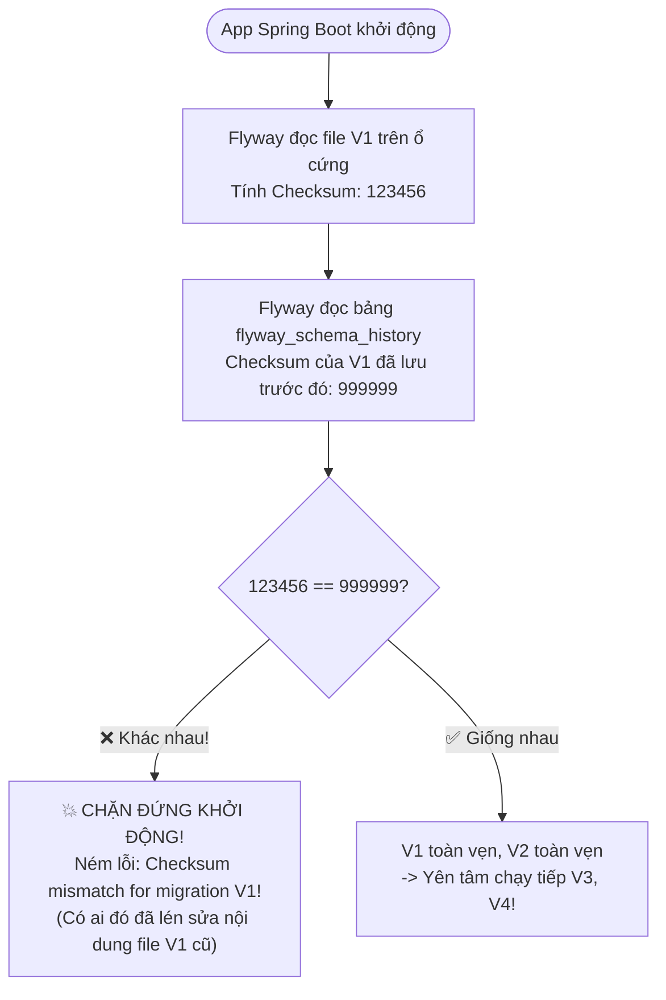

# 📘 CHUYÊN ĐỀ: BẢN CHẤT DDL TRONG SQL & CƠ CHẾ `spring.jpa.hibernate.ddl-auto`

> **Mục tiêu chuyên đề:**
> 1. Hiểu tường tận thuật ngữ **DDL (Data Definition Language)** và vị trí của nó trong hệ sinh thái Cơ sở dữ liệu quan hệ (RDBMS).
> 2. Phân biệt rõ **5 phân nhóm câu lệnh SQL** (DDL, DML, DQL, TCL, DCL) và tính chất Auto-Commit.
> 3. Nắm vững cơ chế hoạt động của `spring.jpa.hibernate.ddl-auto=update` trong Spring Boot.
> 4. Hiểu rõ **điểm yếu chí mạng** của `ddl-auto=update`: vì sao nó chỉ thêm mới mà không xóa cũ, không đổi tên cột, gây ra cột rác (`NULL`).
> 5. Nắm trọn bảng so sánh các giá trị `ddl-auto` (`create`, `create-drop`, `update`, `validate`, `none`).
> 6. Hiểu lý do vì sao Production cấm `ddl-auto=update` và liên hệ với công cụ Database Migration (**Flyway / Liquibase**).
> 7. Tổng hợp các **câu hỏi phỏng vấn thực chiến** (Interview Questions).

---

## 📑 MỤC LỤC

| Phần | Nội dung | Mục tiêu |
|:---:|:---|:---|
| 1 | 🧱 DDL là gì? Vị trí trong Hệ sinh thái SQL | Định nghĩa & Phân loại SQL |
| 2 | ⚖️ 5 Phân nhóm câu lệnh SQL chuẩn ISO/ANSI | Bức tranh tổng thể SQL |
| 3 | ⚙️ Cơ chế hoạt động của `ddl-auto=update` | Hibernate sinh DDL như thế nào? |
| 4 | 💀 Điểm yếu chí mạng: Hiện tượng "Tạo mới chứ không sửa cũ" | Phân tích kịch bản đổi tên cột & Cột rác |
| 5 | 📊 Bảng tổng hợp các giá trị của `ddl-auto` | Phân bổ theo từng môi trường |
| 6 | 🛡️ Tại sao Production cấm `ddl-auto=update`? | Cầu nối sang Flyway / Liquibase |
| 7 | 💼 Câu hỏi phỏng vấn thực chiến (Interview Questions) | Chuẩn bị phỏng vấn |

---

## PHẦN 1: 🧱 DDL LÀ GÌ? VỊ TRÍ TRONG HỆ SINH THÁI SQL

### 1.1. Định nghĩa chuẩn

**DDL** là viết tắt của:  
👉 **`Data Definition Language`** *(Ngôn ngữ Định nghĩa Dữ liệu)*.

* **Bản chất của DDL:** Là tập hợp các câu lệnh SQL dùng để **xây dựng, định hình và thay đổi "bộ khung xương" (Cấu trúc / Schema)** của cơ sở dữ liệu.
* DDL tác động trực tiếp lên các đối tượng cấu trúc như:
  * **Database / Schema** (Cơ sở dữ liệu)
  * **Table** (Bảng)
  * **Column** (Cột & Kiểu dữ liệu)
  * **Constraint** (Ràng buộc: Primary Key, Foreign Key, Unique, Not Null, Check)
  * **Index** (Chỉ mục tìm kiếm)
  * **View, Trigger, Stored Procedure**

> [!IMPORTANT]
> **Điểm cốt lõi:** DDL chỉ thao tác với **CẤU TRÚC / KHUNG CHỨA**, hoàn toàn **KHÔNG** tác động trực tiếp vào từng dòng dữ liệu (Row data) bên trong bảng.

### 1.2. Các câu lệnh DDL kinh điển

```sql
-- 1. Tạo bảng mới
CREATE TABLE users (
    id BIGINT AUTO_INCREMENT PRIMARY KEY,
    name VARCHAR(100) NOT NULL,
    email VARCHAR(150) UNIQUE
);

-- 2. Thêm cột mới vào bảng đã có
ALTER TABLE users ADD COLUMN phone VARCHAR(20);

-- 3. Đổi kiểu dữ liệu của cột
ALTER TABLE users MODIFY COLUMN name VARCHAR(200);

-- 4. Xóa sạch dữ liệu và reset lại bảng về ban đầu
TRUNCATE TABLE users;

-- 5. Xóa sổ hoàn toàn cả cái bảng
DROP TABLE users;
```

---

## PHẦN 2: ⚖️ 5 PHÂN NHÓM CÂU LỆNH SQL CHUẨN ISO/ANSI

Để hiểu DDL đứng ở đâu, bạn cần nhìn vào **5 phân nhóm câu lệnh** cấu thành nên toàn bộ ngôn ngữ SQL:



### 2.1. Bảng đối chiếu chi tiết 5 phân nhóm

| Nhóm | Tên đầy đủ | Đối tượng tác động | Các câu lệnh tiêu biểu | Có Rollback được không? |
| :--- | :--- | :--- | :--- | :---: |
| **🧱 DDL** | Data Definition Language | **Khung xương, cấu trúc** (Table, Column, Index) | `CREATE`, `ALTER`, `DROP`, `TRUNCATE`, `RENAME` | ❌ **KHÔNG** *(Auto-commit ngay lập tức trong MySQL/Oracle)* |
| **📝 DML** | Data Manipulation Language | **Dữ liệu bên trong** từng dòng (Row data) | `INSERT`, `UPDATE`, `DELETE`, `MERGE` | ✅ **CÓ** *(Nằm trong transaction, rollback được)* |
| **🔍 DQL** | Data Query Language | Đọc dữ liệu ra xem | `SELECT` | Không làm đổi dữ liệu |
| **🔄 TCL** | Transaction Control Language | Quản lý giao dịch | `COMMIT`, `ROLLBACK`, `SAVEPOINT` | Điều khiển Rollback |
| **🛡️ DCL** | Data Control Language | Quyền hạn người dùng DB | `GRANT`, `REVOKE` | ❌ Thường tự động commit |

> [!CAUTION]
> **Lưu ý sống còn về Auto-Commit của DDL:**  
> Trong hầu hết các hệ quản trị CSDL như MySQL, Oracle: Mỗi khi câu lệnh DDL (`CREATE`, `ALTER`, `DROP`) được thực thi, **Database sẽ tự động ép gọi `COMMIT` ngay lập tức**!  
> Do đó, nếu bạn lỡ tay chạy câu DDL `DROP TABLE users;` hoặc `ALTER TABLE ...`, bạn **KHÔNG THỂ ROLLBACK** bằng lệnh `ROLLBACK;` thông thường được nữa!

---

## PHẦN 3: ⚙️ CƠ CHẾ HOẠT ĐỘNG CỦA `ddl-auto=update` TRONG SPRING BOOT

### 3.1. Bản chất Auto-Configuration: Có phải Spring Boot chỉ nhìn vào `application.properties`?

Nhiều lập trình viên lầm tưởng rằng: *"Phải viết cấu hình vào `application.properties` thì Spring Boot mới biết đường mà Auto-Configure"*. Nhưng thực tế bên dưới, Spring Boot thông minh hơn thế rất nhiều!

#### 🔹 1. Cái gì MỚI LÀ "NGÒI NỔ" kích hoạt Auto-Configuration?
👉 **Chính là: Các thư viện (Dependencies) bạn khai báo trong file `pom.xml`!**

Triết lý cốt lõi của Spring Boot là: **"Convention over Configuration" (Quy ước quan trọng hơn Cấu hình)**. Khi bạn bật ứng dụng, Spring Boot sẽ quét qua bộ nhớ xem trong dự án có những file `.jar` (thư viện) nào:

* **Thấy có `spring-boot-starter-web`:**  
  $\rightarrow$ Spring Boot tự hiểu: *"À, dự án này muốn làm Web"*.  
  $\rightarrow$ Nó **tự động khởi động máy chủ nhúng Tomcat ở cổng `8080`** và cài đặt `DispatcherServlet`.  
  *(Dù file `application.properties` của bạn có để TRỐNG RỖNG không có dòng nào, Tomcat vẫn tự bật lên bình thường!)*
* **Thấy có `flyway-core`:**  
  $\rightarrow$ Spring Boot tự động kích hoạt `FlywayAutoConfiguration`.
* **Thấy có `spring-boot-starter-data-jpa`:**  
  $\rightarrow$ Tự động cấu hình `EntityManagerFactory`, Hibernate, Transaction Manager...

Spring làm được điều kỳ diệu này là nhờ các annotation điều kiện bên trong mã nguồn framework, tiêu biểu như:
* `@ConditionalOnClass(Tomcat.class)`: *"Hễ thấy có class Tomcat trong dự án thì tự động cấu hình máy chủ web"*.
* `@ConditionalOnMissingBean(DataSource.class)`: *"Nếu lập trình viên chưa tự viết hàm tạo DataSource thì tôi sẽ tự tạo giúp"*.

#### 🔹 2. Vậy file `application.properties` đóng vai trò gì?
Nếu thư viện trong `pom.xml` là **"Động cơ của chiếc xe"**, thì `application.properties` chính là **"Bảng điều khiển / Bàn đạp ga"** để bạn **TÙY BIẾN (CUSTOMIZE / OVERRIDE)** lại các giá trị mặc định của Spring Boot.

* Spring Boot tự bật Tomcat ở cổng mặc định `8080`. Bạn muốn đổi sang cổng `8081`? Bạn vào `application.properties` viết:  
  `server.port=8081`
* Spring Boot thấy có thư viện MySQL, nó chuẩn bị sẵn khung kết nối `DataSource`. Nhưng nó làm sao biết bạn đặt tên database là gì, mật khẩu là gì? Bạn phải cung cấp thông tin đó qua `application.properties`:
  ```properties
  spring.datasource.url=jdbc:mysql://localhost:3306/my_db
  spring.datasource.username=root
  spring.datasource.password=123456
  ```

#### 🔹 3. Sơ đồ quy trình khi bạn bấm nút "RUN" Spring Boot:



| Thành phần | Nguồn khai báo | Vai trò đối với Auto-Configuration |
| :--- | :--- | :--- |
| **`pom.xml`** | Dependencies | **QUYẾT ĐỊNH CÁI GÌ ĐƯỢC TẠO RA.** *(Ví dụ: Có MySQL driver $\rightarrow$ Khởi tạo kết nối DB).* |
| **`application.properties`** | Properties | **TÙY CHỈNH THÔNG SỐ CỤ THỂ.** *(Ví dụ: URL ở đâu, user/pass là gì, ddl-auto là update hay none).* |

> [!TIP]
> **Thử nghiệm kiểm chứng:** Nếu bạn xóa sạch toàn bộ nội dung trong file `application.properties` của một dự án Spring Boot Web thông thường (không có database) rồi bấm Run $\rightarrow$ Ứng dụng vẫn chạy bình thường ở cổng `8080` vì nó dựa vào các thư viện trong `pom.xml` chứ không phụ thuộc hoàn toàn vào `application.properties`.

---

### 3.2. Ý nghĩa cấu hình `spring.jpa.hibernate.ddl-auto=update`

Trong file `application.properties`:
```properties
spring.jpa.hibernate.ddl-auto=update
```

Cấu hình này ra lệnh cho Hibernate:  
> *"Khi ứng dụng Spring Boot khởi động, hãy so sánh các class `@Entity` trong mã nguồn Java với cấu trúc các bảng thực tế dưới Database. Nếu thiếu bảng hoặc thiếu cột nào, hãy **tự động sinh ra các câu lệnh DDL (`CREATE TABLE`, `ALTER TABLE`)** để cập nhật Database cho khớp với Java!"*



### 3.3. Ví dụ thực tế

#### Bước 1: Bạn tạo Entity mới
```java
@Entity
@Table(name = "products")
public class Product {
    @Id
    @GeneratedValue(strategy = GenerationType.IDENTITY)
    private Long id;

    private String name;
    private Double price;
}
```
👉 Khi bật app, Hibernate tự động sinh câu DDL:
```sql
CREATE TABLE products (
    id BIGINT NOT NULL AUTO_INCREMENT PRIMARY KEY,
    name VARCHAR(255),
    price DOUBLE
);
```

#### Bước 2: Hôm sau bạn thêm 1 thuộc tính mới vào Entity
```java
// Bạn gõ thêm trường discount
private Double discount;
```
👉 Khi bật app lại, Hibernate tự động sinh câu DDL:
```sql
ALTER TABLE products ADD COLUMN discount DOUBLE;
```

---

## PHẦN 4: 💀 ĐIỂM YẾU CHÍ MẠNG: HIỆN TƯỢNG "TẠO MỚI CHỨ KHÔNG SỬA CŨ"

Rất nhiều lập trình viên hiểu lầm chữ `update` có nghĩa là *"Cập nhật mọi thứ cho khớp 100% với Java"*. **ĐÂY LÀ HIỂU LẦM TAI HẠI!**

> [!WARNING]
> Hibernate `update` chỉ có tính chất **CỘNG DỒN (ADD-ONLY)**:  
> Nó **CHỈ BIẾT THÊM**, **KHÔNG BAO GIỜ XÓA** và **KHÔNG HỀ BIẾT ĐỔI TÊN CỘT**!

### 4.1. Kịch bản đổi tên thuộc tính: Sinh ra Cột rác (`NULL`)

Hãy xem chuyện gì xảy ra khi bạn đổi tên một biến trong Java:

```java
// ❌ HÔM QUA: Bạn đặt tên biến là fullName
@Entity
public class User {
    private String fullName; // -> DB sinh ra cột `full_name` chứa "Nguyễn Văn A"
}

// ----------------------------------------------------

// ⚠️ HÔM NAY: Bạn đổi tên biến cho ngắn gọn thành name
@Entity
public class User {
    private String name;     // Bạn đổi tên thành name
}
```

Khi ứng dụng khởi động lại, Hibernate xử lý thế nào?
1. Hibernate nhìn vào Java: Thấy có biến `name`.
2. Hibernate nhìn xuống Database: Thấy chưa có cột nào tên là `name`.
3. ❓ **Hibernate không thể đoán mò:** Nó không thể biết được `name` là do đổi tên từ `fullName`, hay là bạn vừa tạo một trường mới tinh.
4. **Hành vi an toàn duy nhất của Hibernate:**
   ```sql
   ALTER TABLE users ADD COLUMN name VARCHAR(255);
   ```

### 4.2. Hậu quả thực tế trong Database

Bảng `users` trong Database lúc này sẽ tồn tại **CẢ 2 CỘT SONG SONG**:

| id | full_name *(Cột cũ)* | name *(Cột mới)* |
|:---:|:---:|:---:|
| 1 | **Nguyễn Văn A** | `NULL` |
| 2 | **Trần Thị B** | `NULL` |
| 3 | **Lê Văn C** | `NULL` |

* 💀 **Cột cũ `full_name`:** Vẫn nằm nguyên trong DB cùng dữ liệu cũ, nhưng code Java không còn biến nào map tới nữa $\rightarrow$ Trở thành **"Cột rác / Cột mồ côi" (Orphan Column)**.
* 💀 **Cột mới `name`:** Được tạo ra nhưng dữ liệu cũ **không tự động di chuyển sang** $\rightarrow$ Toàn bộ dữ liệu của tất cả người dùng hiện có bị gán thành **`NULL`**!
* 💀 **Hậu quả code:** Khi bạn gọi `user.getName()`, kết quả trả về là `null` thay vì "Nguyễn Văn A"!

### 4.3. Bảng tổng kết: Những gì `ddl-auto=update` SẼ LÀM và KHÔNG BAO GIỜ LÀM

| Thao tác trong Java | Hành vi của `ddl-auto=update` | Hệ quả thực tế |
| :--- | :---: | :--- |
| **Thêm `@Entity` mới** | ✅ Sinh `CREATE TABLE` | Tạo bảng mới an toàn |
| **Thêm biến mới vào Entity** | ✅ Sinh `ALTER TABLE ... ADD COLUMN` | Thêm cột mới an toàn |
| **Xóa một biến khỏi Entity** | ❌ **KHÔNG BAO GIỜ XÓA CỘT** | Cột cũ biến thành cột rác trong DB |
| **Xóa hẳn một file Entity** | ❌ **KHÔNG BAO GIỜ DROP TABLE** | Bảng cũ vẫn nằm nguyên trong DB |
| **Đổi tên biến trong Entity** | ❌ **KHÔNG ĐỔI TÊN CỘT** | Sinh cột mới bị `NULL`, bỏ rơi cột cũ |
| **Sửa kiểu dữ liệu** *(String $\rightarrow$ Integer)* | ⚠️ Hầu như **KHÔNG đổi được** | Báo lỗi hoặc bị DB từ chối do xung đột kiểu |

---

## PHẦN 5: 📊 BẢNG TỔNG HỢP CÁC GIÁ TRỊ CỦA `ddl-auto`

Spring Data JPA / Hibernate cung cấp 5 chế độ cấu hình:

| Giá trị | Hành vi cụ thể của Hibernate | Nguy cơ mất dữ liệu | Môi trường áp dụng |
| :--- | :--- | :---: | :--- |
| **`create`** | Xóa sạch bảng cũ (`DROP TABLE`) rồi tạo lại từ đầu (`CREATE TABLE`) mỗi lần bật app. | 🔴 **Mất 100% dữ liệu** mỗi lần restart | Unit Test |
| **`create-drop`** | Giống `create`, nhưng khi ứng dụng tắt (`shutdown`) thì tự động `DROP` sạch sẽ mọi bảng. | 🔴 **Mất 100% dữ liệu** khi tắt app | Integration Test |
| **`update`** | Chỉ thêm bảng/cột mới, không xóa bảng/cột cũ. | 🟡 Không mất data nhưng sinh cột rác | **Local Development** (Học tập, đồ án) |
| **`validate`** | Chỉ đối chiếu xem Java Entity có khớp 100% với Database không. Nếu sai lệch thì **dừng app ngay lập tức**, không tự ý sửa DB. | 🟢 **Tuyệt đối an toàn** | Môi trường Staging / UAT |
| **`none`** | Tắt hoàn toàn tính năng tự động DDL của Hibernate. Không can thiệp gì vào DB. | 🟢 **Tuyệt đối an toàn** | **Production (Sản phẩm thật)** |

---

## PHẦN 6: 🛡️ TẠI SAO PRODUCTION CẤM `ddl-auto=update`?

### 6.1. Ba lý do sống còn cấm `ddl-auto=update` trên Production

Trong môi trường doanh nghiệp thực tế, cấu hình `ddl-auto=update` bị **nghiêm cấm tuyệt đối** vì 3 lý do:

1. **Khóa bảng làm treo hệ thống (Table Locking):**  
   Khi bảng có hàng chục triệu bản ghi, câu lệnh `ALTER TABLE` tự động của Hibernate có thể khóa toàn bộ bảng (Exclusive Lock) trong nhiều phút hoặc hàng giờ $\rightarrow$ Toàn bộ người dùng không thể đăng nhập, mua hàng $\rightarrow$ Sập dịch vụ!
2. **Không có khả năng di chuyển dữ liệu (Data Migration):**  
   Như đã phân tích ở Phần 4, khi đổi tên cột hoặc tách cột, Hibernate không thể chuyển dữ liệu từ cột cũ sang cột mới, gây mất mát hoặc sai lệch thông tin khách hàng.
3. **Mất kiểm soát phiên bản (No Version Control):**  
   Ai sửa Entity gì thì DB tự đổi theo nấy, không có nhật ký ghi lại: *"Ai đã sửa cột này vào ngày nào, vì lý do gì?"*.

---

### 6.2. Giải pháp chuẩn doanh nghiệp: Database Migration Tools (Flyway / Liquibase)

Thay vì để Hibernate tự ý sửa Database, các dự án thực tế sẽ đặt:
```properties
spring.jpa.hibernate.ddl-auto=validate   # hoặc none
```

Và giao quyền quản lý DDL cho **Flyway** thông qua các file script SQL được đánh số phiên bản rõ ràng:
* `V1__init_schema.sql`
* `V2__add_discount_to_products.sql`
* `V3__rename_fullname_to_name.sql`:
  ```sql
  -- Tự tay viết SQL để đổi tên an toàn, dữ liệu cũ vẫn nguyên vẹn 100%:
  ALTER TABLE users RENAME COLUMN full_name TO name;
  ```

---

### 6.3. Cơ chế bảo vệ của Flyway: Tại sao phải kiểm tra Checksum ở các file cũ (V1, V2)?

Nhiều lập trình viên mới tiếp cận thường thắc mắc: *"Ví dụ như `flyway_schema_history` đã apply V1, V2 rồi thì cứ thế chạy các script mới V3, V4 thôi chứ? Mất công kiểm tra checksum ở các file cũ (V1, V2) làm gì? Và Checksum là check ở V1, V2 hay V3, V4?"*

#### 1. Checksum là check ở V1, V2 hay V3, V4?
* **Kiểm tra (Validate Checksum):** Check ở các file **ĐÃ CHẠY (V1, V2)**.
  * Flyway đọc lại các file `V1`, `V2` trong source code, tính mã băm CRC32 rồi so khớp với cột `checksum` đang lưu trong bảng `flyway_schema_history`. Nếu khớp $\rightarrow$ Quá khứ toàn vẹn, hợp lệ.
* **Tính toán & Ghi mới (Insert Checksum):** Thực hiện với các file **MỚI (V3, V4)**.
  * Flyway không có gì trong DB để so sánh cả, nó sẽ thực thi câu lệnh SQL của V3, V4 $\rightarrow$ Chạy xong xuôi thì nó tính checksum của V3, V4 rồi **INSERT một dòng mới** vào `flyway_schema_history` để làm mốc kiểm tra cho những lần khởi động sau.

#### 2. Kiểm tra checksum ở file cũ (V1, V2) để làm gì?
Mục đích duy nhất: **BẢO VỆ TÍNH TOÀN VẸN VÀ BẤT BIẾN (IMMUTABILITY) CỦA DATABASE.**

Hãy xem kịch bản "tai họa" kinh điển khi làm việc nhóm nếu Flyway **KHÔNG** kiểm tra file cũ:

#### 💀 Kịch bản "Tiện tay sửa file cũ":
1. **Tháng trước:** Bạn viết file `V1__create_users.sql` có cột `name VARCHAR(50)`. File này đã được chạy lên Database Production.
2. **Hôm nay:** Một lập trình viên mới vào dự án, thấy `VARCHAR(50)` ngắn quá, bạn này **tiện tay mở file `V1__create_users.sql` ra sửa thành `VARCHAR(255)`**, sau đó tạo thêm file `V3__create_orders.sql`.
3. **Chuyện gì xảy ra nếu Flyway bỏ qua V1 và chạy thẳng V3?**
   * Database Production đã chạy V1 từ tháng trước nên cột `name` vẫn là **`VARCHAR(50)`**.
   * Nhưng trong code Git, file V1 lại ghi là **`VARCHAR(255)`**.
   * Khi dev mới test trên máy cá nhân (database mới toanh) $\rightarrow$ Chạy mượt mà.
   * Nhưng khi deploy lên Production: Người dùng nhập tên 60 ký tự $\rightarrow$ **SẬP HỆ THỐNG TRÊN PRODUCTION!**
   * Cả team sẽ không hiểu vì sao trong code Git ghi 255 mà DB thật lại chỉ có 50. Đây gọi là hiện tượng **Lệch pha cấu trúc (Schema Drift)** cực kỳ nguy hiểm.

#### 3. Sơ đồ minh họa: Chốt chặn Checksum cứu nguy



Khi Flyway phát hiện file cũ bị sửa, nó sẽ ném lỗi:
```
Migration checksum mismatch for migration version 1: DB=999999, Classpath=123456
```

Nó ép cả team phải tuân thủ **Quy tắc vàng số 1 của Database Migration**:
> **"File migration cũ một khi đã chạy thì BẤT DI BẤT DỊCH (không được sửa dù chỉ 1 dấu cách). Muốn sửa gì, BẮT BUỘC phải tạo file mới `V3__alter_users_name.sql`!"**

---

## PHẦN 7: 💼 CÂU HỎI PHỎNG VẤN THỰC CHIẾN (INTERVIEW QUESTIONS)

### ❓ Câu 1: DDL là gì? Phân biệt DDL và DML?
* **Trả lời:**
  * **DDL (Data Definition Language):** Thao tác trên **cấu trúc / khung xương** của CSDL (`CREATE`, `ALTER`, `DROP`, `TRUNCATE`). Thường tự động commit (Auto-commit) và không rollback được.
  * **DML (Data Manipulation Language):** Thao tác trên **dữ liệu từng dòng** bên trong bảng (`INSERT`, `UPDATE`, `DELETE`). Hoạt động dưới sự kiểm soát của Transaction và rollback được hoàn toàn.

### ❓ Câu 2: Trong Spring Boot, `ddl-auto=update` có xóa cột cũ khi ta xóa biến trong Entity không?
* **Trả lời:**
  * **Không bao giờ!** Hibernate `update` chỉ thực hiện thao tác cộng dồn (thêm bảng mới, thêm cột mới). Nó không bao giờ chạy lệnh `DROP COLUMN` vì để bảo vệ dữ liệu khách hàng khỏi bị xóa nhầm. Cột cũ sẽ trở thành cột rác không có ai sử dụng trong DB.

### ❓ Câu 3: Chuyện gì xảy ra nếu ta đổi tên một thuộc tính từ `age` thành `userAge` khi đang bật `ddl-auto=update`?
* **Trả lời:**
  * Hibernate sẽ tạo thêm một cột mới tên là `user_age` trong DB với giá trị toàn bộ là `NULL`.
  * Cột `age` cũ vẫn tồn tại cùng dữ liệu cũ.
  * Dữ liệu không tự chuyển từ `age` sang `user_age`, dẫn đến code đọc ra giá trị `null`.

### ❓ Câu 4: Tại sao trong môi trường Production không bao giờ được dùng `ddl-auto=update`? Giải pháp thay thế là gì?
* **Trả lời:**
  * Vì `ddl-auto=update` có thể gây khóa bảng (Table Lock) làm chết hệ thống khi dữ liệu lớn, không hỗ trợ di chuyển dữ liệu cũ khi đổi tên/tách cột, và không có cơ chế theo dõi lịch sử thay đổi (Audit trail).
  * **Giải pháp:** Cấu hình `ddl-auto=validate` hoặc `none`, kết hợp sử dụng công cụ Database Migration như **Flyway** hoặc **Liquibase** để kiểm soát chặt chẽ từng câu lệnh DDL theo phiên bản.

### ❓ Câu 5: Trong Flyway, tại sao khi khởi động nó lại kiểm tra Checksum của các file cũ (V1, V2) thay vì chỉ chạy thẳng các file mới (V3, V4)?
* **Trả lời:**
  * Để đảm bảo **tính toàn vẹn và bất biến (Immutability)** của lịch sử Database.
  * Việc này ngăn chặn lập trình viên tiện tay sửa lén các file script cũ đã deploy, tránh hiện tượng lệch pha cấu trúc (**Schema Drift**) giữa mã nguồn Git và Database thực tế trên Production. Chỉ khi toàn bộ file cũ được xác nhận là trong sạch và khớp 100%, Flyway mới cho phép thực thi tiếp các script mới.

### ❓ Câu 6: Khi bật ứng dụng Spring Boot, có phải nó chỉ nhìn vào `application.properties` để tự động cấu hình (Auto-Configuration) không?
* **Trả lời:**
  * **Không đủ!** "Ngòi nổ" quyết định Auto-Configuration là các thư viện dependencies trong `pom.xml` (thông qua cơ chế `@ConditionalOnClass` và triết lý *"Convention over Configuration"*).
  * `application.properties` chỉ đóng vai trò là bảng điều khiển để **ghi đè / tùy biến** các thông số cụ thể (như đổi cổng, thông tin đăng nhập database, cấu hình ddl-auto). Kể cả khi file `application.properties` để trống, Spring Boot vẫn tự động bật server Tomcat và cấu hình các thành phần mặc định dựa vào classpath.
