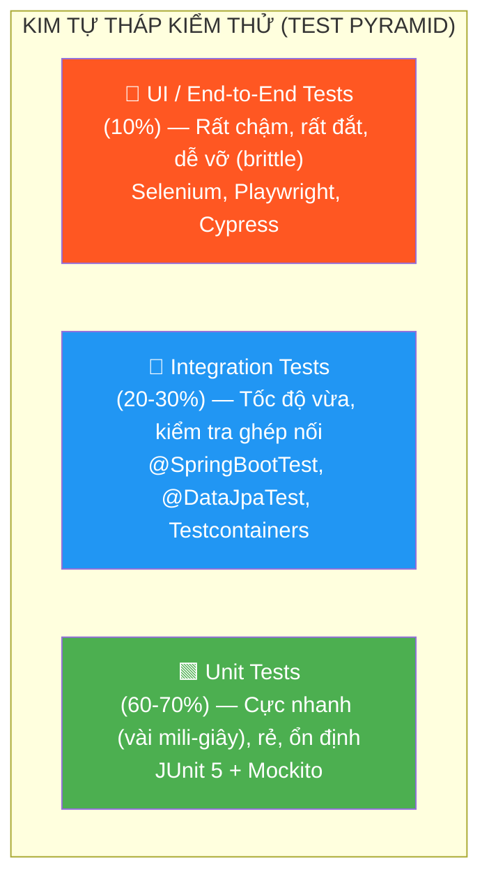
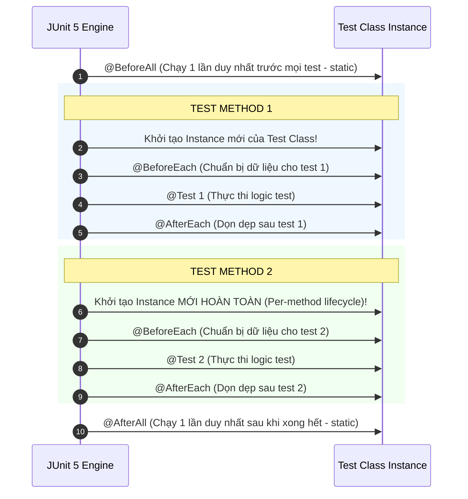
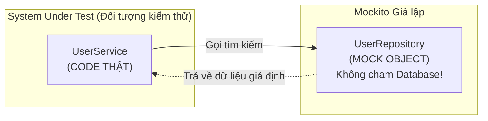
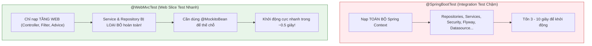

# 📘 BÀI 14: UNIT TEST VỚI JUNIT 5 & MOCKITO — XÂY DỰNG LÁ CHẮN VỮNG CHẮC CHO PHẦN MỀM

> **Mục tiêu bài học:**
> 1. Hiểu sâu **Test Pyramid** (Kim tự tháp kiểm thử) và chiến lược phân bổ kiểm thử hiệu quả, tiết kiệm chi phí trong doanh nghiệp.
> 2. Nắm vững kiến trúc **JUnit 5 (Jupiter)**: Test Lifecycle (`@BeforeEach`, `@AfterEach`, `@BeforeAll`, `@AfterAll`), Assertions, `@Nested`, `@ParameterizedTest` (`@ValueSource`, `@CsvSource`, `@MethodSource`).
> 3. Làm chủ **Mockito Framework**: Bản chất Mocking, phân biệt tường tận `@Mock`, `@InjectMocks`, `@Spy`, kỹ thuật Stubbing và Verification.
> 4. Nâng cao kỹ thuật Mockito: Bắt tham số với **`ArgumentCaptor`**, kiểm tra thứ tự gọi hàm với **`InOrder`**, stub chuỗi kết quả liên tiếp và phong cách **BDDMockito** (`given - willReturn`, `then - should`).
> 5. Thành thạo cấu trúc **Given - When - Then** (Arrange - Act - Assert) và quy ước đặt tên test method chuẩn quốc tế.
> 6. Viết Unit Test cô lập cho **Service Layer** không phụ thuộc database, đạt độ phủ (Code Coverage) cao.
> 7. Thực hiện **Slice Testing Controller** với **`@WebMvcTest` & `MockMvc`**: kiểm tra HTTP status, header, JSON response body bằng `jsonPath` và kiểm thử Bean Validation (400 Bad Request).
> 8. Làm chủ công cụ đo lường chất lượng mã nguồn **JaCoCo Code Coverage** và thiết lập ngưỡng kiểm thử (Quality Gates) trong CI/CD.
> 9. Tự tin trả lời **10 câu hỏi phỏng vấn chuyên sâu** về Unit Testing và Mockito trong Spring Boot.

---

## 📑 MỤC LỤC

| Phần | Nội dung chính | Mục tiêu đạt được |
|:---:|:---|:---|
| 1 | 🏔️ Kim tự tháp kiểm thử (Test Pyramid) | Chiến lược phân cấp kiểm thử hiệu quả |
| 2 | 🧪 JUnit 5 (Jupiter) Core Annotations & Assertions | Làm chủ công cụ thực thi test hàng đầu |
| 3 | 🔢 Parameterized Tests — Kiểm thử đa tập dữ liệu | Tối ưu hóa kiểm thử nhiều bộ tham số và biên |
| 4 | 🎭 Bản chất Mockito: `@Mock`, `@InjectMocks`, `@Spy` | Hiểu cơ chế Dynamic Proxy và Stubbing |
| 5 | 🎯 Kỹ thuật Mockito nâng cao | `ArgumentCaptor`, `InOrder`, Consecutive Stubs & BDD |
| 6 | 📐 Quy chuẩn Given - When - Then & Naming Convention | Viết test case sạch sẽ, dễ bảo trì |
| 7 | 💼 Thực hành: Unit Test Service Layer (UserService & ProductService) | Kiểm thử Business Logic không cần Database |
| 8 | 🌐 Slice Testing Controller với `@WebMvcTest` & `MockMvc` | Kiểm thử tầng HTTP, JSON & Bean Validation |
| 9 | 📊 Đo lường Code Coverage với JaCoCo trong CI/CD | Đảm bảo chỉ tiêu coverage >= 80% chuẩn Enterprise |
| 10 | ⚠️ Best Practices & Anti-Patterns trong Unit Testing | Tránh bẫy Over-mocking, Flaky Tests |
| 11 | 💼 10 Câu hỏi phỏng vấn tuyển dụng (Interview Q&A) | Chinh phục phỏng vấn Java / Spring Boot Test |
| 12 | 📚 Kiến thức nâng cao: Java Core & Design Patterns trong Test | ByteBuddy, Test Data Builder, Object Mother |
| 13 | 📑 Cheat Sheet tra cứu nhanh (Quick Reference) | Tra cứu nhanh cú pháp JUnit 5, Mockito & MockMvc |

---

## PHẦN 1: 🏔️ KIM TỰ THÁP KIỂM THỬ (TEST PYRAMID)

Trong kỹ nghệ phần mềm chuyên nghiệp, việc đảm bảo ứng dụng chạy đúng không thể dựa vào việc lập trình viên mở trình duyệt hoặc Postman bấm tay từng request. Một hệ thống lớn cần hệ thống kiểm thử tự động (Automated Testing) phân tầng theo mô hình **Test Pyramid** của Mike Cohn:



### 1.1. So sánh chi tiết 3 tầng kiểm thử

| Đặc tính | Unit Tests (Kiểm thử đơn vị) | Integration Tests (Kiểm thử tích hợp) | E2E Tests (Kiểm thử đầu-cuối) |
|:---|:---|:---|:---|
| **Phạm vi (Scope)** | Một class/method đơn lẻ, mọi phụ thuộc đều bị MOCK. | Nhiều component tương tác với nhau (Spring Context + DB thật). | Toàn bộ hệ thống chạy thật (Frontend ➔ Gateway ➔ Backend ➔ DB). |
| **Tốc độ thực thi** | ⚡ Siêu nhanh (~1 - 10 ms / test). Hàng nghìn tests chạy trong vài giây. | 🐢 Trung bình (~1 - 5 giây / test) do cần khởi động Spring Context, Docker. | 🐌 Rất chậm (vài phút / test) do phụ thuộc mạng và giao diện trình duyệt. |
| **Chi phí bảo trì** | 💰 Rất rẻ. Khi fail biết chính xác dòng code nào lỗi. | 💵 Trung bình. Khó chẩn đoán hơn khi lỗi xảy ra ở tầng mạng/DB. | 💸 Rất đắt. Dễ bị "Flaky Test" (chạy lúc pass lúc fail do mạng giật). |
| **Môi trường yêu cầu** | Chỉ cần JVM thuần, **không cần DB, không cần Tomcat, không cần Spring**. | Cần Database test (H2 hoặc Docker PostgreSQL). | Cần deploy toàn bộ hệ thống lên môi trường Staging/Test. |

### 1.2. Nguyên tắc F.I.R.S.T của Unit Test sạch

```
┌────────────────────────────────────────────────────────────────────────┐
│                   5 NGUYÊN TẮC F.I.R.S.T CHO UNIT TEST                 │
├───────────────┬────────────────────────────────────────────────────────┤
│ F - Fast      │ Test phải chạy trong mili-giây để Dev chạy liên tục.   │
├───────────────┼────────────────────────────────────────────────────────┤
│ I - Isolated  │ Mỗi test độc lập, không phụ thuộc thứ tự chạy test.    │
├───────────────┼────────────────────────────────────────────────────────┤
│ R - Repeatable│ Chạy ở máy local, server CI/CD hay trên mây đều ra cùng│
│               │ một kết quả duy nhất.                                  │
├───────────────┼────────────────────────────────────────────────────────┤
│ S - Self-     │ Test tự trả về PASS hoặc FAIL (boolean), không bắt con │
│     validating│ người phải mở log đọc kết quả bằng mắt.                │
├───────────────┼────────────────────────────────────────────────────────┤
│ T - Timely    │ Test được viết song song hoặc trước khi viết code thật │
│               │ (TDD - Test Driven Development).                       │
└───────────────┴────────────────────────────────────────────────────────┘
```

---

## PHẦN 2: 🧪 JUNIT 5 (JUPITER) CORE ANNOTATIONS & ASSERTIONS

JUnit 5 là tiêu chuẩn hiện đại trong hệ sinh thái Java. Nó được tách thành 3 module chính:
1. **JUnit Platform:** Nền tảng khởi chạy test trên JVM (tích hợp IDE IntelliJ, Eclipse, Maven Surefire).
2. **JUnit Jupiter:** Chứa mô hình lập trình mới (`@Test`, Assertions, Assumptions, Annotations).
3. **JUnit Vintage:** Hỗ trợ chạy lại các test cũ viết bằng JUnit 3/4.

### 2.1. Vòng đời của một Test Class (Test Lifecycle)



> [!NOTE]
> Mặc định trong JUnit 5, **mỗi test method được thực thi trên một instance Class hoàn toàn mới** (`Lifecycle.PER_METHOD`). Điều này đảm bảo tính độc lập tuyệt đối giữa các test case, biến instance variable không bị dính dữ liệu từ test trước.

### 2.2. Các Assertions quan trọng nhất trong `org.junit.jupiter.api.Assertions`

```java
// 1. So sánh giá trị bằng (equals)
assertEquals(expected, actual, "Thông báo hiển thị khi test thất bại");

// 2. So sánh null/not-null
assertNotNull(actual, "Đối tượng không được phép null");
assertNull(actual);

// 3. So sánh boolean
assertTrue(user.isActive());
assertFalse(user.isDeleted());

// 4. Bắt ngoại lệ mong muốn (Exception Testing)
IllegalArgumentException exception = assertThrows(
    IllegalArgumentException.class,
    () -> userService.createUser(invalidUser),
    "Mong đợi ném IllegalArgumentException khi email bị trùng"
);
assertTrue(exception.getMessage().contains("Email đã tồn tại"));

// 5. Grouped Assertions (assertAll) - Chạy TẤT CẢ assertions ngay cả khi assert đầu tiên bị fail!
assertAll("Kiểm tra toàn bộ thuộc tính User",
    () -> assertEquals("Nguyễn Văn A", user.getName()),
    () -> assertEquals("a@gmail.com", user.getEmail()),
    () -> assertNotNull(user.getId())
);
```

---

## PHẦN 3: 🔢 PARAMETERIZED TESTS — KIỂM THỬ ĐA TẬP DỮ LIỆU

Trong kiểm thử thực tế, có rất nhiều trường hợp ta cần kiểm thử cùng một phương thức với **10 tập dữ liệu khác nhau** (ví dụ: các định dạng email không hợp lệ, chuỗi rỗng, khoảng trắng, các mức giá âm). Nếu viết 10 `@Test` method thì code sẽ bị trùng lặp rất lớn. JUnit 5 giải quyết vấn đề này bằng **`@ParameterizedTest`**.

### 3.1. Các nguồn dữ liệu phổ biến cho Parameterized Test

#### 🔹 1. `@ValueSource` & `@NullAndEmptySource`
```java
@ParameterizedTest
@NullAndEmptySource // Cung cấp lần lượt: null, chuỗi rỗng ""
@ValueSource(strings = {"   ", "\t", "\n"}) // Cung cấp chuỗi toàn khoảng trắng
@DisplayName("Ném ngoại lệ khi tên người dùng không hợp lệ")
void createUser_WhenNameIsBlank_ThrowsException(String invalidName) {
    User invalidUser = new User(null, invalidName, "valid@gmail.com");

    IllegalArgumentException ex = assertThrows(IllegalArgumentException.class, 
        () -> userService.createUser(invalidUser));
    assertEquals("Tên không được để trống", ex.getMessage());
}
```

#### 🔹 2. `@CsvSource` (Kiểm thử bộ tham số đầu vào và kết quả đầu ra)
```java
@ParameterizedTest(name = "Kịch bản [{index}]: Với giá = {0} và giảm giá = {1}% -> Giá sau giảm phải là {2}")
@CsvSource({
    "100.0, 10, 90.0",
    "200.0, 20, 160.0",
    "50.0,  0,  50.0",
    "1000.0, 50, 500.0"
})
void calculateDiscount_ReturnsCorrectPrice(double price, int discountPercent, double expected) {
    double actual = priceCalculator.applyDiscount(price, discountPercent);
    assertEquals(expected, actual, 0.001);
}
```

#### 🔹 3. `@MethodSource` (Cung cấp các đối tượng phức tạp dạng Stream)
```java
@ParameterizedTest
@MethodSource("provideInvalidUserRequests")
@DisplayName("Kiểm tra nhiều đối tượng UserCreateRequest không hợp lệ")
void createUser_WithInvalidRequests_ThrowsValidationException(UserCreateRequest request, String expectedMessage) {
    IllegalArgumentException ex = assertThrows(IllegalArgumentException.class, 
        () -> userService.createUser(request));
    assertEquals(expectedMessage, ex.getMessage());
}

// Phương thức static cung cấp dữ liệu cho test
static Stream<Arguments> provideInvalidUserRequests() {
    return Stream.of(
        Arguments.of(new UserCreateRequest("", "a@gmail.com"), "Tên không được để trống"),
        Arguments.of(new UserCreateRequest("A", "sai-email"), "Email không đúng định dạng"),
        Arguments.of(new UserCreateRequest("A", null), "Email không được để trống")
    );
}
```

---

## PHẦN 4: 🎭 BẢN CHẤT MOCKITO: `@Mock`, `@InjectMocks`, `@Spy`

### 4.1. Tại sao phải Mocking?

Trong kiến trúc 3 tầng: `Controller` ➔ `Service` ➔ `Repository` ➔ `Database`.
Khi bạn muốn viết **Unit Test cho `UserService`**:
- Bạn **CHỈ muốn test logic Java trong `UserService`** (các câu lệnh `if-else`, tính toán, ném ngoại lệ).
- Bạn **KHÔNG muốn kết nối xuống Database thật**, vì DB thật chạy chậm, cần setup dữ liệu, và có thể thay đổi trạng thái sau khi test chạy.
- ➔ **Giải pháp:** Sử dụng Mockito để tạo một "Diễn viên đóng thế" (Mock Object) thay cho `UserRepository`.



### 4.2. Bảng phân biệt toàn diện: `@Mock` vs `@InjectMocks` vs `@Spy`

```
┌────────────────────────────────────────────────────────────────────────┐
│             SO SÁNH 3 ANNOTATION CỐT LÕI CỦA MOCKITO                   │
├─────────────────────┬───────────────────┬──────────────────────────────┤
│ Annotation          │ Loại Object       │ Bản chất & Hành vi           │
├─────────────────────┼───────────────────┼──────────────────────────────┤
│ `@Mock`             │ Dummy / Fake      │ Toàn bộ method là giả lập.   │
│                     │                   │ Mặc định trả về `null`, `0`, │
│                     │                   │ `false`, hoặc empty list     │
│                     │                   │ nếu chưa được Stub (when).   │
├─────────────────────┼───────────────────┼──────────────────────────────┤
│ `@InjectMocks`      │ Real Instance     │ Là class THẬT cần test.      │
│                     │ (Đối tượng thật)  │ Mockito sẽ tìm các bean      │
│                     │                   │ có `@Mock` hoặc `@Spy` để    │
│                     │                   │ tiêm (inject) vào constructor│
├─────────────────────┼───────────────────┼──────────────────────────────┤
│ `@Spy`              │ Partial Mock      │ Gọi method THẬT trừ khi bạn  │
│                     │ (Một nửa thật)    │ chủ động stub method đó.     │
│                     │                   │ Dùng khi muốn test class cha │
│                     │                   │ nhưng mock 1 method con.     │
└─────────────────────┴───────────────────┴──────────────────────────────┘
```

---

## PHẦN 5: 🎯 KỸ THUẬT MOCKITO NÂNG CAO

### 5.1. Bắt tham số với `ArgumentCaptor`

Nhiều khi bạn muốn kiểm tra xem Service có tính toán hoặc gán các trường ẩn (như `status`, `createdAt`, `updatedBy`) vào Entity trước khi gọi `repository.save()` hay không:

```java
@Test
void createUser_ShouldSetDefaultStatusBeforeSaving() {
    // Given
    User inputUser = new User("Trần B", "b@gmail.com");
    when(userRepository.existsByEmail(anyString())).thenReturn(false);
    when(userRepository.save(any(User.class))).thenAnswer(i -> i.getArgument(0));

    // When
    userService.createUser(inputUser);

    // Then - Dùng ArgumentCaptor để "bắt quả tang" object truyền vào hàm save
    ArgumentCaptor<User> userCaptor = ArgumentCaptor.forClass(User.class);
    verify(userRepository).save(userCaptor.capture());

    User capturedUser = userCaptor.getValue();
    assertEquals("Trần B", capturedUser.getName());
    assertEquals("b@gmail.com", capturedUser.getEmail());
}
```

### 5.2. Kiểm tra thứ tự gọi hàm với `InOrder`

Trong nghiệp vụ ngân hàng hoặc bảo mật, thứ tự thực thi là yếu tố sống còn: Bạn phải kiểm tra tồn tại / kiểm tra số dư TRƯỚC KHI trừ tiền:

```java
@Test
void createUser_VerifiesExecutionOrder() {
    User newUser = new User(null, "Trần E", "e@gmail.com");
    when(userRepository.existsByEmail("e@gmail.com")).thenReturn(false);
    when(userRepository.save(any(User.class))).thenReturn(new User(5L, "Trần E", "e@gmail.com"));

    userService.createUser(newUser);

    // Xác thực thứ tự: existsByEmail() BẮT BUỘC phải chạy trước save()!
    InOrder inOrder = inOrder(userRepository);
    inOrder.verify(userRepository).existsByEmail("e@gmail.com");
    inOrder.verify(userRepository).save(newUser);
}
```

### 5.3. Stubbing chuỗi kết quả liên tiếp (Consecutive Stubs)

Đôi khi một method được gọi 2 lần trong 1 luồng xử lý và bạn muốn lần 1 trả về kết quả khác lần 2 (ví dụ kịch bản Retry hoặc kiểm tra trạng thái Polling):

```java
// Lần 1 trả về PENDING, lần 2 trả về COMPLETED
when(paymentGateway.checkStatus("TX_123"))
    .thenReturn("PENDING", "COMPLETED");

// Hoặc lần 1 trả về Data, lần 2 ném Exception
when(thirdPartyApi.call())
    .thenReturn("Data OK")
    .thenThrow(new RuntimeException("Mạng bị đứt ở lần gọi thứ 2"));
```

---

## PHẦN 6: 📐 QUY CHUẨN GIVEN - WHEN - THEN & NAMING CONVENTION

### 6.1. Cấu trúc 3 bước chuẩn hóa (Arrange - Act - Assert)

Mỗi test case phải được phân định rõ ràng thành 3 khối trực quan:

```java
@Test
void createUser_WhenEmailAlreadyExists_ShouldThrowException() {
    // 1. GIVEN (Arrange): Chuẩn bị môi trường & định nghĩa hành vi giả lập (Stubbing)
    User mockUser = new User("Nguyễn Văn A", "a@gmail.com");
    when(userRepository.existsByEmail("a@gmail.com")).thenReturn(true);

    // 2. WHEN (Act): Thực thi method nghiệp vụ cần kiểm thử
    // 3. THEN (Assert): Khẳng định kết quả và kiểm chứng tương tác (Verification)
    IllegalArgumentException exception = assertThrows(
        IllegalArgumentException.class,
        () -> userService.createUser(mockUser)
    );

    assertEquals("Email đã tồn tại: a@gmail.com", exception.getMessage());
    verify(userRepository, never()).save(any(User.class)); // Bảo đảm không lưu vào DB!
}
```

### 6.2. Quy ước đặt tên Test Method quốc tế

Công thức chuẩn: **`[MethodName]_[StateUnderTest]_[ExpectedBehavior]`**

* `getUserById_WhenIdExists_ShouldReturnUser()`
* `getUserById_WhenIdNotFound_ShouldThrowResourceNotFoundException()`
* `createUser_WithValidData_ShouldSaveAndReturnUser()`
* `deleteUser_WhenUserExists_ShouldCallRepositoryDelete()`

---

## PHẦN 7: 💼 THỰC HÀNH: UNIT TEST SERVICE LAYER

Hãy cùng xem mã nguồn kiểm thử thực tế cho [UserService](file:///Users/vovantu/HTML_CSS/JAVA%20/springboot-learning/src/main/java/com/example/springbootlearning/service/UserService.java):

```java
package com.example.springbootlearning.service;

import com.example.springbootlearning.model.User;
import com.example.springbootlearning.repository.UserRepository;
import org.junit.jupiter.api.BeforeEach;
import org.junit.jupiter.api.DisplayName;
import org.junit.jupiter.api.Nested;
import org.junit.jupiter.api.Test;
import org.junit.jupiter.api.extension.ExtendWith;
import org.junit.jupiter.params.ParameterizedTest;
import org.junit.jupiter.params.provider.NullAndEmptySource;
import org.junit.jupiter.params.provider.ValueSource;
import org.mockito.ArgumentCaptor;
import org.mockito.InOrder;
import org.mockito.InjectMocks;
import org.mockito.Mock;
import org.mockito.junit.jupiter.MockitoExtension;

import java.util.List;
import java.util.Optional;

import static org.junit.jupiter.api.Assertions.*;
import static org.mockito.ArgumentMatchers.any;
import static org.mockito.Mockito.*;

@ExtendWith(MockitoExtension.class)
@DisplayName("Kiểm thử UserService với JUnit 5 & Mockito")
class UserServiceTest {

    @Mock
    private UserRepository userRepository;

    @InjectMocks
    private UserService userService;

    private User sampleUser;

    @BeforeEach
    void setUp() {
        sampleUser = new User(1L, "Nguyễn Văn A", "a@gmail.com");
    }

    @Nested
    @DisplayName("Kịch bản getUserById")
    class GetUserByIdTests {

        @Test
        @DisplayName("Thành công: Trả về User khi ID tồn tại")
        void getUserById_WhenUserExists_ReturnsUser() {
            // Given
            when(userRepository.findById(1L)).thenReturn(Optional.of(sampleUser));

            // When
            User actual = userService.getUserById(1L);

            // Then
            assertNotNull(actual);
            assertEquals(1L, actual.getId());
            assertEquals("Nguyễn Văn A", actual.getName());
            assertEquals("a@gmail.com", actual.getEmail());
            verify(userRepository, times(1)).findById(1L);
        }

        @Test
        @DisplayName("Thất bại: Ném RuntimeException khi ID không tồn tại")
        void getUserById_WhenUserNotFound_ThrowsRuntimeException() {
            // Given
            when(userRepository.findById(999L)).thenReturn(Optional.empty());

            // When & Then
            RuntimeException ex = assertThrows(RuntimeException.class, () -> userService.getUserById(999L));
            assertTrue(ex.getMessage().contains("User không tồn tại với id: 999"));
            verify(userRepository, times(1)).findById(999L);
        }
    }

    @Nested
    @DisplayName("Kịch bản createUser")
    class CreateUserTests {

        @Test
        @DisplayName("Thành công: Lưu User mới khi dữ liệu hợp lệ và email chưa tồn tại")
        void createUser_WithValidUser_ReturnsSavedUser() {
            // Given
            User newUser = new User(null, "Lê Văn C", "c@gmail.com");
            when(userRepository.existsByEmail("c@gmail.com")).thenReturn(false);
            when(userRepository.save(any(User.class))).thenReturn(new User(3L, "Lê Văn C", "c@gmail.com"));

            // When
            User saved = userService.createUser(newUser);

            // Then
            assertNotNull(saved);
            assertEquals(3L, saved.getId());
            verify(userRepository, times(1)).existsByEmail("c@gmail.com");
            verify(userRepository, times(1)).save(newUser);
        }

        @Test
        @DisplayName("Kiểm tra thứ tự: Dùng InOrder để kiểm chứng existsByEmail được gọi TRƯỚC save")
        void createUser_VerifiesExecutionOrder() {
            User newUser = new User(null, "Trần E", "e@gmail.com");
            when(userRepository.existsByEmail("e@gmail.com")).thenReturn(false);
            when(userRepository.save(any(User.class))).thenReturn(new User(5L, "Trần E", "e@gmail.com"));

            userService.createUser(newUser);

            InOrder inOrder = inOrder(userRepository);
            inOrder.verify(userRepository).existsByEmail("e@gmail.com");
            inOrder.verify(userRepository).save(newUser);
        }

        @ParameterizedTest
        @NullAndEmptySource
        @ValueSource(strings = {"   ", "\t", "\n"})
        @DisplayName("ParameterizedTest: Ném ngoại lệ với nhiều trường hợp tên không hợp lệ")
        void createUser_WhenNameIsInvalid_ThrowsException(String invalidName) {
            User invalidUser = new User(null, invalidName, "valid@gmail.com");

            IllegalArgumentException ex = assertThrows(IllegalArgumentException.class, 
                () -> userService.createUser(invalidUser));
            assertEquals("Tên không được để trống", ex.getMessage());
            verifyNoInteractions(userRepository);
        }

        @Test
        @DisplayName("Thất bại: Ném IllegalArgumentException khi email đã tồn tại")
        void createUser_WhenEmailAlreadyExists_ThrowsException() {
            User duplicateUser = new User(null, "Trùng Email", "a@gmail.com");
            when(userRepository.existsByEmail("a@gmail.com")).thenReturn(true);

            IllegalArgumentException ex = assertThrows(IllegalArgumentException.class,
                () -> userService.createUser(duplicateUser));
            assertEquals("Email đã tồn tại: a@gmail.com", ex.getMessage());
            verify(userRepository, never()).save(any(User.class));
        }
    }
}
```

---

## PHẦN 8: 🌐 SLICE TESTING CONTROLLER VỚI `@WebMvcTest` & `MockMvc`

### 8.1. `@SpringBootTest` vs `@WebMvcTest` (Slice Test)



### 8.2. Kiểm thử Bean Validation (HTTP 400 Bad Request) trong MockMvc

Khi client gửi request body vi phạm Jakarta Bean Validation (`@NotBlank`, `@NotNull`, `@Positive`), Spring MVC sẽ ném `MethodArgumentNotValidException` và `GlobalExceptionHandler` trả về HTTP 400:

```java
@Test
@DisplayName("POST /api/v1/products: Trả về HTTP 400 Bad Request khi payload vi phạm Bean Validation")
void createProduct_WithInvalidBody_ShouldReturn400() throws Exception {
    // Given: payload rỗng name, price null, category rỗng
    ProductCreateRequest invalidRequest = new ProductCreateRequest();
    invalidRequest.setName("");
    invalidRequest.setPrice(null);
    invalidRequest.setCategory("");

    // When & Then
    mockMvc.perform(post("/api/v1/products")
                    .contentType(MediaType.APPLICATION_JSON)
                    .content(objectMapper.writeValueAsString(invalidRequest)))
            .andExpect(status().isBadRequest())
            .andExpect(jsonPath("$.status", is(400)))
            .andExpect(jsonPath("$.message").exists());

    // Đảm bảo không bao giờ gọi tới service layer khi validation thất bại!
    verifyNoInteractions(productService);
}
```

---

## PHẦN 9: 📊 ĐO LƯỜNG CODE COVERAGE VỚI JACOCO TRONG CI/CD

### 9.1. Code Coverage là gì?
**Code Coverage** (Độ phủ mã nguồn) là chỉ số đo lường tỷ lệ phần trăm mã nguồn thực tế được thực thi khi bộ test tự động chạy:
- **Line Coverage:** Tỷ lệ dòng lệnh được chạy qua.
- **Branch Coverage:** Tỷ lệ các nhánh điều kiện (`if`, `else`, `switch`, toán tử 3 ngôi `? :`) được bao phủ cả 2 hướng `true` và `false`.

### 9.2. Cấu hình JaCoCo trong Maven (`pom.xml`)

```xml
<plugin>
    <groupId>org.jacoco</groupId>
    <artifactId>jacoco-maven-plugin</artifactId>
    <version>0.8.12</version>
    <executions>
        <!-- Khởi tạo agent trước khi test chạy -->
        <execution>
            <goals>
                <goal>prepare-agent</goal>
            </goals>
        </execution>
        <!-- Xuất báo cáo HTML sau khi test xong -->
        <execution>
            <id>report</id>
            <phase>test</phase>
            <goals>
                <goal>report</goal>
            </goals>
        </execution>
        <!-- Thiết lập Quality Gate: Bắt buộc Coverage >= 80%, nếu không FAIL BUILD! -->
        <execution>
            <id>check</id>
            <goals>
                <goal>check</goal>
            </goals>
            <configuration>
                <rules>
                    <rule>
                        <element>BUNDLE</element>
                        <limits>
                            <limit>
                                <counter>LINE</counter>
                                <value>COVEREDRATIO</value>
                                <minimum>0.80</minimum>
                            </limit>
                        </limits>
                    </rule>
                </rules>
            </configuration>
        </execution>
    </executions>
</plugin>
```

```bash
# Chạy test và tạo báo cáo HTML tại target/site/jacoco/index.html:
mvn clean test jacoco:report
```

---

## PHẦN 10: ⚠️ BEST PRACTICES & ANTI-PATTERNS TRONG UNIT TESTING

### ✅ Best Practices (Nên làm):
1. **Kiểm tra cả 2 nhánh (Happy Path & Sad Path):** Không chỉ test lúc dữ liệu đúng, phải test khi dữ liệu sai, null, rỗng, bị trùng, ném ngoại lệ.
2. **Không Mock DTO và Entity:** DTO và Entity chỉ là các class mang dữ liệu (POJO) chứa getters/setters, hãy `new` trực tiếp chúng thay vì `@Mock`.
3. **Mỗi test case chỉ kiểm tra 1 khái niệm nghiệp vụ:** Tránh gom 5 nghiệp vụ khác nhau vào 1 `@Test` duy nhất dài 200 dòng.
4. **Sử dụng Assertions rõ ràng:** Ưu tiên `assertAll()` khi kiểm tra nhiều thuộc tính của một object.
5. **Dùng Mockito `verifyNoMoreInteractions()` có chừng mực:** Chỉ dùng khi cần bảo mật nghiêm ngặt rằng không có side-effect nào xảy ra ngầm.

### ❌ Anti-Patterns (Cần tránh):
1. **Over-mocking (Mock quá đà):** Mock từ getter, setter cho đến cả String/List. Kết quả là bạn đang test chính mã stub của bạn chứ không test code logic nghiệp vụ thật!
2. **Testing Implementation Details (Kiểm tra chi tiết nội bộ):** Test quá phụ thuộc vào tên biến private hoặc thứ tự gọi hàm bên trong thay vì kiểm tra **kết quả đầu ra** (Output). Khi tái cấu trúc (refactor) code, test sẽ vỡ dù chức năng không đổi.
3. **Test phụ thuộc vào Database thật khi chạy Unit Test:** Nếu rút dây mạng hoặc tắt DB mà test bị fail, đó KHÔNG PHẢI là Unit Test!

---

## PHẦN 11: 💼 10 CÂU HỎI PHỎNG VẤN TUYỂN DỤNG CHUYÊN SÂU (INTERVIEW Q&A)

### ❓ Q1: Phân biệt sự khác nhau giữa `@Mock` và `@InjectMocks` trong Mockito?
> **Trả lời:**
> - `@Mock` tạo ra một đối tượng giả lập hoàn toàn (Dummy Object) thông qua cơ chế Dynamic Proxy của ByteBuddy. Các phương thức của mock object không thực thi code thật mà trả về giá trị mặc định (`null`, `0`, `false`) trừ khi được định nghĩa bằng `when().thenReturn()`.
> - `@InjectMocks` tạo ra một **thể hiện thật (Real Instance)** của lớp cần kiểm thử (System Under Test), sau đó tự động tìm kiếm các trường có gắn `@Mock` hoặc `@Spy` trong test class để tiêm (inject) vào constructor hoặc setter của thể hiện thật này.

---

### ❓ Q2: Điểm khác biệt giữa `@Mock` (Mockito thuần) và `@MockBean` / `@MockitoBean` (Spring Test) là gì?
> **Trả lời:**
> - `@Mock` là annotation thuần của Mockito. Nó hoạt động nhanh chóng trong Unit Test thông qua `@ExtendWith(MockitoExtension.class)`, **hoàn toàn không khởi động Spring ApplicationContext**.
> - `@MockBean` (hoặc `@MockitoBean` từ Spring Boot 3.4+) là annotation của Spring Framework. Nó đăng ký mock object này trực tiếp vào **Spring ApplicationContext**, thay thế bất kỳ Bean thật nào cùng kiểu trong Context. Dùng cho Integration Test hoặc Slice Test (`@WebMvcTest`, `@SpringBootTest`).

---

### ❓ Q3: Phân biệt `@Mock` và `@Spy` trong Mockito? Khi nào thì bắt buộc phải dùng `@Spy`?
> **Trả lời:**
> - `@Mock`: Tạo object giả lập hoàn toàn. Mặc định mọi method không chạy code thật.
> - `@Spy` (Partial Mock): Bọc một **object thật**. Mặc định mọi method đều chạy code thật, ngoại trừ các method mà lập trình viên chủ động stub.
> - **Khi nào dùng `@Spy`?**
>   1. Khi muốn kiểm thử một phương thức trong class A, nhưng class A lại gọi một phương thức phụ khác cũng trong class A mà ta muốn cô lập phương thức phụ đó.
>   2. Khi kiểm thử mã nguồn cũ (Legacy Code) không thể tái cấu trúc để chia nhỏ dependency.

---

### ❓ Q4: Tại sao trong Mockito ta dùng `doReturn().when(spy).method()` thay vì `when(spy.method()).thenReturn()` cho Spy object?
> **Trả lời:**
> Với một `@Spy` object, khi ta viết `when(spy.method())`, thì phương thức `spy.method()` **thực sự được gọi một lần** ngay tại thời điểm định nghĩa stub! Nếu phương thức đó có logic nặng, kết nối mạng, hoặc ném exception khi chưa truyền đủ tham số, test sẽ bị văng lỗi ngay lập tức.
> Do đó, với `@Spy`, ta bắt buộc dùng cú pháp `doReturn(...).when(spy).method()` để tránh việc thực thi phương thức thật trong lúc khai báo stub.

---

### ❓ Q5: `ArgumentCaptor` là gì và được sử dụng trong trường hợp nào?
> **Trả lời:**
> `ArgumentCaptor` là công cụ của Mockito dùng để **bắt giữ (capture) tham số** được truyền vào một mock object tại thời điểm phương thức được gọi.
> **Ứng dụng:** Khi phương thức `service.create(request)` tự tạo ra một `new Entity()` bên trong nội bộ service rồi gọi `repository.save(entity)`. Bên ngoài test ta không có tham chiếu đến `entity` này, ta dùng `ArgumentCaptor<Entity>` bắt lấy nó để kiểm tra các trường tự sinh như UUID, timestamp, audit field.

---

### ❓ Q6: Slice Test là gì? Tại sao nên dùng `@WebMvcTest` thay vì `@SpringBootTest` khi test Controller?
> **Trả lời:**
> **Slice Test** là kỹ thuật chỉ nạp một "lát cắt" cụ thể của kiến trúc thay vì nạp toàn bộ Spring Context.
> `@WebMvcTest` chỉ nạp tầng Web (Controller, ControllerAdvice, Jackson Converter, Filter). Nó **bỏ qua hoàn toàn** tầng Service, Repository, Database, JPA EntityManager.
> **Lợi ích:** Tốc độ chạy cực nhanh (chỉ mất vài trăm mili-giây so với vài giây của `@SpringBootTest`), giúp phản hồi nhanh trong quy trình CI/CD và cô lập lỗi đúng tầng HTTP.

---

### ❓ Q7: Làm thế nào để kiểm thử một phương thức `void` có ném ngoại lệ trong Mockito?
> **Trả lời:**
> Với phương thức trả về `void`, ta không thể dùng `when(mock.voidMethod())` vì void không trả về giá trị để bọc trong `when()`. Ta phải dùng cú pháp **`doThrow()`**:
> ```java
> doThrow(new RuntimeException("Lỗi xóa")).when(userRepository).deleteById(1L);
> 
> assertThrows(RuntimeException.class, () -> userService.deleteUser(1L));
> ```

---

### ❓ Q8: Phương thức `verify(mock, times(n))` và `verifyNoInteractions(mock)` có vai trò gì?
> **Trả lời:**
> - `verify(mock, times(n)).method(...)`: Xác nhận phương thức của mock object đã được gọi đúng chính xác `n` lần với tham số chỉ định.
> - `verify(mock, never()).method(...)`: Đảm bảo phương thức tuyệt đối không bị gọi (ví dụ khi validation đầu vào thất bại, đảm bảo không gọi repo lưu vào DB).
> - `verifyNoInteractions(mock)`: Đảm bảo mock object hoàn toàn không bị chạm vào trong suốt quá trình test.

---

### ❓ Q9: `@BeforeEach` trong JUnit 5 khác gì với `@BeforeAll`?
> **Trả lời:**
> - `@BeforeEach`: Chạy trước **mỗi** phương thức `@Test`. Thường dùng để khởi tạo lại dữ liệu mẫu (`setUp()`), đảm bảo môi trường sạch cho từng test case.
> - `@BeforeAll`: Chạy **duy nhất 1 lần** trước toàn bộ các test case trong class. Phương thức bắt buộc phải là `static` (trừ khi dùng `TestInstance.PER_CLASS`). Thường dùng cho các tác vụ khởi tạo rất nặng như mở Testcontainers, khởi tạo WireMock server.

---

### ❓ Q10: Test Coverage 100% có đồng nghĩa với việc phần mềm không có bug không?
> **Trả lời:**
> **KHÔNG.** Test Coverage chỉ đo lường tỷ lệ các dòng code (Line coverage) hoặc nhánh điều kiện (Branch coverage) được thực thi trong lúc chạy test.
> Coverage 100% không chứng minh được:
> 1. Các trường hợp biên (Edge cases) bất thường đã được tính đến.
> 2. Các yêu cầu nghiệp vụ (Business Requirements) bị bỏ sót không được cài đặt.
> 3. Lỗi tương tranh (Concurrency, Race Condition, Deadlock) khi hàng nghìn người dùng truy cập đồng thời.
> Coverage cao là điều kiện cần để đảm bảo chất lượng, nhưng tư duy kiểm thử sâu sắc và thiết kế test case chuẩn mực mới là yếu tố quyết định.

---

## PHẦN 12: 📚 KIẾN THỨC NÂNG CAO: JAVA CORE & SOFTWARE PATTERNS TRONG TESTING

### 12.1. Mockito hoạt động như thế nào bên dưới (Under the Hood)?
Mockito sử dụng thư viện **ByteBuddy** để can thiệp trực tiếp vào Bytecode của JVM tại thời gian chạy (Runtime):
1. **Dynamic Proxy Generation:** Khi bạn khai báo `@Mock UserRepository`, Mockito tạo ra một class ảo con kế thừa từ interface/class đó.
2. **Method Interception:** Mọi lời gọi hàm tới mock object đều bị chuyển hướng (intercept) tới `MockHandler`. Handler này kiểm tra xem hàm đó đã được stub (`when`) hay chưa. Nếu đã stub, nó trả về giá trị cấu hình; nếu chưa, nó ghi nhận vào lịch sử cuộc gọi (Invocation History) để phục vụ lệnh `verify()`.

### 12.2. Test Data Builder Pattern
Khi entity có hàng chục thuộc tính, việc `new User(1L, "A", "a@gmail.com", ...)` khiến code test rối rắm. Áp dụng **Builder Pattern** trong test giúp code thanh lịch và dễ bảo trì:

```java
public class UserTestDataBuilder {
    private Long id = 1L;
    private String name = "Nguyễn Văn A";
    private String email = "a@gmail.com";

    public static UserTestDataBuilder anUser() {
        return new UserTestDataBuilder();
    }

    public UserTestDataBuilder withEmail(String email) {
        this.email = email;
        return this;
    }

    public User build() {
        return new User(id, name, email);
    }
}

// Khi viết test:
User testUser = UserTestDataBuilder.anUser().withEmail("custom@gmail.com").build();
```

---

## PHẦN 13: 📑 BẢNG TRA CỨU NHANH CHEAT SHEET (QUICK REFERENCE)

```
┌───────────────────────────────────────────────────────────────────────────────────────┐
│                      JUNIT 5 & MOCKITO CHEAT SHEET TRA CỨU NHANH                     │
├──────────────────────────┬────────────────────────────────────────────────────────────┤
│ Mục đích                 │ Cú pháp / Mã lệnh mẫu                                      │
├──────────────────────────┼────────────────────────────────────────────────────────────┤
│ Khởi chạy Mockito        │ `@ExtendWith(MockitoExtension.class)`                      │
│ Slice Test Controller    │ `@WebMvcTest(MyController.class)`                          │
│ Mock Bean trong Context  │ `@MockitoBean private MyService myService;`                │
│ Stub trả về kết quả      │ `when(mock.method(arg)).thenReturn(val);`                  │
│ Stub method void ném lỗi │ `doThrow(new Ex()).when(mock).voidMethod();`               │
│ Stub Spy gọi method thật │ `doReturn(val).when(spy).method();`                        │
│ Bắt tham số truyền vào   │ `ArgumentCaptor<T> captor = ArgumentCaptor.forClass(T.class);` │
│                          │ `verify(mock).method(captor.capture());`                   │
│ Kiểm tra thứ tự gọi hàm  │ `InOrder order = inOrder(mockA, mockB);`                   │
│                          │ `order.verify(mockA).step1(); order.verify(mockB).step2();`│
│ Kiểm tra không bị gọi    │ `verify(mock, never()).method(any());`                     │
│ Kiểm tra MockMvc Status  │ `.andExpect(status().isOk())` hoặc `.isCreated()`, `.isNotFound()` │
│ Kiểm tra JSON Path       │ `.andExpect(jsonPath("$.id", is(1)))`                      │
│                          │ `.andExpect(jsonPath("$.data", hasSize(5)))`               │
│ Grouped Assertions       │ `assertAll("Group", () -> assert..., () -> assert...);`    │
│ Exception Assertion      │ `assertThrows(CustomException.class, () -> service.call());` │
└──────────────────────────┴────────────────────────────────────────────────────────────┘
```

---

## 🔗 TÀI LIỆU LIÊN KẾT & MÃ NGUỒN DỰ ÁN
- [Official JUnit 5 User Guide](https://junit.org/junit5/docs/current/user-guide/)
- [Official Mockito Documentation](https://site.mockito.org/)
- [Spring Boot Testing Guide](https://docs.spring.io/spring-boot/docs/current/reference/html/features.html#features.testing)
- Mã nguồn kiểm thử thực tế trong dự án:
  - Unit Test Service: [UserServiceTest.java](file:///Users/vovantu/HTML_CSS/JAVA%20/springboot-learning/src/test/java/com/example/springbootlearning/service/UserServiceTest.java)
  - Unit Test Service: [ProductServiceTest.java](file:///Users/vovantu/HTML_CSS/JAVA%20/springboot-learning/src/test/java/com/example/springbootlearning/service/ProductServiceTest.java)
  - Web Slice Test Controller: [UserControllerTest.java](file:///Users/vovantu/HTML_CSS/JAVA%20/springboot-learning/src/test/java/com/example/springbootlearning/controller/UserControllerTest.java)
  - Web Slice Test Controller: [ProductControllerTest.java](file:///Users/vovantu/HTML_CSS/JAVA%20/springboot-learning/src/test/java/com/example/springbootlearning/controller/ProductControllerTest.java)
