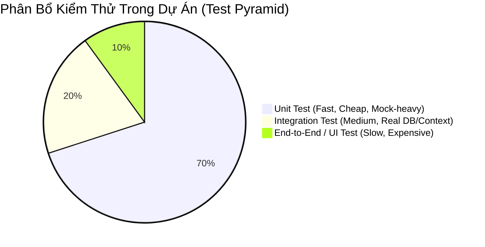
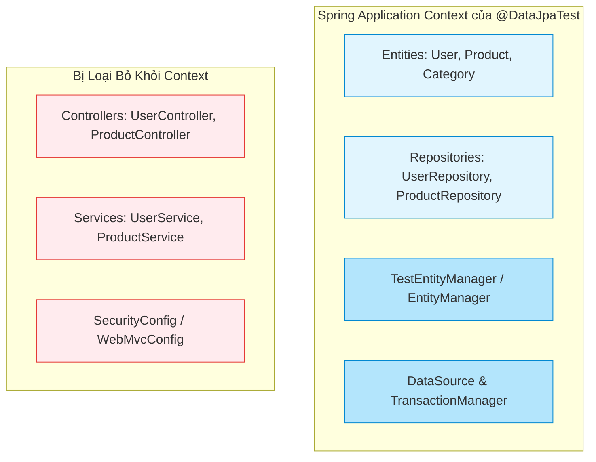
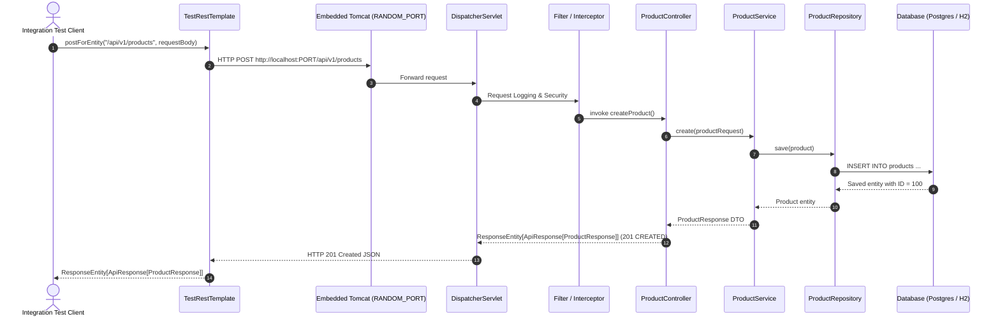
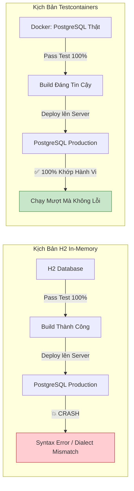
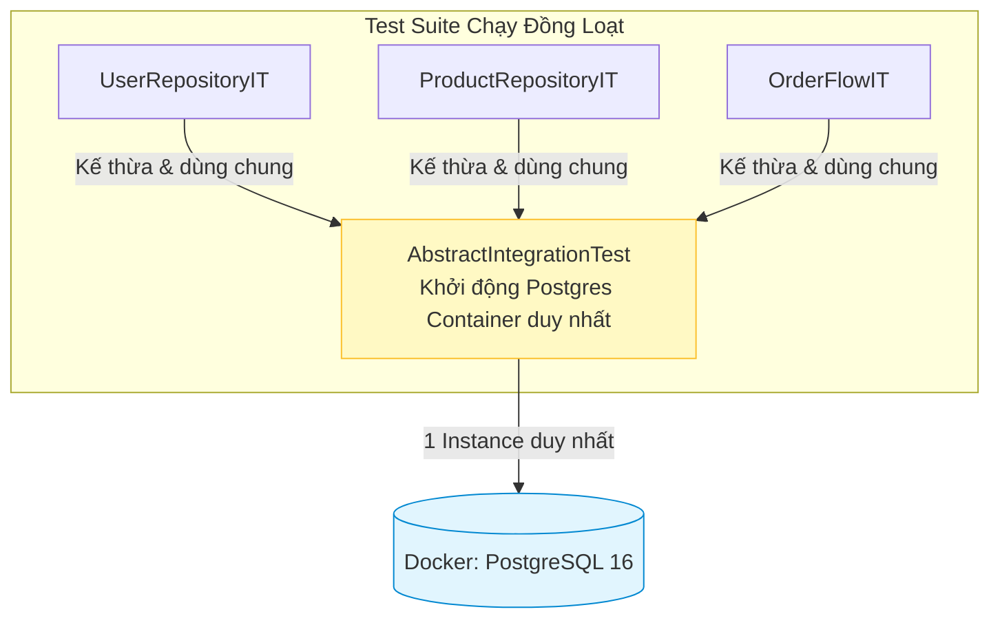
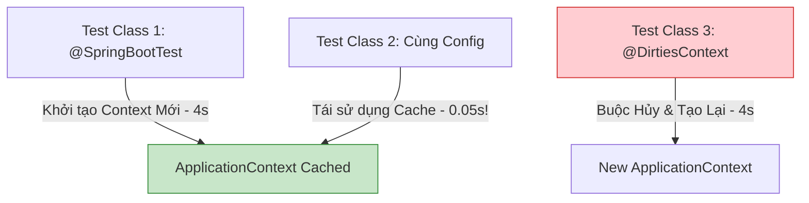

# 📘 BÀI 15: INTEGRATION TEST VỚI @SPRINGBOOTTEST & TESTCONTAINERS

> **Mục tiêu bài học:**
> * 🎯 Hiểu sâu sắc vị trí và vai trò của **Integration Test (Kiểm thử tích hợp)** trong Kim tự tháp kiểm thử phần mềm (**Test Pyramid**).
> * 🧩 Làm chủ kỹ thuật **Slice Testing** tầng dữ liệu với `@DataJpaTest` và công cụ truy vấn chuyên biệt `TestEntityManager`.
> * 🌐 Xây dựng kịch bản kiểm thử toàn diện từ Web đến Database với `@SpringBootTest(webEnvironment = RANDOM_PORT)` kết hợp `TestRestTemplate`.
> * 🐳 Nắm vững công nghệ đột phá **Testcontainers**: Kiểm thử trên cơ sở dữ liệu thật (PostgreSQL) thông qua Docker container, triệt tiêu hoàn toàn rủi ro sai lệch hành vi giữa H2 Memory và môi trường Production.
> * ⚡ Ứng dụng tính năng hiện đại `@ServiceConnection` trong Spring Boot 3.1+ và mẫu thiết kế **Singleton Container Pattern** để tối ưu hóa thời gian thực thi test suite.
> * 🧹 Nắm vững các chiến lược dọn dẹp dữ liệu kiểm thử (Database Cleanup Strategies: `@Transactional`, truncate tables, `@Sql`).
> * 💼 Tự tin trả lời 10 câu hỏi phỏng vấn tuyển dụng chuyên sâu về Integration Testing và Testcontainers.

---

## 📑 MỤC LỤC

1. [Phần 1: Định Vị Integration Test Trong Test Pyramid](#phần-1-định-vị-integration-test-trong-test-pyramid)
2. [Phần 2: Slice Testing Tầng Persistence Với @DataJpaTest & TestEntityManager](#phần-2-slice-testing-tầng-persistence-với-datajpatest--testentitymanager)
3. [Phần 3: Full Integration Test Với @SpringBootTest & TestRestTemplate](#phần-3-full-integration-test-với-springboottest--testresttemplate)
4. [Phần 4: Đột Phá Kiểm Thử Cơ Sở Dữ Liệu Thật Với Testcontainers](#phần-4-đột-phá-kiểm-thử-cơ-sở-dữ-liệu-thật-với-testcontainers)
5. [Phần 5: Quản Lý Vòng Đời Container & Tối Ưu Tốc Độ Thực Thi Test](#phần-5-quản-lý-vòng-đời-container--tối-ưu-tốc-độ-thực-thi-test)
6. [Phần 6: Chiến Lược Dọn Dẹp Dữ Liệu (Database Cleanup Strategies)](#phần-6-chiến-lược-dọn-dẹp-dữ-liệu-database-cleanup-strategies)
7. [Phần 7: Kiến Thức Java Core & Design Patterns Nền Tảng](#phần-7-kiến-thức-java-core--design-patterns-nền-tảng)
8. [Phần 8: 10 Câu Hỏi Phỏng Vấn Chuyên Sâu Kèm Đáp Án Chi Tiết](#phần-8-10-câu-hỏi-phỏng-vấn-chuyên-sâu-kèm-đáp-án-chi-tiết)

---

## PHẦN 1: ĐỊNH VỊ INTEGRATION TEST TRONG TEST PYRAMID

### 1.1. Tại sao Unit Test là chưa đủ?
Trong [Bài 14: Unit Test với JUnit 5 & Mockito](file:///Users/vovantu/HTML_CSS/JAVA%20/Note/Lesson14/bai-14-unit-test-junit5-mockito.md), chúng ta đã cô lập Service và Controller bằng cách giả lập (mock) toàn bộ các phụ thuộc như Repository. 

Tuy nhiên, trong thực tế sản xuất (Production):
* Câu truy vấn SQL phức tạp hoặc Hibernate JPQL/Specification có hoạt động chính xác với dialect của database không?
* Ràng buộc khóa ngoại (`Foreign Key`), chỉ mục duy nhất (`Unique Index`), hoặc trigger database có bị vi phạm không?
* Các cấu hình Spring Bean, lọc Filter, cơ chế Transaction rollback có phối hợp ăn ý giữa các tầng không?

Unit Test **không thể** trả lời các câu hỏi trên vì các đối tượng phụ thuộc đã bị giả lập. Đó là lý do ta cần **Integration Test (Kiểm thử tích hợp)**.



### 1.2. Bảng So Sánh Các Cấp Độ Test Trong Spring Boot

| Tiêu Chí | Unit Test (Bài 14) | Slice Test (`@DataJpaTest`) | Full Integration Test (`@SpringBootTest`) |
| :--- | :--- | :--- | :--- |
| **Phạm vi (Scope)** | Một class đơn lẻ (Service/Controller) | Chỉ nạp tầng JPA/Hibernate & Database | Toàn bộ ứng dụng (ApplicationContext đầy đủ) |
| **Tốc độ chạy** | Cực nhanh (~vài mili-giây) | Nhanh (~1 - 2 giây) | Chậm hơn (~3 - 10 giây nạp context) |
| **Môi trường Web** | Không nạp Servlet Container | Không nạp Web Server | Khởi động Embedded Server (Tomcat) trên port ngẫu nhiên |
| **Database** | Mock toàn bộ (Mockito) | In-Memory (H2) hoặc Testcontainers | Database thật hoặc Testcontainers |
| **Mục đích chính** | Kiểm thử logic nghiệp vụ thuần túy | Kiểm tra câu truy vấn, mapping Entity, Transaction | Kiểm thử trọn vẹn luồng dữ liệu E2E (End-to-End) |

---

## PHẦN 2: SLICE TESTING TẦNG PERSISTENCE VỚI @DATAJPATEST & TESTENTITYMANAGER

### 2.1. Bản Chất Của `@DataJpaTest`
Khi bạn gắn annotation `@DataJpaTest` lên test class:
1. Spring Boot **chỉ nạp các Bean liên quan đến JPA**: `@Entity`, `JpaRepository`, Spring Data JPA repositories, Hibernate Session/EntityManager, `DataSource`, `TransactionManager`.
2. Toàn bộ các bean nghiệp vụ khác như `@Controller`, `@Service`, `@Component` bình thường **bị bỏ qua**, giúp thời gian khởi động cực kỳ nhanh chóng.
3. Mặc định kích hoạt `@Transactional` cho mỗi method test: dữ liệu insert vào sẽ được tự động **rollback** sau khi method test kết thúc.



### 2.2. Vũ Khí Bí Mật: `TestEntityManager`
Khi test Repository, nếu bạn dùng chính `userRepository.save()` rồi gọi `userRepository.findById()`, có thể bạn chỉ đang lấy dữ liệu từ **Hibernate First-Level Cache (Persistence Context)** thay vì thực thi câu lệnh SQL `SELECT` xuống cơ sở dữ liệu thật!

`TestEntityManager` là một helper class được cung cấp riêng cho `@DataJpaTest`:
* `persistAndFlush(entity)`: Lưu entity và ép Hibernate đẩy ngay lập tức câu lệnh SQL `INSERT` xuống database.
* `clear()`: Xóa sạch 1st-level cache của Hibernate để buộc câu truy vấn kế tiếp phải bắn SQL `SELECT` xuống DB.
* `persistAndGetId(entity)`: Lưu và lấy ngay ID tự sinh.

```java
@DataJpaTest
@AutoConfigureTestDatabase(replace = AutoConfigureTestDatabase.Replace.NONE) // Giữ nguyên datasource config
class UserRepositoryDataJpaTest {

    @Autowired
    private TestEntityManager entityManager;

    @Autowired
    private UserRepository userRepository;

    @Test
    @DisplayName("Tìm user bằng email sau khi lưu thành công")
    void testFindByEmail_Success() {
        // Given: Chuẩn bị dữ liệu bằng TestEntityManager
        User user = User.builder()
                .username("johndoe")
                .fullName("John Doe")
                .email("john.doe@example.com")
                .phone("0987654321")
                .status("ACTIVE")
                .build();
        
        entityManager.persistAndFlush(user);
        entityManager.clear(); // Xóa Hibernate Cache để test câu lệnh SELECT thật sự

        // When: Thực thi method của Spring Data JPA Repository
        Optional<User> found = userRepository.findByEmail("john.doe@example.com");

        // Then: Kiểm chứng kết quả
        assertThat(found).isPresent();
        assertThat(found.get().getUsername()).isEqualTo("johndoe");
        assertThat(found.get().getId()).isNotNull();
    }
}
```

---

## PHẦN 3: FULL INTEGRATION TEST VỚI @SPRINGBOOTTEST & TESTRESTTEMPLATE

### 3.1. Cơ Chế Khởi Động Với `webEnvironment = RANDOM_PORT`
Để kiểm thử như một client thực tế gửi HTTP Request vào ứng dụng:
* `@SpringBootTest(webEnvironment = SpringBootTest.WebEnvironment.RANDOM_PORT)`: Khởi động toàn bộ ApplicationContext cùng một Embedded Web Server (Tomcat/Jetty) trên một cổng khả dụng ngẫu nhiên.
* Việc dùng cổng ngẫu nhiên tránh xung đột cổng (port collision) khi chạy song song trên CI/CD pipelines.
* `@LocalServerPort`: Cho phép inject số hiệu cổng ngẫu nhiên này vào test class.
* `TestRestTemplate`: Bộ client gửi HTTP Request đồng bộ, tự động cấu hình URL trỏ vào embedded server.



### 3.2. Cấu Trúc Kiểm Thử End-To-End (E2E)

```java
@SpringBootTest(webEnvironment = SpringBootTest.WebEnvironment.RANDOM_PORT)
@ActiveProfiles("test")
class ProductFlowIntegrationTest {

    @Autowired
    private TestRestTemplate restTemplate;

    @Autowired
    private ProductRepository productRepository;

    @Autowired
    private CategoryRepository categoryRepository;

    @BeforeEach
    void setUp() {
        productRepository.deleteAll();
        categoryRepository.deleteAll();
    }

    @Test
    @DisplayName("Luồng E2E: Tạo mới sản phẩm và truy vấn lại qua REST API")
    void testCreateAndGetProductFlow() {
        // 1. Chuẩn bị Category cha
        Category category = categoryRepository.save(
            Category.builder().name("Điện thoại").description("Smartphone cao cấp").build()
        );

        // 2. Gửi HTTP POST tạo sản phẩm
        ProductCreationRequest request = ProductCreationRequest.builder()
                .name("iPhone 15 Pro Max")
                .price(new BigDecimal("34990000"))
                .stock(50)
                .categoryId(category.getId())
                .build();

        HttpHeaders headers = new HttpHeaders();
        headers.setContentType(MediaType.APPLICATION_JSON);
        HttpEntity<ProductCreationRequest> entity = new HttpEntity<>(request, headers);

        ResponseEntity<ApiResponse<ProductResponse>> postResponse = restTemplate.exchange(
                "/api/v1/products",
                HttpMethod.POST,
                entity,
                new ParameterizedTypeReference<ApiResponse<ProductResponse>>() {}
        );

        // 3. Kiểm tra HTTP Status và Body phản hồi
        assertThat(postResponse.getStatusCode()).isEqualTo(HttpStatus.CREATED);
        assertThat(postResponse.getBody()).isNotNull();
        ProductResponse createdProduct = postResponse.getBody().getData();
        assertThat(createdProduct.getId()).isNotNull();
        assertThat(createdProduct.getName()).isEqualTo("iPhone 15 Pro Max");

        // 4. Gửi HTTP GET để kiểm chứng dữ liệu đã lưu vào DB
        ResponseEntity<ApiResponse<ProductResponse>> getResponse = restTemplate.exchange(
                "/api/v1/products/" + createdProduct.getId(),
                HttpMethod.GET,
                null,
                new ParameterizedTypeReference<ApiResponse<ProductResponse>>() {}
        );

        assertThat(getResponse.getStatusCode()).isEqualTo(HttpStatus.OK);
        assertThat(getResponse.getBody().getData().getName()).isEqualTo("iPhone 15 Pro Max");
    }
}
```

---

## PHẦN 4: ĐỘT PHÁ KIỂM THỬ CƠ SỞ DỮ LIỆU THẬT VỚI TESTCONTAINERS

### 4.1. Hạn Chế Nguy Hiểm Khi Dùng In-Memory Database (H2)
Trong nhiều năm, lập trình viên thường dùng H2 In-Memory Database để chạy test vì nó nhanh và không cần cài đặt. Tuy nhiên, sự khác biệt giữa H2 và Production Database (như PostgreSQL, MySQL, Oracle) dẫn đến những thảm họa thực tế:
1. **JSONB / Array / UUID:** H2 không hỗ trợ native hoặc hành vi mapping khác biệt so với PostgreSQL.
2. **Hàm toán tử & Window Functions:** Cú pháp SQL dialect khác biệt (`DATE_TRUNC`, `STRING_AGG`, Full-Text Search).
3. **Database Constraints & Locking:** Cơ chế khóa dòng (`SELECT FOR UPDATE`), isolation level trong H2 không phản ánh chân thực PostgreSQL.
4. **Flyway Migration:** Các script SQL migration viết cho PostgreSQL (sử dụng cú pháp riêng của Postgres) sẽ bị crash ngay lập tức khi chạy trên H2!



### 4.2. Testcontainers Hoạt Động Như Thế Nào?
**Testcontainers** là một thư viện Java mã nguồn mở, cho phép khởi động tự động các Docker Container chứa các dịch vụ phụ thuộc thật (PostgreSQL, Redis, Kafka, MongoDB, Elasticsearch,...) trong suốt quá trình chạy JUnit test.

Vòng đời tự động:
1. JUnit bắt đầu chạy -> Testcontainers kết nối Docker Daemon -> Kéo image `postgres:16-alpine` -> Khởi chạy container trên cổng ngẫu nhiên.
2. Ứng dụng Spring Boot kết nối vào database trong container -> Flyway chạy migration schema -> Tests thực thi.
3. JUnit kết thúc -> Testcontainers sử dụng cơ chế **Ryuk Sidecar Container** tự động dọn dẹp và hủy toàn bộ container, không để lại rác trên máy host.

### 4.3. Đỉnh Cao Tiện Lợi: `@ServiceConnection` (Spring Boot 3.1+)
Trước Spring Boot 3.1, lập trình viên phải viết hàm static với `@DynamicPropertySource` để ghi đè các thuộc tính `spring.datasource.url`, `spring.datasource.username`, `spring.datasource.password`:

```java
// ❌ CÁCH CŨ TRƯỚC SPRING BOOT 3.1 (Dài dòng, lặp lại)
@DynamicPropertySource
static void overrideProperties(DynamicPropertyRegistry registry) {
    registry.add("spring.datasource.url", postgres::getJdbcUrl);
    registry.add("spring.datasource.username", postgres::getUsername);
    registry.add("spring.datasource.password", postgres::getPassword);
}
```

Từ **Spring Boot 3.1+**, bạn chỉ cần thêm annotation `@ServiceConnection` lên đối tượng container! Spring Boot sẽ tự động nhận diện `PostgreSQLContainer` và cấu hình trọn bộ DataSource mà không cần một dòng code boilerplate nào:

```java
// ✅ CÁCH HIỆN ĐẠI TỪ SPRING BOOT 3.1+ (Ngắn gọn, mạnh mẽ)
@Container
@ServiceConnection
static PostgreSQLContainer<?> postgres = new PostgreSQLContainer<>("postgres:16-alpine");
```

---

## PHẦN 5: QUẢN LÝ VÒNG ĐỜI CONTAINER & TỐI ƯU TỐC ĐỘ THỰC THI TEST

### 5.1. Sai Lầm Phổ Biến: Container Per Test Class
Nếu mỗi test class đều khai báo:
```java
@Testcontainers
class ClassATest {
    @Container
    static PostgreSQLContainer<?> postgres = new PostgreSQLContainer<>("postgres:16-alpine");
}
```
Khi bạn có 20 test classes, Docker sẽ phải start/stop container 20 lần! Mỗi lần tốn từ 2 - 5 giây, dẫn đến tổng thời gian chạy test suite lên tới vài phút.

### 5.2. Giải Pháp: Singleton Container Pattern (Reused Container)
Mẫu thiết kế **Singleton Container** khởi động container **duy nhất 1 lần** cho toàn bộ test suite. Mọi test class kế thừa từ một `BaseIntegrationTest` dùng chung container này:



```java
@SpringBootTest(webEnvironment = SpringBootTest.WebEnvironment.RANDOM_PORT)
@ActiveProfiles("test")
public abstract class BaseIntegrationTest {

    // Khởi tạo static container duy nhất không dùng @Container để tránh bị JUnit đóng sau mỗi class
    static final PostgreSQLContainer<?> POSTGRES;

    static {
        POSTGRES = new PostgreSQLContainer<>("postgres:16-alpine")
                .withDatabaseName("testdb")
                .withUsername("testuser")
                .withPassword("testpass");
        POSTGRES.start();
    }

    @DynamicPropertySource
    static void configureProperties(DynamicPropertyRegistry registry) {
        registry.add("spring.datasource.url", POSTGRES::getJdbcUrl);
        registry.add("spring.datasource.username", POSTGRES::getUsername);
        registry.add("spring.datasource.password", POSTGRES::getPassword);
    }
}
```

---

## PHẦN 6: CHIẾN LƯỢC DỌN DẸP DỮ LIỆU (DATABASE CLEANUP STRATEGIES)

Khi chia sẻ chung một database giữa nhiều test case, việc test case A ghi dữ liệu làm ảnh hưởng đến kết quả của test case B (Side effects / Test pollution) là lỗi phổ biến nhất. Dưới đây là 3 chiến lược giải quyết:

### 6.1. Chiến Lược 1: Rollback Với `@Transactional`
* **Cách làm:** Gắn `@Transactional` lên test method hoặc test class.
* **Cơ chế:** Spring mở transaction trước khi chạy test và tự động rollback khi test kết thúc.
* **Ưu điểm:** Cực nhanh, không cần truncate bảng.
* **Nhược điểm chết người:** Không hoạt động đối với test gọi qua HTTP Client (`TestRestTemplate` / `WebTestClient`) vì HTTP request chạy trên một thread độc lập của Embedded Tomcat, nằm ngoài transaction của test thread!

### 6.2. Chiến Lược 2: Truncate / Delete Dữ Liệu Trong `@BeforeEach`
* **Cách làm:** Inject Repository hoặc `JdbcTemplate` để xóa dữ liệu trước mỗi lần test:
  ```java
  @BeforeEach
  void cleanUp() {
      productRepository.deleteAll();
      categoryRepository.deleteAll();
      userRepository.deleteAll();
  }
  ```
* **Ưu điểm:** Hoạt động tin cậy cho mọi loại test (cả Slice test và HTTP E2E test).
* **Lưu ý:** Phải xóa bảng con trước bảng cha để không vi phạm ràng buộc khóa ngoại (Foreign Key Constraint).

### 6.3. Chiến Lược 3: Nạp Dữ Liệu Chuẩn Với `@Sql`
Spring cung cấp annotation `@Sql` để chạy các script SQL trước và sau khi thực thi test method:
```java
@Test
@Sql(scripts = "/db/test-data/seed-users.sql", executionPhase = Sql.ExecutionPhase.BEFORE_TEST_METHOD)
@Sql(scripts = "/db/test-data/cleanup.sql", executionPhase = Sql.ExecutionPhase.AFTER_TEST_METHOD)
void testCustomQueryWithSeededData() {
    // ...
}
```

---

## PHẦN 7: KIẾN THỨC JAVA CORE & DESIGN PATTERNS NỀN TẢNG

### 7.1. Singleton Pattern & Resource Pooling Trong Testcontainers
Testcontainers áp dụng triệt để **Singleton Pattern** để đảm bảo tài nguyên Docker nặng không bị tái tạo lãng phí. Ryuk Resource Reaper sidecar container chạy song song, sử dụng Unix Socket kết nối đến Docker daemon để theo dõi heartbeat của JVM và dọn dẹp tài nguyên ngay cả khi tiến trình test bị `kill -9`.

### 7.2. Cơ Chế TestContext Framework & Context Caching Của Spring
Spring TestContext Framework có một tính năng tối ưu cực kỳ mạnh mẽ: **ApplicationContext Caching**.
* Nếu Class Test A và Class Test B có cùng tập hợp cấu hình (`@ContextConfiguration`, `@ActiveProfiles`, danh sách beans giống nhau), Spring sẽ **tái sử dụng nguyên vẹn** ApplicationContext đã nạp trước đó thay vì khởi động lại từ đầu!
* ⚠️ **Lưu ý tránh `@DirtiesContext`:** Gắn `@DirtiesContext` sẽ thông báo cho Spring rằng context này đã bị ô nhiễm và buộc Spring phải đóng và tạo mới context cho các bài test tiếp theo. Sử dụng `@DirtiesContext` bừa bãi là nguyên nhân hàng đầu khiến thời gian chạy test suite tăng vọt từ 10 giây lên 5 phút!



---

## PHẦN 8: 10 CÂU HỎI PHỎNG VẤN CHUYÊN SÂU KÈM ĐÁP ÁN CHI TIẾT

### Câu 1: Phân biệt sự khác nhau giữa `@SpringBootTest` và `@DataJpaTest`?
**Đáp án:**
* `@SpringBootTest` khởi tạo toàn bộ `ApplicationContext` của ứng dụng (bao gồm tất cả Controllers, Services, Repositories, Security, Filters, Scheduled Tasks). Thường dùng cho Full Integration Test hoặc E2E Test.
* `@DataJpaTest` là một **Slice Test**, chỉ nạp các thành phần liên quan đến Persistence Layer (Entities, Repositories, EntityManager, DataSource, Liquibase/Flyway). Bỏ qua hoàn toàn Service và Web Layer. Tự động bật chế độ `@Transactional` cho mỗi test method để rollback dữ liệu, giúp thời gian khởi động cực nhanh và tập trung kiểm tra câu truy vấn cơ sở dữ liệu.

### Câu 2: Tại sao chúng ta nên ưu tiên sử dụng Testcontainers thay vì H2 In-Memory Database khi viết Integration Test?
**Đáp án:**
* Mặc dù H2 chạy nhanh và nhẹ, nhưng nó có SQL dialect, hàm tích hợp, cơ chế khóa (locking) và kiểu dữ liệu khác biệt so với Production Database (như PostgreSQL, MySQL).
* Những tính năng nâng cao như JSONB, Array, GIS, Trigger, Stored Procedure, hoặc các câu lệnh SQL Migration của Flyway thường gặp lỗi trên H2 dù chạy rất tốt trên PostgreSQL.
* Testcontainers chạy trên chính Docker image của database production, đảm bảo môi trường kiểm thử tương đồng 100% với môi trường thực tế (*Parity between Test & Production*), triệt tiêu hoàn toàn lỗi bất ngờ khi triển khai thực tế.

### Câu 3: Annotation `@ServiceConnection` trong Spring Boot 3.1 giải quyết bài toán gì và có ưu điểm gì so với `@DynamicPropertySource`?
**Đáp án:**
* Trước Spring Boot 3.1, khi khởi động container bằng Testcontainers, lập trình viên bắt buộc phải sử dụng `@DynamicPropertySource` để trích xuất JDBC URL, username, password từ container và nạp thủ công vào các biến môi trường của Spring (`spring.datasource.url`,...).
* `@ServiceConnection` loại bỏ hoàn toàn mã cấu hình thủ công này. Spring Boot sẽ tự động dò tìm kiểu container (ví dụ `PostgreSQLContainer`) và cấu hình tương thích trực tiếp với DataSource bean trong context, giảm thiểu boilerplate code và tránh các lỗi cấu hình sai chính tả tên thuộc tính.

### Câu 4: Khi kiểm thử API bằng `TestRestTemplate` hoặc `WebTestClient`, tại sao `@Transactional` đặt ở test class lại không tự động rollback dữ liệu trong DB?
**Đáp án:**
* Khi sử dụng `@SpringBootTest(webEnvironment = RANDOM_PORT)`, ứng dụng chạy trên một embedded web server thực tế (như Tomcat).
* `TestRestTemplate` gửi một HTTP Request thật qua giao thức mạng TCP. Request này được xử lý trên một Worker Thread riêng biệt của Tomcat, độc lập hoàn toàn với Main Thread đang chạy JUnit test.
* `@Transactional` trên method test chỉ mở transaction trên Main Thread của test. Do đó, các câu lệnh INSERT/UPDATE được thực thi bởi Tomcat Thread nằm trong transaction khác và đã được commit vào database. Khi test thread kết thúc, rollback của test thread không ảnh hưởng đến dữ liệu đã commit của server thread.
* **Giải pháp:** Sử dụng `@BeforeEach` để dọn dẹp dữ liệu qua Repository hoặc JdbcTemplate.

### Câu 5: Làm thế nào để áp dụng Singleton Container Pattern cho Testcontainers nhằm tăng tốc độ chạy test suite?
**Đáp án:**
* Thay vì khai báo `@Container` trong từng test class (khiến mỗi class tạo ra một container mới), ta định nghĩa một abstract base class (ví dụ `BaseIntegrationTest`).
* Khai báo container dưới dạng `static final` và kích hoạt phương thức `start()` trong static initialization block:
  ```java
  static final PostgreSQLContainer<?> POSTGRES = new PostgreSQLContainer<>("postgres:16-alpine");
  static { POSTGRES.start(); }
  ```
* Bằng cách không sử dụng `@Testcontainers` và `@Container` của JUnit Jupiter extension, container sẽ không bị JUnit hủy sau mỗi class test mà duy trì xuyên suốt toàn bộ tiến trình JVM cho đến khi test suite chạy xong.

### Câu 6: Làm thế nào Ryuk Container trong Testcontainers dọn dẹp các tài nguyên Docker bị rò rỉ?
**Đáp án:**
* Khi Testcontainers khởi động, nó tự động spawn một container nhẹ tên là **Ryuk** (`testcontainers/ryuk`).
* Ryuk kết nối đến Docker daemon qua Unix Socket hoặc TCP và mở một kết nối socket TCP hai chiều với JVM đang chạy test.
* Khi JVM kết thúc bình thường hoặc bị tắt đột ngột (kể cả khi bị Crash / SIGKILL), kết nối socket giữa JVM và Ryuk bị ngắt. Ryuk lập tức phát hiện sự cố và gửi lệnh đến Docker Daemon để xóa toàn bộ containers, networks, volumes đã được gắn nhãn (labeled) bởi phiên test đó.

### Câu 7: Giải thích hiện tượng Spring Test Context Caching và tác hại của `@DirtiesContext`?
**Đáp án:**
* Spring TestContext Framework lưu trữ các `ApplicationContext` đã tạo trong bộ nhớ cache tĩnh (`ContextCache`). Nếu các test class kế tiếp có cùng thông số cấu hình, Spring sẽ tái sử dụng context cũ thay vì mất thời gian khởi tạo lại.
* Nếu một test method hoặc test class gắn `@DirtiesContext`, nó đánh dấu rằng context hiện tại đã bị thay đổi trạng thái (ví dụ bị sửa đổi mock bean nội bộ, hỏng cache). Spring buộc phải đóng context này và khởi động lại một context mới cho các bài test tiếp theo, khiến thời gian chạy kiểm thử tăng lên gấp nhiều lần.

### Câu 8: `TestEntityManager` khác với JPA `EntityManager` tiêu chuẩn như thế nào?
**Đáp án:**
* `TestEntityManager` là một wrapper tiện ích được thiết kế chuyên biệt cho việc kiểm thử trong môi trường `@DataJpaTest`.
* Nó cung cấp các phương thức kết hợp thông minh giúp việc kiểm tra persistence dễ dàng hơn:
  * `persistAndFlush()`: Lưu entity và ép Hibernate đẩy lệnh SQL xuống DB ngay lập tức.
  * `clear()`: Xóa Hibernate Session cache để đảm bảo câu query tiếp theo không đọc dữ liệu từ bộ nhớ đệm (L1 Cache) mà phải truy vấn trực tiếp từ DB.
  * `persistFlushFind()`: Lưu, flush và truy vấn lại ngay entity để kiểm tra các giá trị tự sinh (như `@CreationTimestamp`, `@GeneratedValue`).

### Câu 9: Sự khác biệt giữa `TestRestTemplate` và `WebTestClient` trong kiểm thử Spring Boot là gì?
**Đáp án:**
* `TestRestTemplate` được tối ưu cho kiến trúc Spring MVC đồng bộ (Blocking I/O), cung cấp các method tương tự `RestTemplate` nhưng có khả năng xử lý HTTP authentication và không ném ngoại lệ khi gặp mã lỗi 4xx/5xx (giúp dễ dàng assert status code).
* `WebTestClient` ban đầu được thiết kế cho Spring WebFlux (Non-blocking I/O), nhưng từ Spring Boot 2+ có thể dùng để kiểm thử cả Spring MVC. `WebTestClient` cung cấp Fluent API cực kỳ thanh lịch để vừa gửi request vừa assert headers, status, jsonPath trực tiếp trên cùng một chuỗi gọi hàm mà không cần bóc tách response body thủ công.

### Câu 10: Làm thế nào để chạy Integration Test với Testcontainers trên môi trường CI/CD (GitHub Actions, GitLab CI)?
**Đáp án:**
* Trên CI/CD, máy agent chạy pipeline cần có quyền truy cập vào Docker Daemon (Docker-in-Docker hoặc Docker Socket Binding).
* Với **GitHub Actions**: Runner mặc định (`ubuntu-latest`) đã cài sẵn Docker daemon và socket `/var/run/docker.sock`. Testcontainers hoạt động tự động *out-of-the-box* mà không cần cấu hình thêm gì.
* Với **GitLab CI**: Ta cấu hình `dind` (Docker-in-Docker) service:
  ```yaml
  services:
    - docker:dind
  variables:
    DOCKER_HOST: tcp://docker:2375
    DOCKER_TLS_CERTDIR: ""
  ```
* Có thể tinh chỉnh biến môi trường `TESTCONTAINERS_RYUK_DISABLED=true` nếu môi trường CI gặp vấn đề về đặc quyền cấp phép socket cho Ryuk container.

---

> 💡 **Bài học tiếp theo:** [Bài 16: Caching với Redis - Kiến trúc bộ nhớ đệm hiệu năng cao](file:///Users/vovantu/HTML_CSS/JAVA%20/Note/Lesson16/bai-16-caching-redis.md)
