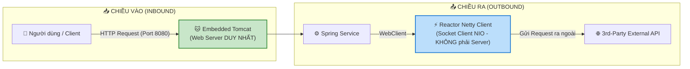
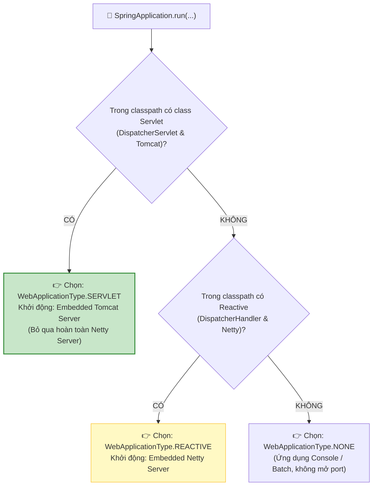
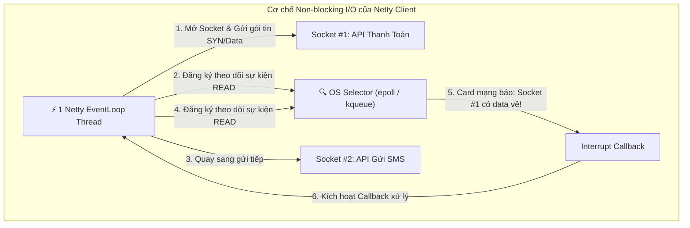
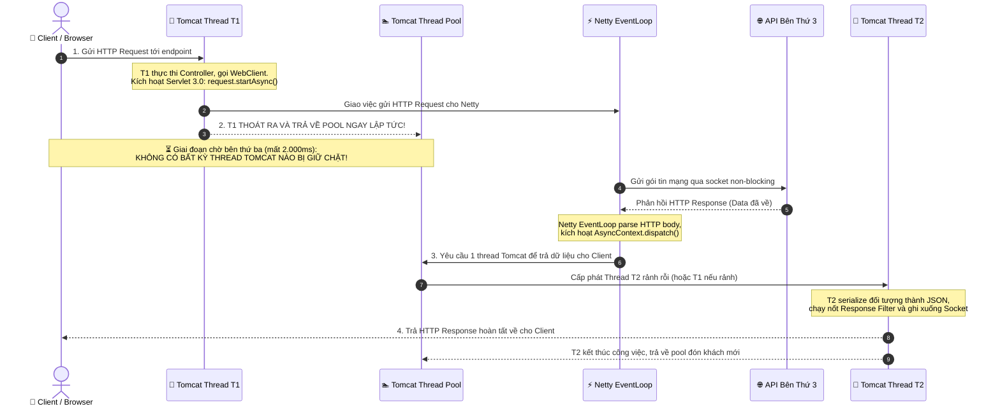

# 🧠 CHUYÊN ĐỀ CHUYÊN SÂU: CƠ CHẾ HOẠT ĐỘNG CỦA WEBCLIENT TRONG SPRING MVC (TOMCAT VS NETTY EVENTLOOP)
## Tóm tắt : có nghĩa là nếu dung webclient thì nó hoạt động theo cơ chế event loop gửi API sang bên thứ 3 (có nghĩa là request của người dùng đi vào tomcat server (spring mvc sử dụng async MoMo<T>) ,sau đó nó sử dụng webclient để gửi API sang bên thứ 3), rồi webclient nó không block lại mà nó quay sa ng tiếp nhận thêm request để gửi API sang bên thứ 3. Bao giờ bên thứ  3 phản hồi thì nó sẽ callback gọi lại 1 thread webclient để tomcat server xử lý để trả lại data cho người dùng  
> **Chủ đề:** Tối ưu hóa I/O, Concurrency & Kiến trúc Thread trong Spring Boot   
> **Mục tiêu:** Hiểu thấu đáo bản chất của `WebClient` khi chạy trong môi trường Spring MVC truyền thống; làm sáng tỏ vai trò của Embedded Tomcat, Netty EventLoop Client và cơ chế Servlet 3.0/3.1 Asynchronous Processing.  
> **Tài liệu liên quan:**  
> - [bai-16-goi-external-api-restclient-webclient-http-service-client.md](file:///Users/vovantu/HTML_CSS/JAVA%20/Note/Lesson16/bai-16-goi-external-api-restclient-webclient-http-service-client.md)  
> - [chuyen-de-spring-mvc-vs-spring-webflux.md](file:///Users/vovantu/HTML_CSS/JAVA%20/Note/ChuyenDe/chuyen-de-spring-mvc-vs-spring-webflux.md)  
> - [chuyen-de-nghen-thread-pool-va-qua-tai-he-thong-spring-mvc.md](file:///Users/vovantu/HTML_CSS/JAVA%20/Note/ChuyenDe/chuyen-de-nghen-thread-pool-va-qua-tai-he-thong-spring-mvc.md)

---

## 📌 PHẦN 1: ĐỊNH NGHĨA CHUẨN XÁC & BẢN CHẤT CỐT LÕI

### 1.1. Câu hỏi lớn
> *"Khi sử dụng `WebClient` trong ứng dụng Spring MVC (đã có `spring-boot-starter-web`), ngoài Web Server Tomcat chính thì ứng dụng có khởi động thêm một Web Server Netty chạy song song không?"*

### 1.2. Định nghĩa chuẩn xác & Tóm tắt cốt lõi (Bắt buộc)
$$\text{Khẳng định kỹ thuật:} \quad \mathbf{HOÀN\ TOÀN\ KHÔNG!}$$

Trong ứng dụng Spring MVC, ứng dụng **chỉ khởi động duy nhất 1 Web Server là Embedded Tomcat** (mặc định mở cổng `8080`). Hoàn toàn không có máy chủ Netty Web Server nào được kích hoạt để lắng nghe kết nối mạng (listen port).

Bản chất của Netty xuất hiện trong trường hợp này được định nghĩa chuẩn xác như sau:
* **Tomcat = Inbound Web Server:** Chịu trách nhiệm mở cổng mạng (port 8080), tiếp nhận các HTTP Request gửi tới từ Client/Browser bên ngoài.
* **Reactor Netty = Outbound HTTP Client:** Chỉ đóng vai trò là một **bộ thư viện socket client** (tương tự như công cụ `curl` hay socket NIO thu nhỏ) được `WebClient` mượn để kết nối ra ngoài Internet nhằm gọi các API bên thứ ba theo cơ chế bất đồng bộ (Non-blocking I/O).



---

## ⚙️ PHẦN 2: CƠ CHẾ PHÁT HIỆN KIỂU ỨNG DỤNG CỦA SPRING BOOT (`WebApplicationType`)

Khi cấu hình `pom.xml` chứa đồng thời cả 2 dependency:
```xml
<!-- 1. Spring MVC Web Server -->
<dependency>
    <groupId>org.springframework.boot</groupId>
    <artifactId>spring-boot-starter-web</artifactId>
</dependency>

<!-- 2. Kéo vào chỉ để sử dụng WebClient -->
<dependency>
    <groupId>org.springframework.boot</groupId>
    <artifactId>spring-boot-starter-webflux</artifactId>
</dependency>
```

Spring Boot khi khởi động sẽ thực thi class `WebApplicationTypeResolver` để xác định loại Container sẽ bootstrap:



| Loại Web Application Type | Điều kiện kích hoạt | Web Server thực tế khởi chạy |
| :--- | :--- | :--- |
| **`SERVLET` (Ưu tiên số 1)** | Có cả Spring MVC và Servlet API trong classpath. | **Embedded Tomcat / Jetty / Undertow**. |
| **`REACTIVE`** | **Chỉ có** Spring WebFlux, **không có** Spring MVC / Servlet. | **Embedded Netty**. |
| **`NONE`** | Không chứa bất kỳ thư viện Web nào. | **Không có Web Server**. |

> [!IMPORTANT]
> **Quy tắc đè (Precedence Rule):** Spring Boot thiết kế theo nguyên tắc tương thích ngược: **Servlet luôn luôn đè Reactive**. Vì vậy, khi có mặt `spring-boot-starter-web`, Netty Web Server sẽ vĩnh viễn bị vô hiệu hóa ở tầng Server.

---

## ⚡ PHẦN 3: KIẾN TRÚC EVENT LOOP CỦA NETTY HTTP CLIENT

Khi `WebClient` thực hiện một cuộc gọi ra bên ngoài, nó không dùng cơ chế chặn luồng (blocking thread) của `java.net.HttpURLConnection` mà tận dụng **Reactor Netty EventLoop**:



### 3.1. Phân biệt chính xác: "Callback / Event Notification" vs "Fallback"
Một số người học thường nhầm lẫn giữa hai khái niệm này:
* ❌ **Fallback (Dự phòng lỗi):** Là thuật ngữ thuộc về mẫu thiết kế **Circuit Breaker** (như Resilience4j). Khi gọi API bên thứ ba bị timeout hoặc lỗi 500, hệ thống kích hoạt hàm `fallbackMethod()` để trả về dữ liệu mặc định trong cache.
*  **Callback / Event Notification (Thông báo sự kiện):** Là cơ chế lập trình hướng sự kiện (Event-Driven) ở tầng I/O. Thread của Netty **không đứng chờ**. Khi hệ điều hành (OS Kernel) nhận đủ gói tin TCP từ bên thứ ba, nó phát tín hiệu (Signal) qua Selector để báo cho Netty EventLoop đọc dữ liệu.

### 3.2. Sức mạnh của Non-blocking I/O
* **Mặc định:** Số lượng `reactor-http-nio` threads chỉ bằng **số nhân CPU** (ví dụ: máy tính 8 cores thì chỉ có đúng 8 threads).
* Nhờ cơ chế đăng ký kênh vào OS Selector (`epoll` trên Linux, `kqueue` trên macOS), **chỉ 1 thread duy nhất có thể quản lý đồng thời hàng nghìn kết nối Outbound** mà không phải tốn RAM tạo hàng nghìn threads như mô hình blocking truyền thống.

---

## 🔄 PHẦN 4: SỰ PHỐI HỢP GIỮA TOMCAT VÀ NETTY QUA SERVLET 3.0/3.1 ASYNC CONTEXT

Đây là câu hỏi cốt lõi về mặt kỹ thuật: *Khi Netty nhận dữ liệu xong từ bên thứ 3, nó trả lại cho người dùng như thế nào trong môi trường Spring MVC? Có cần Thread của Tomcat nhúng tay vào không?*

Câu trả lời: **CÓ! Tomcat bắt buộc phải cấp một Thread để hoàn tất việc ghi dữ liệu trả về cho người dùng.**

### 4.1. Cơ chế Luồng 2 Pha (Two-Phase Execution) với `AsyncContext`



### 4.2. Phân tích chi tiết từng micro-giây:

1. **Pha 1 — Tiếp nhận & Ủy quyền (Bắt đầu):**
   * Request của người dùng đi vào cổng 8080. Tomcat lấy Thread `T1` từ `tomcat-handler-pool` để nhận request.
   * Controller trả về một Reactive Type (`Mono<T>`).
   * Spring MVC nhận thấy Controller trả về `Mono`, lập tức gọi `request.startAsync()`.
   * Thread `T1` ủy quyền nhiệm vụ mạng cho Netty Client rồi **ngay lập tức kết thúc chu kỳ xử lý và trả về Thread Pool**.
   * 👉 *Thời gian `T1` làm việc: chỉ khoảng **0.5 miligiây**.*

2. **Pha Trung gian — Đợi mạng (Waiting I/O):**
   * Kết nối HTTP giữa Client và Tomcat vẫn giữ mở ở tầng Socket (trạng thái Suspended).
   * Bên thứ ba xử lý mất 2 giây (2.000 ms).
   * 👉 *Trong suốt 2.000 ms này, **KHÔNG CÓ MỘT THREAD TOMCAT NÀO BỊ GIỮ**. Cả 200 threads của Tomcat hoàn toàn rảnh tay phục vụ hàng nghìn người dùng khác.*

3. **Pha 2 — Điều phối & Trả hàng (Resume & Response):**
   * Netty EventLoop nhận được data từ bên thứ ba.
   * Netty **không có quyền ghi trực tiếp vào Servlet OutputStream của Tomcat**. Nó phát lệnh `asyncContext.dispatch()`.
   * Tomcat lấy một thread đang rảnh trong pool (ví dụ Thread `T2`) để tiếp tục quy trình Servlet.
   * `T2` thực hiện: chuyển đổi Java Object sang JSON (MessageConverter), thực thi các Interceptor post-handle, ghi byte ra Socket của Client và đóng connection.
   * 👉 *Thời gian `T2` làm việc: chỉ khoảng **0.5 miligiây** rồi lại trả về pool.*

---

## 📊 PHẦN 5: BẢNG SO SÁNH THỜI GIAN CHIẾM GIỮ THREAD (THREAD HOLD TIME)

Để thấy rõ tại sao kiến trúc này tạo ra sự đột phá về thông lượng (Throughput), hãy nhìn vào bảng so sánh thời gian chiếm giữ thread trên mỗi request:

| Hành vi thực tế | Mô hình Blocking Cũ (`RestTemplate` hoặc WebClient `.block()`) | Mô hình Async Servlet (`WebClient` trả về `Mono`) |
| :--- | :--- | :--- |
| **Tiếp nhận request** | Thread `T1` xử lý (~0.5 ms) | Thread `T1` xử lý (~0.5 ms) |
| **Chờ API bên thứ ba (giả sử mất 2s)** | 🔴 **Thread `T1` bị "bắt cóc" (Sleep/Wait) suốt 2.000 ms!** | 🟢 **0 ms.** `T1` đã về pool đón khách khác ngay từ 0.5 ms đầu. |
| **Ghi trả kết quả cho người dùng** | Thread `T1` ghi (~0.5 ms) | Mượn Thread `T2` ghi (~0.5 ms) |
| **TỔNG THỜI GIAN THREAD TOMCAT BỊ GIỮ** | 🔴 **~2.001 miligiây / 1 request** | 🟢 **~1 miligiây / 1 request** |
| **Giới hạn chịu tải với Pool 200 threads** | Tối đa **100 requests/giây** (200 requests đồng thời là cạn kiệt thread pool). | Chịu tải **lên tới 10.000+ requests/giây** mà không nghẽn Tomcat! |

---

## ⚠️ PHẦN 6: BẪY TƯ DUY LỚN NHẤT — LẠM DỤNG LỆNH `.block()`

Rất nhiều lập trình viên sử dụng `WebClient` trong Spring MVC nhưng lại viết code như sau:

```java
// ❌ SAI LẦM PHỔ BIẾN: LÀM PHÁ SẢN TOÀN BỘ LỢI THẾ CỦA WEBCLIENT
@GetMapping("/external-data")
public ProductDto getProductData() {
    return webClient.get()
            .uri("/api/products/1")
            .retrieve()
            .bodyToMono(ProductDto.class)
            .block(); // ⚠️ CHÍNH LÀ NÓ: KẺ GIẾT CHẾT HIỆU NĂNG!
}
```

### Tại sao `.block()` lại nguy hiểm?
1. **Nửa nạc nửa mỡ:** Dù Netty bên dưới gửi request hoàn toàn non-blocking, nhưng lệnh `.block()` ép Thread của Tomcat **phải dừng lại chờ đợi** (Thread chuyển sang trạng thái `TIMED_WAITING`).
2. **Hậu quả:** Thread Tomcat bị giữ nguyên vẹn 2.000 ms. Lợi thế của Non-blocking biến mất hoàn toàn, hệ thống vẫn bị **Thread Starvation** y hệt như dùng `RestTemplate` cổ điển!

###  Cách viết chuẩn mực trong Spring MVC:

```java
//  CÁCH VIẾT CHUẨN: TRẢ VỀ REACTIVE TYPE ĐỂ KÍCH HOẠT ASYNC CONTEXT
@GetMapping("/external-data")
public Mono<ProductDto> getProductData() {
    return webClient.get()
            .uri("/api/products/1")
            .retrieve()
            .bodyToMono(ProductDto.class); // Spring MVC tự động chuyển giao cho Servlet Async!
}
```

---

## ⚖️ PHẦN 7: SO SÁNH: SPRING MVC + WEBCLIENT VS SPRING WEBFLUX THUẦN

| Đặc điểm kiến trúc | Spring MVC + WebClient (Async Servlet 3.1) | Spring WebFlux Thuần (End-to-End Reactive) |
| :--- | :--- | :--- |
| **Inbound Web Server** | **Tomcat** (Thread-per-request cải tiến với AsyncContext). | **Netty Server** (EventLoop-based hoàn toàn). |
| **Cơ chế trả Response** | Netty Client phải **bàn giao qua Thread Tomcat (T2)** để ghi ra socket. | Chính **Netty EventLoop ghi trực tiếp ra Socket** của User, không bàn giao qua pool nào khác. |
| **Số lượng Threads trong App** | Khoảng 200 Tomcat Threads + (số core) Netty Threads. | Cực ít: chỉ khoảng (số nhân CPU × 2) threads cho toàn bộ ứng dụng. |
| **Quản lý Context (`ThreadLocal`)**| Dễ tương thích với Spring Security, `@Transactional`, Hibernate. | Không dùng được `ThreadLocal` truyền thống, phải dùng `Reactor Context`. |
| **Độ phức tạp gỡ lỗi (Debugging)** | Trung bình (StackTrace vẫn giữ được luồng Servlet). | Khó (StackTrace bị phân mảnh trên các EventLoop). |

---

## 🏗️ PHẦN 8: DESIGN PATTERNS & JAVA CORE NỀN TẢNG

1. **Reactor Pattern (I/O Multiplexing):**
   * Netty cài đặt mẫu Reactor Pattern dựa trên `java.nio.channels.Selector`. Một thread duy nhất giám sát nhiều Socket Channels đồng thời bằng cách lắng nghe các sự kiện `OP_READ`, `OP_WRITE`, `OP_CONNECT`.
2. **Observer Pattern / Reactive Streams Specification:**
   * Chuỗi xử lý `Mono` / `Flux` thực hiện giao ước của Reactive Streams: `Publisher` (phát ra dữ liệu) $\rightarrow$ `Subscriber` (tiếp nhận) $\rightarrow$ `Subscription` (quản lý backpressure).
3. **Bridge Pattern (Cầu nối giữa 2 kiến trúc luồng):**
   * Lớp `DeferredResultProcessingInterceptor` và `WebAsyncManager` của Spring MVC đóng vai trò là chiếc cầu nối (Bridge) chuyển giao tín hiệu hoàn thành từ Reactive Pipeline của Project Reactor sang Servlet Container (`AsyncContext`).

---

## ❓ PHẦN 9: BỘ CÂU HỎI PHỎNG VẤN CHUYÊN SÂU (INTERVIEW QUESTIONS)

### Q1: Tại sao trong Spring Boot, khi khai báo cả `spring-boot-starter-web` và `spring-boot-starter-webflux`, ứng dụng lại chạy Tomcat mà không chạy Netty?
**Trả lời:**
Do cơ chế phân giải `WebApplicationType` của Spring Boot. Class `WebApplicationType.deduceFromClasspath()` ưu tiên kiểm tra sự hiện diện của các class Servlet (như `DispatcherServlet`) trước. Nếu tìm thấy, Spring Boot gán kiểu ứng dụng là `SERVLET` và khởi chạy Embedded Tomcat Server. Netty Web Server chỉ được kích hoạt khi kiểu ứng dụng được xác định là `REACTIVE` (tức là hoàn toàn không có `spring-boot-starter-web` trong classpath).

### Q2: Nếu dùng `WebClient` mà gọi `.block()` trong Controller của Spring MVC thì điều gì xảy ra ở tầng Concurrency?
**Trả lời:**
Lệnh `.block()` sẽ ép Thread Tomcat đang xử lý request chuyển sang trạng thái chờ (`WAITING`). Mặc dù Netty Client bên dưới vẫn xử lý I/O non-blocking, nhưng Thread Tomcat vẫn bị chiếm dụng trong toàn bộ thời gian chờ external API phản hồi. Do đó, nếu có lượng truy cập đồng thời lớn, toàn bộ Tomcat thread pool (mặc định 200 threads) sẽ bị cạn kiệt (Thread Starvation), làm mất đi hoàn toàn lợi ích của kiến trúc Non-blocking.

### Q3: Khi Controller Spring MVC trả về `Mono<T>`, cơ chế Servlet nào giúp Tomcat giải phóng thread ban đầu?
**Trả lời:**
Đó là cơ chế **Servlet 3.0 / 3.1 Asynchronous Processing** thông qua `AsyncContext`. Khi nhận diện Controller trả về kiểu Reactive (`Mono`/`Flux`) hoặc `DeferredResult`, Spring MVC gọi `request.startAsync()`. Hành động này đưa request vào trạng thái treo (suspended) nhưng giữ nguyên kết nối socket với client, cho phép Thread tiếp nhận ban đầu thoát ra và quay trở lại Tomcat Thread Pool để phục vụ request khác.

### Q4: Khi bên thứ ba trả kết quả về cho Netty, Thread nào sẽ làm nhiệm vụ serialize JSON và gửi response về cho người dùng?
**Trả lời:**
Thread của Tomcat sẽ làm nhiệm vụ này. Netty EventLoop sau khi nhận đủ dữ liệu từ bên thứ ba sẽ kích hoạt callback và gọi `asyncContext.dispatch()`. Tomcat nhận được tín hiệu sẽ điều phối một thread đang rảnh rỗi từ Tomcat Thread Pool (có thể là một thread khác hoàn toàn so với thread tiếp nhận ban đầu) để serialize đối tượng thành JSON, chạy qua các Response Filter và ghi dữ liệu ra Socket của người dùng.

### Q5: Trong dự án Spring Boot 3.2+ sử dụng Spring MVC, nếu chỉ cần gọi external API theo kiểu đồng bộ đơn giản thì nên chọn WebClient hay giải pháp nào khác? Vì sao?
**Trả lời:**
Nên ưu tiên sử dụng **`RestClient`** hoặc **`HTTP Service Client`** (kết hợp `RestClientAdapter`). 
Lý do:
1. `RestClient` là client đồng bộ thế hệ mới được thiết kế nguyên bản cho Spring MVC từ Spring 6.1+.
2. Nó cung cấp Fluent API hiện đại tương tự `WebClient` nhưng chạy trực tiếp trên luồng đồng bộ, không cần kéo theo toàn bộ thư viện nặng nề `spring-boot-starter-webflux` và `reactor-netty`.
3. Giảm bớt sự phức tạp về bộ nhớ và thread pool (không cần duy trì thêm nhóm luồng Netty EventLoop khi không thực sự cần Reactive).
