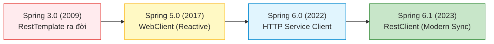
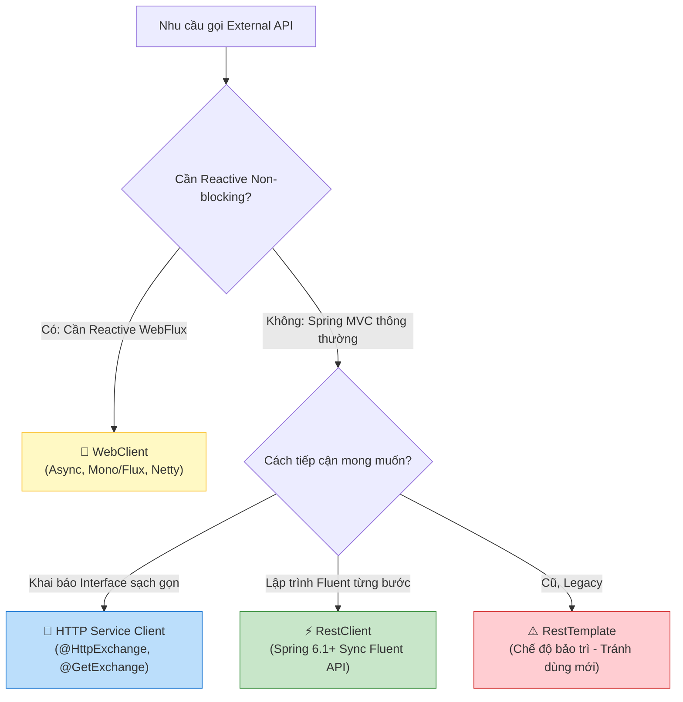
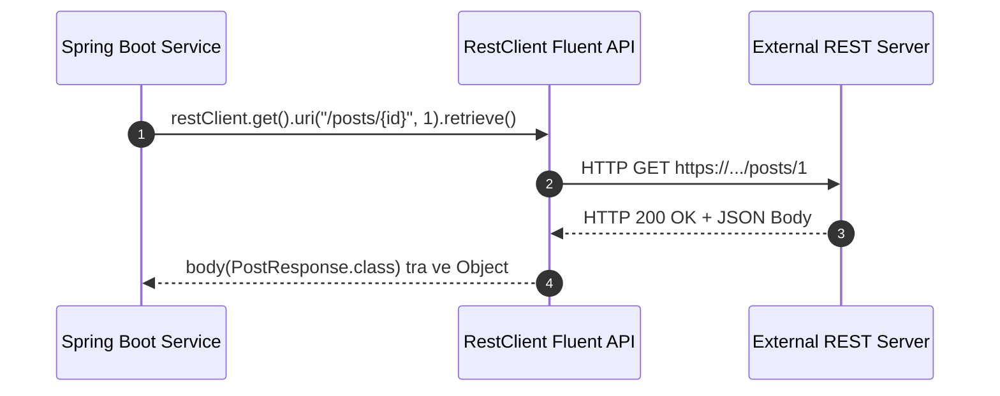
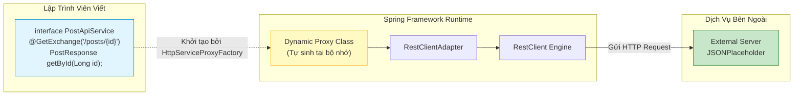

# 📘 BÀI 16: GỌI EXTERNAL API — RESTCLIENT, WEBCLIENT & HTTP SERVICE CLIENT

> **Mục tiêu bài học:**
> * 🎯 Hiểu rõ lộ trình tiến hóa của các HTTP Client trong hệ sinh thái Spring: Từ `RestTemplate` (legacy) $\rightarrow$ `WebClient` (reactive) $\rightarrow$ `RestClient` (Spring 6.1+ / Spring Boot 3.2+) $\rightarrow$ `HTTP Service Client` (Declarative interface).
> * 🚀 Làm chủ `RestClient` với phong cách lập trình Fluent API đồng bộ (synchronous), cấu hình linh hoạt Header, Base URL, và Request Interceptor.
> * 🧩 Nắm vững `HTTP Service Client` (HTTP Interfaces): Khai báo interface với `@HttpExchange`, `@GetExchange`, `@PostExchange` và để Spring tự sinh dynamic proxy implementation — tương tự cơ chế Spring Data JPA.
> * 🛡️ Thiết lập phòng thủ vững chắc khi giao tiếp dịch vụ ngoài: Quản lý kết nối (Connection Pooling), cấu hình thời gian chờ (`connectTimeout`, `readTimeout`), xử lý mã lỗi HTTP (`4xx`, `5xx`) và kỹ thuật Retry an toàn.
> * 💡 Khám phá bản chất Java Core & Design Patterns: Dynamic Proxy Pattern (`java.lang.reflect.Proxy`), Adapter Pattern (`RestClientAdapter`), Builder Pattern và non-blocking I/O multiplexing.
> * 💼 Tự tin giải quyết 10 câu hỏi phỏng vấn tuyển dụng chuyên sâu về tích hợp API và Microservices communication.

---

## 📑 MỤC LỤC

1. [Phần 1: Bức Tranh Tiến Hóa HTTP Clients Trong Spring](#phần-1-bức-tranh-tiến-hóa-http-clients-trong-spring)
2. [Phần 2: RestClient — Vũ Khí Mới Cho Giao Tiếp Đồng Bộ (Spring 6.1+)](#phần-2-restclient--vũ-khí-mới-cho-giao-tiếp-đồng-bộ-spring-61)
3. [Phần 3: HTTP Service Client — Lập Trình Declarative Hiện Đại](#phần-3-http-service-client--lập-trình-declarative-hiện-đại)
4. [Phần 4: WebClient — Xử Lý Bất Đồng Bộ & Non-Blocking (Reactive)](#phần-4-webclient--xử-lý-bất-đồng-bộ--non-blocking-reactive)
5. [Phần 5: Xử Lý Lỗi, Timeout & Tăng Khả Năng Chống Chịu (Resilience)](#phần-5-xử-lý-lỗi-timeout--tăng-khả-năng-chống-chịu-resilience)
6. [Phần 6: Thực Hành Tích Hợp External API (JSONPlaceholder)](#phần-6-thực-hành-tích-hợp-external-api-jsonplaceholder)
7. [Phần 7: Bản Chất Java Core & Design Patterns Nền Tảng](#phần-7-bản-chất-java-core--design-patterns-nền-tảng)
8. [Phần 8: 10 Câu Hỏi Phỏng Vấn Chuyên Sâu Kèm Đáp Án Chi Tiết](#phần-8-10-câu-hỏi-phỏng-vấn-chuyên-sâu-kèm-đáp-án-chi-tiết)

---

## PHẦN 1: BỨC TRANH TIẾN HÓA HTTP CLIENTS TRONG SPRING

### 1.1. Lịch Sử Phát Triển Của HTTP Clients

Trong các ứng dụng doanh nghiệp thực tế, backend hiếm khi đứng độc lập. Chúng ta liên tục phải gọi các dịch vụ bên ngoài: cổng thanh toán (Stripe, VNPay), hệ thống gửi SMS/Email (Twilio, SendGrid), mạng xã hội (Google OAuth2), hoặc các microservices nội bộ.

Spring Framework đã trải qua 4 thế hệ công cụ gọi HTTP:





### 1.2. Bảng So Sánh Chi Tiết 4 Giải Pháp HTTP Client

| Tiêu Chí | `RestTemplate` | `WebClient` | `RestClient` | `HTTP Service Client` |
| :--- | :--- | :--- | :--- | :--- |
| **Phiên bản giới thiệu** | Spring 3.0 (2009) | Spring 5.0 (2017) | Spring 6.1 / Boot 3.2 (2023) | Spring 6.0 / Boot 3.0 (2022) |
| **Mô hình thực thi** | Đồng bộ (Blocking I/O) | Bất đồng bộ (Reactive I/O) | Đồng bộ (Blocking I/O) | Cả 2 (dựa trên adapter nền) |
| **Phong cách viết code** | Gọi hàm nạp chồng (Overloaded methods) | Fluent Functional API (Reactor) | Fluent API hướng đối tượng | Declarative (Khai báo Interface) |
| **Dependency yêu cầu** | `spring-web` | `spring-boot-starter-webflux` | `spring-web` (Không cần WebFlux) | `spring-web` |
| **Xử lý lỗi (Error Handling)** | `ResponseErrorHandler` phức tạp | `.onErrorResume()`, `.retry()` | `.onStatus()` lambda cực gọn | Kế thừa từ Client nền |
| **Trạng thái khuyến nghị** | ⚠️ **Maintenance Mode** | ✅ Dùng cho hệ thống Reactive | ✅ **Mặc định cho Spring MVC** | ✅ **Chuẩn mực cho Microservices** |

---

## PHẦN 2: RESTCLIENT — VŨ KHÍ MỚI CHO GIAO TIẾP ĐỒNG BỘ (SPRING 6.1+)

### 2.1. Tại Sao `RestClient` Ra Đời?
Trước Spring 6.1, nếu bạn muốn một Fluent API thanh lịch, bạn bắt buộc phải kéo dependency nặng `spring-boot-starter-webflux` vào chỉ để sử dụng `WebClient`, dù ứng dụng thuần Spring MVC! Mặt khác, `RestTemplate` cũ có quá nhiều method nạp chồng (`getForObject`, `getForEntity`, `exchange`, `execute`) với hàng chục biến thể tham số rất khó nhớ và dễ nhầm lẫn.

`RestClient` kết hợp ưu điểm tốt nhất của cả hai thế giới:
1. **Dùng hạ tầng đồng bộ (blocking)** của Spring MVC, nhẹ nhàng, không cần runtime Reactor/Netty.
2. **Cung cấp Fluent API hiện đại** tương tự `WebClient`.

### 2.2. Khởi Tạo Và Cấu Hình `RestClient`

```java
@Configuration
public class RestClientConfig {

    @Bean
    public RestClient externalApiClient(RestClient.Builder builder) {
        // Cấu hình HTTP Client cơ sở với Timeout an toàn
        SimpleClientHttpRequestFactory requestFactory = new SimpleClientHttpRequestFactory();
        requestFactory.setConnectTimeout(Duration.ofSeconds(5)); // Timeout khi bắt tay TCP
        requestFactory.setReadTimeout(Duration.ofSeconds(10));    // Timeout khi chờ nhận dữ liệu

        return builder
                .baseUrl("https://jsonplaceholder.typicode.com")
                .requestFactory(requestFactory)
                .defaultHeader(HttpHeaders.CONTENT_TYPE, MediaType.APPLICATION_JSON_VALUE)
                .defaultHeader(HttpHeaders.ACCEPT, MediaType.APPLICATION_JSON_VALUE)
                .defaultHeader("User-Agent", "SpringBoot-Learning-Client/1.0")
                .requestInterceptor((request, body, execution) -> {
                    // Logging hoặc thêm Auth Bearer Token tự động
                    return execution.execute(request, body);
                })
                .build();
    }
}
```

### 2.3. Các Thao Tác CRUD Cơ Bản Với `RestClient`



#### ① HTTP GET — Lấy dữ liệu
```java
// Lấy một đối tượng đơn lẻ
PostResponse post = restClient.get()
        .uri("/posts/{id}", 1)
        .retrieve()
        .body(PostResponse.class);

// Lấy danh sách đối tượng (dùng ParameterizedTypeReference để tránh Type Erasure)
List<PostResponse> posts = restClient.get()
        .uri("/posts")
        .retrieve()
        .body(new ParameterizedTypeReference<List<PostResponse>>() {});

// Lấy trọn vẹn ResponseEntity (gồm Headers, Status Code, Body)
ResponseEntity<PostResponse> response = restClient.get()
        .uri("/posts/{id}", 1)
        .retrieve()
        .toEntity(PostResponse.class);
```

#### ② HTTP POST — Tạo mới dữ liệu
```java
PostCreateRequest newPost = new PostCreateRequest("Tiêu đề bài viết", "Nội dung chi tiết", 1L);

PostResponse createdPost = restClient.post()
        .uri("/posts")
        .contentType(MediaType.APPLICATION_JSON)
        .body(newPost)
        .retrieve()
        .body(PostResponse.class);
```

#### ③ HTTP PUT / PATCH — Cập nhật
```java
PostCreateRequest updateData = new PostCreateRequest("Tiêu đề cập nhật", "Nội dung mới", 1L);

PostResponse updated = restClient.put()
        .uri("/posts/{id}", 1)
        .body(updateData)
        .retrieve()
        .body(PostResponse.class);
```

#### ④ HTTP DELETE — Xóa dữ liệu
```java
restClient.delete()
        .uri("/posts/{id}", 1)
        .retrieve()
        .toBodilessEntity(); // Trả về ResponseEntity<Void> không có body
```

---

## PHẦN 3: HTTP SERVICE CLIENT — LẬP TRÌNH DECLARATIVE HIỆN ĐẠI

### 3.1. Ý Tưởng Cách Mạng: "Spring Data JPA Cho HTTP API"
Hãy nhớ lại cách bạn dùng Spring Data JPA: Bạn chỉ cần định nghĩa `public interface UserRepository extends JpaRepository<User, Long>` và Spring tự động sinh mã thực thi câu truy vấn SQL tại runtime!

**HTTP Service Client (HTTP Interfaces)** áp dụng chính xác triết lý đó cho việc gọi API bên ngoài:
1. Bạn chỉ cần viết một **Java Interface** với các annotation `@HttpExchange`.
2. Spring sử dụng **Java Dynamic Proxy** để tự động tạo bean implement interface đó.
3. Khi gọi hàm trên interface, Spring tự động build HTTP Request, gửi đi và ánh xạ JSON về object tương ứng.



### 3.2. Định Nghĩa HTTP Service Interface

```java
import org.springframework.web.bind.annotation.PathVariable;
import org.springframework.web.bind.annotation.RequestBody;
import org.springframework.web.bind.annotation.RequestParam;
import org.springframework.web.service.annotation.*;

import java.util.List;

@HttpExchange("/posts")
public interface PostClient {

    @GetExchange
    List<PostResponse> getAllPosts(@RequestParam(required = false) Long userId);

    @GetExchange("/{id}")
    PostResponse getPostById(@PathVariable("id") Long id);

    @PostExchange
    PostResponse createPost(@RequestBody PostCreateRequest request);

    @PutExchange("/{id}")
    PostResponse updatePost(@PathVariable("id") Long id, @RequestBody PostCreateRequest request);

    @DeleteExchange("/{id}")
    void deletePost(@PathVariable("id") Long id);
}
```

### 3.3. Đăng Ký Bean Với `HttpServiceProxyFactory`

```java
@Configuration
public class HttpInterfaceConfig {

    @Bean
    public PostClient postClient(RestClient.Builder builder) {
        RestClient restClient = builder
                .baseUrl("https://jsonplaceholder.typicode.com")
                .build();

        // 1. Tạo Adapter thích ứng RestClient với HTTP Service Proxy
        RestClientAdapter adapter = RestClientAdapter.create(restClient);

        // 2. Tạo Factory quản lý proxy
        HttpServiceProxyFactory factory = HttpServiceProxyFactory.builderFor(adapter).build();

        // 3. Yêu cầu factory tạo proxy instance cho Interface
        return factory.createClient(PostClient.class);
    }
}
```

### 3.4. Sử Dụng Cực Kỳ Trong Sáng Trong Service
```java
@Service
public class BlogService {

    private final PostClient postClient;

    public BlogService(PostClient postClient) {
        this.postClient = postClient;
    }

    public PostResponse fetchPost(Long id) {
        // Gọi API bên ngoài tự nhiên như gọi một local Java method!
        return postClient.getPostById(id);
    }
}
```

---

## PHẦN 4: WEBCLIENT — XỬ LÝ BẤT ĐỒNG BỘ & NON-BLOCKING (REACTIVE)

### 4.1. Bản Chất Non-Blocking Của `WebClient`
Khi sử dụng `RestClient` hoặc `RestTemplate`:
* Mỗi HTTP Request chiếm dụng **1 Thread hệ điều hành** (Worker Thread) từ khi gửi request cho đến khi nhận được response (Blocking I/O).
* Nếu API bên ngoài phản hồi chậm 2 giây và hệ thống nhận 500 requests/giây, Thread Pool của Tomcat (mặc định 200 threads) sẽ bị cạn kiệt (Thread Starvation), khiến toàn bộ ứng dụng bị tê liệt!

`WebClient` chạy trên nền tảng **Netty (Event Loop)**:
* Khi gửi HTTP Request, thread không bị khóa mà được giải phóng ngay lập tức để phục vụ request khác.
* Khi server bên ngoài có dữ liệu trả về, hệ điều hành thông báo qua Event Loop để kích hoạt callback tiếp tục xử lý.

> [!TIP]
> 📖 **Đọc thêm chuyên đề chuyên sâu:** Để hiểu cặn kẽ việc Tomcat có chạy thêm Netty Web Server không, luồng phối hợp 2 pha giữa Tomcat Thread Pool và Netty Client qua Servlet 3.0/3.1 `AsyncContext`, xem chi tiết tại: [bai-16-co-che-webclient-trong-spring-mvc-tomcat-vs-netty.md](file:///Users/vovantu/HTML_CSS/JAVA%20/Note/Lesson16/bai-16-co-che-webclient-trong-spring-mvc-tomcat-vs-netty.md).

```mermaid
graph TD
    subgraph BLOCKING ["Blocking I/O - RestClient"]
        T1["Thread 1"] -->|Gửi request & BỊ KHÓA CHỜ 2s...| EXT1["API Ngoài"]
        T2["Thread 2"] -->|Gửi request & BỊ KHÓA CHỜ 2s...| EXT1
        POLL["Cạn kiệt Thread Pool Tomcat"]
    end

    subgraph NON_BLOCKING ["Non-Blocking I/O - WebClient"]
        EL["1 Event Loop Thread Duy Nhất"] -->|Bắn Request 1| EXT2["API Ngoài"]
        EL -->|Bắn Request 2| EXT2
        EL -->|Làm việc khác| WORK["Xử lý nghiệp vụ khác"]
        EXT2 -.->|Báo có data về (Callback)| EL
    end

    style POLL fill:#ffcdd2,stroke:#d32f2f
    style EL fill:#c8e6c9,stroke:#388e3c
```

### 4.2. Cú Pháp Cơ Bản Với Mono & Flux
```java
// Lấy 1 đối tượng bất đồng bộ (Mono)
Mono<PostResponse> postMono = webClient.get()
        .uri("/posts/{id}", 1)
        .retrieve()
        .bodyToMono(PostResponse.class);

// Lấy danh sách stream dữ liệu (Flux)
Flux<PostResponse> postsFlux = webClient.get()
        .uri("/posts")
        .retrieve()
        .bodyToFlux(PostResponse.class);
```

---

## PHẦN 5: XỬ LÝ LỖI, TIMEOUT & TĂNG KHẢ NĂNG CHỐNG CHỊU (RESILIENCE)

### 5.1. Bắt Lỗi HTTP Thông Minh Với `.onStatus()`
Khi gọi API ngoài, lỗi 4xx (Client Error) và 5xx (Server Error) xảy ra thường xuyên. `RestClient` cho phép bắt lỗi tường minh theo từng nhóm status code:

```java
public PostResponse getPostSafely(Long id) {
    return restClient.get()
            .uri("/posts/{id}", id)
            .retrieve()
            // Bắt lỗi 404 Not Found
            .onStatus(status -> status.value() == 404, (request, response) -> {
                throw new ResourceNotFoundException("Bài viết external", id);
            })
            // Bắt lỗi 4xx chung (ví dụ 400 Bad Request, 401 Unauthorized, 403 Forbidden)
            .onStatus(HttpStatusCode::is4xxClientError, (request, response) -> {
                String errorBody = new String(response.getBody().readAllBytes());
                throw new BusinessException("Lỗi từ dịch vụ bên ngoài (Client Error): " + errorBody);
            })
            // Bắt lỗi 5xx Server Error (dịch vụ ngoài sập hoặc quá tải)
            .onStatus(HttpStatusCode::is5xxServerError, (request, response) -> {
                throw new BusinessException("Hệ thống dịch vụ bên ngoài đang gặp sự cố, vui lòng thử lại sau!");
            })
            .body(PostResponse.class);
}
```

### 5.2. Nguyên Tắc Sống Còn: Cấu Hình Timeout
Tuyệt đối **không bao giờ** sử dụng HTTP Client với cấu hình mặc định (vốn không giới hạn timeout hoặc timeout quá lớn)! Nếu dịch vụ bên ngoài bị treo mạng, ứng dụng của bạn sẽ treo theo.

Có 2 loại timeout bắt buộc phải cấu hình:
1. **Connect Timeout**: Thời gian tối đa để thiết lập kết nối TCP (3-way handshake) đến server đích (Khuyến nghị: 2 - 5 giây).
2. **Read Timeout (Socket Timeout)**: Thời gian tối đa chờ nhận gói tin dữ liệu tiếp theo sau khi đã kết nối thành công (Khuyến nghị: 5 - 15 giây).

```java
SimpleClientHttpRequestFactory factory = new SimpleClientHttpRequestFactory();
factory.setConnectTimeout(Duration.ofSeconds(3));
factory.setReadTimeout(Duration.ofSeconds(10));
```

---

## PHẦN 6: THỰC HÀNH TÍCH HỢP EXTERNAL API (JSONPLACEHOLDER)

Trong dự án [springboot-learning](file:///Users/vovantu/HTML_CSS/JAVA%20/springboot-learning), chúng ta sẽ xây dựng module tích hợp với hệ thống bên ngoài **JSONPlaceholder** (`https://jsonplaceholder.typicode.com/posts`):
1. **DTOs**: `ExternalPostResponse` (record) và `ExternalPostCreateRequest`.
2. **Declarative Interface**: `PostApiClient` sử dụng các annotation `@HttpExchange`, `@GetExchange`, `@PostExchange`.
3. **Configuration**: Cấu hình `RestClient` và `HttpServiceProxyFactory`.
4. **Service**: `ExternalPostService` tích hợp gọi API bên ngoài, bọc xử lý ngoại lệ nghiệp vụ.
5. **Controller**: `ExternalPostController` cung cấp REST API cho client truy vấn bài viết từ dịch vụ ngoài.

---

## PHẦN 7: BẢN CHẤT JAVA CORE & DESIGN PATTERNS NỀN TẢNG

### 7.1. Dynamic Proxy Pattern (`java.lang.reflect.Proxy`)
Làm thế nào Spring có thể biến một `interface PostApiClient` không có class thực thi (implementation class) thành một Bean hoạt động được?
* Khi gọi `factory.createClient(PostApiClient.class)`, Spring sử dụng `java.lang.reflect.Proxy.newProxyInstance()` của Java Core.
* Một class ẩn `$ProxyX` được sinh ra trực tiếp trong bytecode bộ nhớ JVM, cài đặt interface `PostApiClient`.
* Mọi lời gọi method (ví dụ `getPostById(1L)`) đều được chuyển tiếp (intercept) vào method `InvocationHandler.invoke()`.
* Tại đây, Spring đọc các annotation (`@GetExchange`, `@PathVariable`), trích xuất tham số, ráp thành URL và giao cho `RestClient` thực thi!

### 7.2. Adapter Pattern (`RestClientAdapter` & `WebClientAdapter`)
* `HttpServiceProxyFactory` là một cơ chế trừu tượng cao cấp (High-level Abstraction). Nó không quan tâm bên dưới đang dùng `RestClient`, `WebClient`, hay bất kỳ HTTP Engine nào khác.
* Để đạt được điều này, Spring sử dụng **Adapter Pattern**:
  * `HttpExchangeAdapter`: Interface chung đại diện cho HTTP execution.
  * `RestClientAdapter`: Chuyển đổi yêu cầu từ Proxy Factory sang các method của `RestClient`.
  * `WebClientAdapter`: Chuyển đổi yêu cầu từ Proxy Factory sang `WebClient`.

---

## PHẦN 8: 10 CÂU HỎI PHỎNG VẤN CHUYÊN SÂU KÈM ĐÁP ÁN CHI TIẾT

### Câu 1: Tại sao Spring khuyến nghị chuyển đổi từ `RestTemplate` sang `RestClient` từ phiên bản Spring Boot 3.2+?
**Đáp án:**
* `RestTemplate` được thiết kế từ thời kỳ đầu của Spring 3 (hơn 15 năm trước), sử dụng phong cách lập trình hướng thủ tục với hàng chục phương thức nạp chồng (`getForObject`, `getForEntity`, `exchange`,...), dẫn đến mã nguồn cồng kềnh, khó bảo trì.
* `RestClient` mang đến phong cách **Fluent API** trực quan, đồng nhất, cho phép xâu chuỗi cấu hình (headers, status handlers, body converters) tuần tự và rõ ràng.
* `RestClient` vẫn sử dụng kiến trúc đồng bộ (Blocking I/O) nên tương thích hoàn hảo với các ứng dụng Spring MVC mà không đòi hỏi dependency nặng hay tư duy Reactive Streams phức tạp như `WebClient`. Hiện tại `RestTemplate` đã chính thức chuyển sang chế độ bảo trì (Maintenance Mode).

### Câu 2: Trình bày cơ chế hoạt động của Declarative HTTP Service Client (HTTP Interfaces) trong Spring Boot 3?
**Đáp án:**
* Lập trình viên chỉ cần định nghĩa một Java Interface với các annotation `@HttpExchange`, `@GetExchange`, `@PostExchange`, `@PathVariable`, `@RequestBody`.
* Sử dụng `HttpServiceProxyFactory` kết hợp với `RestClientAdapter` hoặc `WebClientAdapter` để đăng ký Bean.
* Tại thời điểm runtime, Spring áp dụng mẫu thiết kế **Dynamic Proxy** (`java.lang.reflect.Proxy`) để sinh ra một lớp proxy đại diện. Khi bất kỳ method nào trên interface được gọi, proxy sẽ can thiệp (`MethodInterceptor`), phân tích metadata từ annotation để tự động đóng gói HTTP Request, gửi qua client nền và deserialize response JSON về kiểu trả về của method.

### Câu 3: So sánh sự khác nhau giữa Spring Cloud OpenFeign và Spring HTTP Interfaces (HTTP Service Client)?
**Đáp án:**
* **OpenFeign:** Là thư viện của bên thứ ba (Netflix/OpenFeign), yêu cầu dependency `spring-cloud-starter-openfeign`, cấu hình qua `@EnableFeignClients` và `@FeignClient`. Phổ biến trong các kiến trúc Microservices cũ.
* **Spring HTTP Interfaces:** Là tính năng gốc (**native**) được tích hợp trực tiếp vào core `spring-web` từ Spring Framework 6.0+, không phụ thuộc vào hệ sinh thái Spring Cloud nặng nề. Nó có thể linh hoạt chuyển đổi giữa blocking engine (`RestClientAdapter`) và non-blocking engine (`WebClientAdapter`). Đây là định hướng tương lai được Spring tập trung phát triển để dần thay thế Feign.

### Câu 4: Khi nào nên sử dụng `WebClient` thay vì `RestClient`?
**Đáp án:**
* Nên dùng `WebClient` khi:
  1. Ứng dụng được xây dựng trên stack **Reactive WebFlux** (Netty EventLoop).
  2. Ứng dụng cần gọi đồng thời hàng chục API ngoài song song (`Mono.zip()`) hoặc xử lý Server-Sent Events (SSE), Streaming data.
  3. Hệ thống có lượng truy cập đồng thời cực lớn (high concurrency) mà chi phí cấp phát Thread trong mô hình Thread-per-request của Tomcat là quá tốn kém.
* Nếu là ứng dụng Web MVC thông thường (dùng Tomcat, Spring Data JPA blocking), việc dùng `RestClient` mang lại sự đơn giản, dễ debug, và tránh rủi ro block reactive thread.

### Câu 5: Phân biệt `connectTimeout` và `readTimeout`? Hậu quả gì xảy ra nếu không cấu hình hai thông số này?
**Đáp án:**
* `connectTimeout`: Khoảng thời gian tối đa để client bắt tay TCP (SYN/ACK) với server đích. Nếu sau thời gian này server không phản hồi kết nối $\rightarrow$ ném `ConnectTimeoutException`.
* `readTimeout` (Socket Timeout): Khoảng thời gian tối đa giữa 2 gói tin dữ liệu truyền đi sau khi kết nối đã được thiết lập thành công. Nếu server nhận request nhưng xử lý quá lâu hoặc bị treo $\rightarrow$ ném `SocketTimeoutException`.
* **Hậu quả nếu không cấu hình:** Mặc định nhiều client không giới hạn timeout hoặc timeout tới vài phút. Khi dịch vụ bên ngoài bị treo, các worker thread của ứng dụng sẽ bị giữ chặt vĩnh viễn, dẫn đến cạn kiệt thread pool (Thread Starvation) và gây sập toàn bộ hệ thống (Cascading Failure).

### Câu 6: Làm thế nào để tự động gắn thêm Bearer Token hoặc Header chung cho mọi request gọi qua `RestClient`?
**Đáp án:**
* Chúng ta sử dụng cơ chế **Request Interceptor** (`ClientHttpRequestInterceptor`):
  ```java
  RestClient.builder()
      .requestInterceptor((request, body, execution) -> {
          request.getHeaders().setBearerAuth(tokenService.getToken());
          request.getHeaders().set("X-Correlation-ID", MDC.get("traceId"));
          return execution.execute(request, body);
      })
      .build();
  ```
* Interceptor đóng vai trò như một Servlet Filter ở phía Client, cho phép quan sát, sửa đổi header, body và log thông tin của mọi request trước khi truyền ra ngoài mạng.

### Câu 7: Trong `RestClient`, sự khác biệt giữa `.retrieve()` và `.exchange()` là gì?
**Đáp án:**
* `.retrieve()`: Phương thức tiện ích cấp cao (High-level API). Tự động phân tích HTTP status code, cho phép bắt lỗi qua `.onStatus()` và tự động chuyển đổi body thành object mong muốn qua `.body()`. Đây là phương thức được dùng cho 95% trường hợp.
* `.exchange()`: Phương thức cấp thấp (Low-level API). Cho phép can thiệp trực tiếp vào `ClientHttpRequest` và `ClientHttpResponse`, kiểm soát luồng đọc InputStream thô của response. Dùng khi cần đọc streaming dữ liệu lớn, tùy biến giải nén hoặc xử lý đặc biệt mà `.retrieve()` không hỗ trợ.

### Câu 8: Làm thế nào để viết Unit Test cho một Service sử dụng `RestClient` mà không cần gọi ra Internet thật?
**Đáp án:**
* Có 3 cách tiếp cận:
  1. **`MockRestServiceServer`**: Công cụ của Spring Test, cho phép giả lập server đích và xác thực URL, method, headers gửi đi:
     ```java
     MockRestServiceServer server = MockRestServiceServer.bindTo(restClientBuilder).build();
     server.expect(requestTo("https://api.example.com/posts/1"))
           .andRespond(withSuccess("{\"id\":1}", MediaType.APPLICATION_JSON));
     ```
  2. **WireMock**: Khởi động một mock HTTP server thật trên cổng cục bộ ngẫu nhiên.
  3. **Mockito**: Nếu dùng Declarative HTTP Service Client (Interface), ta chỉ cần mock chính interface đó bằng `@MockBean PostClient postClient`.

### Câu 9: Giải thích vấn đề "Type Erasure" khi parse JSON danh sách (`List<T>`) trong Java và cách `ParameterizedTypeReference` giải quyết?
**Đáp án:**
* Trong Java, do cơ chế **Type Erasure**, thông tin kiểu generic `List<PostResponse>` bị xóa sạch tại thời điểm runtime, chỉ còn lại `List.class`. Khi đó Jackson không biết phải deserialize các phần tử bên trong thành `PostResponse` hay `LinkedHashMap`.
* Để khắc phục, Spring cung cấp lớp ẩn danh trừu tượng `ParameterizedTypeReference<List<PostResponse>>() {}`.
* Thông qua kỹ thuật reflection trên superclass (`getGenericSuperclass()`), Spring giữ lại được kiểu dữ liệu `Type` đầy đủ của generic param tại runtime, giúp Jackson chuyển đổi chính xác từng phần tử trong List thành `PostResponse`.

### Câu 10: Circuit Breaker và Retry Pattern phối hợp với HTTP Client như thế nào để ngăn chặn sự cố dây chuyền (Cascading Failure)?
**Đáp án:**
* Khi một microservice phụ thuộc bên ngoài bị chậm hoặc lỗi liên tục:
  * **Retry Pattern:** Tự động thử lại yêu cầu 2 - 3 lần với khoảng chờ tăng dần (**Exponential Backoff with Jitter**) để khắc phục các lỗi mạng thoáng qua (Transient errors).
  * **Circuit Breaker (Resilience4j):** Đếm tỷ lệ lỗi. Nếu vượt ngưỡng (ví dụ 50% số request trong 10 giây thất bại), Circuit Breaker chuyển sang trạng thái **OPEN** (Ngắt mạch). Mọi request tiếp theo lập tức bị chặn lại và trả về dữ liệu dự phòng (**Fallback Method**) ngay tức thì mà không gửi ra mạng nữa, giúp bảo vệ thread pool của ứng dụng và cho phép dịch vụ ngoài có thời gian tự hồi phục.

---

> 💡 **Bài học tiếp theo:** [Bài 17: AOP (Aspect-Oriented Programming) — Tách Biệt Cross-Cutting Concerns](file:///Users/vovantu/HTML_CSS/JAVA%20/Note/Lesson17/bai-17-aop-aspect-oriented-programming.md)
