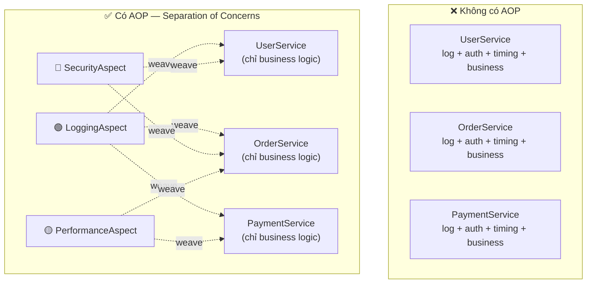
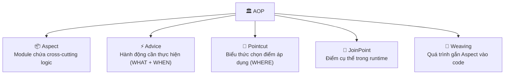
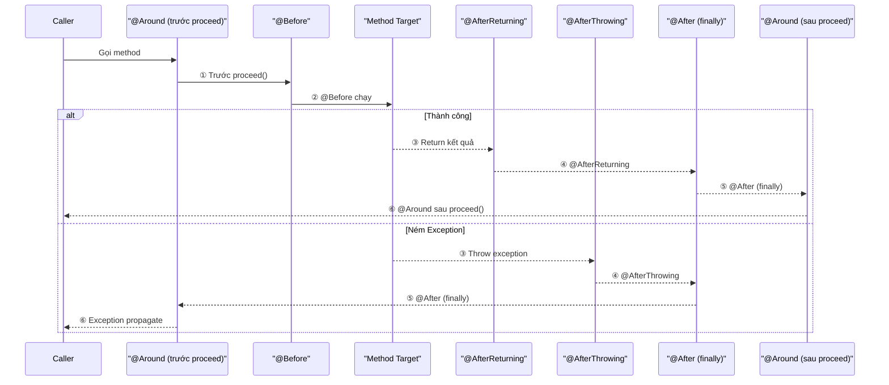
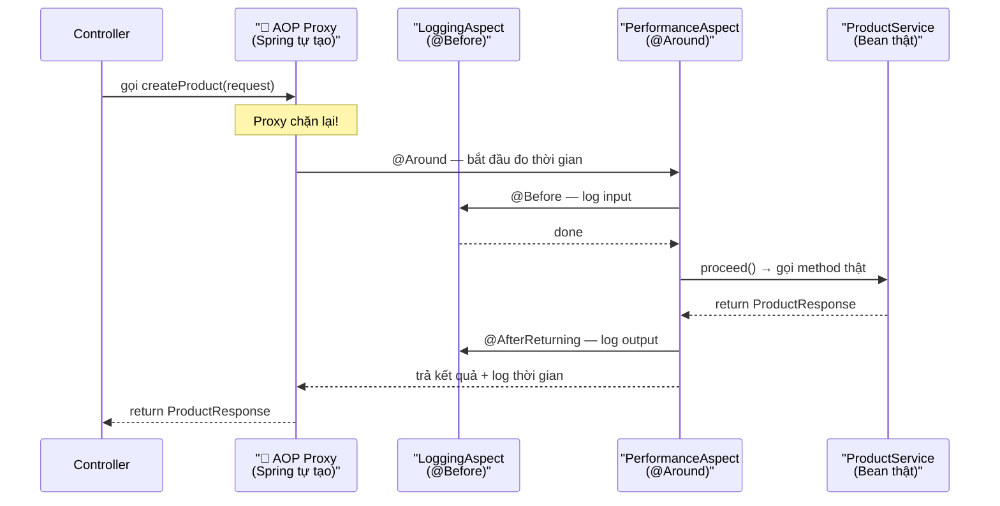
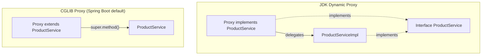
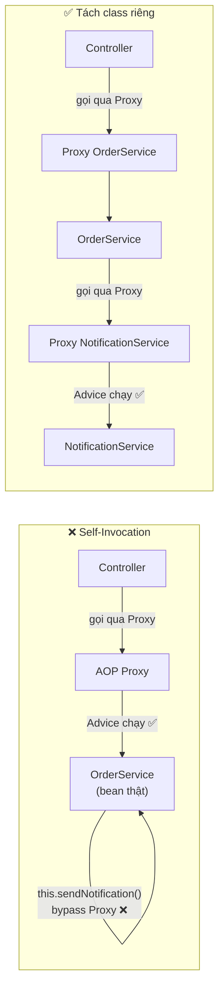

# 📘 Bài 17: AOP — Aspect-Oriented Programming trong Spring

> **Giai đoạn 5 — External API & AOP** | Thời lượng: ~4 giờ lý thuyết + thực hành

---

## 📌 Định Nghĩa & Tóm Tắt Cốt Lõi

| Khái niệm | Định nghĩa ngắn gọn |
|:---|:---|
| **AOP (Aspect-Oriented Programming)** | Lập trình hướng khía cạnh — kỹ thuật tách các **mối quan tâm xuyên suốt** (logging, security, transaction, monitoring) ra khỏi business logic chính, giúp code sạch và không lặp lại |
| **Cross-Cutting Concern** | là những chức năng xuất hiện lặp đi lặp lại ở nhiều nơi trong ứng dụng nhưng không thuộc về nghiệp vụ cốt lõi (ví dụ: mỗi method đều cần log, đều cần kiểm tra quyền, đều cần đo thời gian). Nếu không có AOP, bạn phải chép đoạn code logging hay transaction vào từng method. Với AOP, bạn viết một lần và khai báo nó áp dụng cho những method nào.|
| **Spring AOP** | Module AOP tích hợp trong Spring Framework, sử dụng **Runtime Proxy** (không cần compiler riêng) để "bọc" bean và chèn logic bổ sung trước/sau method gốc |

> [!TIP]
> **Ẩn dụ đời thực:** AOP giống như hệ thống **camera an ninh** trong tòa nhà. Mỗi phòng (Service) chỉ cần lo nghiệp vụ riêng. Camera (Aspect) tự động ghi lại ai vào/ra, lúc nào, làm gì — mà nhân viên trong phòng không cần viết sổ ghi chép thủ công.

---

## 📑 Mục Lục

1. [Vấn đề AOP giải quyết — Cross-Cutting Concerns](#1-vấn-đề-aop-giải-quyết--cross-cutting-concerns)
2. [5 khái niệm trụ cột của AOP](#2-5-khái-niệm-trụ-cột-của-aop)
3. [5 loại Advice trong Spring AOP](#3-5-loại-advice-trong-spring-aop)
4. [Pointcut Expression — Cú pháp chọn điểm cắt](#4-pointcut-expression--cú-pháp-chọn-điểm-cắt)
5. [Cơ chế Proxy — Trái tim của Spring AOP](#5-cơ-chế-proxy--trái-tim-của-spring-aop)
6. [Custom Annotation + AOP — Kỹ thuật thực chiến](#6-custom-annotation--aop--kỹ-thuật-thực-chiến)
7. [Self-Invocation Trap — Bẫy gọi nội bộ](#7-self-invocation-trap--bẫy-gọi-nội-bộ)
8. [Spring AOP vs AspectJ — So sánh chi tiết](#8-spring-aop-vs-aspectj--so-sánh-chi-tiết)
9. [Ứng dụng thực tế trong Production](#9-ứng-dụng-thực-tế-trong-production)
10. [Triển khai code thực hành](#10-triển-khai-code-thực-hành)
11. [Tổng kết & Bảng Cheat-Sheet](#11-tổng-kết--bảng-cheat-sheet)
12. [Câu hỏi phỏng vấn (Interview Questions)](#12-câu-hỏi-phỏng-vấn-interview-questions)

---

## 🎯 Mục Tiêu Bài Học

- [ ] Hiểu bản chất AOP và tại sao cần tách cross-cutting concerns
- [ ] Nắm vững 5 khái niệm trụ cột: **Aspect, Advice, Pointcut, JoinPoint, Weaving**
- [ ] Phân biệt và sử dụng thành thạo 5 loại Advice: `@Before`, `@After`, `@AfterReturning`, `@AfterThrowing`, `@Around`
- [ ] Viết Pointcut Expression chính xác để chọn đúng method cần áp dụng
- [ ] Hiểu cơ chế **Proxy** của Spring AOP (JDK Dynamic Proxy vs CGLIB)
- [ ] Giải thích được tại sao **self-invocation** bypass proxy (liên hệ `@Transactional` ở Bài 12)
- [ ] Tạo **Custom Annotation** kết hợp AOP cho Logging, Audit, Performance Monitoring
- [ ] Phân biệt Spring AOP vs AspectJ

---

## 1. Vấn Đề AOP Giải Quyết — Cross-Cutting Concerns

### 1.1. Thực trạng: Code lặp lại khắp nơi

Trong một ứng dụng Spring Boot thực tế, hầu hết mọi service method đều cần:
- **Logging** đầu vào/đầu ra
- **Đo thời gian** thực thi (performance monitoring)
- **Kiểm tra quyền** truy cập (authorization)
- **Quản lý transaction** (đã học ở Bài 12)
- **Ghi audit trail** (ai làm gì, lúc nào)

Nếu viết trực tiếp, code sẽ trông như thế này:

```java
// ❌ KHÔNG CÓ AOP — Code logging xen lẫn vào business logic
@Service
public class OrderService {

    public OrderResponse createOrder(OrderRequest request) {
        log.info("▶ createOrder called with: {}", request);     // Logging
        long start = System.currentTimeMillis();                 // Timing
        checkPermission("CREATE_ORDER");                         // Security
        
        // ===== Business Logic thật sự (chỉ 3 dòng) =====
        Order order = new Order(request);
        order = orderRepository.save(order);
        OrderResponse response = OrderResponse.from(order);
        // ===============================================
        
        long elapsed = System.currentTimeMillis() - start;       // Timing
        log.info("◀ createOrder completed in {}ms", elapsed);    // Logging
        auditService.log("CREATE_ORDER", order.getId());         // Audit
        return response;
    }
}
```

> **Vấn đề:** Business logic chỉ chiếm **3/10 dòng code**. 70% còn lại là cross-cutting concerns lặp đi lặp lại ở MỌI method.

### 1.2. Giải pháp: Tách riêng bằng AOP



> [!IMPORTANT]
> **Nguyên tắc:** Service chỉ chứa business logic thuần túy. Logging, timing, audit được **tách ra thành các Aspect riêng biệt** và Spring tự động "dệt" (weave) chúng vào đúng thời điểm khi method được gọi.

---

## 2. 5 Khái Niệm Trụ Cột Của AOP



| # | Khái niệm | Định nghĩa | Ẩn dụ đời thực | Ví dụ cụ thể |
|:---:|:---|:---|:---|:---|
| 1 | **Aspect** | Module đóng gói **một mối quan tâm xuyên suốt** hoàn chỉnh | 📹 Hệ thống camera an ninh | `LoggingAspect`, `AuditAspect` |
| 2 | **Advice** | Đoạn code **thực thi** tại thời điểm xác định (trước/sau/bọc quanh method) | 🔔 Chuông báo khi có người vào cửa | `@Before`, `@Around` |
| 3 | **Pointcut** | **Biểu thức** chọn ra tập hợp JoinPoint cần áp dụng Advice | 📋 Danh sách phòng cần lắp camera | `execution(* com.example..service.*.*(..))` |
| 4 | **JoinPoint** | **Điểm cụ thể** trong runtime nơi Advice được chạy | 🚪 Một cửa ra vào cụ thể | `productService.createProduct()` |
| 5 | **Weaving** | **Quá trình** kết hợp Aspect vào code chính | 🔧 Thợ lắp đặt camera vào tòa nhà | Spring làm tại **runtime** qua Proxy |

> [!NOTE]
> **Mối quan hệ:** Một **Aspect** chứa nhiều cặp **Advice + Pointcut**. Mỗi Pointcut khớp với nhiều **JoinPoint**. **Weaving** là cơ chế kết nối tất cả lại với nhau.

---

## 3. 5 Loại Advice Trong Spring AOP

### 3.1. Bảng tổng quan

| Advice | Annotation | Thời điểm chạy | Use case phổ biến |
|:---|:---|:---|:---|
| **Before** | `@Before` | **Trước** khi method target chạy | Log input, kiểm tra quyền |
| **After Returning** | `@AfterReturning` | **Sau** khi method **thành công** | Log output, cache kết quả |
| **After Throwing** | `@AfterThrowing` | **Sau** khi method **ném exception** | Error logging, alert |
| **After (Finally)** | `@After` | **Sau** khi method kết thúc (dù thành công hay lỗi) | Cleanup resource, giống `finally` |
| **Around** | `@Around` | **Bọc quanh** method (trước + sau) | Đo thời gian, caching, retry |

### 3.2. Thứ tự thực thi (Execution Order)



### 3.3. Code minh họa từng loại Advice

```java
@Aspect
@Component
public class LoggingAspect {

    private static final Logger log = LoggerFactory.getLogger(LoggingAspect.class);

    // ═══ POINTCUT — Định nghĩa "nơi áp dụng" ═══
    @Pointcut("execution(* com.example.springbootlearning.service.*.*(..))")
    public void serviceLayer() {} // Marker method — body trống

    // ① @Before — Trước khi method chạy
    @Before("serviceLayer()")
    public void logBefore(JoinPoint joinPoint) {
        log.info("🔵 [BEFORE] → {} | args: {}",
            joinPoint.getSignature().toShortString(),
            Arrays.toString(joinPoint.getArgs()));
    }

    // ② @AfterReturning — Sau khi method thành công
    @AfterReturning(pointcut = "serviceLayer()", returning = "result")
    public void logSuccess(JoinPoint joinPoint, Object result) {
        log.info("✅ [AFTER_RETURNING] ← {} | result: {}",
            joinPoint.getSignature().toShortString(), result);
    }

    // ③ @AfterThrowing — Sau khi method ném exception
    @AfterThrowing(pointcut = "serviceLayer()", throwing = "ex")
    public void logException(JoinPoint joinPoint, Throwable ex) {
        log.error("💥 [AFTER_THROWING] ← {} | error: {}",
            joinPoint.getSignature().toShortString(), ex.getMessage());
    }

    // ④ @After — Luôn chạy (giống finally)
    @After("serviceLayer()")
    public void logFinally(JoinPoint joinPoint) {
        log.info("⚫ [AFTER] ← {} completed", joinPoint.getSignature().toShortString());
    }
}
```

### 3.4. @Around — Loại Advice mạnh nhất

```java
@Aspect
@Component
public class PerformanceAspect {

    private static final Logger log = LoggerFactory.getLogger(PerformanceAspect.class);

    // Chỉ áp dụng cho method có gắn @TrackExecutionTime
    @Around("@annotation(com.example.springbootlearning.annotation.TrackExecutionTime)")
    public Object trackTime(ProceedingJoinPoint joinPoint) throws Throwable {
        // ─── TRƯỚC method ───
        long start = System.nanoTime();
        String methodName = joinPoint.getSignature().toShortString();
        log.info("⏱️ ▶ Starting: {}", methodName);

        try {
            Object result = joinPoint.proceed(); // 🔥 Gọi method thật
            // ─── SAU method (thành công) ───
            long ms = (System.nanoTime() - start) / 1_000_000;
            log.info("⏱️ ◀ Completed: {} — {}ms", methodName, ms);
            return result; // Trả kết quả về caller
        } catch (Throwable ex) {
            // ─── SAU method (thất bại) ───
            long ms = (System.nanoTime() - start) / 1_000_000;
            log.error("⏱️ 💥 Failed: {} — {}ms — {}", methodName, ms, ex.getMessage());
            throw ex; // Ném lại — KHÔNG nuốt exception
        }
    }
}
```

> [!WARNING]
> **`@Around` là Advice mạnh nhất nhưng cũng nguy hiểm nhất:**
> - **Phải gọi** `joinPoint.proceed()` — nếu quên, method target sẽ **không bao giờ chạy**
> - **Phải return** kết quả của `proceed()` — nếu quên, caller nhận `null`
> - **Phải throw lại** exception — nếu nuốt, caller sẽ không biết có lỗi

---

## 4. Pointcut Expression — Cú Pháp Chọn Điểm Cắt

### 4.1. Cú pháp tổng quát

```
execution(modifiers? return-type declaring-type? method-name(param-pattern) throws?)
```

| Thành phần | Bắt buộc? | Ý nghĩa | Wildcard |
|:---|:---:|:---|:---|
| `modifiers` | ❌ | public, protected, ... | Bỏ qua = bất kỳ |
| `return-type` | ✅ | Kiểu trả về | `*` = bất kỳ |
| `declaring-type` | ❌ | Package + Class chứa method | `com.example..*` |
| `method-name` | ✅ | Tên method | `*` = bất kỳ, `get*` = bắt đầu bằng "get" |
| `param-pattern` | ✅ | Tham số | `(..)` = bất kỳ, `(Long)` = 1 tham số Long |
| `throws` | ❌ | Exception kiểu gì | Hiếm khi dùng |

### 4.2. Cheat-Sheet Pointcut Expression

| Expression | Ý nghĩa |
|:---|:---|
| `execution(* com.example..service.*.*(..))` | Mọi method trong mọi class thuộc package `service` (bao gồm sub-packages nhờ `..`) |
| `execution(public * *(..))` | Mọi public method trong toàn bộ ứng dụng |
| `execution(* com.example..*.get*(..))` | Mọi method bắt đầu bằng `get` |
| `execution(* *(..) throws RuntimeException)` | Mọi method khai báo throws RuntimeException |
| `execution(* *(Long, ..))` | Mọi method có tham số đầu tiên kiểu Long |
| `@annotation(com.example.annotation.Audited)` | Mọi method có gắn annotation `@Audited` |
| `@within(org.springframework.stereotype.Service)` | Mọi method trong class có gắn `@Service` |
| `within(com.example..controller.*)` | Mọi method trong mọi class của package `controller` |
| `bean(productService)` | Mọi method của bean tên `productService` (chỉ Spring AOP) |

### 4.3. Kết hợp Pointcut (Boolean Operators)

```java
// AND — Cả hai điều kiện đều đúng
@Pointcut("serviceLayer() && publicMethods()")
public void publicServiceMethods() {}

// OR — Một trong hai điều kiện đúng
@Pointcut("serviceLayer() || controllerLayer()")
public void serviceOrController() {}

// NOT — Phủ định
@Pointcut("serviceLayer() && !execution(* *.get*(..))")
public void nonGetterServiceMethods() {}
```

---

## 5. Cơ Chế Proxy — Trái Tim Của Spring AOP

### 5.1. Proxy là gì?

Spring AOP **không sửa bytecode** của class gốc. Thay vào đó, nó tạo một **Proxy object** bọc ngoài bean thật. Khi một class khác gọi method, nó gọi vào Proxy → Proxy chạy Advice → rồi mới gọi method thật.



### 5.2. Hai loại Proxy trong Spring

| | JDK Dynamic Proxy | CGLIB Proxy |
|:---|:---|:---|
| **Điều kiện** | Bean **implement interface** | Bean **không** implement interface (class thường) |
| **Cơ chế** | Tạo class mới implement cùng interface | Tạo **subclass** kế thừa class gốc |
| **Hạn chế** | Chỉ proxy method trong interface | Không proxy được `final` class/method |
| **Spring Boot mặc định** | — | ✅ **CGLIB** (mặc định từ Spring Boot 2.x) |



> [!NOTE]
> **Spring Boot mặc định dùng CGLIB Proxy** — không cần bean implement interface. Đây là lý do bạn có thể gắn `@Transactional` hoặc AOP lên bất kỳ `@Service` class thường nào mà vẫn hoạt động.

---

## 6. Custom Annotation + AOP — Kỹ Thuật Thực Chiến

### 6.1. Tại sao dùng Custom Annotation?

Thay vì viết Pointcut Expression phức tạp, bạn chỉ cần:
1. Tạo một annotation (ví dụ `@Audited`)
2. Viết Aspect chặn annotation đó
3. Gắn annotation lên method cần áp dụng

**Ưu điểm:** Rõ ràng, dễ đọc, dễ bảo trì — nhìn vào method là biết nó có audit hay không.

### 6.2. Ví dụ: @Audited — Tự động ghi Audit Trail

**Bước 1: Tạo annotation**

```java
@Target(ElementType.METHOD)      // Chỉ dùng trên method
@Retention(RetentionPolicy.RUNTIME) // Tồn tại tại runtime (AOP cần đọc)
public @interface Audited {
    String action() default "";   // Mô tả hành động: "CREATE_PRODUCT"
}
```

**Bước 2: Tạo Aspect xử lý**

```java
@Aspect
@Component
public class AuditAspect {

    private static final Logger log = LoggerFactory.getLogger(AuditAspect.class);

    // @annotation(audited) — Spring tự bind annotation instance vào tham số
    @Around("@annotation(audited)")
    public Object auditAction(ProceedingJoinPoint joinPoint, Audited audited) throws Throwable {
        String action = audited.action();
        String method = joinPoint.getSignature().toShortString();
        String timestamp = LocalDateTime.now().format(DateTimeFormatter.ofPattern("yyyy-MM-dd HH:mm:ss"));

        log.info("📋 [AUDIT] ▶ action={} | method={} | time={}", action, method, timestamp);
        try {
            Object result = joinPoint.proceed();
            log.info("📋 [AUDIT] ✅ action={} | status=SUCCESS", action);
            return result;
        } catch (Throwable ex) {
            log.error("📋 [AUDIT] ❌ action={} | status=FAILED | error={}", action, ex.getMessage());
            throw ex;
        }
    }
}
```

**Bước 3: Sử dụng — Chỉ cần gắn annotation**

```java
@Service
public class ProductService {

    @Audited(action = "CREATE_PRODUCT")  // ← Một dòng duy nhất!
    @Transactional
    public ProductResponse createProduct(ProductCreateRequest request) {
        // Business logic thuần — không có code audit ở đây
        Product product = new Product();
        product.setName(request.getName());
        return ProductResponse.fromEntity(productRepository.save(product));
    }

    @Audited(action = "DELETE_PRODUCT")
    @Transactional
    public void deleteProduct(Long id) {
        productRepository.deleteById(id);
    }
}
```

### 6.3. Ví dụ: @TrackExecutionTime — Đo Performance

```java
// Annotation
@Target(ElementType.METHOD)
@Retention(RetentionPolicy.RUNTIME)
public @interface TrackExecutionTime {}

// Sử dụng
@Service
public class ProductService {

    @TrackExecutionTime  // ← Tự động đo thời gian!
    @Transactional(readOnly = true)
    public List<ProductResponse> getAllProducts() {
        return productRepository.findAll().stream()
            .map(ProductResponse::fromEntity)
            .collect(Collectors.toList());
    }
}
```

**Output console khi gọi API:**
```
⏱️ [PERF] ▶ Starting: ProductService.getAllProducts()
⏱️ [PERF] ◀ Completed: ProductService.getAllProducts() — took 23ms
```

---

## 7. Self-Invocation Trap — Bẫy Gọi Nội Bộ

### 7.1. Vấn đề

```java
@Service
public class OrderService {

    @Transactional
    public void processOrder(Long orderId) {
        // ... xử lý đơn hàng ...
        this.sendNotification(orderId);  // ❌ SELF-INVOCATION!
    }

    @Audited(action = "SEND_NOTIFICATION") // ← SẼ KHÔNG CHẠY!
    public void sendNotification(Long orderId) {
        // ... gửi thông báo ...
    }
}
```

### 7.2. Tại sao không hoạt động?



**Giải thích:** Khi gọi `this.sendNotification()`, `this` trỏ tới **bean thật** (không phải Proxy) → AOP Advice **không được kích hoạt**.

### 7.3. Giải pháp

| # | Giải pháp | Mô tả |
|:---:|:---|:---|
| 1 | **Tách sang class khác** ✅ | Đưa `sendNotification()` vào `NotificationService` riêng |
| 2 | Inject chính mình | `@Lazy @Autowired OrderService self;` rồi gọi `self.sendNotification()` |
| 3 | Dùng `AopContext` | `((OrderService) AopContext.currentProxy()).sendNotification()` |

> [!IMPORTANT]
> **Giải pháp #1 là best practice.** Nó tuân thủ Single Responsibility Principle và tránh hack phức tạp. Đây cũng là cùng lý do tại sao **`@Transactional` trên method nội bộ** không hoạt động (đã học ở Bài 12) — vì `@Transactional` cũng dùng **cơ chế Proxy y hệt** Spring AOP.

---

## 8. Spring AOP vs AspectJ — So Sánh Chi Tiết

| Tiêu chí | Spring AOP | AspectJ |
|:---|:---|:---|
| **Cơ chế** | Runtime Proxy | Compile-time / Load-time Weaving |
| **JoinPoint hỗ trợ** | Chỉ **method execution** | Method, field access, constructor, exception handler |
| **Hiệu năng** | Overhead nhỏ (proxy call) | Không overhead (code đã được weave) |
| **Self-invocation** | ❌ Không hoạt động | ✅ Hoạt động |
| **Cần compiler riêng?** | ❌ Không | ✅ Cần `ajc` compiler |
| **Độ phức tạp** | Đơn giản, tích hợp sẵn Spring | Phức tạp hơn |
| **Khi nào dùng?** | 90% trường hợp ứng dụng Spring Boot | Cần AOP rất chi tiết (hiếm) |

> [!TIP]
> **Quy tắc ngón tay cái:** Dùng **Spring AOP** cho hầu hết dự án Spring Boot. Chỉ chuyển sang AspectJ khi bạn cần weave vào field access, constructor, hoặc cần self-invocation hoạt động.

---

## 9. Ứng Dụng Thực Tế Trong Production

| Use case | Advice | Mô tả |
|:---|:---|:---|
| 📝 **Logging** | `@Around` / `@Before` | Log input/output/thời gian mọi service method |
| 📋 **Audit Trail** | `@Around` + Custom Annotation | Ghi nhận ai làm gì, lúc nào (GDPR, SOX compliance) |
| ⏱️ **Performance Monitoring** | `@Around` | Đo thời gian, cảnh báo method chậm |
| 🔐 **Security Check** | `@Before` | Kiểm tra quyền trước khi method chạy |
| 💰 **Transaction Management** | `@Around` (built-in) | `@Transactional` chính là AOP! |
| 🔄 **Retry Logic** | `@Around` | Tự động retry khi gặp transient error |
| 💾 **Caching** | `@Around` | `@Cacheable` cũng là AOP — check cache trước, gọi method nếu miss |
| 🚦 **Rate Limiting** | `@Around` | Giới hạn số lần gọi method trong khoảng thời gian |
| 📊 **Metrics Collection** | `@Around` | Thu thập metrics gửi đến Prometheus/Grafana |

> [!NOTE]
> **`@Transactional` và `@Cacheable` mà bạn đã dùng trước đây đều là AOP!** Spring tự động tạo Proxy bọc ngoài bean, mở/commit transaction hoặc kiểm tra cache trước khi gọi method thật. Bài 17 này giúp bạn hiểu chính xác cơ chế bên dưới.

---

## 10. Triển Khai Code Thực Hành

### 10.1. Cấu trúc file

```
src/main/java/com/example/springbootlearning/
├── annotation/
│   ├── Audited.java              ← Custom annotation audit
│   └── TrackExecutionTime.java   ← Custom annotation performance
├── aspect/
│   ├── LoggingAspect.java        ← Log tất cả service/controller methods
│   ├── PerformanceAspect.java    ← Đo thời gian thực thi
│   └── AuditAspect.java          ← Ghi audit trail
├── service/
│   └── ProductService.java       ← Sử dụng @Audited, @TrackExecutionTime
```

### 10.2. Dependency trong pom.xml

```xml
<!-- 📘 BÀI 17: AOP (Aspect-Oriented Programming) -->
<dependency>
    <groupId>org.springframework</groupId>
    <artifactId>spring-aspects</artifactId>
</dependency>
<dependency>
    <groupId>org.aspectj</groupId>
    <artifactId>aspectjweaver</artifactId>
</dependency>
```

### 10.3. Các file code đã triển khai

| File | Mô tả | Link |
|:---|:---|:---|
| `Audited.java` | Custom annotation đánh dấu method cần audit | [Audited.java](file:///Users/vovantu/HTML_CSS/JAVA%20/springboot-learning/src/main/java/com/example/springbootlearning/annotation/Audited.java) |
| `TrackExecutionTime.java` | Custom annotation đo thời gian | [TrackExecutionTime.java](file:///Users/vovantu/HTML_CSS/JAVA%20/springboot-learning/src/main/java/com/example/springbootlearning/annotation/TrackExecutionTime.java) |
| `LoggingAspect.java` | Aspect log toàn bộ service + controller | [LoggingAspect.java](file:///Users/vovantu/HTML_CSS/JAVA%20/springboot-learning/src/main/java/com/example/springbootlearning/aspect/LoggingAspect.java) |
| `PerformanceAspect.java` | Aspect đo thời gian thực thi | [PerformanceAspect.java](file:///Users/vovantu/HTML_CSS/JAVA%20/springboot-learning/src/main/java/com/example/springbootlearning/aspect/PerformanceAspect.java) |
| `AuditAspect.java` | Aspect ghi audit trail | [AuditAspect.java](file:///Users/vovantu/HTML_CSS/JAVA%20/springboot-learning/src/main/java/com/example/springbootlearning/aspect/AuditAspect.java) |
| `ProductService.java` | Service đã gắn `@Audited`, `@TrackExecutionTime` | [ProductService.java](file:///Users/vovantu/HTML_CSS/JAVA%20/springboot-learning/src/main/java/com/example/springbootlearning/service/ProductService.java) |

### 10.4. Kết quả khi gọi API

Khi gọi `POST /api/products` để tạo sản phẩm mới, console sẽ in:

```
🔵 [BEFORE] → ProductController.createProduct(..) | args: [ProductCreateRequest{...}]
📋 [AUDIT] ▶ action=CREATE_PRODUCT | method=ProductService.createProduct(..) | time=2026-10-23 15:30:00
⏱️ [PERF] ▶ Starting: ProductService.createProduct(..)
📥 Tạo product mới: name='Laptop', price=999.0
✅ Product created successfully: id=1, name='Laptop'
⏱️ [PERF] ◀ Completed: ProductService.createProduct(..) — took 45ms
📋 [AUDIT] ✅ action=CREATE_PRODUCT | status=SUCCESS
✅ [AFTER_RETURNING] ← ProductService.createProduct(..) | result: ProductResponse{...}
⚫ [AFTER_FINALLY] ← ProductService.createProduct(..) completed
```

> **Nhận xét:** Business logic (3 dòng `📥`, `✅ Product created`) được bao bọc bởi AOP advice tự động — code ProductService **không hề có dòng nào** viết log timing hay audit!

---

## 11. Tổng Kết & Bảng Cheat-Sheet

### 🔑 Kiến thức cốt lõi cần nhớ

| # | Điểm chính | Ghi nhớ |
|:---:|:---|:---|
| 1 | AOP tách **cross-cutting concerns** ra khỏi business logic | Logging, Security, Transaction, Audit |
| 2 | 5 khái niệm: **Aspect, Advice, Pointcut, JoinPoint, Weaving** | Aspect chứa Advice + Pointcut |
| 3 | `@Around` mạnh nhất, **phải gọi `proceed()`** | Quên → method không chạy |
| 4 | Spring AOP dùng **Runtime Proxy** (CGLIB mặc định) | Tạo subclass bọc ngoài bean |
| 5 | **Self-invocation** (`this.method()`) bypass Proxy | Giải pháp: tách sang class khác |
| 6 | `@Transactional` = AOP! | Cùng cơ chế Proxy |
| 7 | Custom Annotation + AOP = thực chiến | `@Audited`, `@TrackExecutionTime` |

### 📊 So sánh JoinPoint vs ProceedingJoinPoint

| | `JoinPoint` | `ProceedingJoinPoint` |
|:---|:---|:---|
| Dùng trong | `@Before`, `@After`, `@AfterReturning`, `@AfterThrowing` | Chỉ `@Around` |
| `getSignature()` | ✅ | ✅ |
| `getArgs()` | ✅ | ✅ |
| `proceed()` | ❌ Không có | ✅ Gọi method thật |

---

## 12. Câu Hỏi Phỏng Vấn (Interview Questions)

### Mức độ cơ bản

**Q1: AOP là gì? Tại sao cần AOP?**

> **A:** AOP (Aspect-Oriented Programming) là kỹ thuật tách **cross-cutting concerns** (logging, security, transaction) ra khỏi business logic chính. Cần AOP vì nếu không, các logic phụ trợ này phải viết lặp lại trong MỌI service method → code phình, khó bảo trì, vi phạm DRY (Don't Repeat Yourself).

---

**Q2: Liệt kê 5 loại Advice và thời điểm chạy.**

> **A:**
> 1. `@Before` — trước khi method chạy
> 2. `@AfterReturning` — sau khi method thành công (có access vào return value)
> 3. `@AfterThrowing` — sau khi method ném exception (có access vào exception)
> 4. `@After` — luôn chạy sau method (giống `finally`)
> 5. `@Around` — bọc quanh method (trước + sau), mạnh nhất, cần gọi `proceed()`

---

**Q3: Pointcut `execution(* com.example..service.*.*(..))` nghĩa là gì?**

> **A:** Khớp với **mọi method** (`*.*`) có **bất kỳ return type** (`*`) và **bất kỳ tham số** (`(..)`) trong **mọi class** (`*`) thuộc package `com.example` và **tất cả sub-packages** (`..`) mà tên package chứa `service`.

---

**Q4: Phân biệt `JoinPoint` và `ProceedingJoinPoint`.**

> **A:** `JoinPoint` dùng trong `@Before`, `@After`, `@AfterReturning`, `@AfterThrowing` — chỉ đọc metadata (tên method, tham số). `ProceedingJoinPoint` chỉ dùng trong `@Around` — có thêm method `proceed()` để gọi method target thật sự. Nếu không gọi `proceed()`, method target sẽ không chạy.

---

### Mức độ trung bình

**Q5: Spring AOP dùng cơ chế gì? Phân biệt JDK Dynamic Proxy và CGLIB.**

> **A:** Spring AOP dùng **Runtime Proxy**:
> - **JDK Dynamic Proxy:** tạo class implement cùng interface với bean → chỉ dùng khi bean implement interface.
> - **CGLIB:** tạo subclass kế thừa class gốc → dùng khi bean không implement interface.
> - Spring Boot mặc định dùng **CGLIB** (`spring.aop.proxy-target-class=true`).
> - Hạn chế CGLIB: không proxy được `final` class/method.

---

**Q6: Tại sao self-invocation (`this.method()`) không kích hoạt AOP?**

> **A:** Vì `this` trỏ tới **bean thật**, không phải **Proxy**. AOP Advice chỉ chạy khi method được gọi **qua Proxy**. Khi gọi nội bộ bằng `this.method()`, cuộc gọi đi thẳng vào bean thật, bypass hoàn toàn Proxy → Advice không kích hoạt. Giải pháp: tách method sang class khác, hoặc inject chính mình qua `@Lazy`.

---

**Q7: `@Transactional` có liên quan gì đến AOP?**

> **A:** `@Transactional` **chính là AOP!** Spring tạo một Proxy bọc ngoài bean, mở transaction trước khi gọi method (`proceed()`), commit nếu thành công, rollback nếu exception. Đây là lý do tại sao `@Transactional` trên method nội bộ (self-invocation) cũng không hoạt động — cùng cơ chế Proxy.

---

**Q8: Khi nào dùng `@Before` vs `@Around`?**

> **A:**
> - **`@Before`:** Khi chỉ cần làm gì đó **trước** method (log input, kiểm tra quyền) và không cần can thiệp vào kết quả hoặc exception.
> - **`@Around`:** Khi cần **bọc quanh** method — ví dụ đo thời gian (cần timestamp trước + sau), retry logic, hoặc muốn **thay đổi/kiểm soát** kết quả trả về. `@Around` mạnh hơn nhưng phức tạp hơn.

---

### Mức độ nâng cao

**Q9: Thứ tự thực thi các Advice khi có nhiều Aspect?**

> **A:** Mặc định thứ tự là **không xác định**. Dùng `@Order(n)` trên class Aspect để kiểm soát — giá trị `n` nhỏ hơn chạy trước:
> ```java
> @Aspect @Order(1)  // Chạy trước
> public class SecurityAspect {}
>
> @Aspect @Order(2)  // Chạy sau
> public class LoggingAspect {}
> ```
> Với `@Around`: Aspect `@Order(1)` bọc ngoài cùng → chạy trước khi vào và sau khi ra.

---

**Q10: Spring AOP có thể proxy được `final` class/method không?**

> **A:** **Không.** CGLIB tạo proxy bằng cách tạo subclass → `final` class không thể tạo subclass, `final` method không thể override. Nếu cần proxy `final`, phải dùng **AspectJ** (compile-time weaving) hoặc thiết kế lại class.

---

**Q11: Phân biệt Spring AOP và AspectJ.**

> **A:**
> | Tiêu chí | Spring AOP | AspectJ |
> |:---|:---|:---|
> | Weaving | Runtime (Proxy) | Compile/Load-time |
> | JoinPoint | Chỉ method execution | Method, field, constructor |
> | Self-invocation | ❌ Bypass | ✅ Hoạt động |
> | Cần compiler riêng | Không | Cần `ajc` |
> | Dùng khi | 90% dự án Spring | Cần AOP rất chi tiết |

---

**Q12: `@annotation` vs `execution` trong Pointcut — khi nào dùng cái nào?**

> **A:**
> - **`execution(...)`:** Chọn method theo **vị trí** (package, class, tên method, tham số) → dùng khi muốn áp dụng AOP **tự động** cho toàn bộ layer (ví dụ: log tất cả service method).
> - **`@annotation(...)`:** Chọn method theo **annotation** → dùng khi muốn **opt-in** (developer tự gắn annotation vào method cần AOP) → rõ ràng, dễ kiểm soát hơn.

---

**Q13: Nếu `@Around` quên gọi `proceed()`, điều gì xảy ra?**

> **A:** Method target **sẽ không bao giờ chạy**. Caller nhận giá trị `null` (hoặc giá trị mà `@Around` return). Đây là tính năng hữu ích (ví dụ: caching — nếu cache hit thì không cần gọi method thật) nhưng cũng là bẫy nguy hiểm nếu quên gọi `proceed()` vô ý.

---

**Q14: Có thể dùng AOP cho `private` method không?**

> **A:** **Spring AOP: Không.** Vì Proxy (CGLIB tạo subclass) không thể override `private` method. **AspectJ: Có** — vì nó weave trực tiếp vào bytecode. Trong thực tế, nên thiết kế method cần AOP là `public` hoặc `protected`.

---

**Q15: Trong production, AOP có ảnh hưởng đến hiệu năng không?**

> **A:** Có, nhưng **rất nhỏ**. Mỗi lần gọi method qua Proxy, có thêm 1-2 lần method call (proxy delegation). Với CGLIB, overhead khoảng **vài microsecond** — không đáng kể so với I/O (database query vài ms, HTTP call vài chục ms). Tuy nhiên, nếu Advice logic **quá nặng** (ghi database trong `@Before` mỗi lần) thì sẽ ảnh hưởng → cần cân nhắc async hoặc buffer.

---

> [!TIP]
> **Mẹo phỏng vấn:** Khi được hỏi về AOP, hãy **liên hệ** với `@Transactional` và `@Cacheable` — chúng chính là AOP built-in. Điều này cho thấy bạn hiểu bản chất, không chỉ thuộc lý thuyết.
