# 📘 Bài 18: Spring Security Fundamentals — Nền Tảng Bảo Mật Ứng Dụng

> **Giai đoạn:** 🔴 GĐ 6 — Security & Authentication (Bài 18/28)
> **Thời lượng:** ~3-4 giờ lý thuyết + thực hành
> **Yêu cầu tiên quyết:** Bài 1-17 (IoC/DI, MVC, JPA, AOP — đặc biệt hiểu cơ chế Proxy và Filter Chain)

---

## 🔑 Định Nghĩa & Tóm Tắt Cốt Lõi

| Khái niệm | Định nghĩa ngắn gọn |
|:---|:---|
| **Spring Security** | Framework bảo mật toàn diện cho ứng dụng Java/Spring. Xử lý hai nhiệm vụ cốt lõi: **Xác thực** (Authentication — bạn là ai?) và **Phân quyền** (Authorization — bạn được làm gì?). |
| **Security Filter Chain** | Chuỗi các bộ lọc (filter) xếp theo thứ tự cố định, mỗi filter đảm nhiệm một nhiệm vụ bảo mật. Mọi HTTP request đều phải "đi qua chuỗi lọc" này trước khi chạm tới Controller. |
| **Authentication** | Quá trình xác minh danh tính: "Bạn tự xưng là `admin@gmail.com` — hãy chứng minh!". Kết quả là một đối tượng `Authentication` chứa thông tin đã được xác thực. |
| **Authorization** | Quá trình kiểm tra quyền: "Bạn đã chứng minh là admin — nhưng bạn có quyền xóa dữ liệu không?". Dựa trên Role/Permission. |
| **UserDetailsService** | Interface mà bạn phải implement để Spring Security biết cách tải thông tin user từ database. Giải thích : Spring Security không thể biết trước Database của bạn là MySQL hay PostreSQL. Nên Spring Security đặt ra 1 hợp đồng (interface). 🗣️ Spring Security sẽ lo hết việc phức tạp: mã hóa mật khẩu, kiểm tra đúng/sai, cấp quyền, chặn cửa. Nhưng tôi không biết DB của bạn ở đâu.Tôi đưa cho bạn cái interface UserDetailsService. Việc của bạn là viết code tìm user trong DB của bạn lên, rồi 'dịch' dữ liệu đó sang chuẩn UserDetails)." |
| **PasswordEncoder** | Component mã hóa mật khẩu một chiều (one-way hash). BCrypt là chuẩn công nghiệp hiện tại. |
| **SecurityContext** | Kho lưu trữ thông tin xác thực của request hiện tại (thread-local). Sau khi xác thực thành công, `Authentication` object được đặt vào đây. |

> [!IMPORTANT]
> **Ẩn dụ thực tế:** Spring Security hoạt động giống hệ thống an ninh của một **tòa nhà văn phòng cao cấp**.
> - **Security Filter Chain** = Các trạm kiểm tra xếp nối tiếp nhau (cổng soát vé → quét thẻ nhân viên → kiểm tra quyền tầng)
> - **Authentication** = Quẹt thẻ nhân viên tại cổng (bạn là ai?)
> - **Authorization** = Thang máy chỉ cho phép lên tầng bạn có quyền (bạn được vào đâu?)
> - **UserDetailsService** = Hệ thống database nhân sự tra cứu thông tin khi quẹt thẻ
> - **PasswordEncoder** = Mật mã hóa ảnh trên thẻ — không ai có thể làm giả

---

## 📑 Mục Lục

1. [Tại sao cần Spring Security?](#1-tại-sao-cần-spring-security)
2. [Kiến trúc tổng quan Spring Security](#2-kiến-trúc-tổng-quan-spring-security)
3. [Security Filter Chain — Chi tiết từng Filter](#3-security-filter-chain--chi-tiết-từng-filter)
4. [Authentication — Cơ chế xác thực](#4-authentication--cơ-chế-xác-thực)
5. [Authorization — Cơ chế phân quyền](#5-authorization--cơ-chế-phân-quyền)
6. [Cấu hình SecurityFilterChain](#6-cấu-hình-securityfilterchain)
7. [Password Encoding — BCrypt](#7-password-encoding--bcrypt)
8. [UserDetailsService — Kết nối Database](#8-userdetailsservice--kết-nối-database)
9. [SecurityContext & SecurityContextHolder](#9-securitycontext--securitycontextholder)
10. [CORS & CSRF — Hai cơ chế bảo vệ web](#10-cors--csrf--hai-cơ-chế-bảo-vệ-web)
11. [Method-Level Security](#11-method-level-security)
12. [Xử lý lỗi Security (AuthenticationEntryPoint & AccessDeniedHandler)](#12-xử-lý-lỗi-security)
13. [Spring Security & AOP — Mối liên hệ với Bài 17](#13-spring-security--aop--mối-liên-hệ-với-bài-17)
14. [Triển khai thực hành](#14-triển-khai-thực-hành)
15. [Bảng tổng hợp Annotation & Interface](#15-bảng-tổng-hợp-annotation--interface)
16. [Design Pattern trong Spring Security](#16-design-pattern-trong-spring-security)
17. [Câu hỏi phỏng vấn (Interview Questions)](#17-câu-hỏi-phỏng-vấn)

---

## 🎯 Mục Tiêu Bài Học

- [ ] Hiểu kiến trúc Spring Security và vị trí của nó trong Spring MVC pipeline
- [ ] Nắm vững Security Filter Chain — luồng xử lý từng request
- [ ] Phân biệt rõ ràng Authentication vs Authorization
- [ ] Cấu hình `SecurityFilterChain` bean theo phong cách Lambda DSL (Spring Security 6.x+)
- [ ] Password Encoding với BCrypt — tại sao không dùng MD5/SHA
- [ ] Implement `UserDetailsService` để tải user từ database
- [ ] Hiểu `SecurityContext` và cách lấy thông tin user đang đăng nhập
- [ ] Cấu hình CORS/CSRF đúng cách cho REST API
- [ ] Sử dụng Method-Level Security với `@PreAuthorize`, `@Secured`
- [ ] Tùy chỉnh xử lý lỗi 401/403

---

## 1. Tại Sao Cần Spring Security?

### 1.1. Ứng dụng không có Security — Mở toang cửa

```
❌ KHÔNG CÓ SPRING SECURITY:

Bất kỳ ai trên internet → GET /api/users → Xem toàn bộ dữ liệu user
Bất kỳ ai trên internet → DELETE /api/users/1 → Xóa user tùy ý
Bất kỳ ai trên internet → GET /h2-console → Truy cập database trực tiếp
```

> Không có bảo mật, REST API chẳng khác gì một ngôi nhà **không có cửa, không có khóa** — ai cũng vào được, lấy gì cũng được.

### 1.2. Ứng dụng có Security — Kiểm soát chặt chẽ

```
✅ CÓ SPRING SECURITY:

Người lạ → GET /api/users → ❌ 401 Unauthorized (chưa đăng nhập)
User thường → DELETE /api/admin/users/1 → ❌ 403 Forbidden (không đủ quyền)
Admin → DELETE /api/admin/users/1 → ✅ 200 OK (đủ quyền)
Người lạ → POST /api/auth/login → ✅ Trả về JWT Token
```

### 1.3. Spring Security cung cấp gì?

| Tính năng | Mô tả |
|:---|:---|
| 🔐 **Authentication** | Xác thực người dùng (username/password, JWT, OAuth2, LDAP) |
| 🛡️ **Authorization** | Phân quyền truy cập theo Role/Permission |
| 🌐 **CORS** | Cross-Origin Resource Sharing — cho phép frontend khác domain gọi API. Giải thích : Khác 1 trong 3 thứ sau : protocal, domain, port thì gọi là khác domain. Ví dụ frontend : http://localhost:3000 thì khác với http://localhost:8080 gọi là khác domain vì khác port|
| 🛑 **CSRF Protection** | Chống tấn công Cross-Site Request Forgery |
| 🔒 **Session Management** | Quản lý phiên đăng nhập:<br/>• **Stateful:** Server lưu thông tin đăng nhập trong RAM/bộ nhớ (`HttpSession`) và nhận diện client qua Cookie `JSESSIONID`.<br/>• **Stateless:** Server không lưu bất kỳ trạng thái nào trong bộ nhớ, mỗi request client phải tự đính kèm bằng chứng xác thực (như JWT Token). |
| 🗝️ **Password Encoding** | Mã hóa mật khẩu an toàn (BCrypt, Argon2) |
| 📋 **Security Headers** | Tự động thêm header bảo mật (X-Frame-Options, X-XSS-Protection...) |
| 🔍 **Audit & Logging** | Ghi log các sự kiện bảo mật |

#### 📌 Chi tiết: Session Management — Stateful vs Stateless

Giao thức HTTP vốn dĩ là **Stateless (vô trạng thái)** — mỗi request độc lập và server không tự ghi nhớ client. Để duy trì trạng thái đăng nhập giữa các request, Spring Security hỗ trợ 2 mô hình chính:

##### 1. Mô hình STATEFUL (Có trạng thái — Server "ghi nhớ" qua Session & Cookie)

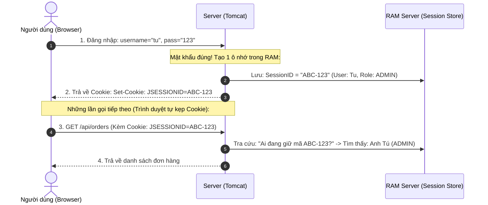

* **Cách hoạt động:**
  * Khi login thành công, Server tạo ra một vùng nhớ trong RAM gọi là `HttpSession` và cấp cho client một mã định danh ngẫu nhiên gọi là `JSESSIONID` (lưu tại Cookie của trình duyệt).
  * Mọi request tiếp theo, trình duyệt tự động gửi kèm cookie `JSESSIONID`. Server đối chiếu ID này trong RAM để xác định danh tính và quyền hạn của người dùng.
* **Đặc điểm & Ứng dụng:**
  * Server chịu trách nhiệm lưu trữ và duy trì trạng thái phiên.
  * Phù hợp với: Ứng dụng web truyền thống dạng Monolith (Spring MVC kết hợp Thymeleaf, JSP rendered từ server).

##### 2. Mô hình STATELESS (Vô trạng thái — Server không lưu bộ nhớ, Client tự mang Token)

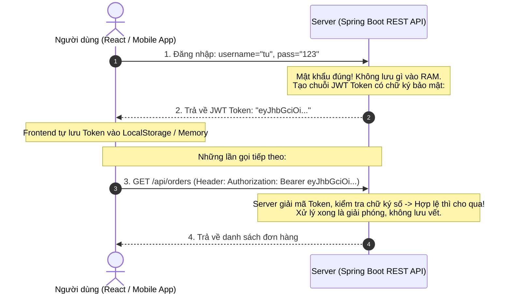

* **Cách hoạt động:**
  * Khi login thành công, Server kiểm tra thông tin hợp lệ sẽ tạo một chuỗi mã hóa **JWT (JSON Web Token)** chứa thông tin user và chữ ký số bí mật (Digital Signature) rồi trả về cho client.
  * Server **hoàn toàn không lưu thông tin phiên trong RAM**.
  * Ở các request tiếp theo, client phải chủ động gắn token này vào HTTP Header: `Authorization: Bearer <token>`. Server chỉ giải mã và xác thực tính hợp lệ của chữ ký; xử lý xong request là kết thúc, không lưu lại trạng thái.
* **Đặc điểm & Ứng dụng:**
  * Server hoàn toàn "Stateless", không tốn tài nguyên bộ nhớ để theo dõi phiên người dùng.
  * Phù hợp với: **Hệ thống REST API hiện đại**, ứng dụng Mobile, kiến trúc Microservices và ứng dụng Single Page App (React, Vue, Angular).

##### 3. Bảng so sánh Stateful vs Stateless

| Tiêu chí | **STATEFUL (Session / Cookie)** | **STATELESS (JWT Token)** |
| :--- | :--- | :--- |
| **Nơi lưu thông tin đăng nhập** | **Trong RAM của Server** (`HttpSession`). | **Phía Client** (Trình duyệt, điện thoại tự giữ Token). |
| **Tài nguyên bộ nhớ Server** | Tốn RAM. Càng nhiều triệu user online đồng thời thì server càng tốn bộ nhớ. | Cực nhẹ RAM. 1 triệu user online đồng thời cũng không làm tăng bộ nhớ session trên server. |
| **Khả năng mở rộng (Scalability)** | **Phức tạp.** Khi mở rộng nhiều server chạy song song (Server A, Server B sau Load Balancer), cần cấu hình Sticky Session hoặc cụm Redis lưu session tập trung. | **Dễ dàng.** Bất kỳ node server nào cũng có thể tự xác thực chữ ký của token một cách độc lập mà không cần đồng bộ bộ nhớ. |
| **Đăng xuất (Logout) & Thu hồi quyền** | **Rất dễ.** Admin chỉ cần xóa Session trong RAM/Redis là user bị vô hiệu hóa phiên ngay lập tức. | **Phức tạp hơn.** Do token nằm ở client, cần chờ token hết hạn (`exp`) hoặc phải tự triển khai cơ chế Token Blacklist (Redis). |

#### 📌 Chi tiết: Cơ Chế Server Xác Định Role Từ JWT Token

Khi client gửi request đính kèm JWT, làm sao Server biết được người dùng có những quyền (Role) gì để cho phép hoặc từ chối? Quy trình diễn ra qua **2 giai đoạn** chặt chẽ:

##### 1. GIAI ĐOÀN 1: Đóng gói Role vào Token (Lúc Đăng nhập - Login)
Khi người dùng đăng nhập thành công, Server truy vấn Database thấy user có quyền `ROLE_ADMIN`. Server sẽ "nhồi" trực tiếp thông tin Role này vào phần **Payload** của JWT (dưới dạng một **Claim**):

```json
// Nội dung bên trong Payload của JWT:
{
  "sub": "tu@gmail.com",
  "roles": ["ROLE_ADMIN"],      // 👈 Role được nhét sẵn vào đây!
  "iat": 1729850000,
  "exp": 1729853600
}
```
Sau đó Server ký điện tử (**Signature**) bằng Secret Key bí mật. Nhờ chữ ký số này, người dùng hay hacker **không thể tự ý sửa `ROLE_USER` thành `ROLE_ADMIN`** (nếu cố tình sửa thì chữ ký sẽ sai lệch và bị từ chối ngay lập tức).

##### 2. GIAI ĐOÀN 2: Bóc tách và Nhận diện Role (Lúc gửi Request gọi API)
Khi client gửi request: `DELETE /api/admin/users/1` kèm Header `Authorization: Bearer <token>`, quy trình kiểm tra Role diễn ra như sau:

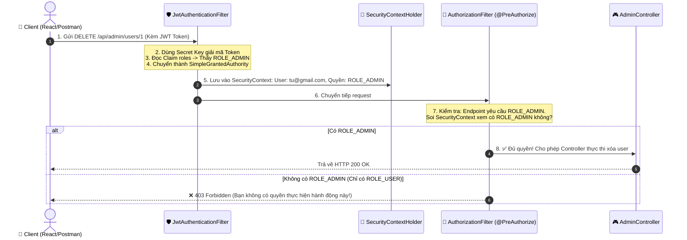

##### 3. Code thực tế: Server bóc Role từ JWT trong Filter

Toàn bộ việc bóc tách Role được xử lý trong `JwtAuthenticationFilter` (chạy trước khi request chạm tới Controller):

```java
@Component
public class JwtAuthenticationFilter extends OncePerRequestFilter {

    private final JwtService jwtService;

    public JwtAuthenticationFilter(JwtService jwtService) {
        this.jwtService = jwtService;
    }

    @Override
    protected void doFilterInternal(HttpServletRequest request, 
                                    HttpServletResponse response, 
                                    FilterChain filterChain) throws ServletException, IOException {

        // 1. Lấy chuỗi token từ Header: "Bearer eyJhbGciOi..."
        String authHeader = request.getHeader("Authorization");
        if (authHeader == null || !authHeader.startsWith("Bearer ")) {
            filterChain.doFilter(request, response);
            return;
        }

        String token = authHeader.substring(7); // Cắt bỏ tiền tố "Bearer "

        // 2. Giải mã token và lấy Username + danh sách Roles từ Payload
        String email = jwtService.extractUsername(token);
        List<String> roles = jwtService.extractRoles(token); // -> ["ROLE_ADMIN"]

        // 3. "Dịch" String Role sang chuẩn của Spring Security (GrantedAuthority)
        List<SimpleGrantedAuthority> authorities = roles.stream()
                .map(SimpleGrantedAuthority::new)
                .toList();

        // 4. Tạo đối tượng Authentication đã xác thực đầy đủ
        UsernamePasswordAuthenticationToken authentication =
                new UsernamePasswordAuthenticationToken(email, null, authorities);

        // 5. 🛑 ĐẶT VÀO BỘ NHỚ REQUEST HIỆN TẠI (SecurityContext)
        SecurityContextHolder.getContext().setAuthentication(authentication);

        // 6. Cho request đi tiếp tới Controller
        filterChain.doFilter(request, response);
    }
}
```

Sau khi Filter hoàn tất, Controller kiểm tra quyền cực kỳ dễ dàng thông qua annotation:

```java
@RestController
@RequestMapping("/api/admin")
public class AdminController {

    @DeleteMapping("/users/{id}")
    @PreAuthorize("hasRole('ADMIN')") // 👈 Spring tự động soi trong SecurityContext
    public ResponseEntity<String> deleteUser(@PathVariable Long id) {
        // Chỉ ai có "ROLE_ADMIN" trong JWT mới lọt được vào đây!
        return ResponseEntity.ok("Xóa user thành công");
    }
}
```

##### 💡 Câu hỏi hay: Có cần query lại Database để lấy Role không?
Có 2 trường phái trong thực tế:
1. **Đọc thẳng Role từ JWT (Cách tối ưu — Phổ biến nhất):**  
   Server không cần đụng tới Database $\rightarrow$ Tốc độ kiểm tra quyền là **0 miligiây**, chịu tải cực lớn.
2. **Lấy username từ JWT rồi query lại Database để lấy Role mới nhất:**  
   Dùng khi hệ thống yêu cầu độ bảo mật cực cao (ví dụ: Admin vừa thu hồi quyền của nhân viên, muốn nhân viên đó mất quyền ngay lập tức mà không cần đợi JWT hết hạn).

---

## 2. Kiến Trúc Tổng Quan Spring Security

### 2.1. Vị trí trong Spring MVC Pipeline

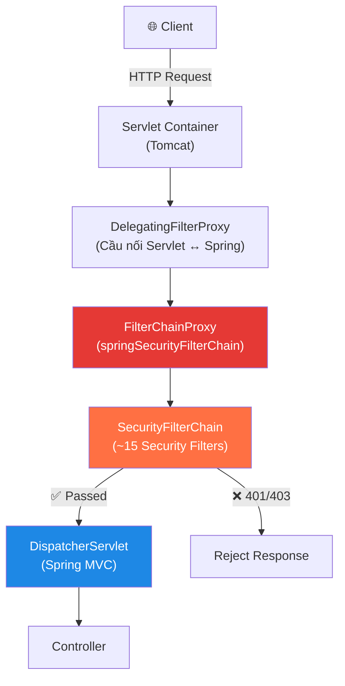

> [!NOTE]
> **Điểm mấu chốt:** Spring Security hoạt động **trước** DispatcherServlet. Nghĩa là nếu request bị chặn bởi Security Filter Chain, nó **không bao giờ** tới được Controller. Đây là nguyên tắc **defense in depth** (bảo vệ nhiều lớp).

### 2.2. Ba lớp kiến trúc chính & Sự phân hóa giữa 2 mô hình (Truyền thống vs Hiện đại)

Spring Security phân tách hệ thống bảo mật thành 3 tầng trừu tượng độc lập:

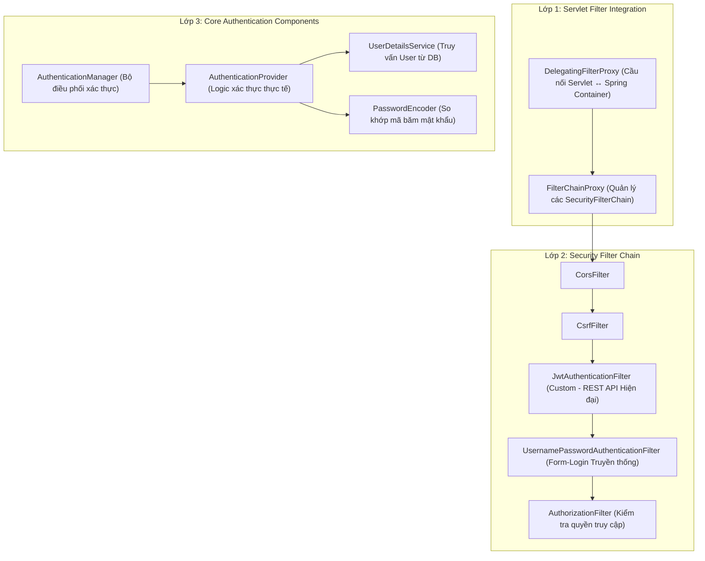

| Lớp | Thành phần chính | Vai trò kỹ thuật |
|:---:|:---|:---|
| **Lớp 1** | `DelegatingFilterProxy` → `FilterChainProxy` | Tiếp nhận request từ Web Server (Tomcat) và chuyển giao vào hệ sinh thái Bean của Spring IoC. |
| **Lớp 2** | Chuỗi các bộ lọc `SecurityFilterChain` | Chuỗi Filter xử lý tuần tự: kiểm tra nguồn gốc CORS, chống CSRF, trích xuất thông tin định danh và thẩm định quyền hạn. |
| **Lớp 3** | `AuthenticationManager`, `AuthenticationProvider`, `UserDetailsService`, `PasswordEncoder` | Bộ máy nghiệp vụ xác minh thông tin tài khoản (username/password) dựa trên dữ liệu lưu trữ. |

---

#### ⚖️ Sự khác biệt cốt tử trong cách vận hành 3 lớp giữa 2 mô hình

Nhiều người học thường bị nhầm lẫn vì **sơ đồ kinh điển của Spring Security được thiết kế cho mô hình Web truyền thống**. Trên thực tế, 2 mô hình vận hành 3 lớp này hoàn toàn khác nhau:

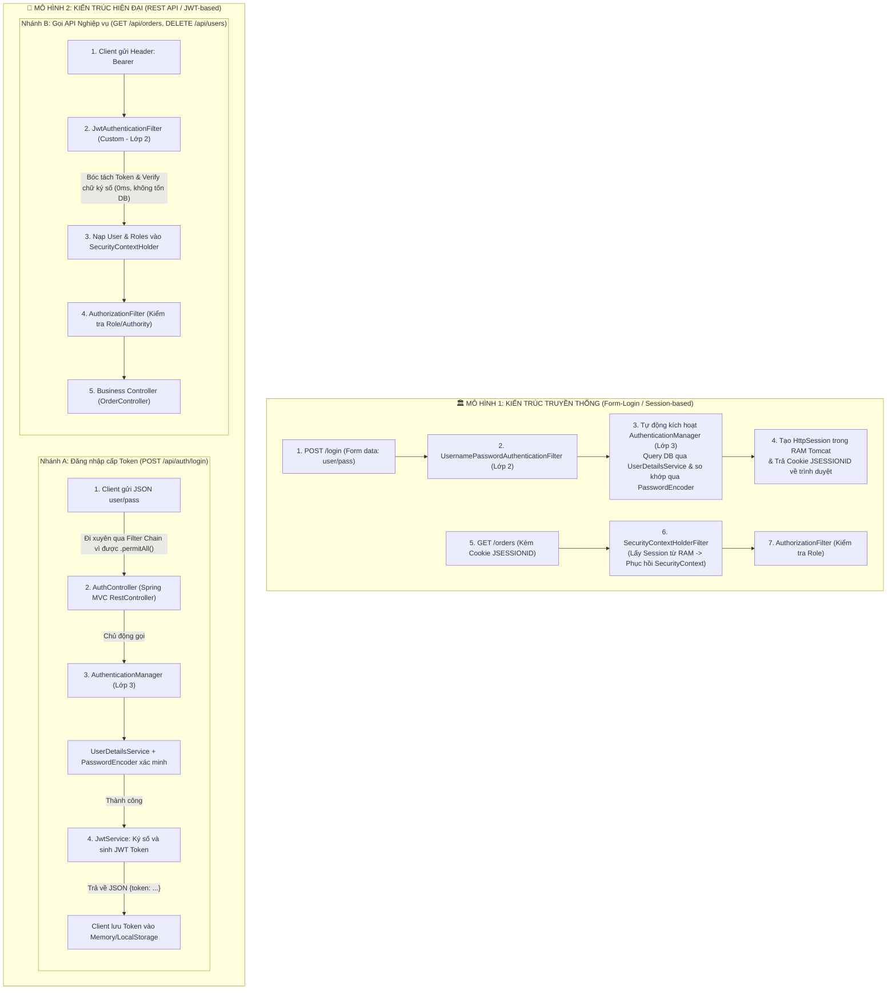

| Tiêu chí phân biệt | Mô hình Truyền thống (Form-Login / Session) | Mô hình Hiện đại (REST API + JWT) |
| :--- | :--- | :--- |
| **Kiểu ứng dụng** | Monolith, Server-side Rendering (Spring MVC + Thymeleaf / JSP). | Client-Server tách biệt (React, Vue, Angular, Mobile App) hoặc Microservices. |
| **Xử lý request đăng nhập** | Do `UsernamePasswordAuthenticationFilter` trong Filter Chain tự động chặn và xử lý. | Đi xuyên qua Filter Chain (nhờ `.permitAll()`) vào thẳng `AuthController`. `AuthController` chủ động gọi `AuthenticationManager` để xác thực và sinh JWT. |
| **Bộ máy Lớp 3 được gọi khi nào?** | Được gọi tự động bởi Filter Chain mỗi khi có request đăng nhập form. | Được lập trình viên chủ động tiêm (inject) vào Service/Controller để gọi khi đăng nhập. |
| **Xác thực các request nghiệp vụ sau đó** | Dựa vào Cookie `JSESSIONID` $\rightarrow$ Server tìm `HttpSession` lưu sẵn trong RAM Tomcat. | Dựa vào `Authorization: Bearer <token>` $\rightarrow$ `JwtAuthenticationFilter` tự giải mã chữ ký, không cần truy cập RAM session. |
| **Vai trò của PasswordEncoder** | So khớp mật khẩu tại Filter Chain khi đăng nhập. | So khớp mật khẩu bên trong logic của `AuthController` / `AuthService`. Các request nghiệp vụ sau đó hoàn toàn không dùng tới `PasswordEncoder`. |

---

## 3. Security Filter Chain — Chi Tiết Từng Filter

### 3.1. Phân loại các Filter theo Kiến trúc

Spring Security đăng ký một chuỗi khoảng **15+ filter** với thứ tự cố định. Tùy thuộc vào kiến trúc bạn cấu hình, các filter sẽ đóng các vai trò khác nhau:

| # | Tên Filter | Nhiệm vụ kỹ thuật | Kiến trúc áp dụng |
|:---:|:---|:---|:---:|
| 1 | `DisableEncodeUrlFilter` | Ngăn chặn việc ghi Session ID trực tiếp vào URL (chống lộ session). | Cả 2 |
| 2 | `WebAsyncManagerIntegrationFilter` | Tích hợp và đồng bộ `SecurityContext` sang các luồng bất đồng bộ (Async Request). | Cả 2 |
| 3 | `SecurityContextHolderFilter` | Khôi phục `SecurityContext` từ lưu trữ phiên (trong Stateless, bước này tạo context rỗng). | ⭐ Truyền thống (Session) |
| 4 | `HeaderWriterFilter` | Tự động ghi các HTTP Header bảo mật vào response (X-Frame-Options, X-Content-Type-Options). | Cả 2 |
| 5 | **`CorsFilter`** | Kiểm tra chính sách chia sẻ tài nguyên nguồn gốc chéo (CORS) cho phép frontend khác domain gọi API. | ⭐⭐ **Bắt buộc trong REST API** |
| 6 | **`CsrfFilter`** | Kiểm tra CSRF Token để chống tấn công Cross-Site Request Forgery. | ⭐ Truyền thống (REST API thường disable) |
| 7 | `LogoutFilter` | Xử lý hủy bỏ phiên đăng nhập khi người dùng gọi endpoint `/logout`. | ⭐ Truyền thống (Session) |
| 8 | **`JwtAuthenticationFilter`** *(Custom)* | Trích xuất chuỗi JWT từ Header `Authorization`, giải mã chữ ký số, lấy Role và nạp vào `SecurityContext`. | ⭐⭐⭐ **Trọng tâm REST API Hiện đại** |
| 9 | **`UsernamePasswordAuthenticationFilter`** | Bắt request đăng nhập dạng form URL-encoded (`username` + `password`). | ⭐ Truyền thống (Form-Login) |
| 10 | `BasicAuthenticationFilter` | Xác thực thông qua HTTP Basic Authentication (chuỗi Base64 `user:pass` ở Header). | REST API đơn giản / Internal tool |
| 11 | `AnonymousAuthenticationFilter` | Nếu request chưa được xác thực qua các filter trước, gán cho nó một danh tính ẩn danh (`anonymousUser`). | Cả 2 |
| 12 | `ExceptionTranslationFilter` | Bắt các ngoại lệ bảo mật: đổi `AuthenticationException` thành HTTP 401, đổi `AccessDeniedException` thành HTTP 403. | ⭐⭐⭐ Cả 2 |
| 13 | **`AuthorizationFilter`** | Đánh giá quyền hạn thực tế (Role/Authority) của User đối với URL đang truy cập. | ⭐⭐⭐ Cả 2 |

---

### 3.2. Luồng xử lý một Request qua Filter Chain trong REST API Hiện Đại

Để tránh hiểu nhầm rằng "mọi request đều trải qua việc kiểm tra mật khẩu", chúng ta phân tích độc lập 2 kịch bản xử lý thực tế trong hệ thống REST API + JWT:

#### 🟢 KỊCH BẢN 1: Luồng xử lý Request Đăng Nhập (`POST /api/auth/login`)

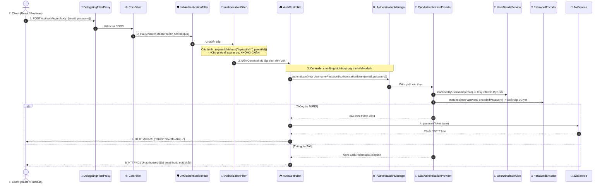

---

#### 🔵 KỊCH BẢN 2: Luồng xử lý Request Nghiệp Vụ Có Kèm JWT (`GET /api/orders`)

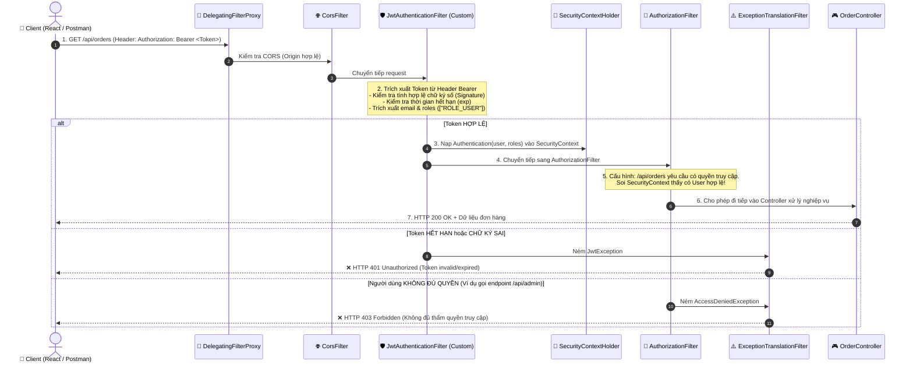

> [!TIP]
> **Điểm mấu chốt cần ghi nhớ:**  
> Trong Kịch bản 2 (Request nghiệp vụ thông thường):  
> * Hoàn toàn **không truy vấn lại password trong Database**.  
> * Hoàn toàn **không dùng tới `PasswordEncoder`**.  
> * Toàn bộ quá trình xác thực danh tính và phân quyền diễn ra **ngay tại `JwtAuthenticationFilter` trong bộ nhớ RAM** thông qua việc giải mã chữ ký số của token, giúp tối ưu hóa hiệu năng tối đa cho hệ thống.

---

## 4. Authentication — Cơ Chế Xác Thực

### 4.1. Các thành phần cốt lõi

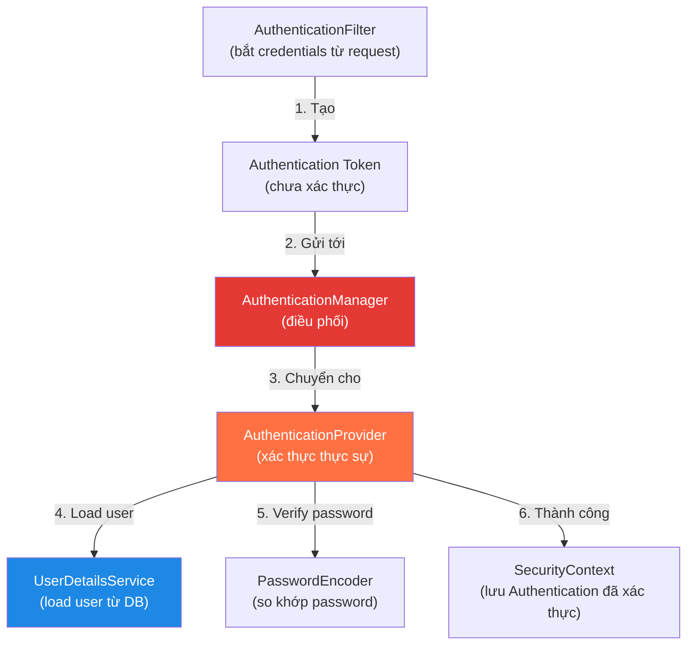

| Thành phần | Interface | Vai trò | Ẩn dụ |
|:---|:---|:---|:---|
| **AuthenticationFilter** | `AbstractAuthenticationProcessingFilter` | Bắt credentials từ HTTP request | 🚪 Nhân viên lễ tân nhận thẻ |
| **AuthenticationManager** | `AuthenticationManager` | Điều phối — chọn Provider phù hợp | 🏢 Quản lý an ninh phân công |
| **AuthenticationProvider** | `AuthenticationProvider` | Thực hiện logic xác thực | 🔍 Nhân viên xác minh thẻ |
| **UserDetailsService** | `UserDetailsService` | Tải thông tin user từ database | 📋 Tra cứu hồ sơ nhân sự |
| **PasswordEncoder** | `PasswordEncoder` | So khớp password đã mã hóa | 🔐 Máy quét vân tay |

### 4.2. Authentication Object — Trước và sau xác thực

```java
// TRƯỚC xác thực (chưa authenticated)
Authentication unauthenticated = new UsernamePasswordAuthenticationToken(
    "admin@gmail.com",     // principal = username (chỉ là chuỗi)
    "raw-password"         // credentials = raw password
);
// isAuthenticated() = false
// authorities = empty

// SAU xác thực (authenticated thành công)
Authentication authenticated = new UsernamePasswordAuthenticationToken(
    userDetails,           // principal = UserDetails object (đầy đủ thông tin)
    null,                  // credentials = null (đã xóa password vì lý do bảo mật)
    authorities            // authorities = [ROLE_USER, ROLE_ADMIN]
);
// isAuthenticated() = true
// authorities = [ROLE_USER, ROLE_ADMIN]
```

> [!IMPORTANT]
> **Sau khi xác thực thành công**, Spring Security **xóa password** khỏi `Authentication` object (set `credentials = null`). Đây là thiết kế có chủ đích — tránh password bị lộ nếu object bị serialize hoặc log.

### 4.3. Luồng xác thực chi tiết với `DaoAuthenticationProvider`

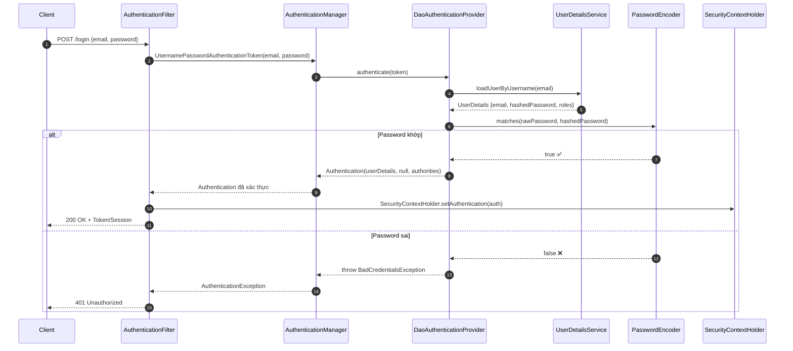

---

## 5. Authorization — Cơ Chế Phân Quyền

### 5.1. Hai cấp độ phân quyền

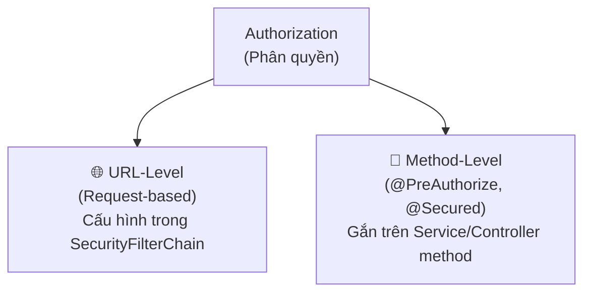

| Cấp độ | Cách dùng | Ví dụ |
|:---|:---|:---|
| **URL-Level** | Cấu hình trong `SecurityFilterChain` bean | `.requestMatchers("/api/admin/**").hasRole("ADMIN")` |
| **Method-Level** | Gắn annotation trên method | `@PreAuthorize("hasRole('ADMIN')")` |

### 5.2. Role vs Authority (Permission)

| | Role | Authority (Permission) |
|:---|:---|:---|
| **Quy ước** | Prefix `ROLE_` (Spring tự thêm) | Không prefix |
| **Granularity** | Nhóm quyền lớn | Quyền đơn lẻ, chi tiết |
| **Ví dụ** | `ROLE_ADMIN`, `ROLE_USER` | `user:read`, `user:write`, `product:delete` |
| **Kiểm tra** | `hasRole("ADMIN")` | `hasAuthority("user:write")` |

```java
// Khi bạn gán role "ADMIN" cho user:
// Spring Security lưu nội bộ là "ROLE_ADMIN"

// hasRole("ADMIN") → kiểm tra có "ROLE_ADMIN" không
// hasAuthority("ROLE_ADMIN") → kiểm tra chính xác chuỗi "ROLE_ADMIN"
// hasAuthority("user:read") → kiểm tra permission cụ thể
```

> [!WARNING]
> **Lỗi phổ biến:** Viết `hasRole("ROLE_ADMIN")` → Spring sẽ kiểm tra `"ROLE_ROLE_ADMIN"` (thêm prefix hai lần!). Đúng cách: `hasRole("ADMIN")` hoặc `hasAuthority("ROLE_ADMIN")`.

---

## 6. Cấu Hình SecurityFilterChain

### 6.1. Cấu hình cơ bản cho REST API (Stateless)

```java
import org.springframework.context.annotation.Bean;
import org.springframework.context.annotation.Configuration;
import org.springframework.http.HttpMethod;
import org.springframework.security.config.annotation.method.configuration.EnableMethodSecurity;
import org.springframework.security.config.annotation.web.builders.HttpSecurity;
import org.springframework.security.config.annotation.web.configuration.EnableWebSecurity;
import org.springframework.security.config.http.SessionCreationPolicy;
import org.springframework.security.crypto.bcrypt.BCryptPasswordEncoder;
import org.springframework.security.crypto.password.PasswordEncoder;
import org.springframework.security.web.SecurityFilterChain;

@Configuration
@EnableWebSecurity       // Kích hoạt Spring Security cho web
@EnableMethodSecurity    // Kích hoạt @PreAuthorize, @Secured, @RolesAllowed
public class SecurityConfig {

    @Bean
    public SecurityFilterChain securityFilterChain(HttpSecurity http) throws Exception {
        return http
            // 1. Tắt CSRF — REST API stateless không cần CSRF protection
            .csrf(csrf -> csrf.disable())

            // 2. Cấu hình phân quyền theo URL
            .authorizeHttpRequests(auth -> auth
                // Public endpoints — không cần đăng nhập
                .requestMatchers("/api/auth/**").permitAll()
                .requestMatchers("/swagger-ui/**", "/v3/api-docs/**").permitAll()
                .requestMatchers("/h2-console/**").permitAll()

                // Chỉ cho phép đọc (GET) với USER hoặc ADMIN
                .requestMatchers(HttpMethod.GET, "/api/products/**").permitAll()

                // Admin-only endpoints
                .requestMatchers("/api/admin/**").hasRole("ADMIN")

                // Tất cả request còn lại phải được xác thực
                .anyRequest().authenticated()
            )

            // 3. Stateless session — không tạo HTTP session
            .sessionManagement(session ->
                session.sessionCreationPolicy(SessionCreationPolicy.STATELESS)
            )

            // 4. Cho phép H2 Console hoạt động (dev only)
            .headers(headers ->
                headers.frameOptions(frame -> frame.sameOrigin())
            )

            .build();
    }

    @Bean
    public PasswordEncoder passwordEncoder() {
        return new BCryptPasswordEncoder();
    }
}
```

### 6.2. Giải thích từng phần cấu hình

| Phần | Giải thích |
|:---|:---|
| `csrf().disable()` | REST API stateless sử dụng JWT token, không có session cookie → không dính CSRF |
| `authorizeHttpRequests()` | Lambda DSL cấu hình quy tắc phân quyền theo thứ tự từ cụ thể → chung |
| `.permitAll()` | Cho phép tất cả truy cập, kể cả anonymous (chưa đăng nhập) |
| `.hasRole("ADMIN")` | Yêu cầu user có role `ROLE_ADMIN` |
| `.authenticated()` | Yêu cầu user đã xác thực (bất kỳ role nào) |
| `SessionCreationPolicy.STATELESS` | Không tạo/dùng HTTP Session — mỗi request tự chứng minh (JWT) |

### 6.3. Thứ tự quy tắc Matcher — Cực kỳ quan trọng!

```java
// ❌ SAI — .anyRequest().authenticated() ĐẶT TRƯỚC sẽ nuốt hết các rule phía sau
.authorizeHttpRequests(auth -> auth
    .anyRequest().authenticated()                      // Rule này match TẤT CẢ
    .requestMatchers("/api/auth/**").permitAll()        // ⚠️ KHÔNG BAO GIỜ tới được!
)

// ✅ ĐÚNG — Rule cụ thể đặt TRƯỚC, .anyRequest() đặt CUỐI CÙNG
.authorizeHttpRequests(auth -> auth
    .requestMatchers("/api/auth/**").permitAll()        // Cụ thể nhất → đầu tiên
    .requestMatchers("/api/admin/**").hasRole("ADMIN")
    .anyRequest().authenticated()                       // Catch-all → cuối cùng
)
```

> [!CAUTION]
> Spring Security đánh giá quy tắc **theo thứ tự khai báo**. Rule đầu tiên khớp sẽ được áp dụng, các rule sau bị bỏ qua. `anyRequest()` luôn phải là **rule cuối cùng**.

---

## 7. Password Encoding — BCrypt

### 7.1. Tại sao không dùng MD5 / SHA-256?

| Thuật toán | Tốc độ | An toàn? | Vấn đề |
|:---|:---|:---:|:---|
| **Plain text** | — | ❌ | Lộ password ngay lập tức khi database bị hack |
| **MD5** | Cực nhanh (~1 tỷ hash/giây) | ❌ | Dễ bị brute-force, rainbow table |
| **SHA-256** | Rất nhanh | ❌ | Thiết kế cho tốc độ, không phải bảo mật password |
| **BCrypt** ✅ | Chậm có chủ đích (~0.3s/hash) | ✅ | Cost factor tăng theo phần cứng |
| **Argon2** ✅ | Chậm + tốn RAM | ✅ | Chống GPU attack, winner PHC 2015 |

### 7.2. BCrypt hoạt động như thế nào?

```
BCrypt($2a$12$LJ3m4dksjf7fhekFJDKLkejslkjef93ksljflk)
        │  │  └──── Hash kết quả (31 chars)
        │  └─────── Salt ngẫu nhiên (22 chars, tự sinh mỗi lần)
        └────────── Cost factor (2^12 = 4096 lần lặp)
```

```java
PasswordEncoder encoder = new BCryptPasswordEncoder();

// Mã hóa — mỗi lần gọi cho kết quả KHÁC NHAU (do salt ngẫu nhiên)
String hash1 = encoder.encode("MyPassword123");
// → $2a$10$N9qo8uLOickgx2ZMRZoMy...
String hash2 = encoder.encode("MyPassword123");
// → $2a$10$ZYjKWkTOZjFdfWe99pGke...  (KHÁC hash1, nhưng vẫn verify được)

// Verify — so khớp raw password với hash
boolean match = encoder.matches("MyPassword123", hash1);  // → true
boolean wrong = encoder.matches("WrongPassword", hash1);  // → false
```

> [!NOTE]
> **Tại sao 2 lần `encode()` cho kết quả khác nhau mà `matches()` vẫn đúng?**
> Vì BCrypt nhúng **salt** vào trong hash string. Khi `matches()`, nó trích xuất salt từ hash, tính lại hash với raw password + salt, rồi so sánh. Thiết kế này giúp mỗi user có hash khác nhau kể cả khi dùng cùng password.

### 7.3. Cấu hình BCrypt với cost factor tùy chỉnh

```java
@Bean
public PasswordEncoder passwordEncoder() {
    // Cost factor = 12 (mặc định = 10)
    // Mỗi lần tăng 1 → thời gian hash gấp đôi
    // Cost 10 ≈ 0.1s, Cost 12 ≈ 0.3s, Cost 14 ≈ 1.2s
    return new BCryptPasswordEncoder(12);
}
```

---

## 8. UserDetailsService — Kết Nối Database

### 8.1. Interface UserDetailsService

```java
/**
 * Interface cốt lõi — Spring Security gọi method này khi cần load user.
 * Bạn chỉ cần implement DUY NHẤT 1 method.
 */
public interface UserDetailsService {
    UserDetails loadUserByUsername(String username) throws UsernameNotFoundException;
}
```

### 8.2. Interface UserDetails

`UserDetails` là interface mà Spring Security dùng để biểu diễn thông tin một user đã xác thực:

```java
public interface UserDetails extends Serializable {
    String getUsername();                               // Email hoặc username
    String getPassword();                              // Password đã mã hóa (BCrypt hash)
    Collection<? extends GrantedAuthority> getAuthorities(); // Danh sách quyền/role
    boolean isAccountNonExpired();                      // Tài khoản chưa hết hạn?
    boolean isAccountNonLocked();                       // Tài khoản chưa bị khóa?
    boolean isCredentialsNonExpired();                  // Mật khẩu chưa hết hạn?
    boolean isEnabled();                               // Tài khoản đang hoạt động?
}
```

### 8.3. Implement đầy đủ

```java
import org.springframework.security.core.GrantedAuthority;
import org.springframework.security.core.authority.SimpleGrantedAuthority;
import org.springframework.security.core.userdetails.UserDetails;
import org.springframework.security.core.userdetails.UserDetailsService;
import org.springframework.security.core.userdetails.UsernameNotFoundException;
import org.springframework.stereotype.Service;

import java.util.Collection;
import java.util.Set;
import java.util.stream.Collectors;

@Service
public class CustomUserDetailsService implements UserDetailsService {

    private final UserRepository userRepository;

    public CustomUserDetailsService(UserRepository userRepository) {
        this.userRepository = userRepository;
    }

    @Override
    public UserDetails loadUserByUsername(String email) throws UsernameNotFoundException {
        // 1. Tìm user trong database
        User user = userRepository.findByEmail(email)
            .orElseThrow(() ->
                new UsernameNotFoundException("Không tìm thấy user với email: " + email)
            );

        // 2. Chuyển đổi Role entity → GrantedAuthority
        Collection<GrantedAuthority> authorities = user.getRoles().stream()
            .map(role -> new SimpleGrantedAuthority("ROLE_" + role.getName()))
            .collect(Collectors.toSet());

        // 3. Trả về UserDetails (dùng class có sẵn của Spring Security)
        return org.springframework.security.core.userdetails.User.builder()
            .username(user.getEmail())
            .password(user.getPassword())     // Password đã mã hóa BCrypt
            .authorities(authorities)
            .accountExpired(false)
            .accountLocked(false)
            .credentialsExpired(false)
            .disabled(!user.isActive())
            .build();
    }
}
```

### 8.4. Tạo Custom UserDetails (khi cần thêm thông tin)

```java
/**
 * Custom UserDetails — mở rộng thêm id, fullName cho tiện sử dụng.
 */
public class CustomUserDetails implements UserDetails {

    private final Long id;
    private final String email;
    private final String password;
    private final String fullName;
    private final boolean active;
    private final Collection<? extends GrantedAuthority> authorities;

    public CustomUserDetails(User user, Collection<? extends GrantedAuthority> authorities) {
        this.id = user.getId();
        this.email = user.getEmail();
        this.password = user.getPassword();
        this.fullName = user.getName();
        this.active = user.isActive();
        this.authorities = authorities;
    }

    // Getter bổ sung (không thuộc UserDetails interface)
    public Long getId() { return id; }
    public String getFullName() { return fullName; }

    // ===== Implement UserDetails =====
    @Override public String getUsername() { return email; }
    @Override public String getPassword() { return password; }
    @Override public Collection<? extends GrantedAuthority> getAuthorities() { return authorities; }
    @Override public boolean isAccountNonExpired() { return true; }
    @Override public boolean isAccountNonLocked() { return true; }
    @Override public boolean isCredentialsNonExpired() { return true; }
    @Override public boolean isEnabled() { return active; }
}
```

---

## 9. SecurityContext & SecurityContextHolder

### 9.1. Cơ chế lưu trữ

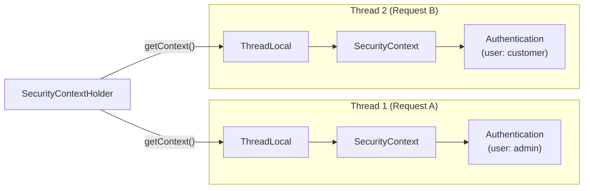

> **`SecurityContextHolder`** sử dụng **`ThreadLocal`** để lưu `SecurityContext`. Mỗi thread (= mỗi request trong Spring MVC) có riêng một `SecurityContext` — đảm bảo request A không nhìn thấy thông tin user của request B.

### 9.2. Lấy thông tin user đang đăng nhập

```java
import org.springframework.security.core.Authentication;
import org.springframework.security.core.context.SecurityContextHolder;

// ===== Cách 1: Trực tiếp từ SecurityContextHolder =====
@Service
public class AuditService {

    public String getCurrentUsername() {
        Authentication auth = SecurityContextHolder.getContext().getAuthentication();
        if (auth == null || !auth.isAuthenticated()) {
            return "anonymous";
        }
        return auth.getName();  // Trả về username (email)
    }
}

// ===== Cách 2: Inject vào Controller method (Khuyến nghị ✅) =====
@RestController
@RequestMapping("/api/profile")
public class ProfileController {

    @GetMapping("/me")
    public ResponseEntity<?> getMyProfile(Authentication authentication) {
        // Spring MVC tự inject Authentication object vào tham số
        String email = authentication.getName();

        // Nếu dùng CustomUserDetails:
        CustomUserDetails userDetails = (CustomUserDetails) authentication.getPrincipal();
        Long userId = userDetails.getId();
        String fullName = userDetails.getFullName();

        return ResponseEntity.ok(Map.of(
            "id", userId,
            "email", email,
            "fullName", fullName
        ));
    }
}

// ===== Cách 3: Dùng @AuthenticationPrincipal =====
@GetMapping("/me-v2")
public ResponseEntity<?> getMyProfileV2(
    @AuthenticationPrincipal CustomUserDetails userDetails
) {
    // Lấy thẳng UserDetails, không cần cast
    return ResponseEntity.ok(Map.of(
        "id", userDetails.getId(),
        "email", userDetails.getUsername()
    ));
}
```

> [!TIP]
> **Best practice:** Sử dụng **Cách 2** hoặc **Cách 3** trong Controller. Chỉ dùng **Cách 1** (`SecurityContextHolder.getContext()`) khi bạn cần lấy thông tin user ở nơi không có tham số Controller (ví dụ: trong Service, AOP Aspect, hoặc Interceptor).

---

## 10. CORS & CSRF — Hai Cơ Chế Bảo Vệ Web

### 10.1. CORS (Cross-Origin Resource Sharing)

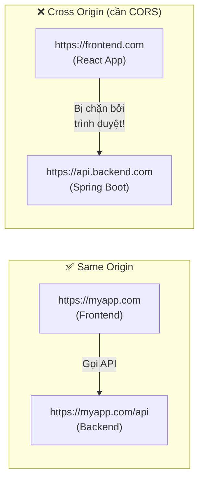

**CORS** là cơ chế trình duyệt cho phép hoặc chặn request từ một domain (origin) khác. Backend phải **chủ động cho phép** bằng cách trả về header `Access-Control-Allow-Origin`.

```java
@Bean
public SecurityFilterChain securityFilterChain(HttpSecurity http) throws Exception {
    return http
        .cors(cors -> cors.configurationSource(corsConfigurationSource()))
        // ... các cấu hình khác
        .build();
}

@Bean
public CorsConfigurationSource corsConfigurationSource() {
    CorsConfiguration config = new CorsConfiguration();
    config.setAllowedOrigins(List.of(
        "http://localhost:3000",         // React dev server
        "https://myapp.com"             // Production frontend
    ));
    config.setAllowedMethods(List.of("GET", "POST", "PUT", "DELETE", "PATCH"));
    config.setAllowedHeaders(List.of("*"));
    config.setAllowCredentials(true);   // Cho phép gửi cookie/token
    config.setMaxAge(3600L);            // Cache preflight 1 giờ

    UrlBasedCorsConfigurationSource source = new UrlBasedCorsConfigurationSource();
    source.registerCorsConfiguration("/api/**", config);
    return source;
}
```

### 10.2. CSRF (Cross-Site Request Forgery)

| | Stateful (Session-based) | Stateless (JWT-based) |
|:---|:---|:---|
| **CSRF Risk** | ⚠️ Có rủi ro (browser tự gửi cookie) | ✅ Không có rủi ro |
| **Cần CSRF Protection?** | ✅ Bắt buộc | ❌ Có thể tắt |
| **Lý do** | Cookie session tự đính kèm request | JWT phải gửi qua header `Authorization` — browser không tự thêm |

```java
// REST API dùng JWT → tắt CSRF
.csrf(csrf -> csrf.disable())

// Ứng dụng web có form login + session → giữ CSRF (mặc định)
.csrf(Customizer.withDefaults())
```

> [!NOTE]
> **Khi nào tắt CSRF an toàn?** Chỉ khi ứng dụng:
> 1. Hoàn toàn stateless (không dùng session/cookie để xác thực)
> 2. Sử dụng token-based authentication (JWT gửi qua header `Authorization`)
> Nếu bạn dùng form login truyền thống + session cookie → **KHÔNG được tắt CSRF**.

---

## 11. Method-Level Security

### 11.1. Kích hoạt

```java
@Configuration
@EnableMethodSecurity  // Spring Security 6.x+ (thay thế @EnableGlobalMethodSecurity)
public class SecurityConfig {
    // ...
}
```

### 11.2. Các annotation phân quyền

```java
@Service
public class UserAdminService {

    // ===== @PreAuthorize — Linh hoạt nhất, hỗ trợ SpEL =====

    @PreAuthorize("hasRole('ADMIN')")
    public void deleteUser(Long userId) {
        // Chỉ ADMIN mới gọi được
    }

    @PreAuthorize("hasRole('ADMIN') or #userId == authentication.principal.id")
    public UserResponse getUserProfile(Long userId) {
        // ADMIN xem được tất cả, USER thường chỉ xem profile của mình
    }

    @PreAuthorize("hasAnyRole('ADMIN', 'MANAGER')")
    public List<UserResponse> getAllUsers() {
        // ADMIN hoặc MANAGER
    }

    @PreAuthorize("hasAuthority('user:write')")
    public void updateUser(Long userId, UserUpdateRequest request) {
        // Yêu cầu permission cụ thể
    }

    // ===== @PostAuthorize — Kiểm tra SAU khi method đã chạy =====

    @PostAuthorize("returnObject.email == authentication.name or hasRole('ADMIN')")
    public UserResponse findUser(Long id) {
        // Method chạy xong → kiểm tra kết quả trả về
        // Nếu user đang login xem profile người khác (và không phải ADMIN) → 403
        return userRepository.findById(id)
            .map(UserResponse::fromEntity)
            .orElseThrow();
    }

    // ===== @Secured — Đơn giản, chỉ check role =====

    @Secured({"ROLE_ADMIN", "ROLE_MANAGER"})
    public void promoteUser(Long userId) {
        // Tương đương hasAnyRole("ADMIN", "MANAGER")
        // Lưu ý: @Secured yêu cầu prefix "ROLE_"
    }
}
```

### 11.3. So sánh 3 annotation phân quyền

| | `@PreAuthorize` | `@PostAuthorize` | `@Secured` |
|:---|:---|:---|:---|
| **Thời điểm** | Trước khi method chạy | Sau khi method chạy | Trước khi method chạy |
| **Hỗ trợ SpEL** | ✅ Đầy đủ | ✅ Đầy đủ | ❌ Không |
| **Kiểm tra kết quả** | ❌ | ✅ (`returnObject`) | ❌ |
| **Độ linh hoạt** | ⭐⭐⭐ Cao nhất | ⭐⭐ Vừa | ⭐ Cơ bản |
| **Khuyến nghị** | ✅ Ưu tiên dùng | Dùng khi cần | Ít dùng |

---

## 12. Xử Lý Lỗi Security

### 12.1. Hai loại lỗi bảo mật

| Lỗi | HTTP Status | Khi nào xảy ra | Handler |
|:---|:---:|:---|:---|
| **Authentication Error** | `401 Unauthorized` | Chưa đăng nhập hoặc token hết hạn/sai | `AuthenticationEntryPoint` |
| **Authorization Error** | `403 Forbidden` | Đã đăng nhập nhưng không đủ quyền | `AccessDeniedHandler` |

### 12.2. Custom Error Handler

```java
import com.fasterxml.jackson.databind.ObjectMapper;
import jakarta.servlet.http.HttpServletRequest;
import jakarta.servlet.http.HttpServletResponse;
import org.springframework.http.HttpStatus;
import org.springframework.http.MediaType;
import org.springframework.security.access.AccessDeniedException;
import org.springframework.security.core.AuthenticationException;
import org.springframework.security.web.AuthenticationEntryPoint;
import org.springframework.security.web.access.AccessDeniedHandler;
import org.springframework.stereotype.Component;

import java.io.IOException;
import java.time.LocalDateTime;
import java.util.Map;

/**
 * Xử lý lỗi 401 — Khi request chưa được xác thực.
 */
@Component
public class CustomAuthenticationEntryPoint implements AuthenticationEntryPoint {

    private final ObjectMapper objectMapper = new ObjectMapper();

    @Override
    public void commence(HttpServletRequest request,
                         HttpServletResponse response,
                         AuthenticationException authException) throws IOException {

        response.setContentType(MediaType.APPLICATION_JSON_VALUE);
        response.setStatus(HttpStatus.UNAUTHORIZED.value());

        Map<String, Object> body = Map.of(
            "status", 401,
            "error", "Unauthorized",
            "message", "Bạn chưa đăng nhập hoặc token đã hết hạn",
            "path", request.getRequestURI(),
            "timestamp", LocalDateTime.now().toString()
        );

        objectMapper.writeValue(response.getOutputStream(), body);
    }
}

/**
 * Xử lý lỗi 403 — Khi user đã xác thực nhưng không đủ quyền.
 */
@Component
public class CustomAccessDeniedHandler implements AccessDeniedHandler {

    private final ObjectMapper objectMapper = new ObjectMapper();

    @Override
    public void handle(HttpServletRequest request,
                       HttpServletResponse response,
                       AccessDeniedException accessDeniedException) throws IOException {

        response.setContentType(MediaType.APPLICATION_JSON_VALUE);
        response.setStatus(HttpStatus.FORBIDDEN.value());

        Map<String, Object> body = Map.of(
            "status", 403,
            "error", "Forbidden",
            "message", "Bạn không có quyền truy cập tài nguyên này",
            "path", request.getRequestURI(),
            "timestamp", LocalDateTime.now().toString()
        );

        objectMapper.writeValue(response.getOutputStream(), body);
    }
}
```

### 12.3. Đăng ký vào SecurityFilterChain

```java
@Bean
public SecurityFilterChain securityFilterChain(
        HttpSecurity http,
        CustomAuthenticationEntryPoint authEntryPoint,
        CustomAccessDeniedHandler accessDeniedHandler
) throws Exception {
    return http
        // ... các cấu hình khác
        .exceptionHandling(ex -> ex
            .authenticationEntryPoint(authEntryPoint)   // Xử lý 401
            .accessDeniedHandler(accessDeniedHandler)   // Xử lý 403
        )
        .build();
}
```

---

## 13. Spring Security & AOP — Mối Liên Hệ Với Bài 17

### 13.1. Method Security dùng AOP Proxy

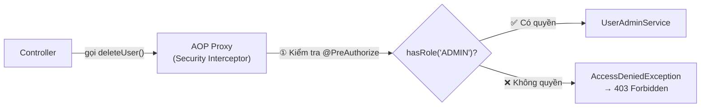

> [!IMPORTANT]
> **Method Security sử dụng CHÍNH cơ chế AOP Proxy** đã học ở Bài 17! `@PreAuthorize` hoạt động thông qua một **Security Interceptor** (cũng là một Aspect) bọc quanh bean thật. Vì vậy:
> - **Self-invocation problem** cũng áp dụng: Nếu `methodA()` gọi `this.methodB()` (có `@PreAuthorize`), kiểm tra quyền **sẽ bị bypass** — giống hệt bẫy `@Transactional` ở Bài 12.
> - Giải pháp: Tách method sang class khác hoặc inject chính mình qua `@Lazy`.

---

## 14. Triển Khai Thực Hành

### 14.1. Mô hình Entity cho Security

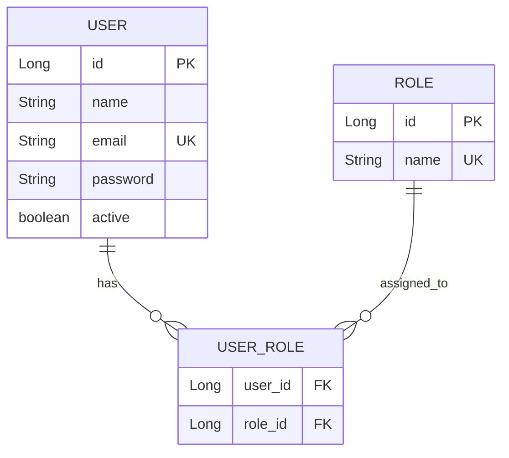

### 14.2. Các file cần tạo / sửa

| # | File | Mô tả |
|:---:|:---|:---|
| 1 | `pom.xml` | Thêm dependency `spring-boot-starter-security` |
| 2 | `V8__add_security_columns_to_users.sql` | Migration: thêm cột `password`, `active` |
| 3 | `V9__create_roles_and_user_roles.sql` | Migration: tạo bảng `roles`, `user_roles` |
| 4 | `V10__seed_security_data.sql` | Migration: seed user admin + roles |
| 5 | `User.java` | Cập nhật entity: thêm `password`, `active`, `roles` |
| 6 | `Role.java` | Entity mới cho Role |
| 7 | `RoleRepository.java` | Repository cho Role |
| 8 | `SecurityConfig.java` | Cấu hình SecurityFilterChain |
| 9 | `CustomUserDetailsService.java` | Implement UserDetailsService |
| 10 | `CustomUserDetails.java` | Custom UserDetails chứa thêm id, fullName |
| 11 | `CustomAuthenticationEntryPoint.java` | Xử lý lỗi 401 |
| 12 | `CustomAccessDeniedHandler.java` | Xử lý lỗi 403 |
| 13 | `AuthController.java` | API đăng ký, đăng nhập (chuẩn bị cho Bài 19) |

---

## 15. Bảng Tổng Hợp Annotation & Interface

| Annotation / Interface | Thuộc về | Mục đích |
|:---|:---|:---|
| `@EnableWebSecurity` | Config class | Kích hoạt Spring Security cho web |
| `@EnableMethodSecurity` | Config class | Kích hoạt `@PreAuthorize`, `@Secured` |
| `@PreAuthorize("expr")` | Method | Kiểm tra quyền TRƯỚC khi method chạy (SpEL) |
| `@PostAuthorize("expr")` | Method | Kiểm tra quyền SAU khi method chạy |
| `@Secured({"ROLE_X"})` | Method | Kiểm tra role đơn giản (không SpEL) |
| `@AuthenticationPrincipal` | Controller param | Inject `UserDetails` vào parameter |
| `SecurityFilterChain` | Bean | Chuỗi filter xử lý security |
| `UserDetailsService` | Interface | Load user từ database |
| `UserDetails` | Interface | Thông tin user cho Spring Security |
| `PasswordEncoder` | Interface | Mã hóa và verify password |
| `AuthenticationEntryPoint` | Interface | Xử lý lỗi 401 |
| `AccessDeniedHandler` | Interface | Xử lý lỗi 403 |
| `GrantedAuthority` | Interface | Đại diện 1 quyền (role/permission) |
| `Authentication` | Interface | Đại diện thông tin xác thực |

---

## 16. Design Pattern Trong Spring Security

| Pattern | Áp dụng ở đâu | Mô tả |
|:---|:---|:---|
| **Chain of Responsibility** | Security Filter Chain | Mỗi filter xử lý một việc, rồi chuyển cho filter tiếp theo |
| **Strategy** | `AuthenticationProvider`, `PasswordEncoder` | Thay đổi thuật toán xác thực/mã hóa mà không đổi code gọi |
| **Proxy** | Method Security (`@PreAuthorize`) | AOP Proxy bọc quanh bean, chặn method để kiểm tra quyền |
| **Template Method** | `AbstractAuthenticationProcessingFilter` | Định nghĩa luồng xác thực, subclass chỉ override bước cụ thể |
| **Builder** | `HttpSecurity` (Lambda DSL) | Xây dựng cấu hình security từng bước với API fluent |
| **Adapter** | `UserDetailsService` → `DaoAuthenticationProvider` | Adapter giữa cách lưu user (DB) và cách Security xác thực |

---

## 17. Câu Hỏi Phỏng Vấn

### 🟢 Mức Cơ Bản

**Q1: Authentication và Authorization khác nhau như thế nào?**

> **Authentication** (Xác thực) = xác minh danh tính — "Bạn là ai?". Kết quả: biết được user là `admin@gmail.com`.
> **Authorization** (Phân quyền) = kiểm tra quyền hạn — "Bạn được làm gì?". Kết quả: user này có quyền `ROLE_ADMIN` nên được xóa dữ liệu.
> Authentication luôn xảy ra **trước**, Authorization xảy ra **sau**. Không thể phân quyền nếu chưa biết người dùng là ai.

**Q2: Tại sao dùng BCrypt mà không dùng MD5/SHA-256 để hash password?**

> MD5 và SHA-256 được thiết kế cho **tốc độ** (hash file, checksum). Với phần cứng hiện đại, có thể tính ~1 tỷ MD5 hash/giây → dễ bị brute-force.
> BCrypt được thiết kế **chậm có chủ đích** với cost factor (2^n lần lặp). Ngoài ra, BCrypt tự sinh **salt ngẫu nhiên** cho mỗi lần hash, chống rainbow table attack. Cost factor có thể tăng theo thời gian để đối phó phần cứng mạnh hơn.

**Q3: `@PreAuthorize` và `@Secured` khác nhau thế nào?**

> `@Secured({"ROLE_ADMIN"})`: Đơn giản, chỉ kiểm tra role, không hỗ trợ SpEL expression.
> `@PreAuthorize("hasRole('ADMIN') and #id == authentication.principal.id")`: Mạnh hơn nhiều, hỗ trợ SpEL — có thể tham chiếu tham số method, authentication object, và viết logic phức tạp.
> **Khuyến nghị:** Luôn dùng `@PreAuthorize` vì linh hoạt hơn.

**Q4: Thứ tự các matcher trong `authorizeHttpRequests()` có quan trọng không?**

> **Có, cực kỳ quan trọng!** Spring Security đánh giá rule theo thứ tự khai báo. Rule đầu tiên match sẽ được áp dụng. Nếu đặt `.anyRequest().authenticated()` lên đầu, mọi rule phía sau đều vô hiệu. Quy tắc: **cụ thể nhất trước, `.anyRequest()` cuối cùng**.

### 🟡 Mức Trung Bình

**Q5: `DelegatingFilterProxy` và `FilterChainProxy` khác nhau thế nào?**

> `DelegatingFilterProxy` là Servlet Filter tiêu chuẩn đăng ký trong Servlet Container. Vai trò duy nhất: **ủy quyền** (delegate) cho một Spring Bean tên `springSecurityFilterChain`.
> `FilterChainProxy` chính là bean `springSecurityFilterChain` đó. Nó quản lý danh sách `SecurityFilterChain` và quyết định chain nào xử lý request dựa trên URL pattern.
> Tóm lại: `DelegatingFilterProxy` là cầu nối Servlet ↔ Spring, `FilterChainProxy` là người quản lý thực sự.

**Q6: Giải thích SecurityContext và SecurityContextHolder?**

> `SecurityContext` là container chứa `Authentication` object (thông tin user đã xác thực).
> `SecurityContextHolder` là utility class quản lý `SecurityContext`, mặc định dùng `ThreadLocal` — mỗi thread (request) có riêng một `SecurityContext`.
> Sau khi xác thực thành công, `Authentication` được đặt vào `SecurityContext` → các component khác (Service, Controller) có thể lấy thông tin user qua `SecurityContextHolder.getContext().getAuthentication()`.

**Q7: Tại sao tắt CSRF cho REST API stateless là an toàn?**

> CSRF attack lợi dụng việc browser **tự động gửi cookie** (bao gồm session cookie) khi gọi request tới domain đã login. Kẻ tấn công tạo trang web giả, nhúng form POST tới API → browser nạn nhân tự đính kèm session cookie → server tưởng request hợp lệ.
> REST API stateless dùng JWT gửi qua header `Authorization: Bearer <token>`. Browser **KHÔNG tự động thêm** header này. Kẻ tấn công không thể ép browser đính kèm JWT → CSRF không khả thi → tắt CSRF an toàn.

**Q8: `UserDetails` và `UserDetailsService` khác nhau thế nào?**

> `UserDetailsService` là **interface** (contract) mà bạn implement để **Spring Security biết cách load user từ nguồn dữ liệu** (database, LDAP, file...). Chỉ có 1 method: `loadUserByUsername(String username)`.
> `UserDetails` là **interface** đại diện cho **thông tin user đã load xong** — bao gồm username, password (đã hash), authorities, và trạng thái tài khoản.
> Quan hệ: `UserDetailsService` trả về `UserDetails`. Spring Security dùng `UserDetails` để xác thực và phân quyền.

### 🔴 Mức Nâng Cao

**Q9: `@PreAuthorize` sử dụng cơ chế gì bên dưới? Nếu method A gọi this.methodB() (có `@PreAuthorize`), liệu kiểm tra quyền có hoạt động?**

> `@PreAuthorize` sử dụng **AOP Proxy** (cơ chế Spring AOP đã học Bài 17). Spring tạo Proxy bọc ngoài bean, trong đó `MethodSecurityInterceptor` kiểm tra quyền trước khi cho phép chạy method thật.
> Nếu `methodA()` gọi `this.methodB()`, `this` trỏ tới **bean thật** (không phải Proxy) → `@PreAuthorize` trên `methodB()` **BỊ BYPASS** hoàn toàn. Đây là bẫy **self-invocation** — giống hệt vấn đề `@Transactional` (Bài 12) và AOP (Bài 17).
> **Giải pháp:** Tách `methodB()` sang class riêng, hoặc inject chính bean qua `@Lazy`.

**Q10: Spring Security hỗ trợ những authentication mechanism nào?**

> - **Form-based**: Username/password qua HTML form (server-rendered)
> - **HTTP Basic**: Username/password trong header `Authorization: Basic base64(user:pass)` — đơn giản nhưng không an toàn nếu không dùng HTTPS
> - **JWT (Token-based)**: Token gửi qua header `Authorization: Bearer <token>` — stateless, phổ biến nhất cho REST API
> - **OAuth2/OIDC**: Delegate xác thực cho Authorization Server (Google, Keycloak, Auth0)
> - **LDAP/Active Directory**: Xác thực qua hệ thống thư mục doanh nghiệp
> - **Certificate (X.509)**: Xác thực bằng chứng chỉ SSL client
> - **SAML 2.0**: Single Sign-On cho enterprise
> Mỗi mechanism có một `AuthenticationFilter` và `AuthenticationProvider` riêng trong Security Filter Chain.

**Q11: Nếu cần hỗ trợ nhiều hình thức xác thực cùng lúc (JWT + API Key + Basic Auth), kiến trúc Spring Security xử lý thế nào?**

> Spring Security hỗ trợ **nhiều `AuthenticationProvider`** đăng ký trong `AuthenticationManager` (cụ thể là `ProviderManager`). Khi xác thực:
> 1. `ProviderManager` lần lượt hỏi từng `AuthenticationProvider`: "Bạn có xử lý được loại token này không?" (`supports(Class<?> authentication)`)
> 2. Provider đầu tiên trả về `true` sẽ xử lý xác thực
> 3. Nếu không provider nào xử lý được → `ProviderNotFoundException`
> Ngoài ra, có thể cấu hình **nhiều `SecurityFilterChain` bean** với `@Order` khác nhau, mỗi chain match một URL pattern riêng (ví dụ: `/api/**` dùng JWT, `/internal/**` dùng Basic Auth).

**Q12: Giải thích flow khi Spring Boot khởi động — Spring Security auto-configuration làm gì?**

> 1. `SecurityAutoConfiguration` kiểm tra classpath có `spring-security-web` → kích hoạt security
> 2. Nếu không có bean `SecurityFilterChain` nào → tạo **default chain**: tất cả URL yêu cầu authenticated, form login + HTTP Basic enabled, CSRF enabled
> 3. Nếu không có bean `UserDetailsService` → tạo `InMemoryUserDetailsManager` với user `user` / password random (in trong console log)
> 4. Nếu không có bean `PasswordEncoder` → tạo `DelegatingPasswordEncoder` (hỗ trợ nhiều thuật toán)
> 5. Đăng ký `DelegatingFilterProxy` → `FilterChainProxy` → `SecurityFilterChain` vào Servlet Container
> **Khi bạn định nghĩa bean `SecurityFilterChain` tùy chỉnh**, default chain bị thay thế hoàn toàn.

**Q13: Phân biệt `hasRole()`, `hasAuthority()`, `hasAnyRole()`, `hasAnyAuthority()`?**

> | Method | Prefix tự động? | Ví dụ | Kiểm tra |
> |:---|:---:|:---|:---|
> | `hasRole("ADMIN")` | ✅ Thêm `ROLE_` | → kiểm tra `ROLE_ADMIN` | Role đơn lẻ |
> | `hasAuthority("ROLE_ADMIN")` | ❌ Không | → kiểm tra chính xác `ROLE_ADMIN` | Authority/permission đơn lẻ |
> | `hasAnyRole("ADMIN", "MANAGER")` | ✅ Thêm `ROLE_` | → kiểm tra `ROLE_ADMIN` HOẶC `ROLE_MANAGER` | Nhiều role (OR) |
> | `hasAnyAuthority("user:read", "user:write")` | ❌ Không | → kiểm tra chính xác | Nhiều authority (OR) |
>
> **Lỗi phổ biến:** `hasRole("ROLE_ADMIN")` → Spring thêm `ROLE_` → thành kiểm tra `ROLE_ROLE_ADMIN` → luôn false!

**Q14: `SessionCreationPolicy.STATELESS` ảnh hưởng gì tới Spring Security?**

> Khi set `STATELESS`:
> - Spring Security **KHÔNG tạo** `HttpSession`
> - **KHÔNG lưu** `SecurityContext` vào session
> - Mỗi request phải **tự chứng minh** (gửi JWT token hoặc credentials)
> - `SecurityContextHolderFilter` không khôi phục context từ session → mỗi request bắt đầu với context rỗng
> - CSRF protection trở nên không cần thiết (vì không có session cookie)
> Đây là chế độ phù hợp cho **REST API + JWT**.

**Q15: Nếu một request gặp cả `AuthenticationException` và `AccessDeniedException`, cái nào được ưu tiên?**

> `ExceptionTranslationFilter` xử lý logic này:
> - Nếu user **chưa xác thực** (anonymous) → luôn trả `401 Unauthorized` (gọi `AuthenticationEntryPoint`)
> - Nếu user **đã xác thực** nhưng không đủ quyền → trả `403 Forbidden` (gọi `AccessDeniedHandler`)
> Tức là Authentication luôn được kiểm tra trước Authorization — phù hợp logic: phải biết "bạn là ai" trước, rồi mới kiểm tra "bạn có quyền gì".

---

> [!NOTE]
> **Bài tiếp theo — Bài 19: JWT Authentication**, bạn sẽ tự tay triển khai JWT Filter, Login/Register API, và Refresh Token mechanism. Kiến thức bài 18 (SecurityFilterChain, UserDetailsService, PasswordEncoder) là nền tảng bắt buộc cho Bài 19.
