# 📘 Bài 20: OAuth2 Resource Server & Các Khái Niệm OAuth2/OIDC

> **Giai đoạn:** 🔴 GĐ 6 — Security & Authentication (Bài 20/28)
> **Thời lượng:** ~4-5 giờ lý thuyết + thực hành
> **Yêu cầu tiên quyết:** Bài 18 (Spring Security Fundamentals), Bài 19 (JWT Authentication)
> **Dự án thực hành:** `springboot-learning`

---

## 📑 Mục lục

1. [Định nghĩa & Tóm tắt cốt lõi](#1-định-nghĩa--tóm-tắt-cốt-lõi)
2. [Tại sao không nên tự viết JWT Filter cho Production?](#2-tại-sao-không-nên-tự-viết-jwt-filter-cho-production)
3. [OAuth2 — Hệ thống Ủy quyền Chuẩn hóa](#3-oauth2--hệ-thống-ủy-quyền-chuẩn-hóa)
4. [OAuth2 Roles — Bốn vai trò cốt lõi](#4-oauth2-roles--bốn-vai-trò-cốt-lõi)
5. [OAuth2 Grant Types — Các luồng cấp phép](#5-oauth2-grant-types--các-luồng-cấp-phép)
6. [OAuth2 Tokens — Access Token, Refresh Token, Scopes](#6-oauth2-tokens--access-token-refresh-token-scopes)
7. [OpenID Connect (OIDC) — Lớp xác thực trên OAuth2](#7-openid-connect-oidc--lớp-xác-thực-trên-oauth2)
8. [Spring Boot OAuth2 Resource Server — Chuẩn hóa JWT Validation](#8-spring-boot-oauth2-resource-server--chuẩn-hóa-jwt-validation)
9. [JwtDecoder — Cơ chế xác thực JWT chuẩn Spring](#9-jwtdecoder--cơ-chế-xác-thực-jwt-chuẩn-spring)
10. [JwtAuthenticationConverter — Chuyển đổi Claims thành Authorities](#10-jwtauthenticationconverter--chuyển-đổi-claims-thành-authorities)
11. [Triển khai thực hành — Chuyển đổi từ Bài 19 sang OAuth2 Resource Server](#11-triển-khai-thực-hành--chuyển-đổi-từ-bài-19-sang-oauth2-resource-server)
12. [Khi nào tự viết JWT vs dùng OAuth2 Provider?](#12-khi-nào-tự-viết-jwt-vs-dùng-oauth2-provider)
13. [Authorization Server Landscape — Keycloak, Auth0, Google](#13-authorization-server-landscape--keycloak-auth0-google)
14. [Bảo mật nâng cao — PKCE, Token Introspection, JWK Rotation](#14-bảo-mật-nâng-cao--pkce-token-introspection-jwk-rotation)
15. [Design Patterns liên quan](#15-design-patterns-liên-quan)
16. [🎯 Bộ câu hỏi phỏng vấn (Interview Questions)](#16--bộ-câu-hỏi-phỏng-vấn-interview-questions)

---

## 🎯 Mục tiêu bài học

Sau khi hoàn thành bài này, bạn sẽ:
- [x] Hiểu **tại sao không nên tự viết JWT filter** trong project production (so sánh trực tiếp với Bài 19)
- [x] Sử dụng thành thạo `spring-boot-starter-oauth2-resource-server` với `JwtDecoder`
- [x] Nắm vững các khái niệm OAuth2: **Authorization Server**, **Resource Server**, **Client**, **Resource Owner**
- [x] Phân biệt **OAuth2** (Authorization) vs **OpenID Connect** (Authentication)
- [x] Hiểu **ID Token** vs **Access Token** — khi nào dùng cái nào
- [x] Biết đánh giá **khi nào tự viết JWT** vs **khi nào dùng OAuth2 Provider** (Keycloak, Auth0, Google)
- [x] Nắm các khái niệm nâng cao: **PKCE**, **Token Introspection**, **JWK Rotation**, **Scopes**

---

## 1. Định nghĩa & Tóm tắt cốt lõi

### 🔑 Các khái niệm then chốt

> **OAuth2 (Open Authorization 2.0)** là một giao thức chuẩn production cho việc Ủy quyền (Authorization), cho phép một ứng dụng bên thứ 3 truy cập hạn chế vào tài nguyên của người dùng trên một hệ thống khác mà không cần người dùng phải tiết lộ mật khẩu cho ứng dụng đó.

> **Trong mọi sơ đồ OAuth2, luôn có sự xuất hiện của 4 thành phần** (Ví dụ: Bạn dùng ứng dụng Shopee và bấm nút "Đăng nhập / Liên kết với tài khoản Google")"

> **Authorization Server (Máy chủ cấp quyền)**: Chỉ làm nhiệm vụ xác thực danh tính người dùng (kiểm tra username/password, OTP, Google Login) và cấp phát JWT token bằng Private Key  sau khi đăng nhập. (Ví dụ: Keycloak, Auth0, Okta, hoặc Spring Authorization Server).

> **Resource Server (Máy chủ tài nguyên)**: Là các Backend Service chứa dữ liệu nghiệp vụ của bạn (Order Service, Payment Service). Nó không có chức năng đăng nhập và không giữ Private Key. Nó chỉ giữ Public Key để kiểm tra xem tờ JWT mà Client mang tới có đúng là do Authorization Server ký hay không, còn hạn không, và có quyền (Scope/Role) gì.

> **Resource Owner (Chủ sở hữu tài nguyên)** : Chính là Người dùng cuối (End-User), người có quyền bấm nút "Đồng ý (Allow)" cho phép chia sẻ dữ liệu của mình.

> **Client (Ứng dụng khách)** : Ứng dụng muốn xin quyền truy cập dữ liệu của người dùng. Ví dụ như frontend/mobile

> **Lưu ý phân biệt giữa OAuth 2.0 và OpenID Connect (OIDC)** : OAuth 2 là để phân quyền/uỷ quyền, trả về access token. OpenID Connect (OIDC) là lớp Xác thực (Authentication) đắp thêm lên trên OAuth 2.0, ngoài trả về access token, thì Authorization Server còn trả về thêm ID Token chứa các thông tin định danh như Avt, gmail, tên,...

### 📊 Bản đồ kiến thức toàn cảnh

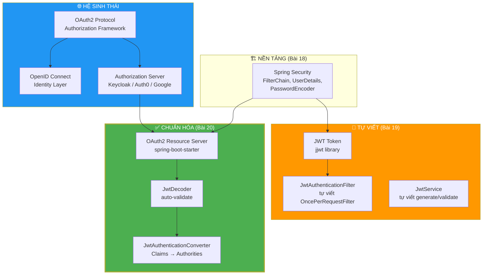

| Khái niệm | Bản chất | Ẩn dụ thực tế |
|:---|:---|:---|
| 🔐 **OAuth2** | Giao thức ủy quyền truy cập tài nguyên | 🏨 Lễ tân khách sạn cấp thẻ phòng cho khách |
| 🪪 **OIDC** | Lớp xác thực danh tính trên OAuth2 | 🪪 Giấy CMND xác nhận "bạn là ai" |
| 🏢 **Resource Server** | API bảo vệ dữ liệu, validate token | 🚪 Cửa phòng dùng thẻ khách sạn để xác thực |
| 🔑 **Authorization Server** | Phát hành và quản lý token | 🏨 Lễ tân cấp thẻ phòng |
| 📱 **Client** | Ứng dụng yêu cầu quyền truy cập | 📱 App đặt phòng (Booking, Agoda) |
| 👤 **Resource Owner** | Người sở hữu dữ liệu | 👤 Khách hàng thuê phòng |
| 🎫 **Access Token** | "Thẻ vào cửa" ngắn hạn | 🎫 Thẻ phòng có thời hạn 1 ngày |
| 🔄 **Refresh Token** | Token để xin cấp Access Token mới | 🔄 Voucher gia hạn thẻ phòng |
| 🪪 **ID Token** | JWT chứa thông tin danh tính user | 🪪 Bản photo CMND do lễ tân cấp |

---

## 2. Tại sao không nên tự viết JWT Filter cho Production?

### 2.1. Bảng so sánh trực tiếp

| Tiêu chí | 🔧 Tự viết JWT Filter (Bài 19) | ✅ OAuth2 Resource Server (Bài 20) |
|:---|:---|:---|
| **Mã nguồn** | ~200 dòng (JwtService + JwtAuthFilter) | ~15 dòng cấu hình |
| **Validate signature** | Tự viết `Jwts.parser().verifyWith()` | Spring tự động qua `JwtDecoder` |
| **Kiểm tra expiration** | Tự viết `isTokenExpired()` | Tự động kiểm tra claim `exp` |
| **Error handling** | Tự bắt `ExpiredJwtException`, `JwtException` | Tự động trả 401 chuẩn RFC 6750 |
| **Chuyển claims→roles** | Tự viết logic extract | `JwtAuthenticationConverter` chuẩn hóa |
| **JWK Rotation** | ❌ Không hỗ trợ | ✅ Tự động tải JWK Set mới |
| **Token Introspection** | ❌ Không hỗ trợ | ✅ Có sẵn (Opaque Token) |
| **Kiểm tra `iss`, `aud`** | ❌ Phải tự thêm | ✅ Tự động validate |
| **Cộng đồng review** | Code của bạn — tự review | Code của Spring Team — hàng triệu dev review |
| **CVE patching** | Tự theo dõi và cập nhật | Spring Boot dependency auto-update |

### 2.2. Rủi ro khi tự viết JWT Filter

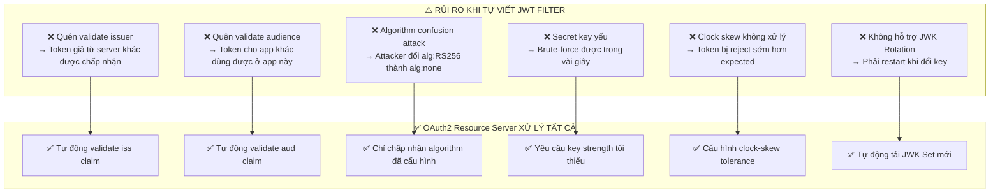

> [!IMPORTANT]
> **Quy tắc vàng:** Bài 19 giúp bạn **hiểu cơ chế JWT từ zero** — rất quan trọng cho việc học. Nhưng trong **production**, hãy luôn dùng **OAuth2 Resource Server** của Spring Boot hoặc một **Authorization Server** chuẩn (Keycloak, Auth0) để tránh tự tạo ra lỗ hổng bảo mật.

---

## 3. OAuth2 — Hệ thống Ủy quyền Chuẩn hóa

### 3.1. OAuth2 là gì?

**OAuth2** (RFC 6749) là giao thức ủy quyền cho phép ứng dụng bên thứ ba (third-party application) **truy cập có kiểm soát** vào tài nguyên của người dùng trên một dịch vụ khác, **mà không cần chia sẻ mật khẩu**.

**Ví dụ thực tế:**
- Bạn cho phép **Canva** truy cập ảnh trên **Google Drive** của bạn — mà không cần đưa mật khẩu Google cho Canva.
- Bạn cho phép **LinkedIn** đọc danh bạ **Gmail** để gợi ý kết nối — Gmail cấp token có quyền đọc danh bạ, LinkedIn không biết mật khẩu Gmail.

### 3.2. Vấn đề OAuth2 giải quyết

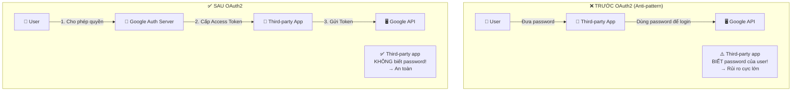

### 3.3. OAuth2 vs Authentication truyền thống

| | Authentication truyền thống | OAuth2 |
|:---|:---|:---|
| **Mục đích** | Xác thực danh tính (Authentication) | Ủy quyền truy cập (Authorization) |
| **Ai kiểm tra?** | Server kiểm tra username/password trực tiếp | Authorization Server phát hành token |
| **Chia sẻ password?** | ✅ Client biết password | ❌ Client KHÔNG biết password |
| **Phạm vi quyền** | Toàn quyền hoặc từ chối | Kiểm soát chi tiết qua **Scopes** |
| **Thu hồi quyền** | Đổi password | Revoke token (không ảnh hưởng password) |

---

## 4. OAuth2 Roles — Bốn vai trò cốt lõi

### 4.1. Sơ đồ tổng thể

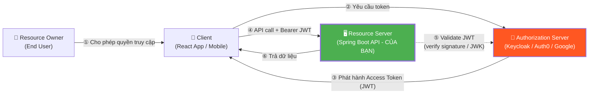

### 4.2. Chi tiết từng vai trò

| Vai trò | Ký hiệu RFC | Trách nhiệm | Ví dụ cụ thể |
|:---|:---|:---|:---|
| 👤 **Resource Owner** | RO | Người sở hữu dữ liệu, cấp quyền truy cập | End user — bạn, tôi |
| 📱 **Client** | Client | Ứng dụng muốn truy cập dữ liệu thay mặt RO | React SPA, Mobile App, Postman |
| 🔐 **Authorization Server** | AS | Xác thực RO, phát hành token, quản lý consent | Keycloak, Auth0, Okta, Google OAuth |
| 🖥️ **Resource Server** | RS | Bảo vệ API, validate token, cung cấp dữ liệu | **Spring Boot API** của bạn |

> [!NOTE]
> Trong Bài 19, ứng dụng Spring Boot của bạn đóng **cả hai vai trò**: vừa là Authorization Server (phát hành JWT qua `/api/auth/login`), vừa là Resource Server (validate JWT qua `JwtAuthenticationFilter`). Trong kiến trúc OAuth2 chuẩn, hai vai trò này thường được **tách riêng** thành các service độc lập.

### 4.3. Authorization Server vs Resource Server — Phân tách trách nhiệm

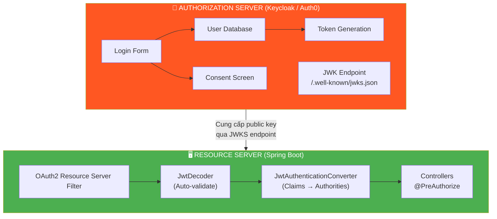

---

## 5. OAuth2 Grant Types — Các luồng cấp phép

OAuth2 định nghĩa nhiều **Grant Types** (luồng cấp phép) tùy theo loại Client:

### 5.1. Bảng tổng hợp Grant Types

| Grant Type | Loại Client | Mô tả ngắn | Bảo mật |
|:---|:---|:---|:---|
| **Authorization Code** | Server-side app (Confidential) | Client → Auth Server → Code → Token | ⭐⭐⭐⭐⭐ |
| **Authorization Code + PKCE** | SPA, Mobile (Public) | Như trên + Proof Key for Code Exchange | ⭐⭐⭐⭐⭐ |
| **Client Credentials** | Machine-to-Machine (M2M) | Không có user, app tự xin token | ⭐⭐⭐⭐ |
| ~~Implicit~~ | ~~SPA~~ | ~~Token trả về trực tiếp qua URL~~ | ❌ **Deprecated** |
| ~~Password (ROPC)~~ | ~~Trusted app~~ | ~~Client gửi username/password~~ | ❌ **Deprecated** |

> [!WARNING]
> **Implicit Grant** và **Resource Owner Password Credentials (ROPC)** đã bị **deprecated** trong OAuth 2.1 (RFC 9728). Không bao giờ sử dụng trong ứng dụng mới. Luôn dùng **Authorization Code + PKCE** cho Public Clients.

### 5.2. Authorization Code Flow (Luồng phổ biến nhất)

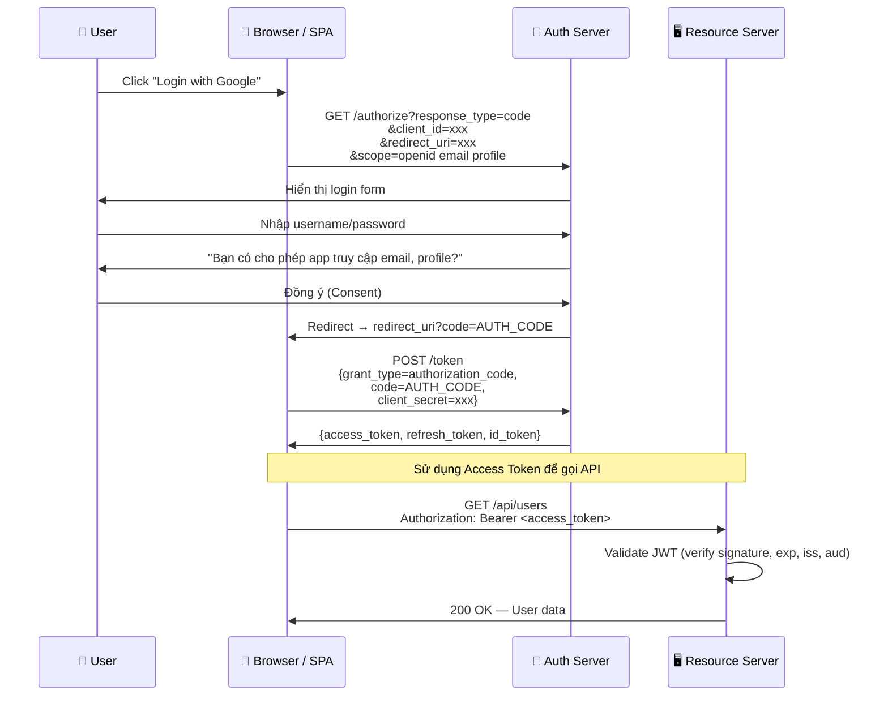

### 5.3. Client Credentials Flow (Machine-to-Machine)

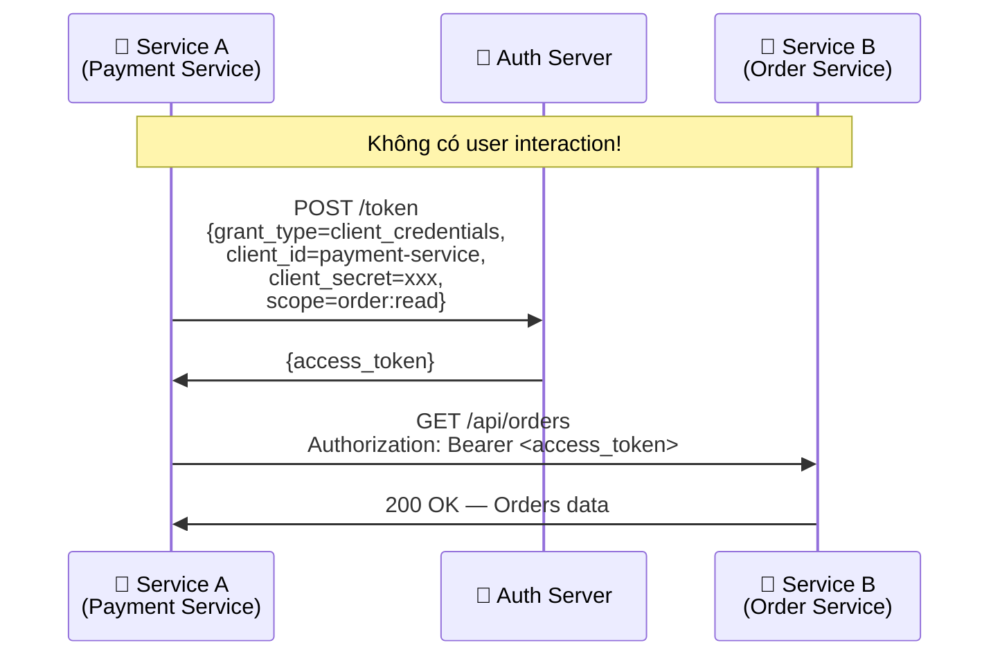

> [!TIP]
> **Client Credentials** dùng cho giao tiếp giữa các **Microservices** — không có người dùng cuối tham gia. Service A xin token để truy cập Service B.

---

## 6. OAuth2 Tokens — Access Token, Refresh Token, Scopes

### 6.1. Ba loại Token trong OAuth2/OIDC

| Token | Định dạng | Audience | Mục đích | Thời hạn |
|:---|:---|:---|:---|:---|
| 🎫 **Access Token** | JWT (thường) hoặc Opaque | Resource Server | Ủy quyền truy cập API | Ngắn (15 phút — 1 giờ) |
| 🔄 **Refresh Token** | Opaque (thường) | Authorization Server | Xin cấp Access Token mới | Dài (7 — 30 ngày) |
| 🪪 **ID Token** | JWT (luôn luôn) | Client App | Xác thực danh tính user | Ngắn (10 — 60 phút) |

### 6.2. Access Token vs ID Token — Phân biệt quan trọng

| Tiêu chí | 🎫 Access Token | 🪪 ID Token |
|:---|:---|:---|
| **Chuẩn giao thức** | OAuth2 | OIDC (OpenID Connect) |
| **Ai dùng?** | Resource Server (API của bạn) | Client App (Frontend) |
| **Mục đích** | Cho phép truy cập tài nguyên | Xác thực "người dùng là ai" |
| **Gửi đến API?** | ✅ Có — trong `Authorization: Bearer` | ❌ KHÔNG — chỉ Client đọc |
| **Chứa gì?** | `scope`, `aud` (resource server), quyền truy cập | `sub`, `name`, `email`, `picture` |
| **Validate ở đâu?** | Resource Server | Client App |

```java
// ❌ SAI: Gửi ID Token đến Resource Server
// Authorization: Bearer <id_token>  ← KHÔNG ĐÚNG!

// ✅ ĐÚNG: Gửi Access Token đến Resource Server
// Authorization: Bearer <access_token>  ← ĐÚNG!
```

> [!CAUTION]
> **ID Token KHÔNG được gửi đến Resource Server!** ID Token dành cho Client đọc thông tin user (hiển thị tên, avatar trên UI). Chỉ Access Token mới được dùng để gọi API.

### 6.3. Scopes — Kiểm soát phạm vi truy cập

**Scopes** là cơ chế kiểm soát mức độ truy cập mà Client yêu cầu:

| Scope | Ý nghĩa | Ví dụ |
|:---|:---|:---|
| `openid` | Bật OIDC — yêu cầu ID Token | Bắt buộc cho OIDC flow |
| `email` | Cho phép đọc email user | `email`, `email_verified` |
| `profile` | Cho phép đọc thông tin cá nhân | `name`, `given_name`, `picture` |
| `read:products` | Custom scope — đọc sản phẩm | App-specific |
| `write:orders` | Custom scope — tạo đơn hàng | App-specific |

```
// Client yêu cầu quyền giới hạn:
GET /authorize?scope=openid email read:products
// → Chỉ được đọc email và xem sản phẩm, KHÔNG được sửa/xóa
```

---

## 7. OpenID Connect (OIDC) — Lớp xác thực trên OAuth2

### 7.1. OAuth2 vs OIDC

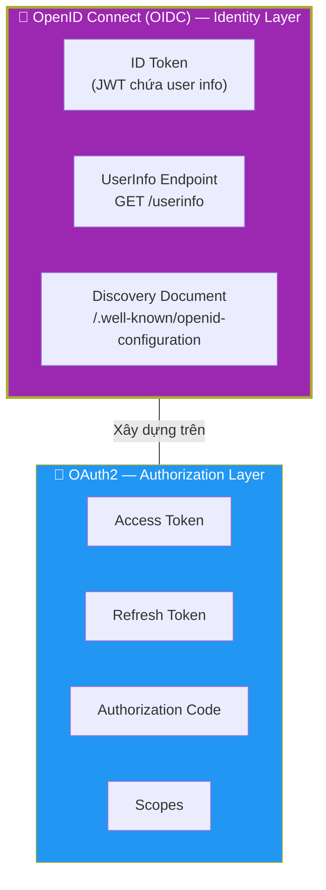

| | OAuth2 | OIDC |
|:---|:---|:---|
| **Câu hỏi trả lời** | "Ứng dụng này có quyền truy cập gì?" | "Người đang đăng nhập là ai?" |
| **Loại** | Authorization framework | Authentication protocol |
| **Token** | Access Token | Access Token **+ ID Token** |
| **Standard claims** | Không định nghĩa | `sub`, `name`, `email`, `picture`,... |
| **Discovery** | Không bắt buộc | ✅ `.well-known/openid-configuration` |

### 7.2. OIDC Discovery Document

Mỗi Authorization Server cung cấp một **Discovery Document** tại URL chuẩn hóa:

```
GET https://accounts.google.com/.well-known/openid-configuration
```

```json
{
  "issuer": "https://accounts.google.com",
  "authorization_endpoint": "https://accounts.google.com/o/oauth2/v2/auth",
  "token_endpoint": "https://oauth2.googleapis.com/token",
  "userinfo_endpoint": "https://openidconnect.googleapis.com/v1/userinfo",
  "jwks_uri": "https://www.googleapis.com/oauth2/v3/certs",
  "scopes_supported": ["openid", "email", "profile"],
  "response_types_supported": ["code", "token", "id_token"],
  "id_token_signing_alg_values_supported": ["RS256"]
}
```

> [!TIP]
> Spring Boot dùng **`issuer-uri`** để tự động tải Discovery Document này và cấu hình `JwtDecoder` — bạn không cần cấu hình thủ công endpoints nào cả!

### 7.3. ID Token — Cấu trúc chi tiết

```json
{
  "iss": "https://accounts.google.com",     // Bên phát hành
  "sub": "110248495938573014202",            // ID định danh duy nhất
  "aud": "my-client-id.apps.googleusercontent.com",  // Client nhận token
  "exp": 1729853200,                         // Hết hạn
  "iat": 1729849600,                         // Thời điểm phát hành
  "nonce": "abc123",                         // Chống replay attack
  "name": "Nguyễn Văn A",                   // Tên đầy đủ
  "email": "nguyenvana@gmail.com",           // Email
  "email_verified": true,                    // Email đã xác minh?
  "picture": "https://lh3.googleusercontent.com/...",  // Avatar
  "at_hash": "HK6E_P6Dh8Y93mRNtsDB1Q"      // Hash của Access Token
}
```

---

## 8. Spring Boot OAuth2 Resource Server — Chuẩn hóa JWT Validation

### 8.1. Dependency cần thêm

```xml
<!-- 📘 BÀI 20: OAuth2 Resource Server -->
<dependency>
    <groupId>org.springframework.boot</groupId>
    <artifactId>spring-boot-starter-oauth2-resource-server</artifactId>
</dependency>
```

> [!NOTE]
> Dependency này kéo về `spring-security-oauth2-resource-server` + `spring-security-oauth2-jose` (thư viện Nimbus JOSE+JWT để xử lý JWK, JWS, JWE). Bạn **không cần** thêm thư viện JJWT nữa khi dùng cách tiếp cận này.

### 8.2. Kiến trúc bên trong OAuth2 Resource Server

```mermaid
graph LR
    Request["HTTP Request<br/>Authorization: Bearer eyJ..."] --> BearerFilter["BearerTokenAuthenticationFilter<br/>(Spring tự tạo)"]
    BearerFilter --> AuthManager["AuthenticationManager"]
    AuthManager --> Provider["JwtAuthenticationProvider"]
    Provider --> Decoder["JwtDecoder<br/>(NimbusJwtDecoder)"]
    Decoder --> Validator["JwtValidator<br/>(timestamp, issuer, audience)"]
    Validator --> Converter["JwtAuthenticationConverter<br/>(Claims → GrantedAuthority)"]
    Converter --> SecCtx["SecurityContext<br/>(JwtAuthenticationToken)"]
    SecCtx --> Controller["Controller<br/>@PreAuthorize"]

    style BearerFilter fill:#FF7043,color:#fff,stroke-width:3px
    style Decoder fill:#4CAF50,color:#fff
    style Converter fill:#2196F3,color:#fff
```

**So sánh với Bài 19:**

| Bài 19 (Tự viết) | Bài 20 (OAuth2 Resource Server) |
|:---|:---|
| `JwtAuthenticationFilter` (tự viết) | `BearerTokenAuthenticationFilter` (Spring cung cấp) |
| `JwtService.extractAllClaims()` (tự viết) | `NimbusJwtDecoder` (Spring cung cấp) |
| Tự tạo `UsernamePasswordAuthenticationToken` | `JwtAuthenticationToken` (Spring cung cấp) |
| Tự extract roles từ claims | `JwtAuthenticationConverter` (Spring cung cấp) |

### 8.3. Hai cách cấu hình JwtDecoder

#### Cách 1: Dùng `issuer-uri` (Recommended — cho External Auth Server)

```properties
# Application.properties — Spring tự động tải Discovery Document
spring.security.oauth2.resourceserver.jwt.issuer-uri=https://auth.example.com/realms/myrealm
```

Spring sẽ tự động:
1. Gọi `{issuer-uri}/.well-known/openid-configuration`
2. Tìm `jwks_uri` trong response
3. Tải public keys từ JWKS endpoint
4. Cấu hình `NimbusJwtDecoder` với các public keys đó

#### Cách 2: Dùng `SecretKeySpec` (Cho Self-Issued JWT — như project learning)

Khi ứng dụng của bạn **tự phát hành JWT** (như Bài 19), không có external Auth Server:

```java
@Bean
public JwtDecoder jwtDecoder(@Value("${jwt.secret}") String secretKey) {
    byte[] keyBytes = Decoders.BASE64.decode(secretKey);
    SecretKeySpec key = new SecretKeySpec(keyBytes, "HmacSHA256");
    return NimbusJwtDecoder.withSecretKey(key).build();
}
```

---

## 9. JwtDecoder — Cơ chế xác thực JWT chuẩn Spring

### 9.1. JwtDecoder hoạt động thế nào?

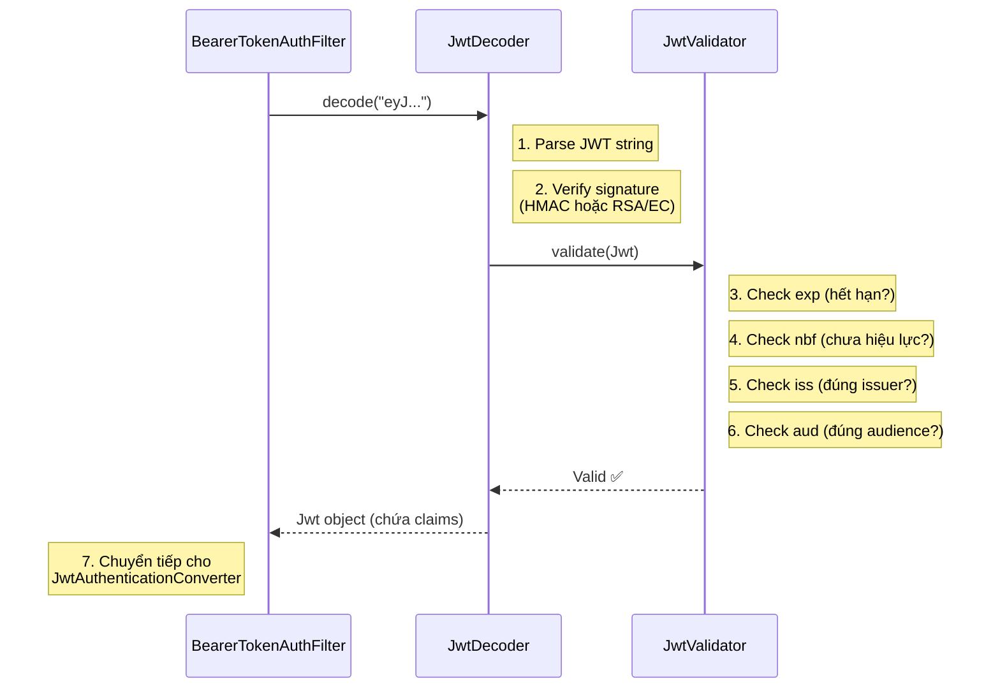

### 9.2. Tùy chỉnh JwtDecoder với Validators

```java
@Bean
public JwtDecoder jwtDecoder(@Value("${jwt.secret}") String secretKey) {
    byte[] keyBytes = Decoders.BASE64.decode(secretKey);
    SecretKeySpec key = new SecretKeySpec(keyBytes, "HmacSHA256");

    NimbusJwtDecoder decoder = NimbusJwtDecoder.withSecretKey(key).build();

    // Tùy chỉnh validation rules
    OAuth2TokenValidator<Jwt> withIssuer = JwtValidators.createDefaultWithIssuer("springboot-learning");
    OAuth2TokenValidator<Jwt> withAudience = new JwtClaimValidator<List<String>>(
            "aud", aud -> aud != null && aud.contains("springboot-learning-api")
    );

    // Kết hợp nhiều validators
    OAuth2TokenValidator<Jwt> combinedValidator = new DelegatingOAuth2TokenValidator<>(
            withIssuer, withAudience
    );

    decoder.setJwtValidator(combinedValidator);
    return decoder;
}
```

---

## 10. JwtAuthenticationConverter — Chuyển đổi Claims thành Authorities

### 10.1. Vấn đề

JWT payload chứa roles dạng custom claim:
```json
{
  "sub": "admin@gmail.com",
  "roles": ["ROLE_ADMIN", "ROLE_USER"],
  "userId": 4
}
```

Spring Security cần `Collection<GrantedAuthority>` để hoạt động với `@PreAuthorize("hasRole('ADMIN')")`. Cần một **converter** để chuyển đổi.

### 10.2. Triển khai JwtAuthenticationConverter

```java
@Bean
public JwtAuthenticationConverter jwtAuthenticationConverter() {
    // Converter cho authorities: đọc claim "roles" từ JWT payload
    JwtGrantedAuthoritiesConverter grantedAuthoritiesConverter = new JwtGrantedAuthoritiesConverter();
    grantedAuthoritiesConverter.setAuthoritiesClaimName("roles"); // Tên claim chứa roles
    grantedAuthoritiesConverter.setAuthorityPrefix("");           // Roles đã có prefix ROLE_

    JwtAuthenticationConverter authConverter = new JwtAuthenticationConverter();
    authConverter.setJwtGrantedAuthoritiesConverter(grantedAuthoritiesConverter);

    // Tùy chỉnh principal name (mặc định đọc "sub" claim)
    authConverter.setPrincipalClaimName("sub");

    return authConverter;
}
```

### 10.3. Custom Converter nâng cao (đọc nhiều claim)

```java
/**
 * Custom converter đọc roles từ nhiều nguồn:
 * - claim "roles" (custom)
 * - claim "scope" (OAuth2 standard)
 */
@Bean
public JwtAuthenticationConverter jwtAuthenticationConverter() {
    JwtAuthenticationConverter converter = new JwtAuthenticationConverter();

    converter.setJwtGrantedAuthoritiesConverter(jwt -> {
        Collection<GrantedAuthority> authorities = new ArrayList<>();

        // 1. Đọc roles từ custom claim "roles"
        List<String> roles = jwt.getClaimAsStringList("roles");
        if (roles != null) {
            roles.forEach(role -> authorities.add(new SimpleGrantedAuthority(role)));
        }

        // 2. Đọc scopes từ OAuth2 standard claim "scope"
        String scope = jwt.getClaimAsString("scope");
        if (scope != null) {
            Arrays.stream(scope.split(" "))
                    .map(s -> new SimpleGrantedAuthority("SCOPE_" + s))
                    .forEach(authorities::add);
        }

        return authorities;
    });

    return converter;
}
```

### 10.4. Luồng hoàn chỉnh từ JWT → Authentication

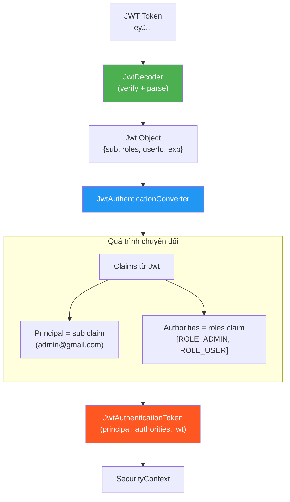

---

## 11. Triển khai thực hành — Chuyển đổi từ Bài 19 sang OAuth2 Resource Server

### 11.1. Chiến lược chuyển đổi

Thay vì xóa code Bài 19, ta sẽ **thêm một profile mới** `oauth2` để có thể **chuyển đổi qua lại** giữa hai cách tiếp cận:

| Profile | Cách xác thực JWT | Khi nào dùng |
|:---|:---|:---|
| **default** (Bài 19) | `JwtAuthenticationFilter` tự viết + `JwtService` | Học tập, debug, hiểu cơ chế |
| **oauth2** (Bài 20) | `BearerTokenAuthenticationFilter` + `JwtDecoder` | Production-ready |

### 11.2. Cấu hình SecurityConfig với OAuth2 Resource Server

```java
@Configuration
@EnableWebSecurity
@EnableMethodSecurity(prePostEnabled = true, securedEnabled = true)
@Profile("oauth2")
public class OAuth2SecurityConfig {

    private final CustomAuthenticationEntryPoint authenticationEntryPoint;
    private final CustomAccessDeniedHandler accessDeniedHandler;

    public OAuth2SecurityConfig(CustomAuthenticationEntryPoint authEntryPoint,
                                 CustomAccessDeniedHandler accessDeniedHandler) {
        this.authenticationEntryPoint = authEntryPoint;
        this.accessDeniedHandler = accessDeniedHandler;
    }

    @Bean
    public SecurityFilterChain securityFilterChain(HttpSecurity http) throws Exception {
        return http
                .cors(cors -> cors.configurationSource(corsConfigurationSource()))
                .csrf(csrf -> csrf.disable())
                .headers(headers -> headers.frameOptions(frame -> frame.sameOrigin()))

                .authorizeHttpRequests(auth -> auth
                        .requestMatchers("/api/auth/**").permitAll()
                        .requestMatchers("/v3/api-docs/**", "/swagger-ui/**", "/swagger-ui.html").permitAll()
                        .requestMatchers("/h2-console/**").permitAll()
                        .requestMatchers(HttpMethod.GET, "/api/v1/products/**", "/api/products/**").permitAll()
                        .requestMatchers("/api/admin/**").hasAnyRole("ADMIN", "MANAGER")
                        .anyRequest().authenticated()
                )

                .sessionManagement(session -> session
                        .sessionCreationPolicy(SessionCreationPolicy.STATELESS)
                )

                // 🆕 BÀI 20: Dùng OAuth2 Resource Server thay JwtAuthFilter tự viết
                .oauth2ResourceServer(oauth2 -> oauth2
                        .jwt(jwt -> jwt
                                .jwtAuthenticationConverter(jwtAuthenticationConverter())
                        )
                )

                .exceptionHandling(ex -> ex
                        .authenticationEntryPoint(authenticationEntryPoint)
                        .accessDeniedHandler(accessDeniedHandler)
                )
                .build();
    }

    @Bean
    public JwtAuthenticationConverter jwtAuthenticationConverter() {
        JwtGrantedAuthoritiesConverter grantedAuthoritiesConverter =
                new JwtGrantedAuthoritiesConverter();
        grantedAuthoritiesConverter.setAuthoritiesClaimName("roles");
        grantedAuthoritiesConverter.setAuthorityPrefix("");

        JwtAuthenticationConverter converter = new JwtAuthenticationConverter();
        converter.setJwtGrantedAuthoritiesConverter(grantedAuthoritiesConverter);
        converter.setPrincipalClaimName("sub");
        return converter;
    }

    // ... (PasswordEncoder, AuthenticationManager, CorsConfig giữ nguyên)
}
```

### 11.3. JwtDecoder Bean cho Self-Issued JWT

```java
@Configuration
@Profile("oauth2")
public class JwtDecoderConfig {

    @Bean
    public JwtDecoder jwtDecoder(@Value("${jwt.secret}") String secretKey) {
        byte[] keyBytes = Decoders.BASE64.decode(secretKey);
        SecretKeySpec key = new SecretKeySpec(keyBytes, "HmacSHA256");
        return NimbusJwtDecoder.withSecretKey(key).build();
    }
}
```

### 11.4. Truy cập thông tin user từ JwtAuthenticationToken

Khi dùng OAuth2 Resource Server, `Authentication` object trong `SecurityContext` là `JwtAuthenticationToken` (không phải `UsernamePasswordAuthenticationToken` như Bài 19):

```java
// Bài 19: Authentication principal là CustomUserDetails
@GetMapping("/me")
public ResponseEntity<AuthResponse> me(@AuthenticationPrincipal CustomUserDetails userDetails) {
    // userDetails.getId(), userDetails.getFullName(),...
}

// Bài 20: Authentication principal là Jwt
@GetMapping("/me")
public ResponseEntity<AuthResponse> me(@AuthenticationPrincipal Jwt jwt) {
    String email = jwt.getSubject();                          // sub claim
    Long userId = jwt.getClaim("userId");                     // custom claim
    String fullName = jwt.getClaim("fullName");               // custom claim
    List<String> roles = jwt.getClaimAsStringList("roles");   // roles claim
}
```

### 11.5. So sánh trước và sau chuyển đổi

| Thành phần | Bài 19 (JwtAuthFilter) | Bài 20 (OAuth2 Resource Server) |
|:---|:---|:---|
| **Filter** | `JwtAuthenticationFilter.java` (97 dòng) | Xóa — Spring tự tạo `BearerTokenAuthenticationFilter` |
| **Decoder/Validator** | `JwtService.java` (131 dòng) | `JwtDecoder` bean (~5 dòng) |
| **SecurityConfig** | `addFilterBefore(jwtAuthFilter,...)` | `.oauth2ResourceServer(oauth2 -> ...)` |
| **Authentication type** | `UsernamePasswordAuthenticationToken` | `JwtAuthenticationToken` |
| **Principal type** | `CustomUserDetails` | `Jwt` |
| **AuthController login** | Giữ nguyên — vẫn phát hành JWT | Giữ nguyên |
| **Tổng code cần viết** | ~250 dòng | ~30 dòng |

---

## 12. Khi nào tự viết JWT vs dùng OAuth2 Provider?

### 12.1. Ma trận quyết định

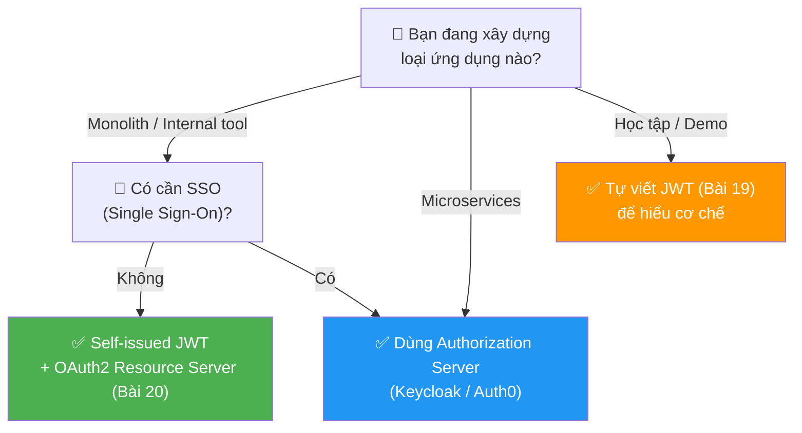

### 12.2. Bảng tổng hợp quyết định

| Tiêu chí | 🔧 Self-Issued JWT | 🏢 OAuth2 Provider (Keycloak/Auth0) |
|:---|:---|:---|
| **Quản lý User** | Tự build (đã có từ Bài 18) | Keycloak/Auth0 quản lý |
| **Login UI** | Tự build (API `/api/auth/login`) | OAuth2 Provider cung cấp |
| **SSO** | ❌ Không hỗ trợ | ✅ Có sẵn |
| **Social Login** | ❌ Phải tự tích hợp từng provider | ✅ Google, Facebook, GitHub,... có sẵn |
| **MFA** | ❌ Phải tự build | ✅ Có sẵn |
| **Infrastructure** | Không cần thêm service nào | Cần chạy thêm Keycloak/Auth0 |
| **Complexity** | Đơn giản, kiểm soát hoàn toàn | Phức tạp hơn, cần hiểu OAuth2 |
| **Production-ready** | ⚠️ Cần thiết kế cẩn thận | ✅ Battle-tested |
| **Phù hợp** | Startup nhỏ, MVP, learning project | Enterprise, multi-tenant, Microservices |

---

## 13. Authorization Server Landscape — Keycloak, Auth0, Google

### 13.1. So sánh các Authorization Server phổ biến

| Provider | Loại | Hosting | Giá | Best for |
|:---|:---|:---|:---|:---|
| **Keycloak** | Open-source | Self-hosted (Docker) | Free | Enterprise, on-premise |
| **Auth0** | SaaS | Cloud | Free tier + Paid | SaaS apps, startup |
| **Okta** | SaaS | Cloud | Paid | Enterprise SSO |
| **Google OAuth** | Social | Cloud | Free | Consumer apps |
| **Spring Authorization Server** | Open-source | Self-hosted | Free | Spring ecosystem |
| **AWS Cognito** | SaaS | AWS | Pay-per-use | AWS-centric apps |

### 13.2. Keycloak — Giải pháp phổ biến nhất

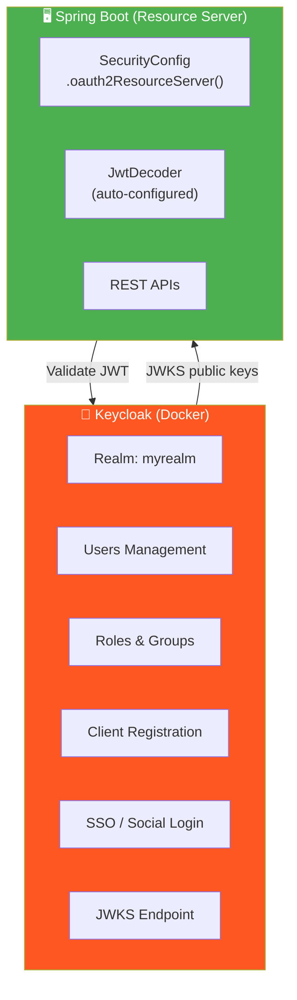

**Cấu hình Spring Boot với Keycloak:**

```properties
# Khi dùng Keycloak (chỉ cần 1 dòng!)
spring.security.oauth2.resourceserver.jwt.issuer-uri=http://localhost:8180/realms/myrealm
```

```java
// SecurityConfig khi dùng external Auth Server
@Bean
public SecurityFilterChain securityFilterChain(HttpSecurity http) throws Exception {
    return http
            .authorizeHttpRequests(auth -> auth
                    .requestMatchers("/api/public/**").permitAll()
                    .anyRequest().authenticated()
            )
            .oauth2ResourceServer(oauth2 -> oauth2
                    .jwt(jwt -> jwt.jwtAuthenticationConverter(jwtAuthConverter()))
            )
            .build();
}
// → Spring tự động tải JWKS từ Keycloak, validate signature, expiration, issuer
```

---

## 14. Bảo mật nâng cao — PKCE, Token Introspection, JWK Rotation

### 14.1. PKCE (Proof Key for Code Exchange)

**PKCE** (phát âm "pixy") là extension bảo mật cho Authorization Code flow, bắt buộc cho **Public Clients** (SPA, Mobile App) trong OAuth 2.1.

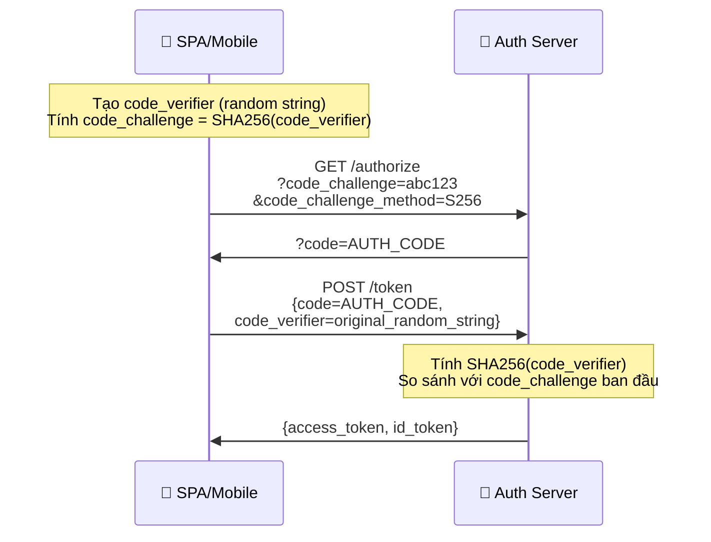

> **Tại sao cần PKCE?** SPA/Mobile không thể giữ `client_secret` an toàn (source code có thể bị inspect). PKCE thay thế `client_secret` bằng cơ chế challenge-response, ngăn attacker dùng authorization code bị đánh cắp.

### 14.2. Token Introspection (Opaque Token)

Thay vì gửi JWT (self-contained), Auth Server có thể phát hành **Opaque Token** (chuỗi random, không chứa claims). Resource Server phải **gọi lại Auth Server** để kiểm tra:

```properties
# Cấu hình Opaque Token Introspection
spring.security.oauth2.resourceserver.opaque-token.introspection-uri=https://auth.example.com/introspect
spring.security.oauth2.resourceserver.opaque-token.client-id=my-resource-server
spring.security.oauth2.resourceserver.opaque-token.client-secret=secret123
```

| | JWT (Self-contained) | Opaque Token (Introspection) |
|:---|:---|:---|
| **Validate** | Resource Server tự verify (offline) | Phải gọi Auth Server mỗi request |
| **Thu hồi** | ⚠️ Khó (phải chờ hết hạn) | ✅ Tức thì (Auth Server kiểm soát) |
| **Hiệu năng** | ✅ Nhanh (không network call) | ⚠️ Chậm hơn (network call mỗi request) |
| **Kích thước** | Lớn (~1KB) | Nhỏ (~32 bytes) |

### 14.3. JWK Rotation (Xoay khóa)

Trong production, private key **phải được xoay định kỳ** (key rotation) để giảm rủi ro nếu key bị lộ:

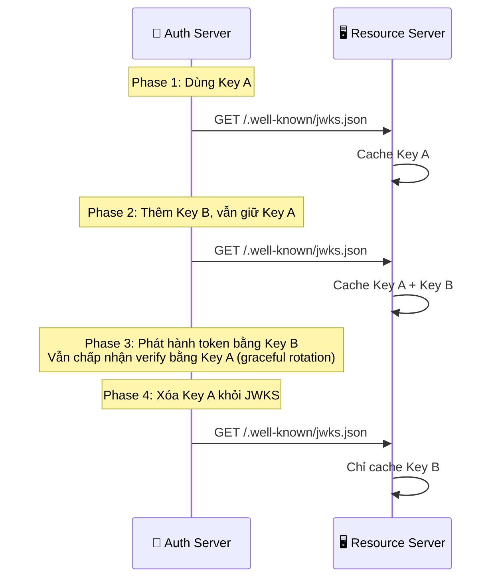

> `NimbusJwtDecoder` của Spring Boot **tự động** tải lại JWK Set khi gặp token có `kid` (Key ID) chưa biết → hỗ trợ JWK Rotation **miễn phí**.

---

## 15. Design Patterns liên quan

### 15.1. Strategy Pattern — Trong JwtDecoder

Spring Security sử dụng **Strategy Pattern** cho `JwtDecoder`:
- `NimbusJwtDecoder.withSecretKey()` — HMAC-SHA256 (symmetric key)
- `NimbusJwtDecoder.withJwkSetUri()` — RSA/EC (asymmetric key)
- `NimbusJwtDecoder.withPublicKey()` — RSA public key cố định

```java
// Strategy 1: Symmetric key (self-issued JWT)
JwtDecoder decoder1 = NimbusJwtDecoder.withSecretKey(secretKey).build();

// Strategy 2: JWK Set URI (external Auth Server)
JwtDecoder decoder2 = NimbusJwtDecoder.withJwkSetUri("https://auth.example.com/.well-known/jwks.json").build();

// Strategy 3: Public key cố định
JwtDecoder decoder3 = NimbusJwtDecoder.withPublicKey(rsaPublicKey).build();
```

### 15.2. Chain of Responsibility Pattern — Trong Validators

```java
// Nhiều validator xử lý tuần tự
OAuth2TokenValidator<Jwt> validator = new DelegatingOAuth2TokenValidator<>(
        JwtValidators.createDefault(),           // timestamp validation
        new JwtIssuerValidator("issuer"),         // issuer validation
        new JwtClaimValidator<>("aud", aud -> ...) // audience validation
);
// → Mỗi validator là 1 "mắt xích" trong chuỗi
```

### 15.3. Adapter Pattern — Trong JwtAuthenticationConverter

`JwtAuthenticationConverter` đóng vai trò **Adapter** chuyển đổi giữa `Jwt` object (thuộc thế giới OAuth2/JOSE) và `Authentication` object (thuộc thế giới Spring Security):

```
[Jwt claims] → JwtAuthenticationConverter → [JwtAuthenticationToken]
     ↑ OAuth2 world                              ↑ Spring Security world
```

---

## 16. 🎯 Bộ câu hỏi phỏng vấn (Interview Questions)

### Câu 1: OAuth2 là Authorization hay Authentication?

> **Đáp án:** OAuth2 là **Authorization framework** — nó giải quyết vấn đề "ứng dụng này có **quyền truy cập** gì vào tài nguyên?". OAuth2 **không phải** là Authentication protocol. **OpenID Connect (OIDC)** mới là lớp Authentication xây dựng trên OAuth2, trả lời câu hỏi "người dùng **là ai**?" thông qua **ID Token**.

### Câu 2: Phân biệt Access Token và ID Token?

> **Đáp án:**
> - **Access Token**: Dùng bởi **Resource Server** để xác thực quyền truy cập API. Gửi trong header `Authorization: Bearer`. Có thể là JWT hoặc opaque.
> - **ID Token**: Dùng bởi **Client App** để biết danh tính user (tên, email, avatar). Luôn là JWT. **KHÔNG BAO GIỜ** gửi đến Resource Server.
>
> Phân biệt đơn giản: Access Token = "thẻ vào cửa", ID Token = "giấy CMND".

### Câu 3: Tại sao không nên tự viết JWT filter trong production?

> **Đáp án:** Tự viết JWT filter có nhiều rủi ro bảo mật:
> 1. **Dễ quên validate issuer/audience** → chấp nhận token giả từ server khác
> 2. **Algorithm confusion attack** → attacker đổi `alg: none` để bypass signature
> 3. **Không hỗ trợ JWK Rotation** → phải restart khi đổi key
> 4. **Không hỗ trợ token introspection** → không thu hồi tức thì
> 5. **Code chưa được audit** → có thể có lỗ hổng chưa phát hiện
>
> `spring-boot-starter-oauth2-resource-server` xử lý tất cả các vấn đề này, đã được hàng triệu developer review và cập nhật CVE thường xuyên.

### Câu 4: Giải thích 4 vai trò trong OAuth2?

> **Đáp án:**
> 1. **Resource Owner** — Người sở hữu dữ liệu (end user)
> 2. **Client** — Ứng dụng muốn truy cập dữ liệu (React app, mobile app)
> 3. **Authorization Server** — Xác thực user, phát hành token (Keycloak, Auth0, Google)
> 4. **Resource Server** — API bảo vệ dữ liệu, validate token (Spring Boot API của bạn)

### Câu 5: Authorization Code Flow khác gì Client Credentials Flow?

> **Đáp án:**
> - **Authorization Code**: Có **user interaction** — user đăng nhập, consent, server trả authorization code, client đổi code lấy token. Dùng cho **user-facing apps**.
> - **Client Credentials**: **Không có user** — service tự xin token bằng client_id + client_secret. Dùng cho **machine-to-machine** (microservice gọi microservice).

### Câu 6: PKCE là gì và tại sao cần thiết?

> **Đáp án:** PKCE (Proof Key for Code Exchange) là extension bảo mật cho Authorization Code flow. Public clients (SPA, mobile) không thể giữ `client_secret` an toàn vì code có thể bị inspect/decompile. PKCE thay thế client_secret bằng cơ chế challenge-response:
> 1. Client tạo `code_verifier` (random string) và tính `code_challenge = SHA256(code_verifier)`
> 2. Gửi `code_challenge` khi yêu cầu authorization code
> 3. Gửi `code_verifier` khi đổi code lấy token
> 4. Auth Server verify SHA256(code_verifier) === code_challenge
>
> Điều này ngăn attacker sử dụng authorization code bị đánh cắp vì họ không có `code_verifier`.

### Câu 7: JwtDecoder hoạt động như thế nào trong Spring?

> **Đáp án:** `JwtDecoder` là interface với 1 method `decode(String token)`. Khi HTTP request đến:
> 1. `BearerTokenAuthenticationFilter` trích JWT từ header
> 2. `JwtAuthenticationProvider` gọi `JwtDecoder.decode(token)`
> 3. `NimbusJwtDecoder` parse JWT, verify signature (HMAC/RSA/EC)
> 4. Chạy chain of validators: check `exp`, `iss`, `aud`, `nbf`
> 5. Trả về `Jwt` object chứa claims
> 6. `JwtAuthenticationConverter` chuyển claims thành `JwtAuthenticationToken`
> 7. Nạp vào `SecurityContext`

### Câu 8: So sánh JWT và Opaque Token?

> **Đáp án:**
> | | JWT (Self-contained) | Opaque Token |
> |:---|:---|:---|
> | **Validate** | Offline — Resource Server tự verify | Online — phải gọi Auth Server (introspection) |
> | **Thu hồi** | Khó — phải chờ hết hạn | Dễ — Auth Server revoke tức thì |
> | **Kích thước** | Lớn (~1KB) | Nhỏ (~32 bytes) |
> | **Hiệu năng** | Nhanh (no network call) | Chậm hơn (network call mỗi request) |
> | **Use case** | Microservices, SPA | Cần revoke tức thì, bảo mật cao |

### Câu 9: Khi nào dùng self-issued JWT, khi nào dùng OAuth2 Provider?

> **Đáp án:**
> - **Self-issued JWT:** Monolith, startup nhỏ, MVP, khi bạn kiểm soát hoàn toàn user management, không cần SSO hay social login.
> - **OAuth2 Provider:** Enterprise, microservices, cần SSO (Single Sign-On), social login (Google/Facebook), MFA (Multi-Factor Authentication), multi-tenant, hoặc khi không muốn tự quản lý user/password.

### Câu 10: JWK Rotation là gì và tại sao quan trọng?

> **Đáp án:** JWK Rotation là quá trình **xoay (thay đổi) signing key** định kỳ. Quan trọng vì:
> 1. Nếu private key bị lộ, thiệt hại giới hạn trong khoảng thời gian key hoạt động
> 2. Tuân thủ compliance (PCI DSS, SOC 2 yêu cầu key rotation)
>
> Quy trình graceful rotation:
> - Phase 1: Thêm key mới vào JWKS endpoint, vẫn giữ key cũ
> - Phase 2: Phát hành token mới bằng key mới, vẫn verify token cũ bằng key cũ
> - Phase 3: Sau khi token cũ hết hạn, xóa key cũ khỏi JWKS
>
> `NimbusJwtDecoder` của Spring tự động tải lại JWKS khi gặp `kid` chưa biết → hỗ trợ rotation miễn phí.

---

## 📚 Tài liệu tham khảo

- [RFC 6749 — OAuth 2.0 Authorization Framework](https://www.rfc-editor.org/rfc/rfc6749)
- [RFC 7519 — JSON Web Token (JWT)](https://www.rfc-editor.org/rfc/rfc7519)
- [RFC 7636 — PKCE](https://www.rfc-editor.org/rfc/rfc7636)
- [OpenID Connect Core 1.0](https://openid.net/specs/openid-connect-core-1_0.html)
- [Spring Security OAuth2 Resource Server](https://docs.spring.io/spring-security/reference/servlet/oauth2/resource-server/index.html)
- [Keycloak Documentation](https://www.keycloak.org/documentation)
